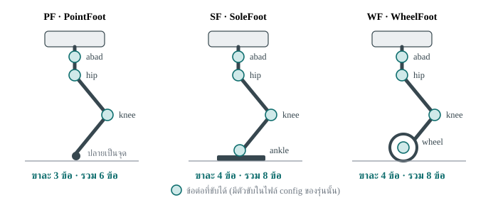
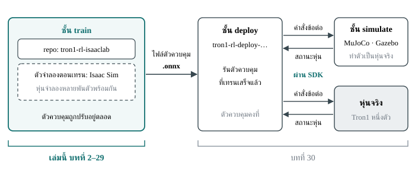

## บทที่ 1 · Tron1 และ repo ที่เกี่ยวข้อง — หุ่นรุ่นไหน โค้ดชุดไหน

> [!INTRO]
> เราอยากให้หุ่นสองขา Tron1 เดินได้ จึงเปิดหน้า GitHub ของผู้ผลิต คือ LimX Dynamics แล้วพบ repo สาธารณะ 57 แห่ง ในจำนวนนั้นมี 12 แห่งที่ชื่อขึ้นต้นด้วย `tron1-` คำถามแรกจึงยังไม่ใช่เรื่องสูตร แต่คือต้อง clone แห่งไหน
>
> บทนี้ให้คำถามสองข้อที่ใช้คัด repo ได้ทุกแห่ง คือ repo นั้นสำหรับหุ่น*รุ่น*ไหน และอยู่*ชั้น*ไหน แล้วใช้สองคำถามนี้ชี้ว่าเล่มนี้ทำงานอยู่ตรงไหนของแผนที่
>
> ของที่ต้องรู้มาก่อน: ไม่มีบทก่อนหน้า บทนี้ใช้เพียงความรู้ทั่วไปของคนทำหุ่นยนต์ คือข้อต่อ มอเตอร์ เกน PD และตัวจำลอง
>
> จบบทนี้แล้ว เราอ่านชื่อ repo หรือชื่องานเทรนแล้วบอกได้ว่าเป็นของหุ่นรุ่นไหนและอยู่ชั้นไหน และบอกได้ว่าการเทรนต้องใช้ repo ใด ไม่ต้องใช้ repo ใด

### ของที่ต้องมีก่อนเริ่ม

บทนี้ไม่มีการคำนวณ สิ่งที่ต้องมีคือโฟลเดอร์ `study_tron1/` ที่ clone `tron1-rl-isaaclab/` ไว้ข้างใน เพื่อเปิดไฟล์ตามที่บทอ้าง จำนวน repo บน GitHub ที่อ้างในบทนี้นับเมื่อวันที่ 25 พ.ย. 2026 และเปลี่ยนได้ตามเวลา ส่วนเนื้อหาของไฟล์ตรวจกับโค้ดเวอร์ชันที่บทนำระบุ

คำที่ใช้ในบทนี้ เรียงตามลำดับที่จะพบ

| คำ | ชนิด | ความหมาย |
| --- | --- | --- |
| **Tron1** | หุ่นยนต์ | หุ่นสองขาของ LimX Dynamics ที่เล่มนี้ใช้ตลอดเล่ม |
| **ตัวควบคุม** | โปรแกรม | สิ่งที่รับค่าจากเซนเซอร์ของหุ่น แล้วให้คำสั่งของข้อต่อ ในเล่มนี้ตัวควบคุมไม่ได้เขียนด้วยมือ แต่ได้จากการเทรน |
| **การเทรน** | กระบวนการ | การให้หุ่นในตัวจำลองลองเดินซ้ำ ๆ แล้วปรับตัวควบคุมให้ดีขึ้นทีละน้อย |
| **งานเทรน** | สิ่งที่สร้างขึ้นจากการตั้งค่าหนึ่งชุด | หุ่นรุ่นหนึ่ง พื้นแบบหนึ่ง และกติกาชุดหนึ่ง ที่ถูกสร้างขึ้นในตัวจำลองให้การเทรนใช้ แต่ละงานมีชื่อ เช่น `Isaac-Limx-SF-Blind-Flat-v0` |
| **รุ่น** (รหัส **PF** · **SF** · **WF**) | สตริงสองตัวอักษร | ชนิดของปลายขา · SF (SoleFoot) คือรุ่นเท้าแบนของ Tron1 · PF (PointFoot) และ WF (WheelFoot) คือรุ่นเท้าอื่นของ Tron1 |
| **ชั้น** | กลุ่มของซอฟต์แวร์ | ซอฟต์แวร์ที่ทำหน้าที่เดียวกัน บทนี้ใช้สามชั้น คือ train, deploy และ simulate repo ของ Tron1 ที่เกี่ยวกับการเทรนและการนำตัวควบคุมไปใช้ อยู่ชั้นใดชั้นหนึ่งในสามชั้นนี้ |
| **ONNX** | รูปแบบไฟล์ | รูปแบบไฟล์กลางสำหรับ export โมเดล · ตัวควบคุมที่เทรนเสร็จถูกเก็บเป็นไฟล์นามสกุล `.onnx` |
| **SDK** | ไลบรารี | ชุดโค้ดของ LimX สำหรับคุยกับหุ่นจริง |

### ปัญหา: 57 repo แล้วต้อง clone แห่งไหน

วิธีที่ง่ายที่สุดคือ clone ทุกแห่งที่ชื่อขึ้นต้นด้วย `tron1-` แล้วติดตั้งทั้งหมดลงเครื่องเดียว วิธีนี้ใช้ไม่ได้ เพราะ repo ทั้ง 12 แห่งไม่ได้ต้องการสภาพแวดล้อมเดียวกัน

| repo | สิ่งที่ต้องการ | อ่านจาก |
| --- | --- | --- |
| `tron1-rl-isaaclab` | Python 3.10 และ Isaac Sim 4.5.0 (ระบุไว้ในข้อมูลกำกับของแพ็กเกจ) | `exts/bipedal_locomotion/setup.py:63-67` |
| `tron1-rl-isaacgym` | Python 3.8 และ Isaac Gym Preview 4 | README ของ repo นั้น |
| `tron1-rl-deploy-ros` | ROS Noetic | คำอธิบายของ repo บน GitHub |
| `tron1-rl-deploy-ros2` | ROS 2 Iron | คำอธิบายของ repo บน GitHub |

สองแถวแรกต้องการ Python คนละเวอร์ชัน สองแถวหลังต้องการ ROS คนละเวอร์ชัน ของทั้งสี่แถวอยู่ร่วมกันในสภาพแวดล้อมเดียวไม่ได้ และถึงติดตั้งได้ครบ เราก็ยังไม่รู้ว่าต้องรันแห่งไหนก่อน

เราจึงต้องมีวิธีคัด คำถามสองข้อต่อไปนี้พอสำหรับ repo ทุกแห่ง

1. repo นี้สำหรับหุ่น**รุ่น**ไหน
2. repo นี้อยู่**ชั้น**ไหน

### รุ่นของหุ่น: PF, SF และ WF

รุ่นคือสตริงสองตัวอักษรที่บอกว่าปลายขาของหุ่นเป็นแบบใด ทั้งสามรุ่นมีข้อต่อสามชื่อแรกเหมือนกันทุกขา คือ abad (ย่อจาก abduction/adduction คือการกางและหุบขา) hip และ knee สิ่งที่ต่างกันคือของที่ต่ออยู่ใต้ knee

| รหัส | ชื่อเต็ม | ปลายขา | ข้อต่อที่ขับได้ต่อหนึ่งขา | รวมสองขา | อ่านจาก |
| --- | --- | --- | --- | --- | --- |
| PF | PointFoot | ปลายเป็นจุด | abad, hip, knee | 6 | `pointfoot_cfg.py:44-71` |
| SF | SoleFoot | แผ่นเท้าแบน มีข้อเท้า | abad, hip, knee, ankle | 8 | `solefoot_cfg.py:39-64` |
| WF | WheelFoot | ล้อที่ขับได้ | abad, hip, knee, wheel | 8 | `wheelfoot_cfg.py:39-64` |

ชื่อเต็มของโมเดลหนึ่งตัวประกอบจากรหัสรุ่นกับชื่อแพลตฟอร์ม เช่น `SF_TRON1A` คือรุ่น SF ของแพลตฟอร์ม TRON1A คำว่า Tron1 จึงมีสามระดับ และเล่มนี้ใช้ตามตารางนี้

| คำ | หมายถึง |
| --- | --- |
| Tron1 | ตระกูลของหุ่น รวมทั้งสามรุ่น |
| `SF_TRON1A` | โมเดลหนึ่งตัว คือรุ่น SF ของแพลตฟอร์ม TRON1A |
| "Tron1" เมื่อเล่มนี้พูดถึงตัวเลขหรือโค้ด | `SF_TRON1A` เสมอ เว้นแต่ระบุเป็นอย่างอื่น |

> [!EXAMPLE] หุ่นรุ่นที่เล่มนี้ใช้มีข้อต่อที่ขับได้กี่ข้อ ชื่ออะไรบ้าง และตั้งเกน PD ไว้เท่าไร
> เล่มนี้ใช้รุ่น SF เราจึงเปิดไฟล์ `solefoot_cfg.py` แล้วอ่านส่วนที่ชื่อ `actuators` ซึ่งแบ่งข้อต่อเป็นสองกลุ่ม ในไฟล์นี้ `stiffness` คือเกน P และ `damping` คือเกน D
>
> | กลุ่ม | ข้อต่อ | `stiffness` | `damping` | บรรทัด |
> | --- | --- | --- | --- | --- |
> | `legs` | abad, hip, knee ของขาซ้ายและขวา | 45.0 | 1.5 | `:39-53` |
> | `ankles` | ankle ของขาซ้ายและขวา | 45.0 | 0.8 | `:54-64` |
>
> ข้อต่อที่ขับได้มี 6 + 2 = 8 ข้อ ชื่อในโค้ดคือ `abad_L_Joint`, `abad_R_Joint`, `hip_L_Joint`, `hip_R_Joint`, `knee_L_Joint`, `knee_R_Joint`, `ankle_L_Joint` และ `ankle_R_Joint`

เลข 8 นี้จะกลับมาอีกหลายครั้งในเล่ม เพราะตัวควบคุมต้องให้คำสั่งหนึ่งค่าต่อข้อต่อที่ขับได้หนึ่งข้อ

> [!REMARK]
> ไฟล์ของรุ่น PF ตั้งท่าเริ่มต้นให้ข้อต่อชื่อ `foot_L_Joint` และ `foot_R_Joint` ไว้ด้วย (`pointfoot_cfg.py:38-39`) แต่ไม่มีตัวขับสำหรับสองข้อนี้ จำนวนข้อต่อที่ขับได้ของ PF จึงเป็น 6 ไม่ใช่ 8

### ชั้นของ repo: train, deploy และ simulate

ชั้นคือกลุ่มของซอฟต์แวร์ที่ทำหน้าที่เดียวกัน repo ของ Tron1 ที่เกี่ยวกับการเทรนและการนำตัวควบคุมไปใช้ อยู่ชั้นใดชั้นหนึ่งในสามชั้น ส่วน repo ที่เหลืออยู่นอกสามชั้นนี้ และชั้นหนึ่งอาจมีซอฟต์แวร์ที่ไม่ใช่ repo ของ LimX อยู่ด้วย เช่นตัวจำลองของ NVIDIA เราบอกชั้นของ repo หนึ่งได้จากสองอย่าง คือมันรับอะไรเข้า และให้อะไรออก

| ชั้น | หน้าที่ | รับเข้า | ให้ออก |
| --- | --- | --- | --- |
| **train** | สร้างตัวควบคุมด้วยการเทรน | โมเดลของหุ่น และการตั้งค่าของงานเทรน | ไฟล์ตัวควบคุมนามสกุล `.onnx` |
| **deploy** | รันตัวควบคุมที่เทรนเสร็จแล้ว | ไฟล์ตัวควบคุม และสถานะของหุ่น | คำสั่งของข้อต่อ ส่งผ่าน SDK |
| **simulate** | ทำตัวเป็นหุ่นจริง ให้ชั้น deploy ทดสอบ | คำสั่งของข้อต่อ | สถานะของหุ่น |

ของที่การเทรนผลิตให้ชั้น deploy คือไฟล์ ใน `tron1-rl-isaaclab` ไฟล์นี้เกิดขึ้นสองขั้น ระหว่างเทรน โปรแกรมบันทึกตัวควบคุมเป็นไฟล์ `model_N.pt` เป็นระยะ โดย N เป็นตัวเลข (`on_policy_runner.py:239`) เมื่อเทรนเสร็จ สคริปต์ `play.py` อ่านไฟล์นั้นแล้วเขียนไฟล์ `.onnx` สองไฟล์ (`play.py:111-122` ตั้งชื่อไฟล์ที่ `rl_mlp_cfg.py:37`) ซึ่งเป็นรูปที่ชั้น deploy ใช้ สคริปต์เดียวกันเขียนไฟล์ `policy.pt` ไว้อีกรูปหนึ่งด้วย (`play.py:107-109`)

ไฟล์ตัวควบคุมไม่ใช่ทุกอย่างที่ชั้น deploy ต้องมี repo ฝั่ง deploy มีไฟล์ตั้งค่าของตัวเองชื่อ `params.yaml` หนึ่งไฟล์ต่อโมเดล (README ของ `tron1-rl-deploy-python`) และไม่มีโค้ดใดใน `tron1-rl-isaaclab` เขียนไฟล์ชื่อนี้ ไฟล์ `params/env.yaml` กับ `params/agent.yaml` ที่การเทรนบันทึกไว้ (`train.py:142-143`) เป็นคนละไฟล์กัน

เมื่อจัด repo ทั้ง 12 แห่ง เราได้ตารางนี้ มี 9 แห่งอยู่ในสามชั้น และ 3 แห่งอยู่นอก คอลัมน์ขวาสุดมาจากคำอธิบายของแต่ละ repo บน GitHub

| ชั้น | repo | ลักษณะ |
| --- | --- | --- |
| train | `tron1-rl-isaaclab` | ใช้ Isaac Lab · **เล่มนี้ใช้แห่งนี้** |
| | `tron1-rl-isaacgym` | ใช้ Isaac Gym |
| deploy | `tron1-rl-deploy-python` | Python ล้วน ไม่ใช้ ROS |
| | `tron1-rl-deploy-ros` | ROS Noetic |
| | `tron1-rl-deploy-ros2` | ROS 2 Iron |
| | `tron1-rl-deploy-arm` | สำหรับแขนกลของ Tron1 |
| simulate | `tron1-mujoco-sim` | ตัวจำลอง MuJoCo |
| | `tron1-gazebo-ros` | ตัวจำลอง Gazebo กับ ROS Noetic |
| | `tron1-gazebo-ros2` | ตัวจำลอง Gazebo กับ ROS 2 Iron |
| นอกสามชั้นนี้ | `tron1-robot-description` | ไฟล์โมเดลของหุ่น (URDF, Xacro) |
| | `tron1-ss` | ทำแผนที่และนำทางด้วย LiDAR |
| | `tron1-agent` | สั่งงานหุ่นด้วยเสียง |

ชื่อของ repo บอกชั้นได้เกือบทุกแห่ง ชื่อที่มี `rl-isaac` อยู่ชั้น train ชื่อที่มี `rl-deploy` อยู่ชั้น deploy และชื่อที่มี `sim` หรือ `gazebo` อยู่ชั้น simulate ส่วน SDK อยู่ใน repo ชื่อ `limxsdk-lowlevel` ซึ่งไม่ได้ขึ้นต้นด้วย `tron1-` เพราะใช้กับหุ่นตระกูลอื่นของ LimX ด้วย

> [!WARNING] ตัวจำลองมีสองที่ และชั้น simulate ไม่ใช่ที่ที่การเทรนจำลองหุ่น
> คำว่าตัวจำลองในแผนที่นี้หมายถึงของสองอย่าง ทั้งสองเป็นตัวจำลองฟิสิกส์เหมือนกัน แต่คนใช้และจุดประสงค์ต่างกัน
>
> | | ตัวจำลองตอนเทรน | ตัวจำลองของชั้น simulate |
> | --- | --- | --- |
> | โปรแกรม | Isaac Sim | MuJoCo หรือ Gazebo |
> | อยู่ในชั้น | train | simulate |
> | จำนวนหุ่น | หลายพันตัวพร้อมกัน ค่าปริยายคือ 4096 (`limx_base_env_cfg.py:484`) | หุ่นตัวเดียว |
> | ใครคุยกับมัน | โค้ดเทรน ซึ่งเปิดมันขึ้นมาเอง (`train.py:39-40`) | โปรแกรมของชั้น deploy ผ่าน SDK |
> | ใช้เพื่อ | สร้างตัวควบคุม | ตรวจตัวควบคุมที่เสร็จแล้ว ก่อนลงหุ่นจริง |

ตารางถัดไปเทียบสองช่วงเวลาที่ตัวควบคุมตัวเดียวกันผ่าน คือตอนเทรนกับตอน deploy

| | ตอนเทรน | ตอน deploy |
| --- | --- | --- |
| ตัวควบคุม | ถูกปรับอยู่ตลอด | คงที่ อ่านจากไฟล์ `.onnx` |
| หุ่น | หุ่นจำลองหลายพันตัวใน Isaac Sim | หุ่นจริงหนึ่งตัว หรือหุ่นจำลองหนึ่งตัวจากชั้น simulate |
| ใช้ SDK | ไม่ใช้ | ใช้ |
| เครื่องที่รัน | เครื่องที่มี GPU | เครื่องที่มีแต่ CPU ก็รันได้ |

แถว "ใช้ SDK" ตรวจได้จากโค้ด ไม่มีไฟล์ใดใน `tron1-rl-isaaclab` ที่เรียกใช้ `limxsdk` เลย ส่วนแถวสุดท้ายมาจาก README ของ `tron1-rl-isaaclab` และของ `tron1-rl-deploy-python`

> [!REMARK]
> คนที่ใช้ `ros2_control` คุ้นกับการสลับระหว่างฮาร์ดแวร์จริงกับฮาร์ดแวร์จำลองโดยไม่แก้ตัวควบคุม ชั้น simulate ทำหน้าที่แบบเดียวกัน ข้อที่ต่างคือจุดสลับ ใน `ros2_control` เราสลับที่ plugin ของฮาร์ดแวร์ ส่วนที่นี่สลับที่ที่อยู่เครือข่าย โปรแกรมของ `tron1-rl-deploy-python` ต่อกับตัวจำลองในเครื่องเมื่อไม่ระบุที่อยู่ และต่อกับหุ่นจริงเมื่อระบุ IP ของหุ่น (README ของ repo นั้น) บทที่ 30 กลับมาที่เรื่องนี้

### เล่มนี้อยู่ตรงไหนของแผนที่

เมื่อตอบคำถามสองข้อ เราได้ตำแหน่งของเล่มนี้

| คำถาม | คำตอบของเล่มนี้ | ผลที่ตามมา |
| --- | --- | --- |
| รุ่นไหน | SF คือโมเดล `SF_TRON1A` | ข้อต่อที่ขับได้ 8 ข้อ |
| ชั้นไหน | train | ใช้ repo เดียว คือ `tron1-rl-isaaclab` |

ชั้น train มี repo สองแห่ง เราเลือก `tron1-rl-isaaclab` ด้วยเหตุผลในตารางนี้

| | `tron1-rl-isaacgym` | `tron1-rl-isaaclab` |
| --- | --- | --- |
| ตัวจำลอง | Isaac Gym Preview 4 | Isaac Sim 4.5.0 |
| Python | 3.8 | 3.10 |
| ที่มาของโค้ด | fork ของ `leggedrobotics/legged_gym` | ส่วนขยายของ Isaac Lab |
| สถานะ | README ของ repo บอกว่า NVIDIA ประกาศเลิกแนะนำ Isaac Gym (deprecated) และให้ใช้ Isaac Lab แทน โครงการใหม่ควรเริ่มที่ `tron1-rl-isaaclab` | ตัวที่ README นั้นแนะนำ |

สิ่งที่การเทรน**ไม่ต้องใช้** มีสามอย่าง

- **`tron1-robot-description`** เพราะโมเดลของหุ่นทั้งสามรุ่นอยู่ใน `tron1-rl-isaaclab` แล้ว ที่โฟลเดอร์ `assets/usd/`
- **SDK** เพราะตอนเทรนไม่มีหุ่นจริงให้คุยด้วย
- **repo ของชั้น deploy และชั้น simulate** จนกว่าจะถึงบทที่ 30

ตั้งแต่บทที่ 2 ถึงบทที่ 29 เราอยู่ในชั้น train ตลอด บทที่ 30 จึงข้ามไปชั้น deploy

### จากรุ่นถึงโค้ด

ใน `tron1-rl-isaaclab` รหัสรุ่นปรากฏหกที่ ทุกที่อยู่ใต้โฟลเดอร์ `exts/bipedal_locomotion/bipedal_locomotion/` ตารางนี้แสดงของรุ่น SF แล้วบอกว่ารุ่นอื่นต่างตรงไหน

| สิ่งที่แยกตามรุ่น | ของรุ่น SF | รุ่นอื่น |
| --- | --- | --- |
| โมเดลของหุ่น | `assets/usd/SF_TRON1A/` | `PF_TRON1A/`, `WF_TRON1A/` |
| ข้อต่อและเกน PD | `assets/config/solefoot_cfg.py` | `pointfoot_cfg.py`, `wheelfoot_cfg.py` |
| การตั้งค่าหลักของงานเทรน | `tasks/locomotion/cfg/SF/limx_base_env_cfg.py` | `cfg/PF/` และ `cfg/WF/` มีไฟล์ชื่อเดียวกัน |
| การตั้งค่าของงานเทรนแต่ละแบบ | `tasks/locomotion/robots/limx_solefoot_env_cfg.py` | `limx_pointfoot_env_cfg.py`, `limx_wheelfoot_env_cfg.py` |
| การตั้งค่าของวิธีเทรน | คลาส `SF_TRON1AFlatPPORunnerCfg` (`limx_rsl_rl_ppo_cfg.py:80`) | คลาสของ PF (`:42`) และของ WF (`:119`) ในไฟล์เดียวกัน |
| ชื่อของงานเทรน | `Isaac-Limx-SF-Blind-Flat-v0` (`robots/__init__.py:74`) | มี `-PF-` (`:27`) หรือ `-WF-` (`:50`) แทน `-SF-` |

> [!WARNING] ไฟล์ชื่อ `limx_base_env_cfg.py` มีสามไฟล์
> โฟลเดอร์ `cfg/PF/`, `cfg/SF/` และ `cfg/WF/` มีไฟล์ชื่อนี้เหมือนกัน แต่เนื้อหาต่างกัน เมื่อเล่มนี้เขียน `limx_base_env_cfg.py` หมายถึงไฟล์ใน `cfg/SF/` เสมอ

> [!NOTE]
> repo ของชั้น deploy และชั้น simulate เลือกรุ่นด้วยตัวแปรสภาพแวดล้อมชื่อ `ROBOT_TYPE` เช่น `ROBOT_TYPE=SF_TRON1A` ส่วน `tron1-rl-isaaclab` เลือกรุ่นด้วยชื่อของงานเทรน ไฟล์ `limx_rsl_rl_ppo_cfg.py:6` อ่านตัวแปร `ROBOT_TYPE` ไว้ก็จริง แต่ไม่มีบรรทัดใดนำค่าไปใช้

> [!SUMMARY]
> - repo ของ LimX คัดได้ด้วยคำถามสองข้อ คือสำหรับหุ่นรุ่นไหน และอยู่ชั้นไหน
> - รุ่นคือชนิดของปลายขา PF มีข้อต่อที่ขับได้ 6 ข้อ ส่วน SF และ WF มี 8 ข้อ เล่มนี้ใช้ SF
> - ชั้น train ให้ไฟล์ตัวควบคุม ชั้น deploy รันไฟล์นั้นและคุยกับหุ่นผ่าน SDK ชั้น simulate ทำตัวเป็นหุ่นจริงให้ชั้น deploy
> - ตัวจำลองมีสองที่ Isaac Sim อยู่ในชั้น train และใช้สร้างตัวควบคุม ส่วน MuJoCo กับ Gazebo อยู่ในชั้น simulate และใช้ตรวจตัวควบคุมที่เสร็จแล้ว
> - การเทรนใช้ repo เดียว คือ `tron1-rl-isaaclab` และไม่ใช้ SDK
>
> ประโยคที่ควรจำ: **ชั้น train สร้างไฟล์ตัวควบคุม ชั้น deploy รันไฟล์นั้น ชั้น simulate ทำตัวเป็นหุ่นจริง และเล่มนี้อยู่ในชั้น train กับหุ่นรุ่น SF**

### แบบฝึกหัด

1. ข้อใดถูกต้อง
    1. รุ่น PF มีข้อต่อที่ขับได้ 6 ข้อ
    2. รุ่น SF และรุ่น WF มีจำนวนข้อต่อที่ขับได้เท่ากัน
    3. ชั้น simulate คือที่ที่การเทรนจำลองหุ่น
    4. ต้องติดตั้ง SDK ก่อนจึงจะเทรนด้วย `tron1-rl-isaaclab` ได้
    5. ไฟล์ที่ชั้น deploy รับจากชั้น train มีนามสกุล `.onnx`
    6. `tron1-rl-deploy-ros2` อยู่ชั้น train
    7. โมเดลของหุ่นทั้งสามรุ่นมีอยู่ใน `tron1-rl-isaaclab` แล้ว
    8. ชื่อ `SF_TRON1A` บอกทั้งชนิดของปลายขาและแพลตฟอร์ม
    9. `tron1-rl-isaaclab` เลือกรุ่นของหุ่นจากค่าของตัวแปร `ROBOT_TYPE`
    10. ตัวควบคุมถูกปรับอยู่ตลอด ทั้งตอนเทรนและตอน deploy

2. จงบอกชั้นของ repo ต่อไปนี้ [01]
    1. `tron1-gazebo-ros2`
    2. `tron1-rl-isaacgym`
    3. `tron1-rl-deploy-python`
    4. `tron1-mujoco-sim`
    5. `tron1-rl-deploy-arm`
    6. `tron1-robot-description`

3. จงเปิดไฟล์ `wheelfoot_cfg.py` แล้วตอบ [wheelfoot_cfg.py:39-64]
    1. ข้อต่อที่ขับได้มีทั้งหมดกี่ข้อ
    2. ข้อต่อในกลุ่ม `wheels` ชื่ออะไรบ้าง
    3. `stiffness` ของกลุ่ม `wheels` เป็นเท่าไร
    4. `damping` ของกลุ่ม `wheels` เป็นเท่าไร

    <!--space:6-->

4. ไฟล์ของแต่ละรุ่นกำหนดความสูงที่วางหุ่นตอนเริ่ม เป็นค่าตัวที่สามของ `pos` จงหาค่านี้ของทั้งสามรุ่น แล้วตอบว่ารุ่นใดถูกวางสูงที่สุด และรุ่น WF ถูกวางสูงกว่ารุ่น SF เท่าไร [pointfoot_cfg.py:30] <!--space:14-->

5. จงเทียบ `stiffness` และ `damping` ของกลุ่ม `legs` ระหว่างรุ่น SF กับรุ่น WF [solefoot_cfg.py:39-53] <!--space:10-->

6. เพื่อนคนหนึ่งมีไฟล์ตัวควบคุมที่เทรนเสร็จแล้ว แต่ยังไม่มีหุ่นจริง และไม่ต้องการติดตั้ง ROS เขาต้องใช้ repo ใดบ้างเพื่อดูหุ่นเดินด้วยตัวควบคุมนั้น และแต่ละแห่งอยู่ชั้นไหน [01] <!--space:12-->

7. จงอธิบายว่าเหตุใดการเทรนจึงไม่ต้องใช้ SDK ทั้งที่ชั้น deploy ต้องใช้ <!--space:12-->

8. ชั้น train ก็มีตัวจำลอง ชั้น simulate ก็มีตัวจำลอง จงบอกข้อแตกต่างของตัวจำลองสองที่นี้มาสองข้อ <!--space:12-->

9. จากข้อ 3 กลุ่ม `wheels` มี `stiffness` เป็น 0 จงอธิบายด้วยความรู้เรื่องตัวคุม PD ว่าค่านี้เหมาะกับล้ออย่างไร <!--space:12-->

<!-- เฉลย -->

1. ข้อที่ถูก: 1, 2, 5, 7, 8

    - ข้อ 3 ผิด: การเทรนจำลองหุ่นด้วย Isaac Sim ซึ่งอยู่ในชั้น train ชั้น simulate ใช้ตรวจตัวควบคุมที่เสร็จแล้ว
    - ข้อ 4 ผิด: ไม่มีไฟล์ใดใน `tron1-rl-isaaclab` ที่เรียกใช้ `limxsdk`
    - ข้อ 6 ผิด: ชื่อที่มี `rl-deploy` อยู่ชั้น deploy
    - ข้อ 9 ผิด: เลือกรุ่นด้วยชื่อของงานเทรน ตัวแปร `ROBOT_TYPE` ถูกอ่านที่ `limx_rsl_rl_ppo_cfg.py:6` แต่ไม่มีบรรทัดใดใช้ค่า
    - ข้อ 10 ผิด: ตอน deploy ตัวควบคุมคงที่ อ่านจากไฟล์ `.onnx`

2. ชั้นของแต่ละ repo

    1. simulate
    2. train
    3. deploy
    4. simulate
    5. deploy
    6. นอกสามชั้นนี้ เป็นไฟล์โมเดลของหุ่น

3. จากไฟล์ `wheelfoot_cfg.py`

    1. 6 + 2 = 8 ข้อ
    2. `wheel_L_Joint` และ `wheel_R_Joint`
    3. 0.0
    4. 0.8

4. PF = 1.0 m (`pointfoot_cfg.py:30`) · SF = 0.8 m (`solefoot_cfg.py:31`) · WF = 0.8 + 0.166 = 0.966 m (`wheelfoot_cfg.py:31`) รุ่น PF ถูกวางสูงที่สุด และรุ่น WF สูงกว่ารุ่น SF อยู่ 0.166 m

5. รุ่น SF ใช้ `stiffness` 45.0 และ `damping` 1.5 (`solefoot_cfg.py:50-51`) รุ่น WF ใช้ `stiffness` 40.0 และ `damping` 2.5 (`wheelfoot_cfg.py:50-51`) รุ่น SF จึงมีเกน P สูงกว่า และเกน D ต่ำกว่า

6. ใช้ `tron1-rl-deploy-python` ซึ่งอยู่ชั้น deploy เพื่อรันตัวควบคุม และ `tron1-mujoco-sim` ซึ่งอยู่ชั้น simulate เพื่อทำตัวเป็นหุ่น ทั้งสองคุยกันผ่าน SDK จาก `limxsdk-lowlevel` และไม่มีแห่งใดใช้ ROS

7. SDK คือชุดโค้ดสำหรับคุยกับหุ่นจริง หรือกับตัวจำลองของชั้น simulate ที่ทำตัวเป็นหุ่นจริง ตอนเทรนไม่มีทั้งสองอย่าง โค้ดเทรนเปิด Isaac Sim ขึ้นมาเองและคุยกับมันโดยตรง ชั้น deploy ต้องส่งคำสั่งออกไปนอกโปรแกรมของตัวเอง จึงต้องใช้ SDK

8. ตอบสองข้อจากรายการนี้: โปรแกรมต่างกัน (Isaac Sim กับ MuJoCo หรือ Gazebo) · จำนวนหุ่นต่างกัน (หลายพันตัวกับตัวเดียว) · คนที่คุยด้วยต่างกัน (โค้ดเทรนกับโปรแกรมของชั้น deploy ผ่าน SDK) · จุดประสงค์ต่างกัน (สร้างตัวควบคุมกับตรวจตัวควบคุมที่เสร็จแล้ว)

9. เกน P คูณกับผลต่างระหว่างมุมเป้าหมายกับมุมจริง ล้อต้องหมุนต่อเนื่องได้ไม่จำกัดรอบ จึงไม่มีมุมเป้าหมายที่ควรดึงกลับไปหา เมื่อเกน P เป็น 0 พจน์ของมุมหายไป เหลือแต่พจน์เกน D ซึ่งคูณกับผลต่างของความเร็ว ล้อจึงถูกคุมด้วยความเร็ว ไม่ใช่ด้วยมุม ซึ่งตรงกับ config ของรุ่น WF ที่สั่งล้อเป็นความเร็ว (`cfg/WF/limx_base_env_cfg.py:111-115`)
