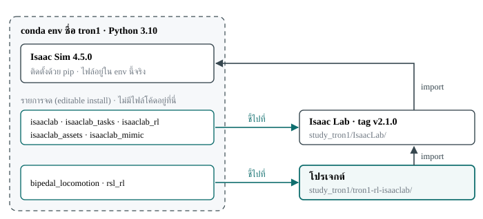
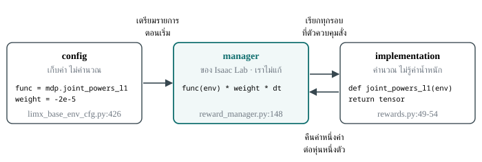

## บทที่ 2 · ไฟล์อยู่ที่ไหน — เทียบกับนิสัยของ ROS 2

> [!INTRO]
> เราเข้าไปที่โฟลเดอร์ `tron1-rl-isaaclab/` แล้วพิมพ์คำสั่งเดียว คือ `python scripts/rsl_rl/train.py --task Isaac-Limx-SF-Blind-Flat-v0 --num_envs 2048 --headless` หุ่นจำลอง 2048 ตัวก็เริ่มหัดเดิน โดยไม่มี `colcon build` ไม่มี launch file และไม่ต้อง `source install/setup.bash` คนที่มาจาก ROS 2 จะถามทันทีว่า Python หาโค้ดเจอได้อย่างไร และถ้าอยากแก้ค่าสักค่า ต้องเปิดไฟล์ไหน
>
> บทนี้ตอบสองคำถามนั้น โดยเทียบกับสิ่งที่เราทำเป็นประจำใน ROS 2 ทีละอย่าง และบอกทุกครั้งว่าการเทียบนั้นใช้ได้ถึงตรงไหน
>
> ของที่ต้องรู้มาก่อน: รุ่น SF และชั้น train จากบทที่ 1 · ความคุ้นเคยกับ workspace ของ ROS 2
>
> จบบทนี้แล้ว เราหา path เต็มของไฟล์ที่เล่มนี้อ้างแบบ `ppo.py:163` ได้ ไล่ได้ว่าคำสั่งข้างบนผ่านโค้ดบรรทัดไหนบ้าง และตัดสินได้ว่าสิ่งที่อยากแก้อยู่ฝั่ง config หรือฝั่ง implementation

### ของที่ต้องมีก่อนเริ่ม

บทนี้อ้างของสามอย่างในเครื่อง คือโฟลเดอร์สองโฟลเดอร์ใต้ `study_tron1/` และ conda env หนึ่งชุด

```text
study_tron1/
    IsaacLab/              git clone, tag v2.1.0
    tron1-rl-isaaclab/     git clone, commit 307145e
conda env "tron1"          Python 3.10, isaacsim 4.5.0
```

คำที่ใช้ในบทนี้ เรียงตามลำดับที่จะพบ

| คำ | ชนิด | ความหมาย |
| --- | --- | --- |
| **Isaac Sim** | โปรแกรม ในรูปแพ็กเกจ pip | ตัวจำลองฟิสิกส์ที่ใช้ตอนเทรน |
| **Isaac Lab** | ไลบรารี Python | โครงสำหรับสร้างงานเทรนหุ่น ทำงานอยู่บน Isaac Sim |
| **โปรเจกต์** | แพ็กเกจ Python | โค้ดของหุ่นตระกูลหนึ่งที่ใช้ Isaac Lab ในเล่มนี้คือ `tron1-rl-isaaclab` |
| **conda env** | โฟลเดอร์ | Python หนึ่งเวอร์ชันกับแพ็กเกจที่ติดตั้งไว้ด้วยกัน เลือกใช้ด้วย `conda activate` |
| **editable install** | รายการจด | บันทึกใน conda env ว่าชื่อแพ็กเกจหนึ่งชื่อชี้ไปที่โฟลเดอร์ต้นทางใด |
| **task ID** | สตริง | ชื่อที่ลงทะเบียนไว้ของงานหนึ่งงาน เช่น `Isaac-Limx-SF-Blind-Flat-v0` |
| **registry** | ตารางในหน่วยความจำ | ตารางของไลบรารี gymnasium ที่มี task ID เป็นคีย์ |
| **tensor** | อาร์เรย์ของตัวเลข | ชนิดข้อมูลของไลบรารี PyTorch ที่โค้ดเทรนใช้เก็บตัวเลขหลายตัวไว้ด้วยกัน |
| **config** | อ็อบเจกต์ที่เก็บค่า | บอกว่าใช้ฟังก์ชันใด ด้วยค่าเท่าไร ไม่คำนวณเอง |
| **implementation** | ฟังก์ชัน หรือคลาสลูกของ `ManagerTermBase` | โค้ดที่คำนวณจริง |
| **manager** | อ็อบเจกต์ของ Isaac Lab | รับ config หนึ่งหมวด เตรียมรายการไว้ตอนเริ่ม แล้วเป็นผู้เรียก implementation |

### ปัญหา: ไม่มี workspace แล้ว Python หาโค้ดเจอได้อย่างไร

ใน ROS 2 เส้นทางจากซอร์สโค้ดถึงโปรแกรมที่รันได้มีสี่ขั้น และทุกขั้นทิ้งร่องรอยไว้บนดิสก์

| ขั้น | สิ่งที่เราทำใน ROS 2 | ร่องรอยบนดิสก์ |
| --- | --- | --- |
| ประกาศแพ็กเกจ | เขียน `package.xml` | ไฟล์ `package.xml` |
| สร้าง | `colcon build` | โฟลเดอร์ `build/` และ `install/` |
| เปิดใช้ | `source install/setup.bash` | ตัวแปรสภาพแวดล้อมที่ชี้เข้า `install/` |
| รัน | `ros2 run` ตามด้วยชื่อแพ็กเกจและชื่อโปรแกรม | ament index ใน `install/` บอกว่าแพ็กเกจอยู่ที่ใด |

เมื่อมองหาร่องรอยเหล่านี้ใน `IsaacLab/` และ `tron1-rl-isaaclab/` เราไม่พบเลย ทั้งสอง repo ไม่มีไฟล์ `package.xml` แม้แต่ไฟล์เดียว และไม่มีโฟลเดอร์ `install/`

วิธีง่ายที่สุดที่จะรู้ว่า Python มองเห็นอะไร คือเปิด Python ใน conda env `tron1` แล้วลอง import ตรง ๆ โดยยืนอยู่ในโฟลเดอร์ที่อยู่นอก repo ทั้งสอง เช่นโฟลเดอร์ home ถ้ายืนอยู่ใน `tron1-rl-isaaclab/` Python จะพบโฟลเดอร์ `rsl_rl/` ที่อยู่ตรงหน้าก่อน และผลของแถวแรกจะไม่บอกอะไรเรื่องการติดตั้ง ผลที่ได้มีสองแบบ

| คำสั่ง | ผล |
| --- | --- |
| `import rsl_rl` | สำเร็จ |
| `import isaaclab` | สำเร็จ |
| `import isaaclab.envs` | ล้มเหลว ด้วยข้อความ `No module named 'omni.kit'` |
| `import bipedal_locomotion` | ล้มเหลว ด้วยข้อความเดียวกัน |

สองแถวแรกบอกว่า Python หาโค้ดเจอ ทั้งที่ไม่มี workspace สองแถวหลังบอกว่าการหาเจออย่างเดียวยังไม่พอ บางส่วนใช้ไม่ได้จนกว่าจะมีอย่างอื่นเกิดขึ้นก่อน บทนี้อธิบายทั้งสองเรื่อง เรื่องแรกคือ editable install เรื่องที่สองคือลำดับการเปิดตัวจำลอง

### ซอฟต์แวร์สามตัวที่ซ้อนกัน

บทที่ 1 ใช้คำว่า*ชั้น*กับกลุ่มของซอฟต์แวร์ที่ทำหน้าที่เดียวกัน ในบทนี้เราอยู่ภายในชั้น train ชั้นเดียว ข้างในมีซอฟต์แวร์สามตัวซ้อนกัน เราจะเรียกแต่ละอย่างว่า*ตัว* เพื่อไม่ให้ปนกับชั้นของบทที่ 1

| ตัว | ชนิด | ติดตั้งด้วย | อยู่ที่ใดในเครื่อง | เวอร์ชันที่เล่มนี้ใช้ |
| --- | --- | --- | --- | --- |
| **Isaac Sim** | โปรแกรมจำลอง ในรูปแพ็กเกจ pip | `pip install` | ใน conda env `tron1` | 4.5.0 |
| **Isaac Lab** | ไลบรารี Python 5 แพ็กเกจ | `git clone` แล้ว editable install | `study_tron1/IsaacLab/` | tag `v2.1.0` |
| **โปรเจกต์** | แพ็กเกจ Python 2 แพ็กเกจ | `git clone` แล้ว editable install | `study_tron1/tron1-rl-isaaclab/` | commit `307145e` |



ลูกศร import ชี้ทางเดียว โปรเจกต์ import Isaac Lab และ Isaac Lab import Isaac Sim ไม่มีทางย้อนกลับ ไม่มีไฟล์ใดใน `IsaacLab/source/` ที่มีคำว่า tron1 หรือ limx เลย ทุกอย่างที่เกี่ยวกับ Tron1 จึงอยู่ในโปรเจกต์

> [!NOTE]
> Isaac Lab เป็นไลบรารี ไม่ใช่แม่แบบที่ต้องคัดลอกทุกครั้ง เรา clone ครั้งเดียว แล้วทุกโปรเจกต์ใน conda env เดียวกันใช้ร่วมกันได้ ข้อยกเว้นคือโปรเจกต์ที่ต้องการ Isaac Lab คนละเวอร์ชัน ซึ่งต้องแยก conda env

ตารางถัดไปเทียบของแต่ละอย่างกับสิ่งที่คุ้นใน ROS 2 คอลัมน์ขวาสุดบอกว่าการเทียบนั้นใช้ไม่ได้ตรงไหน

| สิ่งที่คุ้นใน ROS 2 | ที่นี่ | เหมือนกันตรงที่ | เทียบไม่ได้ตรงที่ |
| --- | --- | --- | --- |
| ตัวจำลอง Gazebo | Isaac Sim | เป็นตัวจำลองที่คนอื่นเขียน เราใช้ตามเวอร์ชันที่กำหนด | Gazebo รันเป็นโปรเซสของตัวเอง โค้ดที่อยู่นอกโปรเซสนั้นคุยกับมันด้วยการสื่อสารข้ามโปรเซส เช่น topic ส่วน Isaac Sim ถูกเปิดขึ้นในโปรเซสเดียวกับ `train.py` (`train.py:39-40`) แล้วถูกเรียกเป็นฟังก์ชัน การเทรนนี้ไม่ใช้ topic เลย |
| เฟรมเวิร์กอย่าง `ros2_control` | Isaac Lab | มีโครงให้ เราเขียนเฉพาะส่วนของหุ่นเรา แล้วโครงเป็นฝ่ายเรียก | `ros2_control` โหลดส่วนของเราเป็น plugin ตามชื่อในไฟล์ตั้งค่า ส่วน Isaac Lab รับฟังก์ชัน Python ของเราผ่าน config โดยตรง |
| แพ็กเกจของหุ่นเรา เช่น `my_robot_bringup` | โปรเจกต์ | รวมทุกอย่างที่เฉพาะกับหุ่นตัวนี้ | แพ็กเกจ ROS ต้องอยู่ใน workspace ส่วนโปรเจกต์อยู่ที่ใดในเครื่องก็ได้ |
| `colcon build --symlink-install` | `pip install -e` | แก้ไฟล์ต้นทางแล้วมีผล โดยไม่ต้องติดตั้งซ้ำ | `pip install -e` ไม่ compile และไม่คัดลอกโค้ด จึงไม่มีโฟลเดอร์ `build/` หรือ `install/` สิ่งที่มันเขียนมีแต่ข้อมูลกำกับ เช่นโฟลเดอร์ `.egg-info` ข้างโค้ดต้นทาง และรายการจดใน conda env |
| `source install/setup.bash` | `conda activate tron1` | เลือกชุดของโค้ดที่ shell นี้มองเห็น | conda env หนึ่งชุดถือได้หลายโปรเจกต์พร้อมกัน โดยไม่ซ้อนกันเป็น overlay กับ underlay แต่ยังมีลำดับอยู่หนึ่งข้อ คือเมื่อชื่อ import ซ้ำกัน แพ็กเกจที่ติดตั้งแบบปกติถูกพบก่อนรายการจด |
| `package.xml` | `setup.py` | บอกชื่อแพ็กเกจและสิ่งที่ต้องติดตั้งก่อน | `package.xml` เป็นข้อมูล ส่วน `setup.py` เป็นโค้ด Python ที่ถูกรันตอนติดตั้ง |
| `ros2 run` ค้นแพ็กเกจจาก ament index | `--task` ค้น task ID จาก registry | ชื่อสั้น ๆ พาไปถึงโค้ด | ament index เป็นไฟล์บนดิสก์ สร้างตอนติดตั้ง ส่วน registry เป็นตารางในหน่วยความจำ สร้างใหม่ทุกครั้งที่รัน |

### editable install: รายการจดที่ทำหน้าที่แทน workspace

editable install คือรายการจดใน conda env ที่บอกว่า ชื่อแพ็กเกจหนึ่งชื่อชี้ไปที่โฟลเดอร์ต้นทางใด ไม่มีการคัดลอกไฟล์โค้ด และไม่มีการ compile

conda env `tron1` มีรายการจด 7 รายการ คอลัมน์ขวาเป็น path ใต้ `study_tron1/`

| ชื่อที่ใช้กับ `import` | โฟลเดอร์ต้นทาง |
| --- | --- |
| `isaaclab` | `IsaacLab/source/isaaclab/isaaclab` |
| `isaaclab_assets` | `IsaacLab/source/isaaclab_assets/isaaclab_assets` |
| `isaaclab_mimic` | `IsaacLab/source/isaaclab_mimic/isaaclab_mimic` |
| `isaaclab_rl` | `IsaacLab/source/isaaclab_rl/isaaclab_rl` |
| `isaaclab_tasks` | `IsaacLab/source/isaaclab_tasks/isaaclab_tasks` |
| `bipedal_locomotion` | `tron1-rl-isaaclab/exts/bipedal_locomotion/bipedal_locomotion` |
| `rsl_rl` | `tron1-rl-isaaclab/rsl_rl/rsl_rl` |

รายการเหล่านี้อ่านได้จากโฟลเดอร์ `site-packages` ของ env แต่ละแพ็กเกจมีไฟล์หนึ่งไฟล์ที่ชื่อขึ้นต้นด้วย `__editable__` และลงท้ายด้วย `_finder.py` ตัวแปร `MAPPING` ในไฟล์นั้นคือรายการจด

การติดตั้งสองแบบให้ผลต่างกันดังนี้

| | ติดตั้งแบบปกติ (Isaac Sim) | editable install (Isaac Lab และโปรเจกต์) |
| --- | --- | --- |
| ไฟล์โค้ดอยู่ที่ | ใน `site-packages` ของ env | ในโฟลเดอร์ที่ clone มา |
| เมื่อแก้ไฟล์ในโฟลเดอร์ที่ clone มา | ไม่มีโฟลเดอร์เช่นนั้น | มีผลในการรันครั้งถัดไป |
| เมื่อย้ายโฟลเดอร์ที่ clone มา | ไม่เกี่ยว | รายการจดชี้ผิดที่ ต้องติดตั้งใหม่ |

> [!EXAMPLE] สมมติว่าเราแก้ `stiffness` ของขาใน `solefoot_cfg.py` จาก 45.0 เป็น 50.0 ต้องทำอะไรอีกบ้างก่อนที่ค่าใหม่จะมีผล
> ไฟล์ `solefoot_cfg.py` อยู่ที่ `exts/bipedal_locomotion/bipedal_locomotion/assets/config/` ซึ่งอยู่ใต้โฟลเดอร์ต้นทางของแพ็กเกจ `bipedal_locomotion` ในตารางข้างบน
>
> แพ็กเกจนี้เป็น editable install Python จึงอ่านไฟล์จากโฟลเดอร์ต้นทางโดยตรงทุกครั้งที่รัน
>
> คำตอบคือไม่ต้องทำอะไรอีก เมื่อรัน `train.py` ครั้งถัดไป ค่า 50.0 ถูกใช้ทันที ส่วนใน ROS 2 ถ้าค่านี้อยู่ในโค้ด C++ เราต้อง `colcon build` ใหม่ก่อน

> [!WARNING] แพ็กเกจ `rsl_rl` ใน env นี้ไม่ใช่ตัวเดียวกับบน PyPI
> แพ็กเกจ `rsl_rl` ที่ env นี้ใช้ คือโฟลเดอร์ `tron1-rl-isaaclab/rsl_rl/` เวอร์ชัน 2.0.2 (`rsl_rl/setup.py:8`) ซึ่งเป็นสำเนาที่ LimX แก้ไขแล้ว ร่องรอยหนึ่งอยู่ที่ `train.py:49-50` บรรทัดเดิมที่ import จากโมดูลชื่อ `rsl_rl.runners` ถูกปิดไว้ และบรรทัดที่ใช้จริง import จากโมดูลชื่อ `rsl_rl.runner`
>
> บน PyPI มีแพ็กเกจชื่อ `rsl-rl-lib` ซึ่งใช้ชื่อ import เดียวกัน คือ `rsl_rl` ถ้าติดตั้งแพ็กเกจนั้นลง env นี้ Python จะพบมันก่อนรายการจด และโค้ดของ LimX จะไม่ถูกใช้

### task ID และ registry: จากชื่อถึงงานเทรน

task ID คือสตริงที่เป็นชื่อของงานหนึ่งงาน ใน repo นี้สามงานลงทะเบียนไว้ใช้เทรน และอีกสามงาน ซึ่งชื่อลงท้ายด้วย `-Play-v0` ลงทะเบียนไว้ใช้เปิดดูผลการเทรน registry คือตารางในหน่วยความจำของไลบรารี gymnasium ที่มี task ID เป็นคีย์ gymnasium เป็นไลบรารี Python ที่ใช้เป็นมาตรฐานกลางสำหรับตั้งชื่องานเทรน และสร้างงานขึ้นจากชื่อ การเพิ่มหนึ่งรายการลงตารางคือการเรียก `gym.register` หนึ่งครั้ง รายการของงานที่เล่มนี้ใช้อยู่ที่ `robots/__init__.py:73-81`

```text
gym.register(
    id="Isaac-Limx-SF-Blind-Flat-v0",
    entry_point="isaaclab.envs:ManagerBasedRLEnv",
    disable_env_checker=True,
    kwargs={
        "env_cfg_entry_point": limx_solefoot_env_cfg.SFBlindFlatEnvCfg,
        "rsl_rl_cfg_entry_point": limx_sf_blind_flat_runner_cfg,
    },
)
```

| ช่อง | ชนิด | ความหมาย |
| --- | --- | --- |
| `id` | สตริง | task ID |
| `entry_point` | ชื่อของคลาสใน Isaac Lab | คลาสที่จะถูกสร้างขึ้นเป็นงาน |
| `env_cfg_entry_point` | คลาส config | การตั้งค่าของงาน: ฉาก หุ่น และกติกาทั้งหมด |
| `rsl_rl_cfg_entry_point` | อ็อบเจกต์ config | การตั้งค่าของวิธีเทรน |

ไฟล์นี้ลงทะเบียน 6 รายการ

| task ID | config ของงาน | บรรทัด |
| --- | --- | --- |
| `Isaac-Limx-PF-Blind-Flat-v0` | `PFBlindFlatEnvCfg` | `:26-34` |
| `Isaac-Limx-PF-Blind-Flat-Play-v0` | `PFBlindFlatEnvCfg_PLAY` | `:36-44` |
| `Isaac-Limx-WF-Blind-Flat-v0` | `WFBlindFlatEnvCfg` | `:49-57` |
| `Isaac-Limx-WF-Blind-Flat-Play-v0` | `WFBlindFlatEnvCfg_PLAY` | `:59-67` |
| `Isaac-Limx-SF-Blind-Flat-v0` | `SFBlindFlatEnvCfg` | `:73-81` |
| `Isaac-Limx-SF-Blind-Flat-Play-v0` | `SFBlindFlatEnvCfg_PLAY` | `:83-91` |

ทั้ง 6 รายการใช้ `entry_point` ตัวเดียวกัน คือคลาส `ManagerBasedRLEnv` ของ Isaac Lab สิ่งที่ทำให้งานหนึ่งต่างจากอีกงานหนึ่งจึงมีแต่ config

แต่ละส่วนของ task ID ที่เราใช้ตรงกับของจริงใน config ดังนี้

| ส่วนของชื่อ | ความหมาย | ดูได้จาก |
| --- | --- | --- |
| `SF` | รุ่นของหุ่น | config ใส่หุ่น `SOLEFOOT_CFG` (`limx_solefoot_env_cfg.py:31`) |
| `Blind` | ไม่ใช้เซนเซอร์วัดความสูงของพื้น | `:76` ตั้ง `height_scanner` เป็น `None` |
| `Flat` | พื้นเรียบ | พื้นเป็นระนาบ (`limx_base_env_cfg.py:36`) และ config นี้ไม่ได้เปลี่ยน |
| `Play` ถ้ามี | config ชุดเล็กสำหรับเปิดดูผลการเทรน | จำลองหุ่น 32 ตัว (`limx_solefoot_env_cfg.py:56`) |

> [!WARNING] task ID ใน README ของ repo ไม่ตรงกับโค้ด
> README ของ `tron1-rl-isaaclab` เขียน task ID ว่า `Isaac-Limx-SF-TRON1A-Blind-Flat-v0` แต่ชื่อที่ลงทะเบียนจริงคือ `Isaac-Limx-SF-Blind-Flat-v0` (`robots/__init__.py:74`) ชื่อใน README ไม่มีอยู่ใน registry เมื่อเอกสารขัดกับโค้ด ให้เชื่อโค้ด

registry ต่างจาก ament index ตรงที่มันถูกสร้างใหม่ทุกครั้งที่ Python เริ่มทำงาน และตอนเริ่มยังไม่มีงานของ LimX อยู่ในนั้น รายการทั้ง 6 เข้าไปอยู่ในตารางได้เพราะมีการ import แพ็กเกจของโปรเจกต์ การลงทะเบียนเป็นผลพลอยได้ของการ import ตามลำดับนี้

| ลำดับ | บรรทัด | สิ่งที่เกิด |
| --- | --- | --- |
| 1 | `train.py:65` | import โมดูลย่อยของ `bipedal_locomotion` Python จึงรัน `__init__.py` ของแพ็กเกจนี้ก่อน |
| 2 | `bipedal_locomotion/__init__.py:6` | `from .tasks import *` |
| 3 | `tasks/__init__.py:16` | `import_packages(...)` ไล่ import แพ็กเกจย่อยทุกตัวใต้ `tasks/` |
| 4 | `tasks/locomotion/__init__.py:3` | `from . import robots` |
| 5 | `robots/__init__.py:26-91` | `gym.register` ทำงาน 6 ครั้ง |

ถ้าเปิด Python ใน env `tron1` แล้วถาม registry โดยยังไม่ import โปรเจกต์ เราจะไม่พบ task ID ของ LimX เลยสักตัว

### config กับ implementation

Isaac Lab แบ่งทุกชิ้นของงานเทรนออกเป็นสองส่วนที่อยู่คนละไฟล์ และมีตัวกลางหนึ่งตัวเชื่อมสองส่วนเข้าด้วยกัน

| ส่วน | ชนิด | รับอะไร | ให้อะไร | อยู่ที่ไหน |
| --- | --- | --- | --- | --- |
| **implementation** | ฟังก์ชัน หรือคลาสลูกของ `ManagerTermBase` | อ็อบเจกต์ของงานทั้งงาน (`env`) และพารามิเตอร์ | ในหมวดการให้คะแนน คือ tensor ที่มีหนึ่งค่าต่อหุ่นจำลองหนึ่งตัว หมวดอื่นคืนของรูปอื่น | `mdp/*.py` ของโปรเจกต์ หรือของ Isaac Lab |
| **config** | อ็อบเจกต์ที่เก็บค่า | ไม่รับอะไร | ตัวฟังก์ชันที่จะใช้ น้ำหนัก และพารามิเตอร์ | `limx_base_env_cfg.py` |
| **manager** | อ็อบเจกต์ของ Isaac Lab | config หนึ่งหมวด | ผลของการเรียกฟังก์ชันทุกตัวในหมวดนั้น | โฟลเดอร์ `managers/` ของ Isaac Lab |

ตัวแปร `env` ในโค้ดคืออ็อบเจกต์ของงานทั้งงาน ซึ่งถือหุ่นจำลองทุกตัวไว้พร้อมกัน ไม่ใช่หุ่นตัวเดียว ฟังก์ชันของหมวดการให้คะแนนหนึ่งตัวจึงคำนวณให้หุ่นทุกตัวในการเรียกครั้งเดียว และคืน tensor ที่มีหนึ่งค่าต่อหุ่นหนึ่งตัว ตั้งแต่บทที่ 7 เล่มนี้ใช้คำว่า env ในอีกความหมายหนึ่ง คือหุ่นจำลองหนึ่งตัวในอ็อบเจกต์นี้ บทที่ 7 จะแยกสองความหมายให้อีกครั้ง

เราดูตัวอย่างหนึ่งชิ้นที่คนทำหุ่นยนต์อ่านออกทันที คือการวัดกำลังที่ข้อต่อใช้

**implementation** อยู่ที่ `rewards.py:49-54` ฟังก์ชันชื่อ `joint_powers_l1` รับ `env` แล้วคืนค่าในบรรทัดเดียว

```text
return torch.sum(torch.abs(torch.mul(asset.data.applied_torque, asset.data.joint_vel)), dim=1)
```

บรรทัดนี้คูณแรงบิดกับความเร็วของข้อต่อทีละข้อ ซึ่งได้กำลังกลของข้อนั้น แล้วใส่ค่าสัมบูรณ์ แล้วบวกรวมทุกข้อของหุ่นตัวเดียวกัน ผลที่ได้คือ tensor ที่มีหนึ่งค่าต่อหุ่นจำลองหนึ่งตัว ฟังก์ชันนี้ไม่รู้ว่าค่าที่มันคืนจะถูกให้น้ำหนักเท่าไร

**config** อยู่ที่ `limx_base_env_cfg.py:426`

```text
pen_joint_power_l1 = RewTerm(func=mdp.joint_powers_l1, weight=-2e-5)
```

บรรทัดนี้ไม่คำนวณอะไร มันเก็บของสองอย่าง คือชี้ว่าใช้ฟังก์ชันใด และให้น้ำหนักเท่าไร

**manager** อยู่ใน Isaac Lab ที่ `reward_manager.py:148`

```text
value = term_cfg.func(self._env, **term_cfg.params) * term_cfg.weight * dt
```

ตอนเริ่ม manager ไล่ดู config ทั้งหมวดหนึ่งรอบเพื่อเตรียมรายการ (`reward_manager.py:215`) หลังจากนั้นบรรทัด `:148` ทำงานทุกรอบที่ตัวควบคุมสั่ง มันเรียกฟังก์ชันที่ config ชี้ แล้วคูณผลด้วยน้ำหนักจาก config และด้วย `dt` ซึ่งคือเวลาระหว่างคำสั่งของตัวควบคุมสองครั้งติดกัน (`manager_based_rl_env.py:207`) ค่านี้ถูกนำไปใช้ทำอะไรต่อเป็นเรื่องของบทที่ 5 ในบทนี้เราดูเพียงว่าของสามชิ้นอยู่คนละที่ และใครเรียกใคร



> [!WARNING] ชื่อของรายการใน config ไม่ใช่ชื่อของฟังก์ชัน
> ในบรรทัด `limx_base_env_cfg.py:426` ชื่อทางซ้ายคือ `pen_joint_power_l1` ซึ่งเป็นชื่อของรายการ และเป็นชื่อที่ปรากฏในตารางที่พิมพ์ออกมาตอนเริ่มเทรน ชื่อหลัง `func=mdp.` คือ `joint_powers_l1` ซึ่งเป็นชื่อของฟังก์ชัน หมวดนี้มี 20 รายการ และไม่มีรายการใดเลยที่สองชื่อนี้ตรงกัน เมื่อจะค้นหา implementation ให้ค้นด้วยชื่อหลัง `func=mdp.`

คำว่า `mdp` ในบรรทัด config ก็ไม่ใช่ไฟล์เดียว มันคือแพ็กเกจที่รวมชื่อมาจากสองแหล่ง (`limx_base_env_cfg.py:22`)

| บรรทัด | นำชื่อเข้ามาจาก |
| --- | --- |
| `mdp/__init__.py:1` | ฟังก์ชันสำเร็จรูปของ Isaac Lab |
| `mdp/__init__.py:3-7` | ของโปรเจกต์เอง คือโฟลเดอร์ `commands` และไฟล์ `curriculums`, `events`, `observations`, `rewards` |

ฟังก์ชันที่ `mdp.` ชี้ถึงจึงอยู่ในโปรเจกต์ก็ได้ อยู่ใน Isaac Lab ก็ได้ ใน 20 รายการของหมวดนี้ มี 9 รายการที่ฟังก์ชันอยู่ในโปรเจกต์ และ 11 รายการที่ฟังก์ชันอยู่ใน Isaac Lab

> [!NOTE]
> ใน 9 รายการของโปรเจกต์ มี 2 รายการที่ `func` เป็นคลาส ไม่ใช่ฟังก์ชัน คือ `GaitReward` (`rewards.py:345`) และ `ActionSmoothnessPenalty` (`rewards.py:481`) manager รับคลาสได้เมื่อเป็นคลาสลูกของ `ManagerTermBase` (`manager_base.py:324-329`) แล้วเรียกผ่านเมธอด `__call__` ของคลาสนั้น (`:330`) คลาสแบบนี้เก็บค่าไว้ข้ามรอบได้ เช่น `ActionSmoothnessPenalty` จำคำสั่งของสองรอบก่อนหน้าไว้ (`rewards.py:496-497`)

> [!EXAMPLE] รายการ `pen_joint_torque` ใช้ implementation ที่อยู่ไฟล์ใด
> ขั้นที่ 1 หาชื่อของฟังก์ชัน บรรทัด `limx_base_env_cfg.py:393` เขียนว่า `func=mdp.joint_torques_l2` ชื่อของฟังก์ชันจึงเป็น `joint_torques_l2`
>
> ขั้นที่ 2 ค้นทั้งโปรเจกต์และ Isaac Lab พร้อมกัน จากโฟลเดอร์ `study_tron1/`
>
> ```text
> grep -rn "def joint_torques_l2" tron1-rl-isaaclab/exts IsaacLab/source
> ```
>
> ขั้นที่ 3 อ่านผล พบที่เดียว คือ `IsaacLab/source/isaaclab/isaaclab/envs/mdp/rewards.py:136`
>
> implementation ของรายการนี้จึงอยู่ใน Isaac Lab ไฟล์ที่พบชื่อ `rewards.py` เหมือนไฟล์ของโปรเจกต์ แต่เป็นคนละไฟล์

config ของงานถูกแบ่งเป็นหมวด หมวดละหนึ่งคลาส ทั้งหมดอยู่ใน `limx_base_env_cfg.py` คอลัมน์ขวาอธิบายด้วยคำธรรมดา ชื่อเฉพาะของหมวดเหล่านี้สอนในบทที่ 3 ถึง 7 และบทที่ 29

| คลาส | บรรทัด | เก็บการตั้งค่าของ |
| --- | --- | --- |
| `SFSceneCfg` | `:30` | ฉาก: พื้น หุ่น เซนเซอร์ และแสง |
| `CommandsCfg` | `:84` | คำสั่งที่ให้หุ่นเดินตาม เช่น ความเร็วที่ต้องการ |
| `ActionsCfg` | `:113` | สิ่งที่ตัวควบคุมสั่งออกไป |
| `ObservarionsCfg` | `:126` | สิ่งที่ตัวควบคุมรับเข้ามา |
| `EventsCfg` | `:237` | เหตุการณ์ที่จงใจทำให้เกิด เช่น การสุ่มมวลของหุ่นตอนเริ่ม และการผลักหุ่น |
| `RewardsCfg` | `:368` | การให้คะแนน 20 รายการ |
| `TerminationsCfg` | `:447` | เงื่อนไขที่ทำให้หยุดแล้วเริ่มใหม่ |
| `CurriculumCfg` | `:458` | การปรับความยากระหว่างเทรน |
| `SFEnvCfg` | `:480` | รวมทุกหมวดข้างบน และตั้งค่าเวลา |

> [!NOTE]
> ชื่อ `ObservarionsCfg` สะกดแบบนี้ในโค้ดจริง ถ้าค้นด้วยคำว่า Observations จะไม่พบคลาสนี้

config ของงานที่เราใช้ไม่ได้จบในไฟล์เดียว คลาสที่ลงทะเบียนไว้กับ task ID สืบทอดมาสี่ระดับ ระดับล่างแก้ค่าของระดับบนในฟังก์ชัน `__post_init__`

| ระดับ | คลาส | สิ่งที่เพิ่มหรือเปลี่ยน |
| --- | --- | --- |
| 1 | `ManagerBasedRLEnvCfg` ของ Isaac Lab | โครงของ config |
| 2 | `SFEnvCfg` (`limx_base_env_cfg.py:480`) | ทุกหมวดของรุ่น SF และค่าเวลา |
| 3 | `SFBaseEnvCfg` (`limx_solefoot_env_cfg.py:27`) | ใส่หุ่น `SOLEFOOT_CFG` (`:31`) |
| 4 | `SFBlindFlatEnvCfg` (`:72`) | ถอดเซนเซอร์วัดความสูงของพื้นออก (`:76`) |

เมื่ออยากแก้อะไรสักอย่าง คำถามแรกคือสิ่งนั้นเป็นค่า หรือเป็นวิธีคำนวณ

| อยากทำอะไร | แก้ที่ | ตัวอย่าง |
| --- | --- | --- |
| เปลี่ยนค่า | config | เปลี่ยนน้ำหนัก −2e-5 ที่ `limx_base_env_cfg.py:426` · เปลี่ยนเกน PD ใน `solefoot_cfg.py` |
| เปลี่ยนวิธีคำนวณ | implementation | แก้บรรทัด `return` ของ `joint_powers_l1` ที่ `rewards.py:54` |
| เพิ่มรายการใหม่ | ทั้งสองที่ | เขียนฟังก์ชันใหม่ใน `mdp/` แล้วเพิ่มหนึ่งบรรทัดในคลาสของหมวดนั้น |

> [!REMARK]
> ของที่ใกล้ที่สุดใน ROS 2 คือ plugin กับไฟล์ YAML ที่บอกว่าโหลด plugin ใดด้วยพารามิเตอร์อะไร การเทียบนี้ใช้ได้กับการแบ่งหน้าที่ แต่ใช้ไม่ได้กับชนิดของ config ไฟล์ YAML เป็นข้อความ ชื่อ plugin ในนั้นถูกแปลเป็นโค้ดตอนโปรแกรมทำงาน ส่วน config ที่นี่เป็นโค้ด Python ช่อง `func` ถือฟังก์ชันตัวจริง ถ้าพิมพ์ชื่อฟังก์ชันผิด โปรแกรมจะหยุดตั้งแต่ตอน import และ config สืบทอดกันได้เหมือนคลาสทั่วไป

### แผนที่ไฟล์: จากชื่อไฟล์ถึง path เต็ม

เล่มนี้อ้างโค้ดด้วยชื่อไฟล์เปล่า ๆ ตารางต่อไปนี้บอกว่าไฟล์เหล่านั้นอยู่ที่ไหน จำนวนบรรทัดบอกขนาดของแต่ละไฟล์ นับแบบที่โปรแกรมแก้ไขข้อความแสดง

ใต้ `tron1-rl-isaaclab/scripts/rsl_rl/` คือสคริปต์ที่เรารันโดยตรง

| ไฟล์ | บรรทัด | เก็บอะไร |
| --- | --- | --- |
| `train.py` | 158 | จุดเริ่มของการเทรน: รับคำสั่ง เปิดตัวจำลอง สร้างงาน แล้วสั่งเทรน |
| `play.py` | 150 | โหลดตัวควบคุมที่บันทึกไว้ เปิดดูหุ่นเดิน และแปลงเป็นไฟล์ `.onnx` |
| `cli_args.py` | 82 | ตัวเลือกบรรทัดคำสั่งเพิ่มเติม |

ใต้ `tron1-rl-isaaclab/rsl_rl/rsl_rl/` คือวิธีเทรน ซึ่งไม่รู้จักหุ่นตัวใดโดยเฉพาะ

| ไฟล์ | บรรทัด | เก็บอะไร |
| --- | --- | --- |
| `runner/on_policy_runner.py` | 392 | วงรอบนอกของการเทรน: เก็บข้อมูล ปรับตัวควบคุม บันทึกผล แล้ววนซ้ำ |
| `algorithm/ppo.py` | 333 | ขั้นตอนปรับตัวควบคุมจากข้อมูลที่เก็บมา |
| `storage/rollout_storage.py` | 313 | ตารางที่เก็บข้อมูลไว้ระหว่างรอการปรับ |
| `modules/actor_critic.py` | 192 | ตัวควบคุมในรูปโครงข่ายประสาท และโครงข่ายอีกตัวที่ใช้เฉพาะตอนเทรน |
| `modules/mlp_encoder.py` | 127 | โครงข่ายตัวที่สาม ซึ่งเป็นส่วนที่ LimX เพิ่มเข้ามา |

ใต้ `tron1-rl-isaaclab/exts/bipedal_locomotion/bipedal_locomotion/` คือทุกอย่างที่เกี่ยวกับ Tron1

| ไฟล์ | บรรทัด | เก็บอะไร |
| --- | --- | --- |
| `assets/config/solefoot_cfg.py` | 66 | หุ่นรุ่น SF: โมเดล ท่าเริ่มต้น ข้อต่อ และเกน PD |
| `tasks/locomotion/robots/__init__.py` | 91 | การลงทะเบียน task ID ทั้ง 6 ตัว |
| `tasks/locomotion/robots/limx_solefoot_env_cfg.py` | 359 | config ของงานแต่ละแบบของรุ่น SF |
| `tasks/locomotion/cfg/SF/limx_base_env_cfg.py` | 508 | config หลักของงาน ครบทุกหมวด |
| `tasks/locomotion/agents/limx_rsl_rl_ppo_cfg.py` | 153 | config ของวิธีเทรน |
| `tasks/locomotion/mdp/rewards.py` | 534 | implementation ของการให้คะแนน |
| `tasks/locomotion/mdp/observations.py` | 182 | implementation ของสิ่งที่ตัวควบคุมรับเข้ามา |
| `tasks/locomotion/mdp/events.py` | 220 | implementation ของเหตุการณ์ |
| `utils/wrappers/rsl_rl/rl_mlp_cfg.py` | 62 | config เพิ่มเติมของวิธีเทรน และฟังก์ชันที่แปลงตัวควบคุมเป็นไฟล์ `.onnx` |

ไฟล์ของ Isaac Lab ที่เล่มนี้อ้าง อยู่ใต้ `IsaacLab/source/` ทั้งหมด

| ไฟล์ | เก็บอะไร |
| --- | --- |
| `isaaclab/isaaclab/app/app_launcher.py` | การเปิด Isaac Sim |
| `isaaclab/isaaclab/envs/manager_based_rl_env.py` | คลาส `ManagerBasedRLEnv` ซึ่งเป็น `entry_point` ของ task ID ทั้ง 6 ตัว |
| `isaaclab/isaaclab/managers/manager_base.py` | ส่วนที่ manager ทุกหมวดใช้ร่วมกัน |
| `isaaclab/isaaclab/managers/reward_manager.py` | manager ของหมวดการให้คะแนน |
| `isaaclab/isaaclab/envs/mdp/rewards.py` | implementation สำเร็จรูปของการให้คะแนน |
| `isaaclab/isaaclab/envs/mdp/actions/joint_actions.py` | การแปลงคำสั่งของตัวควบคุมเป็นเป้าหมายของข้อต่อ |
| `isaaclab_tasks/isaaclab_tasks/utils/parse_cfg.py` | การอ่าน config ออกจาก registry |
| `isaaclab_rl/isaaclab_rl/rsl_rl/vecenv_wrapper.py` | ตัวเชื่อมระหว่างงานกับ `rsl_rl` |

บทหลัง ๆ อ้างไฟล์อีกสองไฟล์ที่ไม่ได้อยู่ใน repo ใดเลย คือ `adam.py` และ `normal.py` ทั้งสองเป็นของไลบรารี PyTorch อยู่ใน `site-packages/torch/optim/` และ `site-packages/torch/distributions/` ของ conda env

> [!WARNING] ชื่อไฟล์ที่ซ้ำกัน
> ชื่อไฟล์เปล่า ๆ ชี้ได้มากกว่าหนึ่งไฟล์ในสามกรณี เล่มนี้ใช้กติกาต่อไปนี้
>
> | กรณี | ไฟล์ที่ซ้ำ | เล่มนี้หมายถึง |
> | --- | --- | --- |
> | ซ้ำระหว่างรุ่น | `limx_base_env_cfg.py` และ `terrains_cfg.py` มีใน `cfg/PF/`, `cfg/SF/` และ `cfg/WF/` | ไฟล์ใน `cfg/SF/` |
> | ซ้ำกับ Isaac Lab | `rewards.py`, `observations.py`, `events.py`, `curriculums.py`, `train.py`, `play.py` และ `cli_args.py` มีทั้งในโปรเจกต์และใน Isaac Lab | ไฟล์ของโปรเจกต์ เว้นแต่เขียน `IsaacLab/` นำหน้า |
> | ซ้ำภายในโปรเจกต์ | `__init__.py` มีในทุกโฟลเดอร์ที่เป็นแพ็กเกจ และ `setup.py` มีสองไฟล์ | เขียนชื่อโฟลเดอร์นำหน้าเสมอ เช่น `robots/__init__.py` |

### จากคำสั่งถึงโค้ด

เรากลับไปที่คำสั่งเปิดบท แล้วไล่ `train.py` จากบนลงล่าง ทุกแถวคือจุดที่คำสั่งนั้นแตะโค้ด

| บรรทัด | โค้ด | ทำอะไร |
| --- | --- | --- |
| `train.py:18`, `:21` | `parser.add_argument("--num_envs", ...)` และ `"--task"` | รับจำนวนหุ่นจำลอง และ task ID จากคำสั่ง |
| `:39-40` | `app_launcher = AppLauncher(args_cli)` | เปิด Isaac Sim ขึ้นในโปรเซสนี้ (`app_launcher.py:780`) |
| `:65` | `from bipedal_locomotion.utils.wrappers.rsl_rl import ...` | import โปรเจกต์ ทำให้ task ID ทั้ง 6 ตัวเข้าไปอยู่ใน registry |
| `:77-79` | `env_cfg = parse_env_cfg(task_name=args_cli.task, ...)` | ใช้ task ID ค้น registry เพื่อเอา config ของงาน (`parse_cfg.py:120`, `:55`) |
| `:80` | `agent_cfg = cli_args.parse_rsl_rl_cfg(args_cli.task, args_cli)` | ใช้ task ID ค้น registry เพื่อเอา config ของวิธีเทรน (`cli_args.py:49`) |
| `:98` | `env = gym.make(args_cli.task, cfg=env_cfg, ...)` | สร้าง `ManagerBasedRLEnv` จาก config ของงาน manager ถูกสร้างในขั้นนี้ (`manager_based_rl_env.py:124`) |
| `:123` | `runner = OnPolicyRunner(env, agent_cfg.to_dict(), ...)` | สร้างตัวเทรนจาก config ของวิธีเทรน |
| `:148` | `runner.learn(...)` | เริ่มเทรน |

task ID ถูกใช้สามครั้ง คือที่ `:77-79`, `:80` และ `:98` สองครั้งแรกเอา config ออกมาจาก registry ครั้งที่สามสร้างงานขึ้นจากคลาสใน `entry_point`

> [!WARNING] ลำดับของ import ใน `train.py` สลับไม่ได้
> `train.py` แบ่งเป็นสองช่วงที่บรรทัด `:42` ช่วงบน import ได้เฉพาะของที่ไม่ต้องใช้ตัวจำลอง ช่วงล่าง import ส่วนที่เหลือ หลังจากบรรทัด `:39-40` เปิด Isaac Sim แล้ว นี่คือสาเหตุที่ `import isaaclab.envs` และ `import bipedal_locomotion` ล้มเหลวในตารางของหัวข้อปัญหา ตอนนั้นยังไม่มีใครเปิด Isaac Sim

> [!WARNING] อย่า source ROS 2 ใน shell ที่ใช้เทรน
> ในเครื่องที่มี ROS 2 ติดตั้งอยู่ด้วย การ `source` ไฟล์ `setup.bash` ของ ROS 2 จะใส่ path ของแพ็กเกจ Python ของ ROS ลงในตัวแปร `PYTHONPATH` ถ้า ROS นั้นใช้ Python คนละเวอร์ชันกับ 3.10 ของ env `tron1` เช่น ROS 2 Jazzy ซึ่งใช้ Python 3.12 การ import จะล้มเหลว และถึงเวอร์ชันจะตรงกัน แพ็กเกจของ ROS ก็อาจถูกพบก่อนแพ็กเกจของ env ให้เปิด terminal ใหม่ที่ไม่ได้ source ROS สำหรับการเทรน

> [!NOTE]
> `train.py` เขียนผลการเทรนลงโฟลเดอร์ `logs/rsl_rl/` นับจากโฟลเดอร์ที่เรายืนอยู่ตอนพิมพ์คำสั่ง (`train.py:88-89`) ให้รันจาก `tron1-rl-isaaclab/` ทุกครั้ง ผลของทุกรอบจะได้อยู่ที่เดียวกัน

> [!SUMMARY]
> - ภายในชั้น train มีซอฟต์แวร์สามตัว คือ Isaac Sim, Isaac Lab และโปรเจกต์ การ import ไหลทางเดียว และทุกอย่างที่เกี่ยวกับ Tron1 อยู่ในโปรเจกต์
> - ที่นี่ไม่มี workspace editable install จดไว้ว่าชื่อแพ็กเกจชี้ไปที่โฟลเดอร์ใด เมื่อแก้ไฟล์ต้นทาง ค่าใหม่มีผลในการรันครั้งถัดไป
> - task ID เป็นคีย์ของ registry ซึ่งเป็นตารางในหน่วยความจำ และถูกเติมเมื่อ import โปรเจกต์ task ID ทั้ง 6 ตัวใช้คลาสเดียวกัน ต่างกันที่ config
> - config เก็บค่า implementation คำนวณ และ manager ของ Isaac Lab เป็นผู้เรียก ชื่อของรายการใน config ไม่ใช่ชื่อของฟังก์ชัน และฟังก์ชันอาจอยู่ใน Isaac Lab
> - ชื่อไฟล์เปล่า ๆ ในเล่มนี้หมายถึงไฟล์ของโปรเจกต์ รุ่น SF เว้นแต่ระบุเป็นอย่างอื่น
>
> ประโยคที่ควรจำ: **task ID พาไปถึง config · config ชี้ไปที่ implementation · และ manager ของ Isaac Lab เป็นผู้เรียก**

### แบบฝึกหัด

1. ข้อใดถูกต้อง
    1. Isaac Sim ถูกติดตั้งแบบ editable install
    2. เมื่อแก้ไฟล์ใน `tron1-rl-isaaclab/` ต้องรัน `pip install -e` ซ้ำก่อน ค่าใหม่จึงจะมีผล
    3. registry ของ gymnasium เป็นไฟล์บนดิสก์
    4. task ID ทั้ง 6 ตัวใช้ `entry_point` เดียวกัน
    5. `Isaac-Limx-SF-TRON1A-Blind-Flat-v0` เป็น task ID ที่ลงทะเบียนไว้
    6. ฟังก์ชันที่ config ชี้ถึงด้วย `mdp.` อยู่ในโปรเจกต์เสมอ
    7. บรรทัดที่คูณน้ำหนักเข้ากับค่าที่ฟังก์ชันคืนมา อยู่ใน Isaac Lab
    8. `import isaaclab.envs` ทำได้ก่อนเปิด Isaac Sim
    9. ไฟล์ชื่อ `rewards.py` มีทั้งในโปรเจกต์และใน Isaac Lab
    10. โปรเจกต์ import Isaac Lab แต่ Isaac Lab ไม่ import โปรเจกต์

2. จงเขียน path เต็มของไฟล์ต่อไปนี้ นับจาก `tron1-rl-isaaclab/` [04]
    1. `ppo.py`
    2. `rollout_storage.py`
    3. `solefoot_cfg.py`
    4. `limx_rsl_rl_ppo_cfg.py`

    <!--space:16-->

3. จงเปิดบรรทัดต่อไปนี้ แล้วบอกว่าบรรทัดนั้นทำอะไร
    1. `train.py:21`
    2. `train.py:123`
    3. `limx_base_env_cfg.py:484`
    4. `limx_solefoot_env_cfg.py:56`

    <!--space:18-->

4. จากการลงทะเบียนใน `robots/__init__.py` [robots/__init__.py:26-91]
    1. task ID ที่มีคำว่า `Play` มีกี่ตัว
    2. task ID ใดใช้ config ชื่อ `WFBlindFlatEnvCfg`
    3. งาน `Isaac-Limx-SF-Blind-Flat-Play-v0` จำลองหุ่นกี่ตัวเมื่อไม่ระบุ `--num_envs`

    <!--space:14-->

5. จงหาชื่อของฟังก์ชัน และไฟล์ที่ฟังก์ชันนั้นอยู่ ของรายการต่อไปนี้ในคลาส `RewardsCfg` [limx_base_env_cfg.py:368]
    1. `keep_balance`
    2. `pen_action_rate`
    3. `pen_feet_distance`
    4. `rew_lin_vel_xy`

    <!--space:22-->

6. การแก้ต่อไปนี้อยู่ฝั่ง config หรือฝั่ง implementation และต้องเปิดไฟล์ใด [04]
    1. เปลี่ยนน้ำหนักของ `pen_joint_power_l1` จาก −2e-5 เป็น −1e-5
    2. เปลี่ยนให้ `joint_powers_l1` ใช้กำลังสองแทนค่าสัมบูรณ์
    3. เปลี่ยน `damping` ของข้อเท้ารุ่น SF
    4. เพิ่มรายการให้คะแนนใหม่ ซึ่งยังไม่มีฟังก์ชันใดคำนวณ

    <!--space:20-->

7. config ตั้ง `decimation = 4` และ `sim.dt = 0.005` วินาที ตัวจำลองคำนวณฟิสิกส์ `decimation` ก้าว ต่อคำสั่งของตัวควบคุมหนึ่งครั้ง จงหาว่าตัวควบคุมสั่งทุกกี่วินาที และกี่ครั้งต่อวินาที [limx_base_env_cfg.py:497-501] <!--space:20-->

8. บรรทัด `play.py:51` เขียนว่า `import bipedal_locomotion` แล้วไม่ได้ใช้ชื่อนี้เรียกอะไรต่อ เครื่องหมาย `noqa: F401` ท้ายบรรทัดก็บอกว่าเป็น import ที่ไม่ถูกใช้ จงอธิบายว่าการ import เพียงอย่างเดียวมีผลอะไร [play.py:50-51] <!--space:22-->

9. จงบอกข้อที่เหมือนกันหนึ่งข้อ และข้อที่ต่างกันหนึ่งข้อ ระหว่าง ament index ของ ROS 2 กับ registry ของ gymnasium <!--space:22-->

10. จงอธิบายว่าเหตุใดการติดตั้งแพ็กเกจ `rsl-rl-lib` จาก PyPI ลง conda env `tron1` จึงทำให้การเทรนไม่ได้ใช้โค้ดของ LimX [04] <!--space:22-->

<!-- เฉลย -->

1. ข้อที่ถูก: 4, 7, 9, 10

    - ข้อ 1 ผิด: Isaac Sim ติดตั้งแบบปกติด้วย pip ไฟล์อยู่ใน conda env
    - ข้อ 2 ผิด: editable install อ่านไฟล์จากโฟลเดอร์ต้นทางโดยตรง รันใหม่ก็ได้ค่าใหม่
    - ข้อ 3 ผิด: registry เป็นตารางในหน่วยความจำ สร้างใหม่ทุกครั้งที่รัน
    - ข้อ 5 ผิด: ชื่อนี้มาจาก README ชื่อที่ลงทะเบียนจริงคือ `Isaac-Limx-SF-Blind-Flat-v0` (`robots/__init__.py:74`)
    - ข้อ 6 ผิด: ใน 20 รายการของ `RewardsCfg` มี 11 รายการที่ฟังก์ชันอยู่ใน Isaac Lab
    - ข้อ 8 ผิด: ล้มเหลวด้วยข้อความ `No module named 'omni.kit'`

2. path เต็มนับจาก `tron1-rl-isaaclab/`

    1. `rsl_rl/rsl_rl/algorithm/ppo.py`
    2. `rsl_rl/rsl_rl/storage/rollout_storage.py`
    3. `exts/bipedal_locomotion/bipedal_locomotion/assets/config/solefoot_cfg.py`
    4. `exts/bipedal_locomotion/bipedal_locomotion/tasks/locomotion/agents/limx_rsl_rl_ppo_cfg.py`

3. สิ่งที่แต่ละบรรทัดทำ

    1. เพิ่มตัวเลือก `--task` ให้คำสั่ง เพื่อรับ task ID
    2. สร้าง `OnPolicyRunner` จากงานเทรนและ config ของวิธีเทรน
    3. ตั้งจำนวนหุ่นจำลองโดยปริยายเป็น 4096 ตัว ห่างกันตัวละ 2.5 m
    4. ตั้งจำนวนหุ่นจำลองของ config ชุด `_PLAY` เป็น 32 ตัว

4. จากการลงทะเบียน

    1. 3 ตัว คือของรุ่น PF, WF และ SF รุ่นละหนึ่งตัว
    2. `Isaac-Limx-WF-Blind-Flat-v0` (`robots/__init__.py:49-57`)
    3. 32 ตัว (`limx_solefoot_env_cfg.py:56`)

5. ชื่อของฟังก์ชันและที่อยู่

    1. `stay_alive` อยู่ในโปรเจกต์ ที่ `rewards.py:23`
    2. `action_rate_l2` อยู่ใน Isaac Lab ที่ `IsaacLab/source/isaaclab/isaaclab/envs/mdp/rewards.py:245`
    3. `feet_distance` อยู่ในโปรเจกต์ ที่ `rewards.py:111`
    4. `track_lin_vel_xy_exp` อยู่ใน Isaac Lab ที่ `IsaacLab/source/isaaclab/isaaclab/envs/mdp/rewards.py:287`

6. ฝั่งที่ต้องแก้

    1. config ที่ `limx_base_env_cfg.py:426`
    2. implementation ที่ `rewards.py:54`
    3. config ที่ `solefoot_cfg.py:62`
    4. ทั้งสองฝั่ง เขียนฟังก์ชันใหม่ใน `mdp/rewards.py` แล้วเพิ่มหนึ่งบรรทัดในคลาส `RewardsCfg`

7. ตัวควบคุมสั่งทุก 4 × 0.005 = 0.02 วินาที คือ 1 ÷ 0.02 = 50 ครั้งต่อวินาที ส่วนฟิสิกส์ถูกคำนวณ 1 ÷ 0.005 = 200 ครั้งต่อวินาที ค่า 0.02 วินาทีนี้คือ `dt` ที่ manager ใช้คูณในบรรทัด `reward_manager.py:148`

8. การ import แพ็กเกจทำให้ Python รัน `__init__.py` ของแพ็กเกจนั้น ซึ่งนำไปสู่ `robots/__init__.py` ที่เรียก `gym.register` 6 ครั้ง task ID ของ LimX จึงเข้าไปอยู่ใน registry ถ้าไม่มีการ import นี้ registry จะไม่มี task ID ที่เราพิมพ์ในคำสั่ง comment ที่ `play.py:50` บอกจุดประสงค์นี้ไว้

9. ข้อที่เหมือน: ทั้งสองจับคู่ชื่อสั้น ๆ กับโค้ดที่ต้องใช้ ข้อที่ต่าง: ament index เป็นไฟล์บนดิสก์ที่สร้างตอนติดตั้ง ส่วน registry เป็นตารางในหน่วยความจำ สร้างใหม่ทุกครั้งที่ Python เริ่มทำงาน และงานของ LimX เข้าไปอยู่ในนั้นเมื่อ import โปรเจกต์

10. แพ็กเกจ `rsl-rl-lib` ใช้ชื่อ import ว่า `rsl_rl` ซึ่งเป็นชื่อเดียวกับโฟลเดอร์ `tron1-rl-isaaclab/rsl_rl/` ที่ LimX แก้ไขแล้ว เมื่อมีทั้งสองอย่างใน env เดียว Python พบแพ็กเกจที่ติดตั้งแบบปกติก่อนรายการจดของ editable install คำสั่ง `import rsl_rl` จึงได้โค้ดจาก PyPI ซึ่งไม่มีส่วนที่ LimX แก้
