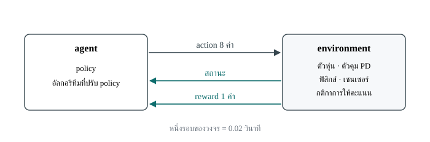

## บทที่ 3 · RL กำลังแก้ปัญหาอะไร — เรียนจากคะแนน ไม่ใช่จากเฉลย

> [!INTRO]
> Tron1 ยืนอยู่บนพื้นราบ ทุก 0.02 วินาที ตัวควบคุมต้องให้ตัวเลข 8 ตัว หนึ่งตัวต่อข้อต่อหนึ่งข้อ ถ้าตัวเลขชุดนั้นผิด หุ่นล้ม ไม่มีใครมีสูตรสำเร็จที่บอกตัวเลขทั้ง 8 ตัวนี้ และไม่มีใครมีเฉลยให้ลอก
>
> บทนี้อธิบายว่าวิชา reinforcement learning ซึ่งย่อว่า RL ตั้งโจทย์แบบนี้อย่างไร เราจะได้คำหกคำ คือ agent, environment, สถานะ, action, reward และ policy และได้วงจรที่คำทั้งหกหมุนเวียนกัน บทนี้ยังไม่มีสมการ
>
> ของที่ต้องรู้มาก่อน: ตัวควบคุม การเทรน และงานเทรน จากบทที่ 1 · config, manager และตัวแปร `env` จากบทที่ 2
>
> จบบทนี้แล้ว เราชี้ได้ว่าในการเทรน Tron1 อะไรอยู่ฝั่ง agent อะไรอยู่ฝั่ง environment และสัญญาณสามเส้นที่วิ่งระหว่างสองฝั่งอยู่ที่บรรทัดไหนของโค้ด

### ของที่ต้องมีก่อนเริ่ม

บทนี้ใช้ตัวเลขสี่ตัวที่อ่านได้จาก config ของงานเทรน สองตัวแรกมาจากบทที่ 1 และ 2

| ตัวเลข | ค่า | อ่านจาก |
| --- | --- | --- |
| ข้อต่อที่ขับได้ของรุ่น SF | 8 | `solefoot_cfg.py:39-64` (บทที่ 1) |
| รายการของหมวดการให้คะแนน | 20 | `RewardsCfg` `limx_base_env_cfg.py:368` (บทที่ 2) |
| เวลาระหว่างคำสั่งสองครั้งติดกัน | 4 × 0.005 = 0.02 วินาที | `decimation` `:497` และ `sim.dt` `:501` |
| จำนวนหุ่นจำลอง (ค่าปริยาย) | 4096 | `num_envs` `:484` |

คำที่บทนี้สอน เรียงตามลำดับที่จะพบ คอลัมน์ชนิดในบทนี้ใช้คำธรรมดา เช่น ฟังก์ชัน รายการของตัวเลข และตัวเลขตัวเดียว บทที่ 4 จะให้รายการชนิดครบชุด

| คำ | ชนิด | ความหมาย |
| --- | --- | --- |
| **RL** (reinforcement learning) | แนวคิด | การเรียนรู้แบบเสริมกำลัง คือเรียนจากรางวัล ไม่ใช่จากเฉลย |
| **agent** | แนวคิด | ผู้ตัดสินใจและผู้เรียน ประกอบด้วย policy กับอัลกอริทึมที่ปรับ policy |
| **environment** | แนวคิด | ทุกอย่างที่ agent สั่งให้เป็นไปตามใจไม่ได้ agent ทำได้เพียงส่ง action เข้าไป แล้วรับสถานะกับ reward กลับมา |
| **สถานะ** (state) | รายการของตัวเลข | ตัวเลขชุดหนึ่งที่บอกสถานการณ์ของหุ่นในรอบหนึ่ง |
| **action** | รายการของตัวเลข | ตัวเลขชุดหนึ่งที่ agent สั่งออกไปในรอบหนึ่ง สำหรับ Tron1 มี 8 ตัว |
| **reward** | ตัวเลขตัวเดียว | คะแนนของรอบเดียว รู้ทันที |
| **policy** | ฟังก์ชัน | กฎเลือก action จากสถานะ เป็นคำตอบ ไม่ใช่โจทย์ |

คำว่า*รอบ*ในบทนี้หมายถึงการตัดสินใจหนึ่งครั้งของตัวควบคุม ซึ่งกินเวลา 0.02 วินาที บทที่ 7 จะตั้งชื่อเฉพาะให้

> [!NOTE]
> สามคำที่ภาค ก ใช้แทนไว้ก่อน ได้ชื่อจริงในบทนี้ สิ่งที่บทที่ 1 เรียกว่า*ตัวควบคุม* คือ policy สิ่งที่เรียกว่า*คะแนน* คือ reward และ*งานเทรน*หนึ่งงานคือ environment หนึ่งแบบ ที่ถูกสร้างขึ้นในตัวจำลอง

### ปัญหา: ไม่มีสูตร และไม่มีเฉลย

หุ่นหนึ่งตัวต้องการตัวเลข 8 ตัวทุก 0.02 วินาที คือ 50 ชุดต่อวินาที หรือ 400 ตัวเลขต่อวินาที เรามีทางได้ตัวเลขเหล่านี้สามทาง

**ทางที่หนึ่ง เขียนกฎด้วยมือ** เรานั่งคิดว่าเมื่อหุ่นเอียงไปข้างหน้าเท่านี้ ควรสั่งข้อเข่าเท่าไร แล้วเขียนเป็นโปรแกรม ทางนี้ติดที่จำนวนกรณี หุ่นสองขาเปลี่ยนขาที่ยันพื้นอยู่ตลอด แรงเสียดทานของพื้นไม่คงที่ มวลของแต่ละท่อนขากระจายไม่เท่ากัน และขาที่กำลังแกว่งมีโมเมนตัมของมันเอง กฎที่เขียนด้วยมือต้องครอบคลุมทุกสถานการณ์ที่เกิดจากของเหล่านี้ผสมกัน

**ทางที่สอง เรียนจากเฉลย** เราเก็บตัวอย่างเป็นคู่ คือสถานการณ์หนึ่ง กับคำสั่งของข้อต่อที่ถูกต้องสำหรับสถานการณ์นั้น แล้วให้โปรแกรมเรียนจากคู่เหล่านี้ ทางนี้ติดตั้งแต่ต้น เพราะไม่มีใครรู้คำสั่งที่ถูกต้อง ถ้ามีคนรู้ เราก็ไม่ต้องเทรน

**ทางที่สาม เรียนจากคะแนน** เราไม่บอกว่าคำสั่งที่ถูกคืออะไร เราปล่อยให้หุ่นในตัวจำลองลองสั่งเอง แล้วให้คะแนนกำกับทุกรอบว่าผลที่ออกมาดีหรือแย่ ทำซ้ำเป็นจำนวนมาก แล้วปรับตัวควบคุมให้เก็บคะแนนสะสมได้มากขึ้น ทางนี้คือ RL

| ทาง | มนุษย์ต้องให้อะไร | ติดตรงไหน |
| --- | --- | --- |
| เขียนกฎด้วยมือ | กฎครบทุกสถานการณ์ | สถานการณ์มีมากเกินกว่าจะเขียนครบ |
| เรียนจากเฉลย | คำสั่งที่ถูกต้องของทุกตัวอย่าง | ไม่มีใครรู้คำสั่งที่ถูกต้อง |
| เรียนจากคะแนน (RL) | กติกาการให้คะแนน | ต้องลองเป็นจำนวนมาก และคะแนนไม่บอกว่าควรแก้อย่างไร |

แถวสุดท้ายยังมีราคา ซึ่งเป็นเหตุผลที่ต้องมีบทที่เหลือของเล่มนี้ แต่สิ่งที่มนุษย์ต้องให้เปลี่ยนจากของที่ไม่มีใครมี เป็นของที่เขียนได้ การเขียนว่า "ยืนอยู่ได้ให้ 1 คะแนน" ง่ายกว่าการบอกว่าต้องสั่งข้อต่อ 8 ข้ออย่างไรจึงจะยืนอยู่ได้

> [!REMARK]
> ทางที่หนึ่งไม่ได้เป็นไปไม่ได้ ตัวควบคุมที่ออกแบบจากแบบจำลองของหุ่นมีใช้จริงกับหุ่นสองขาหลายตัว แต่ต้องมีแบบจำลองที่แม่น และต้องออกแบบซ้ำเมื่อเงื่อนไขเปลี่ยน เล่มนี้ไม่ได้เทียบว่าทางใดดีกว่า เล่มนี้ศึกษา `tron1-rl-isaaclab` ซึ่งเลือกทางที่สาม

### วงจรระหว่าง agent กับ environment

RL แบ่งโลกออกเป็นสองฝั่ง ฝั่งที่ตัดสินใจและเรียนรู้เรียกว่า **agent** ฝั่งที่เหลือทั้งหมดเรียกว่า **environment** สองฝั่งคุยกันด้วยสัญญาณสามเส้นเท่านั้น และคุยกันเป็นรอบ

1. environment ส่ง**สถานะ**ให้ agent สถานะคือตัวเลขชุดหนึ่งที่บอกว่าตอนนี้หุ่นเป็นอย่างไร
2. agent ใช้ **policy** ของตัวเองเลือก **action** จากสถานะนั้น แล้วส่ง action เข้า environment
3. environment ทำตาม action ฟิสิกส์เดินไป 0.02 วินาที หุ่นขยับ
4. environment ส่ง **reward** หนึ่งตัวเลขกลับมา บอกว่าผลของรอบนี้ดีแค่ไหน พร้อมกับสถานะใหม่ แล้วกลับไปข้อ 2

สัญญาณสามเส้นเป็นของคนละชนิด

| สัญญาณ | ชนิด | ใครส่งให้ใคร | ของ Tron1 |
| --- | --- | --- | --- |
| สถานะ | รายการของตัวเลข | environment → agent | บทที่ 5 นับให้ว่ามีกี่ตัว |
| action | รายการของตัวเลข | agent → environment | 8 ตัว หนึ่งตัวต่อข้อต่อ |
| reward | ตัวเลขตัวเดียว | environment → agent | 1 ตัว รวมจากการให้คะแนน 20 รายการ |

ส่วน policy ไม่ใช่สัญญาณ มันเป็นฟังก์ชัน คือของที่รับสถานะเข้าไปแล้วให้ action ออกมา policy อยู่กับที่ในฝั่ง agent และถูกเรียกใช้รอบละครั้ง

ตารางข้างบนเป็นของหุ่นหนึ่งตัว ตอนเทรนมีหุ่นจำลองหลายพันตัวทำวงจรนี้พร้อมกัน บทที่ 2 บอกไว้แล้วว่าตัวแปร `env` ถือหุ่นทุกตัวไว้ในอ็อบเจกต์เดียว สัญญาณแต่ละเส้นในโค้ดจึงเป็น tensor ที่มีหนึ่งแถวต่อหุ่นหนึ่งตัว

> [!EXAMPLE] ในเวลาจำลองหนึ่งวินาที policy ถูกเรียกใช้เพื่อตัดสินใจกี่ครั้ง เมื่อใช้จำนวนหุ่นตามค่าปริยาย
> ขั้นที่ 1 หาจำนวนรอบต่อวินาทีของหุ่นหนึ่งตัว หนึ่งรอบกินเวลา 4 × 0.005 = 0.02 วินาที
>
> $$\frac{1}{0.02} = 50$$
>
> ขั้นที่ 2 คูณด้วยจำนวนหุ่นจำลอง ค่าปริยายคือ 4096 ตัว
>
> $$50 \times 4096 = 204{,}800$$
>
> policy ตัวเดียวกันตัดสินใจ 204,800 ครั้งในหนึ่งวินาทีของเวลาจำลอง การลองเป็นจำนวนมากในแถวสุดท้ายของตารางสามทางจึงทำได้จริงเมื่อใช้ตัวจำลอง

### เส้นแบ่ง: อะไรเป็น agent อะไรเป็น environment

ในภาษาพูด เรามักพูดว่าหุ่นคือผู้เรียน ใน RL เส้นแบ่งไม่ได้อยู่ที่ผิวของหุ่น กติกาที่ใช้แบ่งคือ สิ่งใดที่ agent เปลี่ยนตามใจไม่ได้ สิ่งนั้นอยู่นอก agent และเป็นส่วนหนึ่งของ environment (Sutton และ Barto หัวข้อ 3.1)

| ของ | ฝั่ง | เหตุผล |
| --- | --- | --- |
| policy | agent | เป็นของที่การเทรนปรับโดยตรง |
| อัลกอริทึมที่ปรับ policy | agent | เป็นผู้เรียน |
| ตัวหุ่น มอเตอร์ และตัวคุม PD ของข้อต่อ | environment | agent ส่งได้เพียง action แรงบิดที่เกิดขึ้นจริงเป็นผลของตัวคุม PD กับฟิสิกส์ |
| เซนเซอร์ | environment | agent เลือกไม่ได้ว่าจะวัดอะไร และวัดได้แม่นแค่ไหน |
| ฟิสิกส์ พื้น และแรงเสียดทาน | environment | เป็นของตัวจำลอง |
| กติกาการให้คะแนน 20 รายการ | environment | มนุษย์เขียนไว้ใน config และ manager ของ Isaac Lab เป็นผู้คำนวณ |

แถวที่สามและแถวสุดท้ายเป็นสองแถวที่ผิดกันบ่อย ตัวหุ่นทั้งตัวอยู่ฝั่ง environment และ reward ก็มาจากฝั่ง environment agent เป็นเพียงผู้รับตัวเลข

> [!WARNING] agent แก้กติกาการให้คะแนนไม่ได้
> เส้นแบ่งของสองฝั่งวัดจากสิ่งที่ agent *ควบคุม*ได้ ไม่ได้วัดจากสิ่งที่ agent *รู้* (Sutton และ Barto หัวข้อ 3.1) reward อยู่ฝั่ง environment เพราะ agent แก้กติกาไม่ได้ ไม่ว่ามันจะรู้กติกาหรือไม่ก็ตาม reward คำนวณที่ `reward_manager.py:148` ซึ่งเป็นโค้ดของ Isaac Lab ในกรณีของ Tron1 agent ไม่เห็นกติกาด้วย มันไม่เห็นน้ำหนักของแต่ละรายการ และได้รับเพียงผลรวมเป็นตัวเลขตัวเดียวต่อรอบ ถ้ากติกาเขียนผิด agent จะเรียนสิ่งที่กติกาให้คะแนน ไม่ใช่สิ่งที่ผู้เขียนตั้งใจ

คำว่า agent จึงมีสองความหมายที่ต้องแยก

| ความหมาย | หมายถึง | ใช้เมื่อไร |
| --- | --- | --- |
| ในภาษาพูด | หุ่นทั้งตัว | เมื่อพูดรวม ๆ ว่าหุ่นเรียนรู้ที่จะเดิน |
| ใน RL และในเล่มนี้ | policy กับอัลกอริทึมที่ปรับมัน | เมื่อถามว่าใครคำนวณอะไร |

สองความหมายให้คำตอบตรงกันเมื่อถามว่าใครเป็นผู้เลือก action และให้คำตอบต่างกันเมื่อถามว่าใครคำนวณ reward หรือใครคำนวณแรงบิด

### reward ต่างจากเฉลยอย่างไร

เฉลยกับ reward เป็นข้อมูลคนละชนิด สมมติว่าในรอบหนึ่ง policy สั่งตัวเลข 8 ตัวออกไป

| | เฉลย | reward |
| --- | --- | --- |
| ชนิด | รายการของตัวเลข 8 ตัว | ตัวเลขตัวเดียว |
| บอกอะไร | ตัวเลข 8 ตัวที่ควรจะสั่ง | ผลของตัวเลข 8 ตัวที่สั่งไปแล้วดีแค่ไหน |
| บอกทิศที่ควรแก้หรือไม่ | บอก ผลต่างจากเฉลยคือทิศที่ต้องแก้ ครบทั้ง 8 ตัว | ไม่บอก ไม่รู้ว่าตัวไหนใน 8 ตัวที่ทำให้คะแนนต่ำ และไม่รู้ว่าค่าที่ดีกว่าอยู่ทางไหน |
| มีสำหรับ Tron1 หรือไม่ | ไม่มี | มี เขียนเป็นกติกาได้ |

ผลของความต่างนี้มีสองข้อ และทั้งสองข้อกำหนดรูปร่างของวิชานี้

**ข้อแรก ต้องลองของที่ต่างกัน** reward บอกได้เพียงว่าของที่ลองไปแล้วดีแค่ไหน ถ้า policy สั่งแบบเดิมทุกครั้ง มันจะไม่มีวันรู้ว่าแบบอื่นดีกว่าหรือไม่ การเรียนจาก reward จึงต้องมีการลองผิดลองถูก บทที่ 12 อธิบายว่า policy ของ Tron1 ลองอย่างไร

**ข้อที่สอง ผลของ action มาถึงช้า** การย่อเข่าในรอบนี้อาจทำให้ reward ของรอบนี้ลดลงเล็กน้อย แต่ทำให้หุ่นไม่ล้มในอีกสิบรอบข้างหน้า action จึงตัดสินจาก reward ของรอบเดียวไม่ได้ คำถามที่ RL ทุกวิธีพยายามตอบคือคำถามเดียวกัน

อยู่ในสถานะนี้ ควรเลือก action ใด เพื่อให้ได้ reward สะสมในระยะยาว มากที่สุด

วิธีต่าง ๆ ของ RL ต่างกันที่วิธีคำนวณคำตอบ ไม่ได้ต่างกันที่คำถาม

> [!NOTE]
> คำว่า reward สะสมในระยะยาวยังเป็นคำพูด บทที่ 8 เขียนให้เป็นตัวเลข และตัวเลขที่ใช้ปรับ policy จริงก็ไม่ใช่ reward ดิบของแต่ละรอบ บทที่ 9 และบทที่ 22 สร้างตัวเลขนั้นขึ้นทีละขั้น

### เทียบกับวงควบคุมป้อนกลับ

คนทำหุ่นยนต์เห็นวงจรในรูปแล้วนึกถึงวงควบคุมป้อนกลับ คือวัด คำนวณ แล้วสั่ง การเทียบนี้ใช้ได้กับรูปของวง แต่ใช้ไม่ได้กับสัญญาณที่บอกว่าดีหรือไม่ดี

| | วงควบคุมป้อนกลับ เช่น ตัวคุม PD | วงจรของ RL |
| --- | --- | --- |
| รูปของวง | วัด → คำนวณ → สั่ง | สถานะ → policy → action |
| กฎที่ใช้คำนวณ | มนุษย์เลือกรูปของกฎและตั้งเกน | ได้จากการเทรน |
| **เทียบไม่ได้ตรงที่** สัญญาณบอกความดี | ค่าผิดพลาดเทียบกับค่าเป้าหมาย มีทั้งขนาดและทิศ และเป็น input ของกฎโดยตรง | reward เป็นคะแนน ไม่มีทิศ และไม่ใช่ input ของ policy |
| **เทียบไม่ได้ตรงที่** เวลาที่ใช้สัญญาณนั้น | ทุกรอบ ตลอดการทำงาน | เฉพาะตอนเทรน เมื่อนำ policy ไปใช้กับหุ่นจริง ไม่มี reward แล้ว |

ในการเทรน Tron1 วงทั้งสองแบบมีอยู่พร้อมกันและซ้อนกัน วงนอกคือวงจรของ RL ซึ่งหมุน 50 รอบต่อวินาที วงในคือตัวคุม PD ของข้อต่อ ซึ่งบทที่ 1 แสดงเกนไว้แล้ว (`solefoot_cfg.py:39-64`) ตัวจำลองคำนวณมันทุกก้าวของฟิสิกส์ (`manager_based_rl_env.py:189`) คือ 200 ครั้งต่อวินาที และมันอยู่ในฝั่ง environment ทั้งวง

### จากวงจรถึงโค้ด

วงจรหนึ่งรอบคือสามบรรทัดในไฟล์ `on_policy_runner.py` ตัวแปร `self.alg` คือฝั่ง agent และ `self.env` คือฝั่ง environment

| ขั้นของวงจร | บรรทัด | โค้ด |
| --- | --- | --- |
| agent เลือก action จากสิ่งที่ได้รับ | `on_policy_runner.py:175` | `actions = self.alg.act(obs, obs_history, commands, critic_obs)` |
| environment รับ action แล้วคืนของกลับมา | `:177` | `(obs, rewards, dones, infos) = self.env.step(actions)` |
| agent รับ reward ไปเก็บไว้ | `:192` | `self.alg.process_env_step(rewards, dones, infos, obs)` |

บรรทัด `:175` ไม่มี `rewards` อยู่ในวงเล็บ ซึ่งตรงกับตารางเทียบข้างบน policy เลือก action โดยไม่เห็น reward ส่วน reward ของรอบนี้ถูกส่งให้ agent ที่บรรทัด `:192` หลังจาก action ถูกสั่งออกไปแล้ว

บรรทัด `:177` เรียกฟังก์ชัน `step` ของ Isaac Lab ข้างในฟังก์ชันนั้นคือข้อ 3 และข้อ 4 ของวงจร

| สิ่งที่ environment ทำ | บรรทัด |
| --- | --- |
| รับ action เข้ามา | `manager_based_rl_env.py:173` |
| เดินฟิสิกส์ 4 ก้าวย่อย ก้าวละ 0.005 วินาที | `:182-189` |
| คำนวณ reward ด้วย manager ของหมวดการให้คะแนน | `:207` |
| อ่านค่าที่ policy จะได้รับในรอบถัดไป | `:239` |
| คืนของทั้งหมดให้ผู้เรียก | `:242` |

> [!NOTE]
> โค้ดสามบรรทัดในตารางแรกมีชื่อที่บทนี้ยังไม่ได้อธิบาย คือ `obs`, `obs_history`, `commands`, `critic_obs`, `dones` และ `infos` บทที่ 5 อธิบาย `obs` กับ `commands` บทที่ 6 อธิบาย `obs_history` บทที่ 7 อธิบาย `dones` และบทที่ 9 อธิบาย `critic_obs` ส่วน `infos` เป็นที่ที่ environment ใส่ของเพิ่มเติมส่งกลับมา ซึ่งรวม `obs_history`, `commands` และ `critic_obs` ด้วย (`on_policy_runner.py:179-181` อ่านสามตัวนี้ออกมา) บรรทัด `on_policy_runner.py:175-192` อยู่ในลูปสองชั้น (`on_policy_runner.py:170` และ `:174`) ซึ่งบทที่ 7 ตั้งชื่อให้เช่นกัน

> [!SUMMARY]
> - RL คือการเรียนจาก reward ไม่ใช่จากเฉลย มนุษย์ให้กติกาการให้คะแนน ไม่ได้ให้คำสั่งที่ถูกต้อง
> - โลกถูกแบ่งเป็นสองฝั่ง agent คือ policy กับอัลกอริทึมที่ปรับมัน environment คือทุกอย่างที่เหลือ รวมตัวหุ่น ตัวคุม PD ฟิสิกส์ และกติกาการให้คะแนน
> - สองฝั่งคุยกันด้วยสัญญาณสามเส้น สถานะและ reward วิ่งจาก environment ไป agent ส่วน action วิ่งกลับ
> - reward เป็นตัวเลขตัวเดียวที่ไม่บอกทิศ agent จึงต้องลองของที่ต่างกัน และต้องตัดสิน action จาก reward สะสมในระยะยาว
> - ในโค้ด วงจรหนึ่งรอบคือ `alg.act` แล้ว `env.step` แล้ว `alg.process_env_step`
>
> ประโยคที่ควรจำ: **agent ส่ง action เข้าไป แล้วได้สถานะกับ reward กลับมา ทุกอย่างที่ agent สั่งตามใจไม่ได้คือ environment รวมทั้งตัวหุ่นและกติกาการให้คะแนน**

### แบบฝึกหัด

1. ข้อใดถูกต้อง
    1. RL ต้องมีคำสั่งที่ถูกต้องของทุกสถานการณ์ก่อนจึงจะเริ่มเทรนได้
    2. reward ของหนึ่งรอบเป็นตัวเลขตัวเดียว
    3. action ของ Tron1 รุ่น SF มี 8 ตัวเลข
    4. มอเตอร์ของหุ่นอยู่ฝั่ง agent
    5. กติกาการให้คะแนนอยู่ฝั่ง environment
    6. policy เป็นสัญญาณที่วิ่งจาก environment ไป agent
    7. policy ได้รับ reward ของรอบก่อนหน้าเป็น input
    8. reward บอกว่าตัวเลขตัวไหนใน action ที่ควรแก้
    9. หนึ่งรอบของวงจรกินเวลา 0.02 วินาที
    10. เมื่อนำ policy ไปใช้กับหุ่นจริง ยังต้องคำนวณ reward ทุกรอบ

2. จงบอกว่าของต่อไปนี้อยู่ฝั่ง agent หรือฝั่ง environment [05 §1.1]
    1. policy
    2. ตัวคุม PD ของข้อเข่า
    3. ฟังก์ชัน `joint_powers_l1` ของบทที่ 2
    4. ตัวจำลองฟิสิกส์
    5. อัลกอริทึมที่ปรับ policy
    6. เซนเซอร์วัดมุมข้อต่อ

3. หุ่นหนึ่งตัวได้รับตัวเลขของ action กี่ตัวในเวลาจำลองหนึ่งวินาที [limx_base_env_cfg.py:497] <!--space:14-->

4. ถ้าเทรนด้วยหุ่นจำลอง 2048 ตัว policy ตัดสินใจกี่ครั้งในเวลาจำลองหนึ่งวินาที และในเวลาจำลองหนึ่งนาที <!--space:16-->

5. จงเปิด `on_policy_runner.py:177` แล้วตอบ [on_policy_runner.py:177]
    1. ชื่อใดทางซ้ายของเครื่องหมายเท่ากับคือ reward
    2. ชื่อใดในวงเล็บทางขวาคือ action
    3. บรรทัดนี้เป็นของฝั่ง agent หรือ environment ที่ทำงาน

    <!--space:8-->

6. ภายในหนึ่งรอบ ฟิสิกส์เดินกี่ก้าวย่อย และตัวคุม PD ของข้อต่อทำงานกี่ครั้งต่อวินาที [manager_based_rl_env.py:182-189] <!--space:12-->

7. จงอธิบายว่าเหตุใด reward เพียงอย่างเดียวจึงไม่พอที่จะบอกว่า action ที่ถูกคืออะไร <!--space:16-->

8. เพื่อนคนหนึ่งพูดว่า "agent ก็คือหุ่น Tron1" ประโยคนี้ใช้ได้ในกรณีใด และทำให้เข้าใจผิดในกรณีใด <!--space:16-->

9. จงบอกข้อแตกต่างสองข้อระหว่างค่าผิดพลาดของตัวคุม PD กับ reward ของ RL <!--space:14-->

<!-- เฉลย -->

1. ข้อที่ถูก: 2, 3, 5, 9

    - ข้อ 1 ผิด: RL เรียนจาก reward ไม่มีใครมีคำสั่งที่ถูกต้อง
    - ข้อ 4 ผิด: ตัวหุ่นและมอเตอร์อยู่ฝั่ง environment เพราะ agent ส่งได้เพียง action
    - ข้อ 6 ผิด: policy เป็นฟังก์ชันที่อยู่ในฝั่ง agent ไม่ใช่สัญญาณ
    - ข้อ 7 ผิด: `alg.act` ที่ `on_policy_runner.py:175` ไม่รับ reward
    - ข้อ 8 ผิด: reward เป็นคะแนนที่ไม่มีทิศ
    - ข้อ 10 ผิด: reward ใช้เฉพาะตอนเทรน

2. ฝั่งของแต่ละข้อ

    1. agent
    2. environment
    3. environment เป็นฟังก์ชันของหมวดการให้คะแนน
    4. environment
    5. agent
    6. environment

3. หนึ่งวินาทีมี 1 / 0.02 = 50 รอบ รอบละ 8 ตัว รวม 8 × 50 = 400 ตัว

4. 50 × 2048 = 102,400 ครั้งต่อวินาที และ 102,400 × 60 = 6,144,000 ครั้งต่อนาที

5. จากบรรทัด `:177`

    1. `rewards`
    2. `actions`
    3. environment เพราะ `self.env.step` คือการให้ environment ทำตาม action

6. ฟิสิกส์เดิน 4 ก้าวย่อยต่อรอบ (`decimation = 4` `limx_base_env_cfg.py:497`) ก้าวละ 0.005 วินาที ตัวคุม PD ทำงานทุกก้าวของฟิสิกส์ จึงเป็น 1 / 0.005 = 200 ครั้งต่อวินาที

7. reward เป็นตัวเลขตัวเดียว ส่วน action มี 8 ตัว reward ไม่บอกว่าตัวใดทำให้คะแนนสูงหรือต่ำ และไม่บอกว่าค่าที่ดีกว่าอยู่ทางไหน นอกจากนั้นผลของ action อาจมาถึงในรอบหลัง reward ของรอบเดียวจึงตัดสิน action ของรอบนั้นไม่ได้

8. ใช้ได้เมื่อพูดรวม ๆ ว่าใครเป็นผู้เลือก action ทำให้เข้าใจผิดเมื่อถามว่าใครคำนวณ reward หรือแรงบิด เพราะตัวหุ่น มอเตอร์ ตัวคุม PD และกติกาการให้คะแนน อยู่ฝั่ง environment ทั้งหมด

9. ตอบสองข้อจากรายการนี้: ค่าผิดพลาดมีทิศ ส่วน reward ไม่มี · ค่าผิดพลาดเป็น input ของกฎควบคุม ส่วน reward ไม่ใช่ input ของ policy · ค่าผิดพลาดใช้ตลอดการทำงาน ส่วน reward ใช้เฉพาะตอนเทรน
