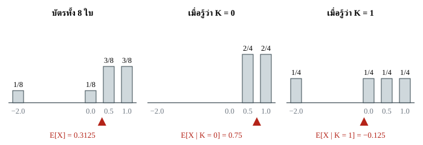

## บทที่ 4 · พื้นฐาน 1 ตัวแปรสุ่มและค่าคาดหวัง — สัญลักษณ์สี่ตัวของคำว่าโดยเฉลี่ย

> [!INTRO]
> บทที่ 3 จบที่ประโยคว่า agent ต้องการ reward สะสมให้มากที่สุด แต่หุ่นที่ลองเดินสองครั้งจากท่าเดียวกันไม่ได้คะแนนเท่ากัน ครั้งหนึ่งเดินได้ อีกครั้งหนึ่งล้ม คำว่ามากที่สุดจึงต้องหมายถึงมากที่สุด*โดยเฉลี่ย* และเราต้องมีภาษาสำหรับพูดคำว่าโดยเฉลี่ยให้ชัด
>
> บทนี้สอนสัญลักษณ์สี่ตัว คือการแจกแจง เครื่องหมาย $\sim$ ขีดตั้ง $\mid$ และ $\mathbb{E}$ ด้วยกล่องใส่บัตรสองใบ แล้วปิดด้วยรายการชนิดของวัตถุ 11 แบบที่เล่มนี้ใช้ในคอลัมน์ชนิดของทุกตาราง
>
> ของที่ต้องรู้มาก่อน: การบวกและคูณเศษส่วน · คำว่า reward และ policy จากบทที่ 3 ใช้เฉพาะในตารางชนิดท้ายบท ผู้อ่านที่คล่องเรื่องค่าคาดหวังแบบมีเงื่อนไขอยู่แล้ว ให้ทำแบบฝึกหัดข้อ 2 ถึง 5 ถ้าทำได้ครบ ข้ามไปอ่านหัวข้อชนิดของวัตถุได้เลย
>
> จบบทนี้แล้ว เราอ่านนิพจน์อย่าง $\mathbb{E}[X \mid K = 1]$ ออกเสียงเป็นประโยคได้ คำนวณค่าของมันได้ และบอกได้ว่าของแต่ละชิ้นในนิพจน์เป็นชนิดใด

### ของที่ต้องมีก่อนเริ่ม

บทนี้ใช้อุปกรณ์ชุดเดียว คือกล่องสองใบ ใบหนึ่งเขียนเลข 0 อีกใบเขียนเลข 1 แต่ละกล่องมีบัตร 4 ใบ บนบัตรมีตัวเลขหนึ่งตัว

| กล่อง | บัตรใบที่ 1 | บัตรใบที่ 2 | บัตรใบที่ 3 | บัตรใบที่ 4 |
| --- | --- | --- | --- | --- |
| **กล่อง 0** | 1.0 | 0.5 | 1.0 | 0.5 |
| **กล่อง 1** | 0.5 | 1.0 | −2.0 | 0.0 |

การทดลองมีสองขั้น ขั้นแรกโยนเหรียญเพื่อเลือกกล่อง ขั้นที่สองหลับตาจับบัตรหนึ่งใบจากกล่องนั้น บัตรทั้ง 8 ใบจึงมีโอกาสถูกจับเท่ากัน คือใบละ 1/8

> [!NOTE]
> ตัวเลขแปดตัวนี้ไม่ได้ตั้งขึ้นใหม่ มันคือแถวหนึ่งของตารางตัวอย่างประจำเล่ม ซึ่งบทที่ 7 จะเปิดให้ดูทั้งใบ ในบทนี้ให้มองเป็นบัตรในกล่องไปก่อน

สัญลักษณ์ที่ใช้ในบทนี้ เรียงตามลำดับที่จะพบ

| สัญลักษณ์ | ชนิด | ความหมาย |
| --- | --- | --- |
| $X$, $K$ **ตัวแปรสุ่ม** | แนวคิด | ปริมาณที่ยังไม่มีค่าจนกว่าจะสุ่ม และได้ค่าใหม่ทุกครั้งที่สุ่ม · ในบทนี้ $X$ คือตัวเลขบนบัตรที่จับได้ และ $K$ คือเลขของกล่องที่เลือกได้ |
| $P(X = x)$ **ความน่าจะเป็น** | scalar | สัดส่วนของครั้งที่ $X$ ออกมาเป็นค่า $x$ เมื่อทดลองซ้ำไม่จำกัดครั้ง |
| **การแจกแจง** | การแจกแจง | ของที่ทำได้สองอย่าง คือสุ่มค่าออกมาได้ และถามได้ว่าค่าหนึ่งออกบ่อยแค่ไหน |
| $\sim$ | ตัวดำเนินการ | อ่านว่า "สุ่มจาก" ทางซ้ายคือค่าที่ได้ ทางขวาคือการแจกแจงที่ใช้สุ่ม |
| $\mid$ **ขีดตั้ง** | ตัวดำเนินการ | อ่านว่า "เมื่อรู้ว่า" ทางขวาคือสิ่งที่รู้แล้วและตรึงไว้ ทางซ้ายคือสิ่งที่ยังสุ่มอยู่ |
| $\mathbb{E}[\cdot]$ **ค่าคาดหวัง** | ตัวดำเนินการ | ค่าเฉลี่ยถ้าทำซ้ำหลาย ๆ รอบ · ในโค้ดคือ `.mean()` บนตัวอย่างจำนวนมาก |

### ปัญหา: จับบัตรใบเดียว บอกไม่ได้ว่ากล่องดีแค่ไหน

สมมติว่าตัวเลขบนบัตรคือคะแนนที่เราได้ และเราอยากรู้ว่าการทดลองนี้ดีแค่ไหน วิธีที่ง่ายที่สุดคือทดลองหนึ่งครั้งแล้วดูตัวเลข

วิธีนี้ใช้ไม่ได้ เพราะคำตอบเปลี่ยนทุกครั้ง ครั้งหนึ่งเราได้ 1.0 แล้วสรุปว่าการทดลองนี้ดี อีกครั้งหนึ่งเราได้ −2.0 แล้วสรุปว่าแย่ ทั้งที่กล่องและบัตรไม่ได้เปลี่ยนเลย ตัวเลขที่ได้จากการจับหนึ่งครั้งบอกเรื่องของครั้งนั้น ไม่ได้บอกเรื่องของกล่อง

เราต้องการตัวเลขที่เป็นสมบัติของการทดลองทั้งหมด และไม่เปลี่ยนเมื่อทดลองซ้ำ การจะได้ตัวเลขนั้น เราต้องแยกของสองอย่างออกจากกันก่อน คือ*ตัวเลขที่จับได้ครั้งนี้* กับ*ตัวเลขที่อาจจับได้*

### ตัวแปรสุ่ม และการแจกแจงของมัน

**ตัวแปรสุ่ม** คือปริมาณที่ยังไม่มีค่าจนกว่าจะสุ่ม เราเขียนด้วยตัวพิมพ์ใหญ่ ตัวเลขบนบัตรที่จะจับได้คือ $X$ ส่วนค่าที่จับได้แล้วเขียนด้วยตัวพิมพ์เล็ก $x$ และเป็นตัวเลขธรรมดา

| | ก่อนจับ | หลังจับ |
| --- | --- | --- |
| เขียนว่า | $X$ | $x$ เช่น $x = 0.5$ |
| ชนิด | ตัวแปรสุ่ม | scalar |
| ถามว่าเท่ากับเท่าไรได้หรือไม่ | ไม่ได้ ถามได้เพียงว่าแต่ละค่าออกบ่อยแค่ไหน | ได้ |

คำตอบของคำถามว่าแต่ละค่าออกบ่อยแค่ไหน คือ**การแจกแจง**ของ $X$ สำหรับตัวแปรสุ่มที่มีค่าได้ไม่กี่ค่า การแจกแจงเขียนเป็นตารางได้ เรานับบัตรทั้ง 8 ใบ

| ค่า $x$ | จำนวนบัตร | $P(X = x)$ |
| --- | --- | --- |
| 1.0 | 3 | 3/8 |
| 0.5 | 3 | 3/8 |
| 0.0 | 1 | 1/8 |
| −2.0 | 1 | 1/8 |
| รวม | 8 | 1 |

ความน่าจะเป็นของทุกค่ารวมกันได้ 1 เสมอ เพราะจับบัตรแล้วต้องได้ค่าใดค่าหนึ่ง

เราเขียนการแจกแจงของ $X$ ทั้งตารางว่า $P(X)$ โดยไม่มีเครื่องหมายเท่ากับ ส่วน $P(X = x)$ คือตัวเลขหนึ่งช่องของตารางนั้น เมื่อเราจับบัตรจริงหนึ่งใบ เราเขียนว่า

$$x \sim P(X)$$

เครื่องหมาย $\sim$ อ่านว่า "สุ่มจาก" ประโยคนี้อ่านว่า $x$ ถูกสุ่มออกมาจากการแจกแจงของ $X$ ถ้าทำซ้ำ เราได้ $x$ ตัวใหม่ แต่การแจกแจงทางขวายังเป็นตารางใบเดิม

> [!WARNING] เครื่องหมาย $\sim$ ไม่ได้แปลว่าประมาณเท่ากับ
> ในวิชาอื่น $\sim$ อาจใช้แทนคำว่าประมาณ ในเล่มนี้ $\sim$ หมายถึงการสุ่มเท่านั้น ส่วนคำว่าประมาณเท่ากับเขียนด้วย $\approx$

### ค่าคาดหวัง: ตัวเลขตัวเดียวที่สรุปการแจกแจง

ตอนนี้เราตอบคำถามเปิดบทได้ ตัวเลขที่เป็นสมบัติของการทดลองทั้งหมดคือค่าเฉลี่ยของบัตร โดยบัตรที่ออกบ่อยกว่าได้น้ำหนักมากกว่า

> [!KEY] ค่าคาดหวังของตัวแปรสุ่มที่มีค่าได้จำนวนจำกัด
> $$\mathbb{E}[X] = \sum_{x} x \cdot P(X = x)$$
>
> | | |
> | --- | --- |
> | $\sum_{x}$ | บวกทุกค่าที่ $X$ เป็นได้ |
> | $P(X = x)$ | น้ำหนักของค่านั้น คือความน่าจะเป็นที่มันจะออก |

สมการนี้บอกให้เอาค่าแต่ละค่าคูณกับความน่าจะเป็นของมัน แล้วบวกกันทั้งหมด ผลที่ได้คือค่าเฉลี่ยที่เราจะเห็นถ้าทดลองซ้ำไปเรื่อย ๆ โดยไม่หยุด

> [!EXAMPLE] จงหา $\mathbb{E}[X]$ ของการทดลองจับบัตร
> เราใช้ตารางการแจกแจงของหัวข้อก่อนหน้า หนึ่งพจน์ต่อหนึ่งแถว
>
> $$\begin{aligned}
> \mathbb{E}[X] &= 1.0 \times \tfrac{3}{8} + 0.5 \times \tfrac{3}{8} + 0.0 \times \tfrac{1}{8} + (-2.0) \times \tfrac{1}{8} \\
> &= 0.3750 + 0.1875 + 0 - 0.2500 \\
> &= 0.3125
> \end{aligned}$$
>
> ตรวจด้วยอีกวิธีหนึ่ง บัตรทั้ง 8 ใบมีโอกาสเท่ากัน ค่าคาดหวังจึงเท่ากับผลรวมของตัวเลขบนบัตรหารด้วย 8 คือ 2.5 / 8 = 0.3125

ค่าคาดหวังมีสมบัติสามข้อที่ควรสังเกตจากตัวอย่างนี้

- $\mathbb{E}[X]$ เป็น scalar ไม่ใช่ตัวแปรสุ่ม ทดลองกี่ครั้งมันก็เป็น 0.3125
- 0.3125 ไม่ได้อยู่บนบัตรใบใดเลย ค่าคาดหวังไม่จำเป็นต้องเป็นค่าที่จับได้จริง
- บัตร −2.0 ใบเดียวดึงค่าคาดหวังลงมาก ถ้าเอาบัตรใบนั้นออก แล้วจับหนึ่งใบจาก 7 ใบที่เหลือด้วยโอกาสเท่ากัน ค่าคาดหวังคือ 4.5 / 7 = 0.6429

### จาก $\mathbb{E}$ ถึง `.mean()`

การคำนวณ $\mathbb{E}[X]$ ด้วยสมการข้างบนต้องรู้การแจกแจงทั้งตาราง ในงานจริงเรามักไม่รู้ เรามีเพียงตัวอย่างที่สุ่มมาได้จำนวนหนึ่ง สิ่งที่ทำได้คือเฉลี่ยตัวอย่างเหล่านั้น ซึ่งในโค้ดคือเมธอด `.mean()`

ตารางนี้ได้จากการให้คอมพิวเตอร์จับบัตร 8,000 ครั้ง โดยใส่บัตรคืนก่อนจับครั้งถัดไป แล้วเฉลี่ยเฉพาะ $n$ ครั้งแรก สคริปต์เฉลยตั้งค่าเริ่มต้นของตัวสุ่มไว้ จึงได้ตัวเลขชุดนี้ทุกครั้งที่รัน

| จำนวนครั้ง $n$ | ค่าเฉลี่ยของตัวอย่าง | ห่างจาก 0.3125 |
| --- | --- | --- |
| 1 | 1.0000 | 0.6875 |
| 8 | 0.5000 | 0.1875 |
| 80 | 0.2938 | 0.0187 |
| 800 | 0.3094 | 0.0031 |
| 8,000 | 0.3277 | 0.0152 |

ค่าเฉลี่ยของตัวอย่างเข้าใกล้ 0.3125 เมื่อ $n$ มากขึ้น แต่ไม่ได้ใกล้ขึ้นทุกขั้น แถวสุดท้ายห่างกว่าแถวก่อนหน้า เพราะค่าเฉลี่ยของตัวอย่างเองก็เป็นตัวแปรสุ่ม ถ้าจับใหม่อีกชุด เราจะได้ตารางที่ตัวเลขต่างไป

| | $\mathbb{E}[X]$ | `.mean()` ของตัวอย่าง |
| --- | --- | --- |
| ชนิด | scalar ที่ไม่เปลี่ยน | scalar ที่เปลี่ยนทุกครั้งที่สุ่มตัวอย่างชุดใหม่ |
| ต้องรู้อะไร | การแจกแจงทั้งตาราง | ตัวอย่างที่สุ่มมาแล้ว |
| ในเล่มนี้ | อยู่ในสมการ | อยู่ในโค้ด |

> [!WARNING] ทุกครั้งที่สมการเขียน $\mathbb{E}$ โค้ดมี `.mean()` และสองอย่างนี้ไม่เท่ากันพอดี
> สมการในเล่มนี้เขียนด้วย $\mathbb{E}$ ซึ่งเป็นค่าในอุดมคติ โค้ดคำนวณด้วย `.mean()` บนตัวอย่างที่เก็บมา ซึ่งเป็นค่าประมาณ ความต่างระหว่างสองค่านี้เล็กลงเมื่อตัวอย่างมีมากขึ้น นี่คือเหตุผลหนึ่งที่การเทรนใช้หุ่นจำลองหลายพันตัวพร้อมกัน

### ขีดตั้ง: เมื่อรู้อะไรบางอย่างแล้ว

สมมติว่าเพื่อนโยนเหรียญให้ แล้วบอกเราว่าได้กล่อง 1 ก่อนที่เราจะจับบัตร ข้อมูลนี้เปลี่ยนคำตอบของคำถามว่าแต่ละค่าออกบ่อยแค่ไหน เพราะตอนนี้มีบัตรให้จับเพียง 4 ใบ

เราเขียนสิ่งที่รู้แล้วไว้ทางขวาของขีดตั้ง

$$P(X = 1.0 \mid K = 1) = \tfrac{1}{4}$$

อ่านว่า ความน่าจะเป็นที่ $X$ เป็น 1.0 **เมื่อรู้ว่า** $K$ เป็น 1 เท่ากับ 1/4 การแจกแจงของ $X$ เมื่อรู้เลขกล่อง มีสองตาราง หนึ่งตารางต่อหนึ่งกล่อง

| ค่า $x$ | $P(X = x \mid K = 0)$ | $P(X = x \mid K = 1)$ |
| --- | --- | --- |
| 1.0 | 2/4 | 1/4 |
| 0.5 | 2/4 | 1/4 |
| 0.0 | 0 | 1/4 |
| −2.0 | 0 | 1/4 |
| รวมในแนวตั้ง | 1 | 1 |

ขีดตั้งบอกว่าของสองข้างมีบทบาทต่างกัน

| | ทางซ้ายของขีด | ทางขวาของขีด |
| --- | --- | --- |
| คืออะไร | สิ่งที่ยังสุ่มอยู่ | สิ่งที่รู้แล้วและตรึงไว้ |
| ในตัวอย่าง | ตัวเลขบนบัตร | เลขของกล่อง |
| เมื่อบวกทุกค่าของฝั่งนี้ | ได้ 1 เสมอ | ไม่มีความหมาย |

แถวสุดท้ายตรวจได้จากตาราง บวกในแนวตั้งได้ 1 ทั้งสองคอลัมน์ แต่บวกในแนวนอนของแถวแรกได้ 2/4 + 1/4 = 0.75 ซึ่งไม่ใช่ 1 และไม่ได้เป็นความน่าจะเป็นของอะไร

> [!WARNING] สลับของสองข้างของขีดตั้งแล้วได้คนละคำถาม
> $P(X = 1.0 \mid K = 1) = 1/4$ ถามว่าเมื่อรู้ว่าได้กล่อง 1 บัตรจะเป็น 1.0 บ่อยแค่ไหน ส่วน $P(K = 1 \mid X = 1.0)$ ถามว่าเมื่อเห็นบัตร 1.0 แล้ว บัตรนั้นมาจากกล่อง 1 บ่อยแค่ไหน บัตร 1.0 มี 3 ใบ อยู่ในกล่อง 1 เพียงใบเดียว คำตอบจึงเป็น 1/3 ไม่ใช่ 1/4

ค่าคาดหวังก็มีเงื่อนไขได้เช่นกัน วิธีคำนวณเหมือนเดิมทุกอย่าง เพียงแต่ใช้ตารางของกล่องที่รู้แล้ว

> [!KEY] ค่าคาดหวังแบบมีเงื่อนไข
> $$\mathbb{E}[X \mid K = k] = \sum_{x} x \cdot P(X = x \mid K = k)$$

สมการนี้บอกค่าเฉลี่ยของ $X$ เมื่อนับเฉพาะครั้งที่ $K$ เป็น $k$

> [!EXAMPLE] จงหา $\mathbb{E}[X \mid K = 0]$
> เมื่อรู้ว่าได้กล่อง 0 ค่าที่เป็นไปได้มีสองค่า คือ 1.0 และ 0.5 ค่าละ 2/4
>
> $$\mathbb{E}[X \mid K = 0] = 1.0 \times \tfrac{2}{4} + 0.5 \times \tfrac{2}{4} = 0.50 + 0.25 = 0.75$$

กล่อง 1 ทำแบบเดียวกันได้ −0.125 ซึ่งเป็นแบบฝึกหัดข้อ 2 เราจึงมีค่าคาดหวังสามตัว และทั้งสามตัวเป็นคำตอบของคำถามที่ต่างกัน

| เขียนว่า | ค่า | ถามว่า |
| --- | --- | --- |
| $\mathbb{E}[X]$ | 0.3125 | บัตรที่จับได้มีค่าเฉลี่ยเท่าไร เมื่อยังไม่รู้ว่าได้กล่องไหน |
| $\mathbb{E}[X \mid K = 0]$ | 0.75 | เมื่อรู้ว่าได้กล่อง 0 |
| $\mathbb{E}[X \mid K = 1]$ | −0.125 | เมื่อรู้ว่าได้กล่อง 1 |

### กฎสองข้อที่บทหลังใช้ซ้ำ

**กฎข้อแรก เฉลี่ยสองชั้น** ค่าคาดหวังทั้งสามตัวในตารางข้างบนเกี่ยวข้องกัน ถ้าเราเฉลี่ยค่าคาดหวังของแต่ละกล่อง โดยถ่วงด้วยโอกาสที่จะได้กล่องนั้น เราได้ค่าคาดหวังรวมกลับมา

> [!KEY] กฎการเฉลี่ยสองชั้น
> $$\mathbb{E}[X] = \sum_{k} P(K = k) \cdot \mathbb{E}[X \mid K = k]$$

ตรวจกับตัวอย่าง เหรียญให้โอกาสกล่องละ 1/2

$$\tfrac{1}{2} \times 0.75 + \tfrac{1}{2} \times (-0.125) = 0.375 - 0.0625 = 0.3125$$

กฎนี้ยอมให้เราคิดค่าเฉลี่ยของเรื่องที่ซับซ้อนเป็นสองขั้น คือเฉลี่ยภายในแต่ละกรณีก่อน แล้วจึงเฉลี่ยข้ามกรณี บทที่ 9 ใช้กฎนี้ตอนแยกอนาคตของหุ่นออกเป็นรอบถัดไปกับรอบที่เหลือทั้งหมด

**กฎข้อที่สอง ค่าคาดหวังแยกผลบวกได้ และดึงตัวคูณคงที่ออกได้**

> [!KEY] ความเป็นเชิงเส้นของค่าคาดหวัง
> $$\mathbb{E}[aX + bY] = a\,\mathbb{E}[X] + b\,\mathbb{E}[Y]$$
>
> | | |
> | --- | --- |
> | $a$, $b$ | ตัวเลขคงที่ |
> | $X$, $Y$ | ตัวแปรสุ่มสองตัวใดก็ได้ ไม่ต้องเป็นอิสระต่อกัน |

> [!EXAMPLE] ทำการทดลองทั้งสองขั้นสองครั้ง คือโยนเหรียญแล้วจับบัตร ใส่บัตรคืน แล้วโยนเหรียญและจับบัตรอีกครั้ง ให้ $X_1$ และ $X_2$ เป็นตัวเลขของครั้งที่หนึ่งและครั้งที่สอง จงหา $\mathbb{E}[X_1 + 0.9\,X_2]$
> การจับแต่ละครั้งใช้การแจกแจงเดียวกัน ค่าคาดหวังของแต่ละครั้งจึงเป็น 0.3125
>
> $$\begin{aligned}
> \mathbb{E}[X_1 + 0.9\,X_2] &= \mathbb{E}[X_1] + 0.9\,\mathbb{E}[X_2] \\
> &= 0.3125 + 0.9 \times 0.3125 \\
> &= 0.59375
> \end{aligned}$$
>
> ถ้าไม่ใช้กฎนี้ เราต้องไล่คู่ของบัตรทั้ง 8 × 8 = 64 คู่ แล้วเฉลี่ย ซึ่งได้ค่าเดียวกัน

รูปของนิพจน์ $X_1 + 0.9\,X_2$ ไม่ได้เลือกมาโดยบังเอิญ บทที่ 8 รวมคะแนนของหลายรอบด้วยรูปนี้ โดยรอบที่อยู่ไกลออกไปถูกคูณด้วยตัวเลขที่น้อยกว่า 1

### ชนิดของวัตถุ 11 แบบ

บทนำบอกไว้ว่าเล่มนี้ถามเสมอว่าของสิ่งหนึ่งเป็นชนิดใด ก่อนจะถามว่ามันทำอะไร ตอนนี้เรามีคำครบพอจะให้รายการชนิดทั้งหมด ตารางสัญลักษณ์ของวัตถุทางคณิตศาสตร์และของโค้ดในเล่มนี้เลือกชนิดจาก 11 แบบนี้ ของที่อยู่นอกสองกลุ่มนั้น เช่นไฟล์ ไลบรารี หรือรูปของ tensor บอกชนิดด้วยคำธรรมดา

| ชนิด | หมายถึง | ตัวอย่างที่พบแล้ว |
| --- | --- | --- |
| **ฟังก์ชัน** | รับของเข้าไป คืนของออกมา ยังไม่ได้เรียก | policy · ฟังก์ชัน `joint_powers_l1` ของบทที่ 2 |
| **การแจกแจง** | ของที่สุ่มค่าออกมาได้ และถามได้ว่าค่าหนึ่งออกบ่อยแค่ไหน | ตารางของ $P(X = x \mid K = 1)$ |
| **เวกเตอร์** | ตัวเลขหลายตัวเรียงกัน มีจำนวนช่องที่แน่นอน | action 8 ตัวของ Tron1 |
| **scalar** | ตัวเลขตัวเดียว | reward ของหนึ่งรอบ · $\mathbb{E}[X] = 0.3125$ |
| **ค่าคงที่** | ตัวเลขที่มนุษย์ตั้งใน config ไม่ถูกเรียนรู้ | `decimation = 4` |
| **โค้ด** | บรรทัดหรือเมธอดที่*ทำ*อะไรสักอย่าง ไม่มีค่าของตัวเอง | `env.step()` |
| **หน่วยนับ** | วิธีหั่นข้อมูลหรือเวลา | รอบการตัดสินใจหนึ่งรอบ |
| **แนวคิด** | ไม่มีค่า ไม่มีโค้ด เป็นคำอธิบายพฤติกรรม | agent · environment · ตัวแปรสุ่ม |
| **เซต** | กลุ่มของสมาชิกทั้งหมดที่เป็นไปได้ นอนนิ่ง ไม่สุ่ม ไม่คำนวณ | ค่าที่ $X$ เป็นได้ คือ $\{-2.0,\ 0.0,\ 0.5,\ 1.0\}$ |
| **สมการ** | ความสัมพันธ์ที่มีเลขกำกับ ไม่ใช่ตัวเลข ไม่ใช่โค้ด | สมการ (1) ซึ่งจะพบในบทที่ 6 |
| **ตัวดำเนินการ** | เครื่องหมายที่บอกว่าจะเอาของมาทำอะไรกัน | $\sim$ · $\mid$ · $\mathbb{E}$ |

สี่ชนิดแรกเรียงกันเป็นสาย และชนิดเปลี่ยนไปทุกครั้งที่เราทำอะไรกับของชิ้นนั้น

ฟังก์ชัน → การแจกแจง → เวกเตอร์ → scalar

การทดลองจับบัตรเดินผ่านสายนี้ โดยขั้นของเวกเตอร์ยุบเป็น scalar เพราะบัตรหนึ่งใบมีตัวเลขตัวเดียว

| ขั้น | ของที่มีอยู่ในมือ | ชนิด |
| --- | --- | --- |
| ยังไม่ได้เลือกกล่อง | กฎที่ว่า บอกเลขกล่องมา แล้วจะได้ตารางการแจกแจงของกล่องนั้น | ฟังก์ชัน ซึ่งรับเลขกล่อง แล้วคืนการแจกแจง |
| เลือกได้กล่อง 1 | ตารางของ $P(X = x \mid K = 1)$ | การแจกแจง |
| จับบัตรแล้ว | −2.0 | scalar ถ้าบัตรหนึ่งใบมีตัวเลขหลายตัว ขั้นนี้จะเป็นเวกเตอร์ |
| ถามว่าบัตรใบนี้ออกบ่อยแค่ไหน | $P(X = -2.0 \mid K = 1) = 1/4$ | scalar |

ของสี่ชิ้นนี้ใช้ตัวอักษร $P$, $X$ และ $K$ ชุดเดียวกัน แต่เป็นของคนละชนิด ถ้าสัญลักษณ์หน้าตาคล้ายกันปรากฏในสองชนิด มันไม่ใช่ของชิ้นเดียวกัน บทที่ 11 พบสายเดียวกันนี้อีกครั้งกับ policy

### วิธีอ่านสัญลักษณ์ที่ซ้อนกัน

สัญลักษณ์ในวิชานี้ดูยากเพราะมีหลายชั้นซ้อนอยู่ในตัวเดียว กฎห้าข้อนี้พอสำหรับส่วนที่ 2 ทั้งส่วน

| เห็นอะไร | อ่านว่า | ตัวอย่าง |
| --- | --- | --- |
| ตัวห้อย $t$ | "ในรอบที่ $t$" เป็นของตัวเดิมที่เวลาต่างกัน ไม่ใช่ตัวแปรคนละตัว | $X_1$, $X_2$ คือบัตรของครั้งที่หนึ่งและสอง |
| วงเล็บ $f(x)$ | "ป้อน $x$ เข้าไป ได้ค่าออกมา" | $P(X = 0.5)$ |
| ขีดตั้ง $\mid$ | "เมื่อรู้ว่า" ของทางขวาคือเงื่อนไข | $P(X = 0.5 \mid K = 0)$ |
| $\mathbb{E}[\cdot]$ | "ค่าเฉลี่ยถ้าทำซ้ำหลาย ๆ รอบ" ในโค้ดคือ `.mean()` | $\mathbb{E}[X]$ |
| $\sim$ | "สุ่มจาก" | $x \sim P(X)$ |

เมื่อพบนิพจน์ยาว ให้อ่านสามรอบ ตัวอย่างคือ $\mathbb{E}[X_1 + 0.9\,X_2 \mid K = 1]$

| รอบ | ทำอะไร | ผลที่ได้ |
| --- | --- | --- |
| 1 หาโครง | มองข้ามตัวห้อยและตัวเลข หาตัวดำเนินการหลัก | $\mathbb{E}[\ \cdot \mid \cdot\ ]$ คือค่าเฉลี่ยของอะไรบางอย่าง เมื่อรู้อะไรบางอย่าง |
| 2 เติมชื่อ | แทนสัญลักษณ์ด้วยคำ | ค่าเฉลี่ยของบัตรครั้งแรก บวก 0.9 เท่าของบัตรครั้งที่สอง เมื่อรู้ว่าได้กล่อง 1 |
| 3 ถามชนิด | ผลลัพธ์เป็นของชนิดใด | scalar หนึ่งตัว ไม่ใช่ตัวแปรสุ่ม |

### จากสัญลักษณ์ถึงโค้ด

สัญลักษณ์ของบทนี้ไม่มีตัวใดเป็นชื่อฟังก์ชันในโค้ด แต่ทุกตัวมีรูปที่จำได้

| สัญลักษณ์ | รูปในโค้ด | บรรทัดตัวอย่าง |
| --- | --- | --- |
| $\sim$ | เมธอดที่สุ่มค่า | `gait_command.py:63` สุ่มความถี่ของการก้าวจากช่วงที่ config กำหนด (`limx_base_env_cfg.py:91`) ด้วย `uniform_` |
| $\mathbb{E}$ | `.mean()` หรือฟังก์ชันเฉลี่ยอื่น บนตัวอย่างที่เก็บมา | `on_policy_runner.py:326` เฉลี่ยคะแนนรวมของการลองครั้งล่าสุดด้วย `statistics.mean` |
| $\mid$ | ไม่มีตัวดำเนินการ อยู่ในลำดับของโค้ด คือต้องมีสิ่งที่รู้แล้วก่อน จึงสร้างการแจกแจงได้ แล้วจึงสุ่ม | `actor_critic.py:157` สร้างการแจกแจงจากสิ่งที่รับเข้ามา แล้ว `:161` จึงสุ่มจากมัน |

บรรทัดสองแถวล่างมีรายละเอียดที่ยังไม่ได้สอน บทที่ 7 และ 8 กลับมาที่บรรทัด `:326` และบทที่ 11 และ 12 อ่านบรรทัด `:157` กับ `:161` ทีละคำ ในบทนี้ให้ดูเพียงว่าสัญลักษณ์ทั้งสามมีที่อยู่ในโค้ด

> [!SUMMARY]
> - ตัวแปรสุ่มคือปริมาณที่ยังไม่มีค่าจนกว่าจะสุ่ม การแจกแจงบอกว่าแต่ละค่าออกบ่อยแค่ไหน และ $\sim$ อ่านว่าสุ่มจาก
> - $\mathbb{E}[X]$ คือผลรวมของค่าคูณความน่าจะเป็น เป็น scalar ที่ไม่เปลี่ยน ส่วน `.mean()` ในโค้ดเป็นค่าประมาณของมันจากตัวอย่าง
> - ขีดตั้งอ่านว่าเมื่อรู้ว่า ทางขวาคือสิ่งที่ตรึงไว้ ทางซ้ายคือสิ่งที่ยังสุ่มอยู่ และสลับข้างแล้วได้คนละคำถาม
> - กฎการเฉลี่ยสองชั้น และความเป็นเชิงเส้นของค่าคาดหวัง คือกฎสองข้อที่บทที่ 8 และ 9 ใช้
> - ทุกสัญลักษณ์ในเล่มเป็นหนึ่งใน 11 ชนิด และสี่ชนิดแรกเรียงเป็นสาย ฟังก์ชัน → การแจกแจง → เวกเตอร์ → scalar
>
> ประโยคที่ควรจำ: **ค่าที่จับได้ครั้งเดียวเป็นเรื่องของครั้งนั้น ค่าคาดหวังเป็นเรื่องของการแจกแจงทั้งใบ และขีดตั้งบอกว่าเรารู้อะไรแล้วก่อนจะเฉลี่ย**

### แบบฝึกหัด

1. ข้อใดถูกต้อง
    1. $X$ ก่อนจับบัตรเป็นตัวแปรสุ่ม
    2. $\mathbb{E}[X]$ เป็นตัวแปรสุ่ม
    3. เครื่องหมาย $\sim$ อ่านว่าประมาณเท่ากับ
    4. ความน่าจะเป็นของทุกค่าที่ $X$ เป็นได้ รวมกันได้ 1
    5. ค่าคาดหวังต้องเป็นค่าที่มีอยู่บนบัตรใบใดใบหนึ่ง
    6. $P(X = 1.0 \mid K = 0)$ $+\ P(X = 1.0 \mid K = 1) = 1$
    7. $P(X = 0.5 \mid K = 0)$ $+\ P(X = 1.0 \mid K = 0) = 1$
    8. $P(X = 1.0 \mid K = 1)$ เท่ากับ $P(K = 1 \mid X = 1.0)$
    9. `.mean()` ของตัวอย่าง 8 ตัว ให้ค่าเท่ากับ $\mathbb{E}[X]$ เสมอ
    10. $\mathbb{E}[2X] = 2\,\mathbb{E}[X]$

2. จงเขียนตารางการแจกแจงของ $X$ เมื่อรู้ว่า $K = 1$ แล้วแสดงวิธีหา $\mathbb{E}[X \mid K = 1]$ [06 §3.5.1] <!--space:30-->

3. จงหาความน่าจะเป็นต่อไปนี้
    1. $P(X \ge 0.5)$
    2. $P(X \ge 0.5 \mid K = 1)$
    3. $P(X < 0)$
    4. $P(K = 0 \mid X = 0.5)$

    <!--space:16-->

4. จงหาค่าต่อไปนี้ด้วยความเป็นเชิงเส้นของค่าคาดหวัง
    1. $\mathbb{E}[2X + 1]$
    2. $\mathbb{E}[0.9\,X]$
    3. $\mathbb{E}[X \mid K = 0] + 0.9\,\mathbb{E}[X \mid K = 1]$

    <!--space:18-->

5. สมมติว่าเปลี่ยนเหรียญเป็นเหรียญถ่วง ซึ่งให้กล่อง 0 ด้วยความน่าจะเป็น 3/4 และกล่อง 1 ด้วยความน่าจะเป็น 1/4 จงหา $\mathbb{E}[X]$ ด้วยกฎการเฉลี่ยสองชั้น <!--space:18-->

6. จงหา $\mathbb{E}[X^2]$ แล้วเทียบกับ $(\mathbb{E}[X])^2$ สองค่านี้เท่ากันหรือไม่ <!--space:22-->

7. จงบอกชนิดของของต่อไปนี้ โดยเลือกจาก 11 ชนิด [00 §0]
    1. ตัวเลข 0.5 บนบัตรที่จับได้แล้ว
    2. ตารางของ $P(X = x \mid K = 0)$
    3. `decimation` ใน config
    4. เมธอด `.mean()`
    5. $\{0, 1\}$ ซึ่งเป็นเลขกล่องที่เป็นไปได้
    6. $\mathbb{E}[X \mid K = 0]$

8. จงอ่านนิพจน์ $P(X = 0.5 \mid K = 0) = 1/2$ ออกเป็นประโยค แล้วบอกว่าของชิ้นใดอยู่ทางซ้ายและทางขวาของขีดตั้ง <!--space:14-->

9. ในตารางของหัวข้อ "จาก $\mathbb{E}$ ถึง `.mean()`" ค่าเฉลี่ยของตัวอย่าง 8 ครั้งแรกเป็น 0.5000 ทั้งที่ $\mathbb{E}[X] = 0.3125$ จงอธิบายว่าเหตุใดสองค่านี้จึงต่างกัน และต้องทำอย่างไรให้ใกล้กันมากขึ้น <!--space:18-->

<!-- เฉลย -->

1. ข้อที่ถูก: 1, 4, 7, 10

    - ข้อ 2 ผิด: $\mathbb{E}[X]$ เป็น scalar ที่ไม่เปลี่ยน
    - ข้อ 3 ผิด: อ่านว่าสุ่มจาก
    - ข้อ 5 ผิด: 0.3125 ไม่อยู่บนบัตรใบใด
    - ข้อ 6 ผิด: ได้ 2/4 + 1/4 = 0.75 เพราะเป็นการบวกข้ามค่าของฝั่งขวา
    - ข้อ 8 ผิด: 1/4 กับ 1/3
    - ข้อ 9 ผิด: เป็นค่าประมาณ ซึ่งเปลี่ยนทุกครั้งที่สุ่มชุดใหม่

2. กล่อง 1 มีบัตร 0.5, 1.0, −2.0 และ 0.0 อย่างละใบ ความน่าจะเป็นจึงเป็นค่าละ 1/4

    $$\begin{aligned}
    \mathbb{E}[X \mid K = 1] &= 1.0 \times \tfrac{1}{4} + 0.5 \times \tfrac{1}{4} + 0.0 \times \tfrac{1}{4} + (-2.0) \times \tfrac{1}{4} \\
    &= 0.25 + 0.125 + 0 - 0.5 = -0.125
    \end{aligned}$$

3. ความน่าจะเป็นแต่ละข้อ

    1. 6/8 = 0.75
    2. 2/4 = 0.5
    3. 1/8 = 0.125
    4. บัตร 0.5 มี 3 ใบ อยู่ในกล่อง 0 สองใบ จึงได้ 2/3

4. ค่าของแต่ละข้อ

    1. 2 × 0.3125 + 1 = 1.625
    2. 0.9 × 0.3125 = 0.28125
    3. 0.75 + 0.9 × (−0.125) = 0.6375

5. $\mathbb{E}[X] = \tfrac{3}{4} \times 0.75 + \tfrac{1}{4} \times (-0.125)$ $= 0.5625 - 0.03125 = 0.53125$

6. $\mathbb{E}[X^2] = 1.0 \times \tfrac{3}{8} + 0.25 \times \tfrac{3}{8} + 0 \times \tfrac{1}{8} + 4.0 \times \tfrac{1}{8} = 0.9688$ ส่วน $(\mathbb{E}[X])^2 = 0.3125^2 = 0.0977$ สองค่านี้ไม่เท่ากัน ความเป็นเชิงเส้นใช้ได้กับการบวกและการคูณด้วยค่าคงที่ ไม่ได้ใช้กับการยกกำลัง

7. ชนิดของแต่ละข้อ

    1. scalar
    2. การแจกแจง
    3. ค่าคงที่
    4. โค้ด
    5. เซต
    6. scalar

8. อ่านว่า ความน่าจะเป็นที่ตัวเลขบนบัตรเป็น 0.5 เมื่อรู้ว่าเลือกได้กล่อง 0 เท่ากับหนึ่งในสอง ทางซ้ายของขีดคือตัวเลขบนบัตร ซึ่งยังสุ่มอยู่ ทางขวาคือเลขของกล่อง ซึ่งรู้แล้ว

9. ค่าเฉลี่ยของตัวอย่างเป็นค่าประมาณจากบัตร 8 ใบที่บังเอิญจับได้ ในชุดนั้นจับได้บัตร 1.0 ถึงห้าครั้ง จึงสูงกว่าค่าคาดหวัง ถ้าจับชุดใหม่จะได้ค่าอื่น ต้องเพิ่มจำนวนตัวอย่างเพื่อให้ค่าประมาณเข้าใกล้ค่าคาดหวังมากขึ้น
