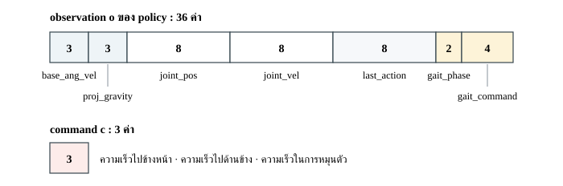

## บทที่ 5 · MDP ห้าช่อง — แบบฟอร์มของโจทย์ และสิ่งที่ Tron1 กรอก

> [!INTRO]
> บทที่ 3 บรรยายวงจรของ agent กับ environment ด้วยคำพูด คำพูดพอสำหรับคนฟัง แต่ไม่พอสำหรับอัลกอริทึม ถ้าเราจะหยิบวิธีสำเร็จรูปของวิชา RL มาใช้กับ Tron1 เราต้องเขียนโจทย์ในรูปที่วิธีเหล่านั้นรับได้
>
> รูปนั้นชื่อ Markov Decision Process ย่อว่า MDP เป็นแบบฟอร์มที่มีห้าช่อง บทนี้อธิบายทีละช่องว่าเป็นของชนิดใด แล้วเปิด config ดูว่า Tron1 กรอกแต่ละช่องด้วยอะไร เราจะได้ตัวเลขสามตัวที่ใช้ไปทั้งเล่ม คือ observation 36 ค่า action 8 ค่า และ reward 20 พจน์
>
> ของที่ต้องรู้มาก่อน: agent, environment, สถานะ, action, reward และ policy จากบทที่ 3 · การแจกแจง ขีดตั้ง และชนิดของวัตถุ 11 แบบจากบทที่ 4 · config, implementation และ manager จากบทที่ 2
>
> จบบทนี้แล้ว เรากรอกแบบฟอร์มห้าช่องของ Tron1 ได้เอง ชี้บรรทัดของ config ได้ทุกช่อง และคำนวณ reward ของหนึ่งรอบจากรายการใน config ได้ด้วยมือ

### ของที่ต้องมีก่อนเริ่ม

บทนี้ไม่มีข้อมูลตัวเลขที่ให้มาก่อน ตัวเลขทุกตัวอ่านจากไฟล์ `limx_base_env_cfg.py` ซึ่งบทที่ 2 แนะนำไว้แล้วว่าแบ่งเป็นหมวด

สัญลักษณ์ที่ใช้ในบทนี้ เรียงตามลำดับที่จะพบ ตัวห้อย $t$ อ่านว่า "ในรอบที่ $t$"

| สัญลักษณ์ | ชนิด | ความหมาย |
| --- | --- | --- |
| $\mathcal{S}$ **เซตของสถานะ** | เซต | ทุกสถานการณ์ที่หุ่นอาจอยู่ · ตัวใหญ่หมายถึงทั้งเซต |
| $s_t$ **สถานะ** ในรอบที่ $t$ | เวกเตอร์ | สมาชิกหนึ่งตัวของ $\mathcal{S}$ |
| $\mathcal{A}$ **เซตของ action** | เซต | ทุกท่าที่สั่งได้ · ของ Tron1 คือ $\mathbb{R}^8$ |
| $a_t$ **action** | เวกเตอร์ `(8,)` | สมาชิกหนึ่งตัวของ $\mathcal{A}$ |
| $P(s' \mid s, a)$ **transition** | การแจกแจง | โลกตอบสนองอย่างไร · ของ Tron1 คือตัวจำลองฟิสิกส์ |
| $R(s, a)$ **ฟังก์ชันรางวัล** | ฟังก์ชัน | กติกาที่มนุษย์เขียน ให้คะแนนแต่ละรอบ · เขียนมีวงเล็บเสมอ |
| $r_t$ **reward** ที่ได้จริง | scalar | คะแนนของรอบเดียว รู้ทันที |
| $\gamma$ **discount** | ค่าคงที่ | อนาคตหนึ่งก้าวถัดไปมีค่ากี่เปอร์เซ็นต์ของตอนนี้ · ของ Tron1 คือ 0.99 |
| $o$ **observation** ของ policy | เวกเตอร์ `(36,)` | สิ่งที่เซนเซอร์ให้ |
| $c$ **commands** | เวกเตอร์ `(3,)` | ความเร็วเป้าหมาย $(v_x, v_y, \omega_z)$ |
| $\pi$ **policy** | ฟังก์ชัน | กฎเลือก action จากสถานะ เป็นคำตอบ ไม่ใช่โจทย์ |

`(8,)` คือ shape ของ tensor อ่านว่ามีตัวเลข 8 ตัวเรียงเป็นแถวเดียว ส่วน $\mathbb{R}^8$ คือเซตของรายการที่มีจำนวนจริง 8 ตัว

### ปัญหา: บรรยายโจทย์ด้วยคำพูด แล้วใช้เครื่องมือสำเร็จรูปไม่ได้

สมมติว่าเราอธิบายโจทย์ของ Tron1 ให้เพื่อนฟังว่า "หุ่นต้องเดินตามความเร็วที่สั่ง โดยไม่ล้ม" เพื่อนเข้าใจ แต่ประโยคนี้ยังขาดข้อมูลที่อัลกอริทึมต้องใช้ทุกข้อ หุ่นรับรู้อะไรได้บ้าง สั่งอะไรได้บ้าง สั่งแล้วเกิดอะไรขึ้น คำว่าเดินดีวัดอย่างไร และผลที่จะเกิดในอีกสิบวินาทีสำคัญเท่ากับผลตอนนี้หรือไม่

คนทำหุ่นยนต์รู้จักทางออกของปัญหารูปนี้อยู่แล้ว ถ้าไม่มีรูปแบบกลาง โปรแกรมแต่ละตัวต้องบรรยายโครงของหุ่นด้วยวิธีของตัวเอง เมื่อมี URDF เป็นรูปแบบกลาง โปรแกรมแสดงผล ตัวจำลอง และตัววางแผนการเคลื่อนที่ ก็อ่านไฟล์เดียวกันได้ MDP ทำหน้าที่เดียวกันให้กับปัญหาการตัดสินใจ

| | URDF | MDP |
| --- | --- | --- |
| เป็นอะไร | รูปแบบมาตรฐานสำหรับบรรยายโครงของหุ่น | รูปแบบมาตรฐานสำหรับบรรยายปัญหาการตัดสินใจเป็นลำดับ |
| ไม่ใช่อะไร | ไม่ใช่หุ่น ไม่ใช่ตัวควบคุม ไม่ใช่ตัวจำลอง | ไม่ใช่อัลกอริทึม ไม่ใช่วิธีแก้ ไม่ใช่สิ่งที่ต้องคำนวณ |
| ประโยชน์ | เครื่องมือที่รู้จักรูปแบบนี้ใช้กับหุ่นของเราได้ทันที | อัลกอริทึมที่รู้จักรูปแบบนี้ใช้กับโจทย์ของเราได้ทันที |
| **เทียบไม่ได้ตรงที่** | เป็นไฟล์จริงที่โปรแกรมเปิดอ่าน | เป็นรูปแบบทางคณิตศาสตร์ ไม่มีไฟล์ชื่อ MDP ในโค้ด ช่องทั้งห้ากระจายอยู่ในหลายคลาสของ config และมีหนึ่งช่องที่อยู่อีกไฟล์หนึ่ง |

### แบบฟอร์มห้าช่อง

MDP คือแบบฟอร์มที่ถามคำถามห้าข้อ คำตอบของแต่ละข้อเป็นของคนละชนิด

| ช่อง | ชนิด | คำถามที่ช่องนี้ถาม |
| --- | --- | --- |
| $\mathcal{S}$ | เซต | สถานการณ์ที่เป็นไปได้มีอะไรบ้าง |
| $\mathcal{A}$ | เซต | สั่งอะไรได้บ้าง |
| $P(s' \mid s, a)$ | การแจกแจง | เมื่ออยู่ที่สถานะ $s$ แล้วสั่ง $a$ สถานะถัดไป $s'$ จะเป็นอะไร |
| $R(s, a)$ | ฟังก์ชัน ซึ่งคืน scalar | ให้คะแนนอย่างไร |
| $\gamma$ | ค่าคงที่ | อนาคตสำคัญเท่ากับปัจจุบันหรือไม่ |

เมื่อกรอกครบห้าช่อง โจทย์ของเรา*เป็น* MDP และเครื่องมือทั้งตระกูลของ RL ใช้กับมันได้ ส่วน policy $\pi$ ไม่อยู่ในแบบฟอร์ม แบบฟอร์มคือโจทย์ ส่วน policy คือคำตอบที่เรากำลังจะไปหา

วงจรของบทที่ 3 เขียนด้วยสัญลักษณ์ของแบบฟอร์มได้ดังนี้ ในรอบที่ $t$ agent ได้รับ $s_t$ แล้วเลือก $a_t$ จากนั้น environment สุ่มสถานะถัดไปจาก $P$

$$s_{t+1} \sim P(\,\cdot \mid s_t, a_t)$$

แล้วให้ reward $r_t$ ตามกติกา $R(s, a)$ หัวข้อของช่อง $R(s, a)$ บอกว่า $r_t$ เกี่ยวกับกติกานี้อย่างไร

จุดกลมทางซ้ายของขีดตั้งคือช่องที่ยังไม่ได้เติมค่า $P(\,\cdot \mid s_t, a_t)$ จึงเป็นการแจกแจงทั้งใบ เหมือนตารางของกล่องหนึ่งใบในบทที่ 4 โดยมี $s_t$ กับ $a_t$ ทำหน้าที่เป็นเลขกล่อง

หัวข้อต่อไปนี้กรอกแบบฟอร์มของ Tron1 ทีละช่อง เราเริ่มจากช่องที่ง่ายที่สุด

### ช่อง $\mathcal{A}$: สั่งอะไรได้บ้าง

หมวด `ActionsCfg` มีรายการเดียว (`limx_base_env_cfg.py:116-121`) และรายการนั้นเลือกข้อต่อด้วย `joint_names=[".*"]` ซึ่งหมายถึงทุกข้อต่อที่ขับได้ ของรุ่น SF มี 8 ข้อ action หนึ่งตัวจึงเป็นเวกเตอร์ของตัวเลข 8 ตัว และตัวเลขแต่ละตัวเป็นจำนวนจริงค่าใดก็ได้

$$\mathcal{A} = \mathbb{R}^8, \qquad a_t \in \mathcal{A}$$

ตัวเลขใน $a_t$ ยังไม่มีหน่วย มันไม่ใช่มุมและไม่ใช่แรงบิด บรรทัด `:119-120` บอกวิธีแปลงมันเป็นมุมเป้าหมายของข้อต่อ ซึ่งเป็นเรื่องของบทที่ 15 ในบทนี้เราต้องการเพียงขนาดของมัน คือ 8

### ช่อง $\mathcal{S}$: observation 36 ค่า และ command 3 ค่า

ช่องนี้ถามว่าสถานการณ์ที่เป็นไปได้มีอะไรบ้าง ในตัวจำลอง คำตอบเต็มคือทุกอย่างที่ตัวจำลองรู้เกี่ยวกับหุ่นและโลกรอบตัว policy ไม่ได้รับทั้งหมดนั้น สิ่งที่มันได้รับมีสองก้อน และสองก้อนนี้คือสิ่งที่ policy ใช้แทนสถานะ

**ก้อนแรก observation** คือสิ่งที่ policy ได้รับเกี่ยวกับตัวหุ่น ซึ่งส่วนใหญ่มาจากเซนเซอร์ เขียนแทนด้วย $o$ กลุ่มชื่อ `PolicyCfg` (`:130-146`) มี 7 รายการ แต่ละรายการให้ตัวเลขจำนวนหนึ่ง

| รายการ | บรรทัด | ให้อะไร | จำนวนค่า |
| --- | --- | --- | --- |
| `base_ang_vel` | `:134` | ความเร็วเชิงมุมของลำตัว | 3 |
| `proj_gravity` | `:135` | ทิศของแรงโน้มถ่วงเมื่อมองจากลำตัว บอกว่าลำตัวเอียงไปทางใด | 3 |
| `joint_pos` | `:138` | มุมของข้อต่อ วัดจากท่าเริ่มต้น | 8 |
| `joint_vel` | `:139` | ความเร็วของข้อต่อ | 8 |
| `last_action` | `:142` | action ของรอบก่อนหน้า | 8 |
| `gait_phase` | `:145` | ตำแหน่งในจังหวะก้าว เขียนเป็นค่า sin กับ cos | 2 |
| `gait_command` | `:146` | จังหวะก้าวที่สั่ง คือความถี่ ระยะเหลื่อมของสองขา สัดส่วนเวลาที่เท้าแตะพื้น และความสูงของการยกเท้า | 4 |
| รวม | | | **36** |

$$3 + 3 + 8 + 8 + 8 + 2 + 4 = 36$$

สองรายการแรกมาจาก IMU สองรายการถัดมามาจากตัววัดมุมของข้อต่อ รวมเป็น 22 ค่าที่มาจากเซนเซอร์ อีก 14 ค่าไม่ได้มาจากเซนเซอร์ รายการที่ห้าเป็นของที่ agent จำไว้เอง และสองรายการสุดท้ายเป็นเรื่องของจังหวะก้าว ซึ่งคำนวณจากนาฬิกาและคำสั่ง ทุกรายการเป็นของที่หาได้บนหุ่นจริง

**ก้อนที่สอง command** คือความเร็วที่เราสั่งให้หุ่นเดิน เขียนแทนด้วย $c$ มี 3 ค่า คือความเร็วไปข้างหน้า $v_x$ ความเร็วไปด้านข้าง $v_y$ และความเร็วในการหมุนตัว $\omega_z$ ตอนเทรน environment เป็นผู้ตั้ง command ให้หุ่นแต่ละตัว และตั้งใหม่ทุก 3 ถึง 15 วินาที (`:105`) หุ่นจึงได้ฝึกเดินตามความเร็วหลายค่า

| ค่าใน $c$ | ได้มาอย่างไร | ช่วง | หน่วย |
| --- | --- | --- | --- |
| $v_x$ | สุ่มจากช่วงใน config (`velocity_command.py:127`) | −1.0 ถึง 1.0 | m/s |
| $v_y$ | สุ่มจากช่วงใน config (`:129`) | −0.3 ถึง 0.5 | m/s |
| $\omega_z$ | ถูกสุ่มเช่นกัน (`:131`) แต่ถูกเขียนทับทุกรอบด้วยค่าที่คำนวณจากผลต่างระหว่างทิศที่หุ่นหันอยู่กับทิศเป้าหมายที่สุ่มไว้ แล้วจำกัดไม่ให้ออกนอกช่วง (`:147-156`) | −1 ถึง 1 | rad/s |

ช่วงทั้งสามอยู่ที่ `limx_base_env_cfg.py:107` แถวของ $\omega_z$ ต่างจากสองแถวแรก เพราะ config เปิดตัวเลือก `heading_command` ไว้ (`:100`) และตั้งให้ใช้กับหุ่นทุกตัว (`:103`) ค่าที่สุ่มได้ของ $\omega_z$ จึงถูกเขียนทับทุกรอบ ตั้งแต่รอบที่สุ่มมา สิ่งที่มีผลคือทิศเป้าหมายที่สุ่มไว้ (`velocity_command.py:134`) โดย $\omega_z$ เท่ากับผลต่างของทิศคูณด้วยเกน 1.0 (`limx_base_env_cfg.py:101`) นอกจากนั้น ทุกครั้งที่ตั้ง command ใหม่ หุ่นแต่ละตัวมีโอกาส 2% ที่จะถูกสั่งให้ยืนนิ่ง (`:102` และ `velocity_command.py:138`) คือได้ command เป็นศูนย์ทั้งสามค่า (`:159-160`)

command ไม่ใช่ค่าจากเซนเซอร์ แต่ policy ต้องเห็นมัน เพราะหุ่นที่อยู่ในท่าเดียวกันควรทำต่างกันเมื่อถูกสั่งให้เดินหน้ากับเมื่อถูกสั่งให้หยุด เล่มนี้จึงนับ $c$ เป็นส่วนหนึ่งของสถานะ ในโค้ด $o$ กับ $c$ ถูกต่อเข้าด้วยกันก่อนส่งให้ policy (`ppo.py:137-139`)

> [!NOTE]
> บรรทัด `ppo.py:138` ต่อของสามก้อน ไม่ใช่สองก้อน ก้อนที่อยู่หน้าสุดชื่อ `encoder_out` มี 3 ค่า และเป็นเรื่องของบทที่ 21 เมื่อรวมแล้ว policy รับตัวเลข 3 + 36 + 3 = 42 ตัว ในบทนี้เรารู้ที่มาของ 39 ตัวหลัง ซึ่งเป็น $o$ กับ $c$

> [!WARNING] คำว่า command มีสองตัวในโค้ด
> หมวด `CommandsCfg` มีสองรายการ คือ `gait_command` (`limx_base_env_cfg.py:87`) ซึ่งสั่งจังหวะก้าวและมี 4 ค่า กับ `base_velocity` (`:98`) ซึ่งสั่งความเร็วและมี 3 ค่า ตัวแรกเข้าไปอยู่*ใน* observation 36 ค่าแล้ว (`:146`) ส่วนสัญลักษณ์ $c$ ของเล่มนี้หมายถึงตัวหลังเท่านั้น ซึ่งถูกส่งให้ policy เป็นกลุ่มแยกชื่อ `commands` (`:232` โดยคลาสของกลุ่มอยู่ที่ `:226-227`)

ตัวเลข 36 ค่านี้บอกสถานการณ์ของหุ่นได้ครบหรือไม่ เป็นคำถามที่แบบฟอร์มไม่ได้ถาม แต่สำคัญมาก บทที่ 6 ทั้งบทตอบคำถามนี้

### ช่อง $P(s' \mid s, a)$: สั่งแล้วเกิดอะไรขึ้น

ช่องนี้ถามว่าเมื่ออยู่ที่สถานะ $s$ แล้วสั่ง $a$ สถานะถัดไปจะเป็นอะไร สำหรับ Tron1 ไม่มีใครเขียนคำตอบเป็นสูตร คำตอบคือตัวจำลองฟิสิกส์ เราถามมันได้ด้วยวิธีเดียว คือสั่ง action เข้าไปแล้วดูว่าเกิดอะไรขึ้น

ในโค้ด การถามหนึ่งครั้งคือลูปที่ `manager_based_rl_env.py:182-189` ซึ่งเดินฟิสิกส์ 4 ก้าวย่อย ก้าวละ 0.005 วินาที รวมเป็น 0.02 วินาทีต่อหนึ่งรอบ

ช่องนี้เป็นการแจกแจง ไม่ใช่ฟังก์ชันที่คืนสถานะเดียว เพราะเมื่อมองจากฝั่ง agent สถานะถัดไปไม่ได้ถูกกำหนดตายตัว ตัวอย่างจาก config มีสองข้อ command ถูกตั้งใหม่ด้วยการสุ่มเป็นระยะ (`limx_base_env_cfg.py:105`) และค่าที่เซนเซอร์อ่านได้ถูกบวกสัญญาณรบกวนที่สุ่มขึ้น (`:134`) agent ที่อยู่ในสถานะเดียวกันและสั่ง action เดียวกันสองครั้ง จึงอาจได้สถานะถัดไปต่างกัน

| | ฟังก์ชัน | การแจกแจง $P(\,\cdot \mid s, a)$ |
| --- | --- | --- |
| รับ $s$ กับ $a$ แล้วให้ | สถานะถัดไปหนึ่งตัว เหมือนเดิมทุกครั้ง | ของที่สุ่มสถานะถัดไปออกมาได้ |
| เหมาะกับ | โลกที่ไม่มีอะไรสุ่มเลย | โลกที่ agent ไม่รู้ทุกอย่าง |

### ช่อง $R(s, a)$: ให้คะแนนอย่างไร

ช่องนี้คือกติกาที่บทที่ 3 พูดถึง หมวด `RewardsCfg` (`:368`) มี 20 รายการ บทที่ 2 แสดงไว้แล้วว่า manager คำนวณค่าของแต่ละรายการด้วยฟังก์ชัน คูณน้ำหนัก คูณ `dt` (`reward_manager.py:148`) และทิ้งคำถามไว้ว่าค่านั้นถูกนำไปทำอะไรต่อ คำตอบอยู่สองบรรทัดถัดลงมา ค่าของทุกรายการถูกบวกเข้าด้วยกัน (`:150`) ผลรวมคือ reward ของรอบนั้น

> [!KEY] reward ของหนึ่งรอบใน Isaac Lab
> $$r_t = \sum_{i=1}^{20} f_i \cdot w_i \cdot \Delta t$$
>
> | | |
> | --- | --- |
> | $f_i$ | ค่าที่ฟังก์ชันของรายการที่ $i$ คืน |
> | $w_i$ | น้ำหนักของรายการที่ $i$ จาก config |
> | $\Delta t$ | เวลาของหนึ่งรอบ คือ 0.02 วินาที |

สมการนี้บอกว่า reward ของหนึ่งรอบเป็นตัวเลขตัวเดียวที่รวมมาจาก 20 พจน์ แต่ละพจน์คือความเห็นของกติกาหนึ่งข้อ พจน์ที่ผลคูณ $f_i \cdot w_i$ เป็นบวกให้คะแนน พจน์ที่ผลคูณเป็นลบหักคะแนน

การคูณด้วย $\Delta t$ ทำให้น้ำหนักอ่านได้เป็นคะแนนต่อวินาที รายการ `keep_balance` ใช้ฟังก์ชันชื่อ `stay_alive` (`limx_base_env_cfg.py:372-375`) ซึ่งคืนค่า 1 เสมอ (`rewards.py:23-25`) และมีน้ำหนัก 1.0 จึงให้ 0.02 คะแนนต่อรอบ เมื่อผ่านไป 50 รอบ คือหนึ่งวินาที มันให้รวม 1.0 คะแนนพอดี

รายการทั้ง 20 แบ่งตามเครื่องหมายของน้ำหนักได้สองกลุ่ม คือน้ำหนักเป็นบวก 5 รายการ และน้ำหนักเป็นลบ 15 รายการ

| กลุ่ม | จำนวน | รายการ (น้ำหนัก) |
| --- | --- | --- |
| น้ำหนักเป็นบวก | 5 | `keep_balance` (1.0) · `rew_lin_vel_xy` (2.5) · `rew_ang_vel_z` (1.0) · `rew_keep_ankle_pitch_zero_in_air` (0.5) · `test_gait_reward` (1.0) |
| น้ำหนักเป็นลบ เรื่องท่าทางของลำตัว | 5 | `pen_base_height` (−50) · `pen_lin_vel_z` (−10) · `pen_ang_vel_xy` (−0.05) · `pen_flat_orientation` (−5.0) · `pen_feet_distance` (−100) |
| น้ำหนักเป็นลบ เรื่องความราบรื่นของ action | 2 | `pen_action_rate` (−0.5) · `pen_action_smoothness` (−0.15) |
| น้ำหนักเป็นลบ เรื่องแรงและพลังงานของข้อต่อ | 4 | `pen_joint_torque` (−8e-5) · `pen_joint_accel` (−1e-6) · `pen_joint_power_l1` (−2e-5) · `pen_joint_vel_l2` (−5e-5) |
| น้ำหนักเป็นลบ เรื่องขีดจำกัดและการสัมผัส | 4 | `pen_joint_pos_limits` (−2.0) · `pen_undesired_contacts` (−0.5) · `pen_feet_regulation` (−0.2) · `pen_foot_landing_vel` (−0.15) |

การแบ่งกลุ่มย่อยของรายการที่น้ำหนักเป็นลบเป็นการจัดของเล่มนี้เพื่อให้อ่านง่าย ในโค้ดมีเพียงรายการ 20 รายการเรียงกัน

> [!WARNING] น้ำหนักเป็นบวกไม่ได้แปลว่าให้คะแนนเสมอ
> รายการ `test_gait_reward` มีน้ำหนัก +1.0 แต่ config ตั้งตัวคูณภายในของมันไว้ที่ −2.0 ทั้งสองตัว (`limx_base_env_cfg.py:434-435`) ฟังก์ชันของมันจึงคืนค่าที่ไม่เกินศูนย์เสมอ (`rewards.py:466` และ `:478`) รายการนี้หักคะแนนเมื่อเท้าไม่ทำตามจังหวะก้าวที่สั่ง และให้ได้มากที่สุดคือศูนย์ จะรู้ว่ารายการหนึ่งให้หรือหักคะแนน ต้องดูเครื่องหมายของค่าที่ฟังก์ชันคืนคู่กับเครื่องหมายของน้ำหนัก

น้ำหนักต่างกันได้มาก รายการ `rew_lin_vel_xy` มีน้ำหนักเป็น 125,000 เท่าของขนาดน้ำหนักของ `pen_joint_power_l1` แต่ขนาดของน้ำหนักอย่างเดียวบอกไม่ได้ว่ารายการใดมีผลมากกว่า เพราะค่าที่ฟังก์ชันคืนก็มีขนาดต่างกัน

> [!EXAMPLE] ในรอบหนึ่ง ความเร็วของลำตัวต่างจาก command อยู่ 0.5 m/s จงหาส่วนของ reward ที่มาจาก `keep_balance` และ `rew_lin_vel_xy`
> ขั้นที่ 1 รายการ `keep_balance` ฟังก์ชันคืน 1 น้ำหนัก 1.0
>
> $$1 \times 1.0 \times 0.02 = 0.0200$$
>
> ขั้นที่ 2 รายการ `rew_lin_vel_xy` ฟังก์ชันคือ `track_lin_vel_xy_exp` ของ Isaac Lab (`IsaacLab/.../rewards.py:294-298`) ซึ่งเอาผลต่างของความเร็วมายกกำลังสอง หารด้วยกำลังสองของพารามิเตอร์ `std` แล้วใส่ใน $e$ ยกกำลังติดลบ config ตั้งกำลังสองของ `std` ไว้ที่ 0.25 (`limx_base_env_cfg.py:379`)
>
> $$f = e^{-0.5^2 / 0.25} = e^{-1} = 0.3679$$
>
> ขั้นที่ 3 คูณน้ำหนัก 2.5 และ $\Delta t$
>
> $$0.3679 \times 2.5 \times 0.02 = 0.0184$$
>
> ขั้นที่ 4 รวมสองพจน์
>
> $$0.0200 + 0.0184 = 0.0384$$
>
> reward จริงของรอบนั้นคือเลขนี้บวกกับอีก 18 พจน์ที่เหลือ ซึ่งต้องรู้ท่าของหุ่นจึงจะคำนวณได้

ตัวอย่างนี้แสดงเรื่องสำคัญสองข้อ ข้อแรก ฟังก์ชันของ `rew_lin_vel_xy` ต้องใช้ command สัญลักษณ์ $R(s, a)$ จึงถูกต้องก็เพราะเรานับ $c$ เป็นส่วนหนึ่งของ $s$ ข้อที่สอง ฟังก์ชันเดียวกันใช้ความเร็วจริงของลำตัว ซึ่งไม่อยู่ใน observation 36 ค่า ตัว $s$ ในวงเล็บของ $R(s, a)$ จึงหมายถึงสถานะเต็มที่ตัวจำลองรู้ ไม่ใช่เพียงสิ่งที่ policy ได้รับ ช่องว่างระหว่างสองอย่างนี้คือเรื่องของบทที่ 6

| | $R(s, a)$ | $r_t$ |
| --- | --- | --- |
| ชนิด | ฟังก์ชัน | scalar |
| คืออะไร | กติกา 20 ข้อ ที่มนุษย์เขียนไว้ใน config | ตัวเลขที่กติกาให้ออกมาในรอบที่ $t$ เป็นผลของการใช้กติกาหนึ่งครั้ง |
| เปลี่ยนระหว่างเทรนหรือไม่ | ไม่เปลี่ยน | เปลี่ยนทุกรอบ |
| ในโค้ด | หมวด `RewardsCfg` กับ `reward_manager.py:148-150` | ค่าที่ `env.step` คืนมาในชื่อ `rewards` (`on_policy_runner.py:177`) |

> [!REMARK]
> วงเล็บ $(s, a)$ บอกว่า reward ขึ้นกับสถานะและ action เมื่อเปิดดูรายการใน config ของที่ฟังก์ชันใช้มีอย่างน้อยสี่แบบ แบบแรกคือสภาพของหุ่น*หลัง*ฟิสิกส์เดินแล้ว เพราะ `env.step` เดินฟิสิกส์ก่อน (`manager_based_rl_env.py:189`) แล้วจึงคำนวณ reward (`:207`) แบบที่สองคือ action โดยตรง เช่น `pen_action_rate` ใช้ผลต่างของ action รอบนี้กับรอบก่อน (`IsaacLab/.../rewards.py:247`) แบบที่สามคือ command ดังในตัวอย่าง แบบที่สี่คือไม่ใช้อะไรเลย คือ `keep_balance` รูปเต็มในตำราจึงเป็น $R(s_t, a_t, s_{t+1})$ และย่อเป็น $R(s, a)$ ได้ด้วยการเฉลี่ยเหนือ $s_{t+1}$ ที่สุ่มจาก $P$ ตัวเลข $r_t$ ที่ได้จริงในรอบหนึ่งจึงเป็นค่าหนึ่งค่าที่มีค่าเฉลี่ยเป็น $R(s_t, a_t)$ ไม่จำเป็นต้องเท่ากับมันพอดี ส่วนรายการ `pen_action_smoothness` ใช้ action ย้อนหลังถึงสองรอบ (`rewards.py:523`) ซึ่งเป็นข้อยกเว้นเล็กน้อยที่ทำให้ reward ขึ้นกับอดีตด้วย

### ช่อง $\gamma$: อนาคตสำคัญแค่ไหน

ช่องสุดท้ายเป็นตัวเลขตัวเดียว ระหว่าง 0 กับ 1 ซึ่งบอกว่า reward ที่จะได้ในรอบถัดไปมีค่ากี่เปอร์เซ็นต์ของ reward ที่ได้ในรอบนี้ Tron1 ใช้ 0.99

ช่องนี้ต่างจากอีกสี่ช่องตรงที่อยู่ มันไม่อยู่ใน config ของงานเทรน แต่อยู่ใน config ของวิธีเทรน คือ `gamma` ที่ `limx_rsl_rl_ppo_cfg.py:102` ทั้งที่ตามแบบฟอร์มแล้วมันเป็นส่วนหนึ่งของโจทย์ ในบทนี้เราจดไว้เพียงว่าช่องนี้มีค่าเท่าไรและอยู่ที่ไหน บทที่ 8 ใช้มันรวมคะแนนของหลายรอบ และอธิบายว่าทำไมต้องมี

### แบบฟอร์มของ Tron1 ทั้งใบ และโจทย์ที่ไม่ใช่ MDP

| ช่อง | ชนิด | Tron1 กรอกว่า | อ่านจาก |
| --- | --- | --- | --- |
| $\mathcal{S}$ | เซต | สถานะเต็มของโลกจำลอง ซึ่ง policy ได้รับเพียง observation 36 ค่า กับ command 3 ค่า และอีก 3 ค่าที่บทที่ 21 อธิบาย เป็นจำนวนจริงทั้งหมด | `PolicyCfg` `limx_base_env_cfg.py:130-146` · `CommandsCfg` `:84` |
| $\mathcal{A}$ | เซต | $\mathbb{R}^8$ คือตัวเลขหนึ่งตัวต่อข้อต่อ | `ActionsCfg` `:113` |
| $P(s' \mid s, a)$ | การแจกแจง | ตัวจำลองฟิสิกส์ เดิน 4 ก้าวย่อยต่อรอบ | `decimation` `:497` · `sim.dt` `:501` |
| $R(s, a)$ | ฟังก์ชัน | ผลรวมของ 20 พจน์ | `RewardsCfg` `limx_base_env_cfg.py:368` |
| $\gamma$ | ค่าคงที่ | 0.99 | `gamma` `limx_rsl_rl_ppo_cfg.py:102` |

การเทียบกับโจทย์ที่กรอกแบบฟอร์มไม่ครบ ช่วยให้เห็นว่าแต่ละช่องมีไว้ทำไม

| โจทย์ | เป็น MDP หรือไม่ | เหตุผล |
| --- | --- | --- |
| จำแนกรูปว่าเป็นแมวหรือสุนัข | ไม่เป็น | ไม่มีลำดับเวลา ทายรูปนี้เสร็จก็จบ ไม่มีผลต่อรูปถัดไป |
| เครื่องสล็อตที่มีคันโยกหลายคัน | เกือบเป็น | มี $\mathcal{A}$ กับ $R(s, a)$ แต่ไม่มี $\mathcal{S}$ และ $P$ เพราะดึงคันโยกแล้วเครื่องไม่เปลี่ยนสถานะ action จึงไม่มีผลระยะยาว |
| Tron1 เดิน | เป็น | ครบทุกช่อง และทั้ง $\mathcal{S}$ กับ $\mathcal{A}$ เป็นแบบต่อเนื่อง คือเป็นจำนวนจริง นับจำนวนสมาชิกไม่ได้ |

แถวของเครื่องสล็อตบอกว่าทำไมหุ่นเดินจึงยากกว่า การก้าวขาครั้งนี้เปลี่ยนท่าของก้าวถัดไปเสมอ action ทุกตัวจึงมีผลระยะยาวผ่านช่อง $P$ ส่วนคำว่าต่อเนื่องในแถวสุดท้ายจะกลับมามีความสำคัญในบทที่ 16 ซึ่งแสดงว่าวิธีรุ่นแรกของ RL ใช้ไม่ได้เมื่อ $\mathcal{S}$ และ $\mathcal{A}$ เป็นแบบนี้

### จากแบบฟอร์มถึงโค้ด

ทุกช่องของแบบฟอร์มมีทั้งที่ที่ถูกตั้งค่า และที่ที่ถูกใช้งานในแต่ละรอบ

| ช่อง | ตั้งค่าที่ | ใช้งานที่ |
| --- | --- | --- |
| $\mathcal{A}$ | `limx_base_env_cfg.py:116-121` | `manager_based_rl_env.py:173` รับ action เข้ามา |
| $P(s' \mid s, a)$ | `limx_base_env_cfg.py:497` และ `:501` | `manager_based_rl_env.py:182-189` เรียก `sim.step` 4 ครั้ง |
| $R(s, a)$ | `limx_base_env_cfg.py:368` เป็นต้นไป | `reward_manager.py:148-150` บวกค่าของทุกรายการ |
| $\mathcal{S}$ | `limx_base_env_cfg.py:130-146` และ `:226-227` | `manager_based_rl_env.py:239` อ่าน observation |
| $\gamma$ | `limx_rsl_rl_ppo_cfg.py:102` | บทที่ 17 และ 22 |

บรรทัดที่ใช้งานของสี่ช่องแรกอยู่ในโค้ดของ Isaac Lab ที่ฟังก์ชัน `step` ทำเองหรือเรียกใช้ทั้งหมด ซึ่งตรงกับบทที่ 3 ที่ว่าช่องเหล่านี้เป็นของฝั่ง environment ส่วน $\gamma$ ถูกใช้โดยฝั่ง agent

> [!SUMMARY]
> - MDP คือแบบฟอร์มสำหรับบรรยายโจทย์ ไม่ใช่วิธีแก้ มีห้าช่อง คือ $\mathcal{S}$, $\mathcal{A}$, $P(s' \mid s, a)$, $R(s, a)$ และ $\gamma$ และ policy ไม่อยู่ในแบบฟอร์ม
> - ห้าช่องเป็นของคนละชนิด สองช่องแรกเป็นเซต $P(s' \mid s, a)$ เป็นการแจกแจง $R(s, a)$ เป็นฟังก์ชัน และ $\gamma$ เป็นค่าคงที่
> - Tron1 ใช้ observation 36 ค่า กับ command 3 ค่า และ action 8 ค่า
> - reward ของหนึ่งรอบคือผลรวมของ 20 พจน์ แต่ละพจน์คือค่าของฟังก์ชัน คูณน้ำหนัก คูณ 0.02
> - $R(s, a)$ เป็นกติกา ส่วน $r_t$ เป็นตัวเลขที่กติกาให้ออกมาในรอบหนึ่ง
>
> ประโยคที่ควรจำ: **MDP คือแบบฟอร์มห้าช่องของโจทย์ ช่องทั้งห้าเป็นของฝั่ง environment หรือของผู้ออกแบบ ส่วน policy เป็นคำตอบที่อยู่นอกแบบฟอร์ม**

### แบบฝึกหัด

1. ข้อใดถูกต้อง
    1. MDP เป็นอัลกอริทึมสำหรับเทรนหุ่น
    2. policy เป็นช่องหนึ่งของแบบฟอร์ม MDP
    3. $\mathcal{A}$ ของ Tron1 รุ่น SF คือ $\mathbb{R}^8$
    4. $P(s' \mid s, a)$ เป็นการแจกแจง
    5. $R(s, a)$ กับ $r_t$ เป็นของชนิดเดียวกัน
    6. observation ของ policy มี 36 ค่า
    7. สัญลักษณ์ $c$ ของเล่มนี้มี 4 ค่า
    8. ค่าที่ฟังก์ชันของแต่ละรายการคืน ถูกคูณด้วยน้ำหนักและ 0.02 ก่อนรวมเป็น reward
    9. $\gamma$ ถูกตั้งไว้ในไฟล์ `limx_base_env_cfg.py`
    10. โจทย์จำแนกรูปเป็น MDP

2. ถ้าตัดรายการ `last_action` ออกจาก `PolicyCfg` observation จะเหลือกี่ค่า [limx_base_env_cfg.py:130-146] <!--space:10-->

3. จงหาส่วนของ reward ที่มาจาก `keep_balance` และ `rew_lin_vel_xy` รวมกัน เมื่อความเร็วของลำตัวต่างจาก command เท่ากับ [03]
    1. 0 m/s
    2. 1.0 m/s

    <!--space:26-->

4. ในรอบหนึ่ง action ของข้อต่อหนึ่งข้อต่างจากรอบก่อน 0.2 และอีก 7 ข้อเท่าเดิม ฟังก์ชันของ `pen_action_rate` คืนผลรวมของกำลังสองของผลต่างทั้ง 8 ข้อ จงหาค่าที่รายการนี้เพิ่มให้ reward ของรอบนั้น [limx_base_env_cfg.py:395] <!--space:16-->

5. จงเปิดหมวด `RewardsCfg` แล้วตอบ [limx_base_env_cfg.py:368]
    1. รายการใดมีขนาดของน้ำหนักมากที่สุด
    2. รายการใดมีขนาดของน้ำหนักน้อยที่สุด
    3. รายการที่น้ำหนักเป็นบวกมีผลรวมของน้ำหนักเท่าไร

    <!--space:10-->

6. จงเปิด `ppo.py:138` แล้วบอกว่าของสามก้อนที่ถูกต่อกันมีขนาดเท่าไรบ้าง และรวมเป็นเท่าไร [ppo.py:137-139] <!--space:10-->

7. รายการ `gait_command` ใน observation มี 4 ค่า จงเปิด `gait_command.py:63-69` แล้วบอกว่าแต่ละค่าคืออะไร [gait_command.py:63] <!--space:12-->

8. จงอธิบายว่าเหตุใดช่อง $P$ จึงเป็นการแจกแจง ไม่ใช่ฟังก์ชันที่คืนสถานะถัดไปตัวเดียว <!--space:14-->

9. จงอธิบายว่าเหตุใดเครื่องสล็อตจึงไม่ต้องมีช่อง $P$ และเหตุใดหุ่นเดินจึงต้องมี [05 §1.2] <!--space:14-->

10. เพื่อนคนหนึ่งบอกว่า "URDF คือหุ่น และ MDP คือวิธีเทรน" จงแก้ประโยคนี้ให้ถูก และบอกหนึ่งจุดที่การเทียบ MDP กับ URDF ใช้ไม่ได้ <!--space:16-->

<!-- เฉลย -->

1. ข้อที่ถูก: 3, 4, 6, 8

    - ข้อ 1 ผิด: MDP เป็นแบบฟอร์มของโจทย์ ไม่ใช่วิธีแก้
    - ข้อ 2 ผิด: policy เป็นคำตอบ อยู่นอกแบบฟอร์ม
    - ข้อ 5 ผิด: $R(s, a)$ เป็นฟังก์ชัน ส่วน $r_t$ เป็น scalar
    - ข้อ 7 ผิด: $c$ คือ command ของความเร็ว มี 3 ค่า ส่วน 4 ค่าเป็นของ `gait_command`
    - ข้อ 9 ผิด: อยู่ที่ `limx_rsl_rl_ppo_cfg.py:102`
    - ข้อ 10 ผิด: ไม่มีลำดับเวลา

2. 36 − 8 = 28 ค่า

3. ส่วนของ reward จากสองรายการ

    1. ฟังก์ชันคืน $e^{0} = 1$ จึงได้ $0.0200 + 1 \times 2.5 \times 0.02 = 0.0700$
    2. ฟังก์ชันคืน $e^{-1.0^2/0.25} = e^{-4} = 0.0183$ จึงได้ $0.0200 + 0.0183 \times 2.5 \times 0.02 = 0.0209$

4. ฟังก์ชันคืน $0.2^2 = 0.04$ น้ำหนักคือ −0.5 จึงได้ $0.04 \times (-0.5) \times 0.02 = -0.0004$

5. จากหมวด `RewardsCfg`

    1. `pen_feet_distance` น้ำหนัก −100 (`:408-412`)
    2. `pen_joint_accel` น้ำหนัก −1e-6 (`:394`)
    3. 1.0 + 2.5 + 1.0 + 0.5 + 1.0 = 6.0

6. `encoder_out` มี 3 ค่า `obs` มี 36 ค่า และ `commands` มี 3 ค่า รวม 42 ค่า

7. ค่าที่ 0 คือความถี่ของการก้าว ค่าที่ 1 คือระยะเหลื่อมของจังหวะระหว่างสองขา ค่าที่ 2 คือสัดส่วนเวลาที่เท้าแตะพื้น และค่าที่ 3 คือความสูงของการยกเท้า ค่าที่ 3 อยู่ใน observation แต่ฟังก์ชันให้คะแนนเรื่องจังหวะก้าวอ่านเพียงสามค่าแรก (`rewards.py:413-418`)

8. เมื่อมองจากฝั่ง agent สถานะถัดไปไม่ได้ถูกกำหนดตายตัวจาก $s$ กับ $a$ เช่น command ถูกตั้งใหม่ด้วยการสุ่มเป็นระยะ และค่าจากเซนเซอร์มีสัญญาณรบกวนที่สุ่มขึ้น สถานะเดียวกันกับ action เดียวกันจึงนำไปสู่สถานะถัดไปได้หลายแบบ ของที่บรรยายสิ่งนี้ได้คือการแจกแจง

9. ดึงคันโยกแล้วเครื่องไม่เปลี่ยนสถานะ การดึงครั้งนี้จึงไม่มีผลต่อครั้งถัดไป ไม่มีอะไรให้ช่อง $P$ บรรยาย ส่วนหุ่นเดิน การก้าวขาครั้งนี้เปลี่ยนท่าของก้าวถัดไปเสมอ จึงต้องมีช่อง $P$ บอกว่าท่าเปลี่ยนอย่างไร

10. URDF เป็นรูปแบบสำหรับบรรยายโครงของหุ่น ไม่ใช่ตัวหุ่น และ MDP เป็นรูปแบบสำหรับบรรยายโจทย์ ไม่ใช่วิธีเทรน จุดที่เทียบไม่ได้คือ URDF เป็นไฟล์จริงที่โปรแกรมเปิดอ่าน ส่วน MDP เป็นรูปแบบทางคณิตศาสตร์ ไม่มีไฟล์ชื่อ MDP ช่องทั้งห้ากระจายอยู่ในหลายคลาสของ config
