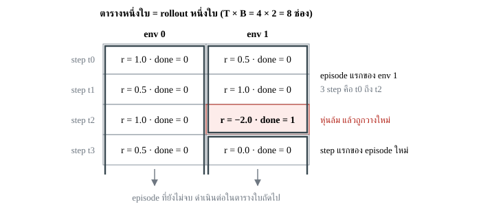

## บทที่ 7 · step episode และตารางหนึ่งใบ — หน่วยนับของข้อมูล

> [!INTRO]
> ตอนเทรน หุ่นจำลองหลายพันตัวเดินพร้อมกัน บางตัวเพิ่งเริ่มยืน บางตัวเดินมาแล้วสิบวินาที บางตัวเพิ่งล้มและถูกวางใหม่ ถ้าเราจะเก็บข้อมูลจากหุ่นทั้งหมดนี้ไปใช้ปรับ policy เราต้องตอบให้ได้ก่อนว่าเก็บเป็นหน่วยอะไร และหยุดเก็บเมื่อไร
>
> บทนี้ตั้งชื่อให้หน่วยนับห้าหน่วย คือ step, episode, transition, rollout และ iteration พร้อมธงชื่อ done ที่บอกว่า episode จบ แล้วเปิดตารางตัวอย่างประจำเล่ม ขนาด 2 env × 4 step ซึ่งเป็นที่มาของตัวเลขในทุกบทหลังจากนี้
>
> ของที่ต้องรู้มาก่อน: วงจรของ agent กับ environment จากบทที่ 3 · สถานะ action และ reward ในรูปสัญลักษณ์จากบทที่ 5 · ตัวแปร `env` ในโค้ดจากบทที่ 2
>
> จบบทนี้แล้ว เราอ่านตารางตัวอย่างออกว่าช่องใดอยู่ใน episode ใด นับได้ว่าตารางของ Tron1 หนึ่งใบมีกี่ช่อง และบอกได้ว่าคำว่า env ในประโยคหนึ่งหมายถึงความหมายใด

### ของที่ต้องมีก่อนเริ่ม

ตัวเลขจาก config ที่บทนี้ใช้

| ชื่อใน config | ค่า | อ่านจาก |
| --- | --- | --- |
| `decimation` · `sim.dt` | 4 · 0.005 วินาที | `limx_base_env_cfg.py:497` · `:501` |
| `episode_length_s` | 20.0 วินาที | `:498` |
| `num_steps_per_env` | 24 | `limx_rsl_rl_ppo_cfg.py:81` |
| `max_iterations` | 15,000 | `:82` |
| `num_envs` | 4096 เป็นค่าปริยาย (`limx_base_env_cfg.py:484`) · เล่มนี้เทรนด้วย 2048 ซึ่งพิมพ์ในคำสั่งว่า `--num_envs 2048` ตามไฟล์ `README.md` ของโฟลเดอร์ `study_tron1/` | |

คำที่บทนี้สอน เรียงจากหน่วยเล็กไปหน่วยใหญ่

| คำ | ชนิด | ความหมาย |
| --- | --- | --- |
| **step** | หน่วยนับ | หนึ่งรอบการตัดสินใจ 0.02 วินาที คือ 50 ครั้งต่อวินาที ข้างในมีฟิสิกส์ 4 ก้าวย่อย |
| **env** · $B$ | หน่วยนับ | หุ่นจำลองหนึ่งตัว · $B$ คือจำนวนที่รันขนานกัน เท่ากับจำนวนคอลัมน์ของตาราง |
| **episode** | หน่วยนับ | ช่วงต่อเนื่องของ step ใน env เดียว จนกว่าจะ done |
| **done** | เวกเตอร์ `(B,)` | ธง 1 หรือ 0 ว่า step นี้เป็น step สุดท้ายของ episode หรือไม่ |
| **termination** กับ **truncation** | แนวคิด | สองสาเหตุของ done · termination คือล้ม อนาคตถูกตัดจริง · truncation คือหมดเวลา อนาคตยังมี เราเพียงหยุดดู |
| **transition** | หน่วยนับ | ของที่หนึ่ง step ทิ้งไว้ในตาราง |
| $T$ **จำนวน step ต่อ env** | หน่วยนับ | จำนวนแถวของตาราง คือเก็บกี่ step ต่อ env ก่อนเรียนรู้หนึ่งครั้ง |
| **rollout** | หน่วยนับ | ตารางเต็มหนึ่งใบ คือ $T \times B$ transition ที่เก็บก่อนเรียนรู้ |
| **iteration** | หน่วยนับ | เก็บ rollout แล้วเรียนรู้ แล้วล้างตาราง แล้วเริ่มใหม่ |

สิ่งที่บทที่ 3 ถึง 6 เรียกว่า*รอบ* คือ step ตั้งแต่บทนี้เราใช้คำว่า step

### ปัญหา: จะหยุดเก็บข้อมูลเมื่อไร

agent เรียนจากประสบการณ์ จึงต้องเก็บประสบการณ์ไว้จำนวนหนึ่งก่อน แล้วจึงปรับ policy คำถามคือเก็บเท่าไร

วิธีที่ตรงที่สุดคือเก็บจนหุ่นเดินจบหนึ่งเที่ยว คือตั้งแต่ถูกวางลงจนล้มหรือหมดเวลา แล้วจึงเรียนรู้ วิธีนี้ติดสามข้อเมื่อมีหุ่นหลายพันตัว

| ข้อที่ติด | รายละเอียด |
| --- | --- |
| หนึ่งเที่ยวยาวได้มาก | หุ่นที่ไม่ล้มเดินได้ถึง 20 วินาที ซึ่งเท่ากับ 1000 step ระหว่างนั้น policy ไม่ได้ถูกปรับเลย |
| แต่ละตัวจบไม่พร้อมกัน | บางตัวล้มตั้งแต่ step ที่ 3 บางตัวเดินครบ ตัวที่จบก่อนต้องรอตัวที่จบทีหลัง |
| ขนาดของข้อมูลไม่แน่นอน | จำนวน step ที่ได้ในแต่ละครั้งไม่เท่ากัน โค้ดจองหน่วยความจำล่วงหน้าไม่ได้ |

โค้ดของ Tron1 จึงไม่รอให้ใครเดินจบ มันเก็บจำนวน step คงที่จากหุ่นทุกตัวพร้อมกัน ลงในตารางขนาดคงที่ แล้วเรียนรู้จากตารางนั้น หุ่นตัวใดจะจบเที่ยวตรงไหนของตารางก็ได้ เมื่อทำเช่นนี้ เราต้องมีหน่วยนับสองชุดที่ไม่ขึ้นต่อกัน ชุดหนึ่งนับตามการเดินของหุ่น อีกชุดหนึ่งนับตามตาราง

### step: หนึ่งรอบของวงจร

**step** คือหนึ่งรอบของวงจรในบทที่ 3 ตั้งแต่ agent ได้รับสถานะ จนได้ reward ของ action ที่สั่งไป ในโค้ดคือ `alg.act` ตามด้วย `env.step` (`on_policy_runner.py:175-177`)

$$4 \times 0.005 = 0.02 \ \text{s}, \qquad \frac{1}{0.02} = 50 \ \text{Hz}$$

ภายในหนึ่ง step ฟิสิกส์เดิน 4 ก้าวย่อย แต่ policy ตัดสินใจครั้งเดียว และ action ตัวเดิมถูกใช้ตลอดทั้ง 4 ก้าวย่อย (`manager_based_rl_env.py:182-189`)

> [!WARNING] คำว่า step มีหลายตัวในโค้ด
> | เขียนว่า | หมายถึง | ใช้เวลา |
> | --- | --- | --- |
> | step ในเล่มนี้ | หนึ่งรอบการตัดสินใจของ policy | 0.02 วินาที |
> | `env.step()` | ฟังก์ชันที่ทำให้ environment เดินหนึ่ง step | เรียกหนึ่งครั้งต่อ step |
> | `sim.step()` | ฟิสิกส์เดินหนึ่งก้าวย่อย | 0.005 วินาที เรียก 4 ครั้งต่อ step |
>
> บทที่ 25 จะพบ `optimizer.step()` อีกตัวหนึ่ง ซึ่งไม่เกี่ยวกับเวลาเลย เมื่อเล่มนี้เขียนคำว่า step โดยไม่มีวงเล็บ หมายถึงแถวแรกเสมอ

### episode และ done

**episode** คือช่วงต่อเนื่องของ step ของหุ่นหนึ่งตัว เริ่มเมื่อหุ่นถูกวางลงในท่าเริ่มต้น และจบเมื่อ environment ตัดสินว่าต้องเริ่มใหม่ ถ้าเทียบ step กับภาพหนึ่งเฟรม episode ก็คือภาพยนตร์ทั้งเรื่อง การเทียบนี้ใช้ได้กับขนาดของหน่วยเท่านั้น ภาพยนตร์มีความยาวตายตัว ส่วน episode จะจบเมื่อใดไม่มีใครรู้ล่วงหน้า

environment บอกว่า episode จบด้วยธงชื่อ **done** ซึ่งมีค่า 1 ที่ step สุดท้ายของ episode และมีค่า 0 ที่ step อื่น หมวด `TerminationsCfg` กำหนดเหตุที่ทำให้ done เป็น 1 ไว้สองข้อ

| รายการใน config | บรรทัด | เกิดเมื่อ | ชื่อของสาเหตุ | อนาคตของหุ่น |
| --- | --- | --- | --- | --- |
| `base_contact` | `limx_base_env_cfg.py:451-454` | ลำตัวของหุ่นแตะพื้นด้วยแรงเกินค่าที่ตั้งไว้ คือหุ่นล้ม | **termination** | ถูกตัดจริง หุ่นที่ล้มแล้วเดินต่อไม่ได้ |
| `time_out` | `:450` | เดินครบเวลาสูงสุดของ episode โดยไม่ล้ม | **truncation** | ยังมี หุ่นเดินต่อได้ เราเพียงหยุดดู |

> [!EXAMPLE] episode ของ Tron1 ยาวได้สูงสุดกี่ step
> config ตั้งเวลาสูงสุดไว้ 20.0 วินาที (`:498`) และหนึ่ง step กินเวลา 0.02 วินาที โค้ดคำนวณจำนวน step สูงสุดด้วยการหารแล้วปัดขึ้น (`manager_based_rl_env.py:101-103`)
>
> $$\frac{20.0}{0.02} = 1000$$
>
> ฟังก์ชัน `time_out` ของ Isaac Lab คืนค่าจริงเมื่อตัวนับ step ของ episode ไปถึง 1000 (`IsaacLab/.../envs/mdp/terminations.py:30-32`)

สองสาเหตุนี้ให้ธง done เป็น 1 เหมือนกัน แต่มีความหมายต่างกัน หุ่นที่ล้มไม่มีอนาคตใน episode นั้นแล้ว ส่วนหุ่นที่หมดเวลายังเดินได้ดีและน่าจะเก็บ reward ต่อได้อีก ถ้าอัลกอริทึมมองสองกรณีนี้เหมือนกัน มันจะเข้าใจว่าการเดินครบ 20 วินาทีแย่พอ ๆ กับการล้ม โค้ดจึงส่งข้อมูลออกมาสองเส้น

| ตัวแปร | บรรทัด | มีค่า 1 เมื่อ |
| --- | --- | --- |
| `dones` | `vecenv_wrapper.py:178` | ล้ม หรือหมดเวลา |
| `time_outs` | `:185` | หมดเวลาเท่านั้น |

บทนี้ใช้เพียง `dones` ส่วน `time_outs` ถูกใช้ในบทที่ 22 ซึ่งแสดงว่าอัลกอริทึมปฏิบัติต่อสองสาเหตุต่างกันอย่างไร

ลำดับของงานภายใน `env.step` หนึ่งครั้งอธิบายได้ว่าเกิดอะไรขึ้นที่ step ซึ่ง done เป็น 1

| ลำดับ | สิ่งที่ทำ | บรรทัด |
| --- | --- | --- |
| 1 | รับ action เข้ามา | `manager_based_rl_env.py:173` |
| 2 | เดินฟิสิกส์ 4 ก้าวย่อยด้วย action นั้น | `:182-189` |
| 3 | เพิ่มตัวนับ step ของ episode ของหุ่นแต่ละตัว | `:200` |
| 4 | ตรวจว่าหุ่นตัวใดล้มหรือหมดเวลา | `:203-205` |
| 5 | คำนวณ reward | `:207` |
| 6 | วางหุ่นที่ done กลับสู่ท่าเริ่มต้น | `:215-220` |
| 7 | ปรับ command สำหรับ step ถัดไป | `:233` |
| 8 | อ่าน observation | `:239` |

ลำดับที่ 5 มาก่อนลำดับที่ 6 reward ของ step ที่หุ่นล้มจึงคำนวณจากท่าที่ล้ม ส่วนลำดับที่ 8 มาหลังลำดับที่ 6 observation ที่ agent ได้รับกลับมาจาก step นั้นจึงเป็นของท่ายืนใหม่แล้ว step ถัดไปของหุ่นตัวนั้นเป็น step แรกของ episode ใหม่ โดย agent ไม่ต้องทำอะไรเป็นพิเศษ

### env สองความหมาย

บทที่ 2 เตือนไว้ว่าคำว่า env จะมีสองความหมาย ตอนนี้เราแยกได้ครบ

| | `env` ในโค้ด | env ในเล่มนี้ |
| --- | --- | --- |
| หมายถึง | อ็อบเจกต์ของงานเทรนทั้งงาน ซึ่งถือหุ่นจำลองทุกตัวไว้ | หุ่นจำลองหนึ่งตัว |
| มีกี่ตัว | หนึ่งตัวต่อการเทรนหนึ่งครั้ง | $B$ ตัว |
| ตัวอย่าง | `self.env.step(actions)` | "env 1 ล้มที่ t2" |

สองความหมายตรงกันเมื่อ $B = 1$ เท่านั้น จำนวน $B$ ตั้งด้วย `num_envs` ค่าปริยายคือ 4096 และเล่มนี้เทรนด้วย 2048

environment ของบทที่ 3 เป็นแนวคิด คือทุกอย่างที่อยู่นอก agent ในโค้ดมันคืออ็อบเจกต์ `env` ซึ่งทำสำเนาของโลกเดียวกันไว้ $B$ ชุด หุ่นแต่ละตัวอยู่ในโลกของตัวเอง ไม่ชนกัน และนับ episode ของตัวเอง

### ตารางหนึ่งใบ

โค้ดเก็บข้อมูลลงตารางที่มี $T$ แถว และ $B$ คอลัมน์ หนึ่งแถวคือหนึ่ง step หนึ่งคอลัมน์คือหนึ่ง env หนึ่งช่องคือสิ่งที่ env หนึ่งตัวทำใน step หนึ่ง

> [!EXAMPLE] ตารางของ Tron1 หนึ่งใบมีกี่ช่อง และครอบคลุมเวลาจำลองเท่าไร
> ขั้นที่ 1 นับช่อง ตารางมี $T = 24$ แถว และ $B = 2048$ คอลัมน์
>
> $$24 \times 2048 = 49{,}152$$
>
> ขั้นที่ 2 นับเวลา หนึ่งแถวคือ 0.02 วินาที
>
> $$24 \times 0.02 = 0.48 \ \text{s}$$
>
> ตารางหนึ่งใบมี 49,152 ช่อง และแต่ละ env เดินไปเพียง 0.48 วินาทีระหว่างที่ตารางถูกเติมจนเต็ม

ตารางขนาดนี้เขียนลงกระดาษไม่ได้ ทั้งเล่มจึงใช้ตารางย่อส่วนที่มี 2 env และ 4 step คือ $B = 2$ และ $T = 4$ รวม 8 ช่อง เราเรียกช่องด้วยเลข env และเลข step เช่น **e1 t2** คือ env 1 ที่ step 2

| | | t=0 | t=1 | t=2 | t=3 | $V_{last}$ |
| --- | --- | --- | --- | --- | --- | --- |
| **env 0** | $\mu$ | 0.20 | 0.30 | 0.10 | 0.40 | |
| | $\varepsilon$ | +0.40 | −0.20 | +0.80 | 0.00 | |
| | $r$ | 1.0 | 0.5 | 1.0 | 0.5 | |
| | $V$ | 5.0 | 4.5 | 4.0 | 3.5 | 3.0 |
| | done | 0 | 0 | 0 | 0 | |
| **env 1** | $\mu$ | −0.10 | 0.00 | 0.20 | −0.30 | |
| | $\varepsilon$ | −0.60 | +0.80 | +0.20 | +0.40 | |
| | $r$ | 0.5 | 1.0 | **−2.0** | 0.0 | |
| | $V$ | 3.0 | 2.0 | 1.0 | 4.0 | 3.5 |
| | done | 0 | 0 | **1** | 0 | |

ตารางนี้พิมพ์โดยให้ step เรียงในแนวนอนเพื่อประหยัดที่ ในโค้ด step เป็นแถวและ env เป็นคอลัมน์ ข้อมูลเป็นชุดเดียวกัน

ตัวเลขในตารางเป็นค่าที่ตั้งขึ้นให้คิดด้วยมือได้ และมีครบทุกกรณีที่บทหลังต้องใช้ ในบทนี้เราอ่านเพียงสองแถวของแต่ละ env คือ $r$ และ done แถวที่เหลือมีบทของตัวเอง

| แถว | คืออะไร | บทที่อธิบาย |
| --- | --- | --- |
| $r$ | reward ที่ environment ให้ใน step นั้น | บทที่ 5 และบทนี้ |
| done | ธงว่า step นั้นเป็น step สุดท้ายของ episode | บทนี้ |
| $V$ และ $V_{last}$ | ตัวเลขที่บอกว่าสถานะดีแค่ไหน | บทที่ 9 |
| $\mu$ | ค่าที่ policy คำนวณได้ก่อนจะเลือก action | บทที่ 11 |
| $\varepsilon$ | ตัวเลขสุ่มที่ใช้เลือก action | บทที่ 12 |

ตารางตัวอย่างไม่มีแถวของสถานะ เพราะตัวอย่างนี้ไม่มีเซนเซอร์ เราไม่ต้องรู้ว่าสถานะคืออะไร รู้เพียงว่าแต่ละช่องมีสถานะของมัน ซึ่งเป็นที่มาของตัวเลขในแถวอื่น

> [!NOTE]
> แถว $r$ ของสองคอลัมน์คือบัตรแปดใบของบทที่ 4 กล่อง 0 คือ env 0 และกล่อง 1 คือ env 1 ตัวเลข 0.3125 ของบทนั้นคือค่าเฉลี่ยของ reward ทั้ง 8 ช่องของตารางนี้ การเทียบนี้ใช้ได้กับการคิดค่าเฉลี่ยเท่านั้น บัตรแต่ละใบถูกจับอย่างอิสระต่อกัน ส่วน reward ของ step ที่ติดกันขึ้นต่อกันผ่านสถานะของหุ่น 0.3125 จึงเป็นค่าคาดหวังของการทดลองจับบัตร ไม่ใช่ค่าคาดหวังของ reward ที่ policy จะได้

### episode ในตารางตัวอย่าง

done เป็น 1 เพียงช่องเดียว คือ e1 t2 ซึ่งมี reward −2.0 ช่องนั้นคือ step ที่ env 1 ล้ม

> [!EXAMPLE] env 1 มี episode กี่อันในตารางนี้ แต่ละอันมีกี่ step และจบแล้วหรือยัง
> เราไล่แถว done ของ env 1 จากซ้ายไปขวา คือ 0, 0, 1, 0
>
> - t0 และ t1 มี done เป็น 0 episode ยังดำเนินอยู่
> - t2 มี done เป็น 1 episode จบที่ step นี้ หุ่นล้มและถูกวางใหม่
> - t3 เป็น step แรกของ episode ถัดไป และมี done เป็น 0 episode นี้ยังไม่จบเมื่อตารางเต็ม
>
> env 1 จึงมี episode สองอันในตาราง อันแรกมี 3 step คือ t0 ถึง t2 และจบแล้ว อันที่สองมี 1 step คือ t3 และจะดำเนินต่อในตารางใบถัดไป

เส้นแบ่ง episode กับขอบของตารางเป็นของสองอย่างที่ไม่เกี่ยวกัน

| | ขอบของ episode | ขอบของตาราง |
| --- | --- | --- |
| เกิดเมื่อ | หุ่นล้ม หรือหมดเวลา | เก็บครบ $T$ step |
| กำหนดโดย | environment | config ของวิธีเทรน |
| ตำแหน่ง | ต่างกันในแต่ละ env ไม่รู้ล่วงหน้า | เหมือนกันทุก env รู้ล่วงหน้า |
| ในตารางตัวอย่าง | หลัง e1 t2 | หลัง t3 ของทั้งสอง env |

สำหรับ Tron1 สองขนาดนี้ต่างกันมาก episode ที่เดินครบเวลายาว 1000 step ส่วนตารางมี 24 แถว episode เดียวจึงยาวเท่ากับ 1000 / 24 = 41.67 ตาราง คือทอดข้ามตารางอย่างน้อย 42 ใบ ช่วงที่ปรากฏในตารางใบหนึ่งเป็นเพียงชิ้นส่วนของ episode

### transition: ของที่หนึ่ง step ทิ้งไว้

หนึ่งช่องของตารางเรียกว่า **transition** คือชุดของค่าที่ step หนึ่งของ env หนึ่งทิ้งไว้ให้ ในตารางตัวอย่างหนึ่งช่องมีค่าที่แสดงไว้ 5 ตัว ในโค้ด ฟังก์ชัน `add_transitions` เขียนค่าลงตารางทีละแถว ครั้งละ 12 ช่องเก็บ (`rollout_storage.py:131-148`) เช่น `actions`, `rewards` (`:141`) และ `dones` (`:142`)

> [!WARNING] คำว่า transition มีสองความหมาย
> | | transition ของบทที่ 5 | transition ของบทนี้ |
> | --- | --- | --- |
> | คืออะไร | $P(s' \mid s, a)$ ช่องหนึ่งของแบบฟอร์ม MDP | ข้อมูลของหนึ่งช่องในตาราง |
> | ชนิด | การแจกแจง | หน่วยนับ |
> | บอกอะไร | สถานะถัดไป*อาจ*เป็นอะไรได้บ้าง | สิ่งที่*เกิดขึ้นแล้ว*ใน step หนึ่ง |
>
> ความหมายที่สองคือผลของการสุ่มจากความหมายแรกหนึ่งครั้ง พร้อมกับ action และ reward ของ step นั้น ตั้งแต่บทนี้ เมื่อเล่มนี้นับจำนวน transition หมายถึงความหมายที่สอง

### rollout และ iteration

ตารางที่เติมเต็มแล้วหนึ่งใบเรียกว่า **rollout** มี $T \times B$ transition เมื่อได้ rollout หนึ่งใบ agent ใช้มันปรับ policy แล้วล้างตารางทิ้ง แล้วเริ่มเก็บใบใหม่ด้วย policy ที่ปรับแล้ว หนึ่งรอบของงานชุดนี้เรียกว่า **iteration**

เก็บ rollout หนึ่งใบ → ปรับ policy จากตารางนั้น → ล้างตาราง → เริ่ม iteration ถัดไป

กล่องกลางคืองานของส่วนที่ 5 ทั้งส่วน ในบทนี้เรารู้เพียงว่ามันเกิดหนึ่งครั้งต่อหนึ่งตาราง และเกิดหลังจากตารางเต็มแล้ว

| หน่วย | คืออะไรในตาราง | ตารางตัวอย่าง | Tron1 |
| --- | --- | --- | --- |
| step | หนึ่งแถว | 4 แถว | 24 แถว |
| env | หนึ่งคอลัมน์ | 2 คอลัมน์ | 2048 คอลัมน์ |
| transition | หนึ่งช่อง | 8 ช่อง | 49,152 ช่อง |
| episode | ช่วงต่อเนื่องในคอลัมน์เดียว จนถึงช่องที่ done เป็น 1 | env 1 มีสองอัน | ยาวได้ถึง 1000 step |
| rollout | ตารางทั้งใบ | 1 ใบ | 1 ใบต่อ iteration |
| iteration | เก็บตาราง ปรับ policy ล้างตาราง | 1 | 15,000 |

> [!EXAMPLE] ตลอดการเทรน 15,000 iteration แต่ละ env เดินไปกี่ step และเป็นเวลาจำลองเท่าไร
> ขั้นที่ 1 นับ step ต่อ env
>
> $$15{,}000 \times 24 = 360{,}000$$
>
> ขั้นที่ 2 แปลงเป็นเวลา
>
> $$360{,}000 \times 0.02 = 7{,}200 \ \text{s} = 2.0 \ \text{h}$$
>
> แต่ละ env เดินรวม 2 ชั่วโมงของเวลาจำลอง เมื่อมี 2048 env จำนวน transition ทั้งหมดคือ 15,000 × 49,152 = 737,280,000

> [!WARNING] episode ไม่ใช่หน่วยของอัลกอริทึม
> อัลกอริทึมไม่เคยรอให้ episode จบ และไม่เคยคำนวณอะไรต่อ episode มันทำงานต่อ rollout เท่านั้น episode เป็นหน่วยของ environment คือบอกว่าเมื่อไรต้องวางหุ่นใหม่ และเป็นหน่วยของการวัดผล สิ่งที่ episode ส่งให้คณิตศาสตร์ของบทหลังมีเพียงสองอย่าง คือธง done กับ `time_outs`

การวัดผลที่ว่านี้อยู่ในโค้ดของลูปเก็บข้อมูล มันบวก reward ของแต่ละ env ไปทุก step และนับจำนวน step ไว้ (`on_policy_runner.py:200-201`) เมื่อ env ใดมี done เป็น 1 มันจดผลรวมและความยาวของ episode นั้น แล้วเริ่มนับใหม่จากศูนย์ (`:202-210`) รายการที่จดไว้เก็บได้ไม่เกิน 100 episode ล่าสุด (`:160-161`) ค่าเฉลี่ยของผลรวมในรายการนั้นถูกพิมพ์ออกมาในชื่อ `Mean reward` และของความยาวในชื่อ `Mean episode length` (`:326-327`) ถ้า episode แรกของ env 1 เริ่มที่ t0 พอดี สิ่งที่ถูกจดคือผลรวม 0.5 + 1.0 − 2.0 = −0.5 และความยาว 3

### จากหน่วยนับถึงโค้ด

| หน่วย | บรรทัด | โค้ด |
| --- | --- | --- |
| iteration | `on_policy_runner.py:170` | `for it in range(self.current_learning_iteration, tot_iter):` |
| แถวของตาราง | `:174` | `for i in range(self.num_steps_per_env):` |
| step | `:175-177` | `self.alg.act(...)` แล้ว `self.env.step(actions)` |
| transition | `ppo.py:172` | `self.storage.add_transitions(self.transition)` |
| done | `rollout_storage.py:142` | `self.dones[self.step].copy_(transition.dones.view(-1, 1))` |
| จบการเก็บ rollout | `on_policy_runner.py:221-225` | เรียก `compute_returns` หนึ่งครั้งหลังลูปของ `:174` จบ ซึ่งเป็นงานของบทที่ 22 |
| ล้างตาราง | `ppo.py:331` | `self.storage.clear()` |

ลูปสองชั้นที่บทที่ 3 ทิ้งไว้ได้ชื่อครบแล้ว ลูปนอกที่ `on_policy_runner.py:170` นับ iteration และลูปในที่ `:174` นับ step ภายใน rollout หนึ่งใบ ไม่มีลูปใดนับ env เพราะ tensor ทุกตัวมีหนึ่งแถวต่อ env อยู่แล้ว การคำนวณหนึ่งครั้งจึงทำให้ทุก env พร้อมกัน

> [!SUMMARY]
> - step คือหนึ่งรอบการตัดสินใจ 0.02 วินาที episode คือช่วงของ step ตั้งแต่วางหุ่นจนถึง done
> - done เป็น 1 ได้จากสองสาเหตุ termination คือล้ม และ truncation คือหมดเวลา โค้ดส่ง `dones` กับ `time_outs` แยกกัน
> - ข้อมูลถูกเก็บลงตารางขนาด $T \times B$ ของ Tron1 คือ 24 × 2048 = 49,152 transition ตารางเต็มหนึ่งใบคือ rollout
> - ขอบของ episode กับขอบของตารางไม่เกี่ยวกัน episode ที่เดินครบเวลาทอดข้ามตารางอย่างน้อย 42 ใบ และอัลกอริทึมทำงานต่อตาราง ไม่ใช่ต่อ episode
> - iteration คือเก็บ rollout ปรับ policy แล้วล้างตาราง Tron1 ทำ 15,000 iteration
>
> ประโยคที่ควรจำ: **หนึ่ง step ของหนึ่ง env คือหนึ่งช่องของตาราง ตารางถูกตัดที่จำนวนแถวคงที่ ไม่ได้ตัดที่จุดจบของ episode และ episode ทิ้งธง done ไว้ในตารางเพื่อบอกว่ามันจบที่ช่องใด**

### แบบฝึกหัด

1. ข้อใดถูกต้อง
    1. หนึ่ง step ของ Tron1 กินเวลา 0.005 วินาที
    2. done เป็น 1 ที่ step สุดท้ายของ episode
    3. truncation หมายถึงหุ่นล้ม
    4. ในเล่มนี้ env หมายถึงหุ่นจำลองหนึ่งตัว
    5. ตารางของ Tron1 มี 24 คอลัมน์
    6. ในตารางตัวอย่าง ช่อง e1 t3 อยู่ใน episode เดียวกับช่อง e1 t2
    7. rollout คือตารางที่เติมเต็มแล้วหนึ่งใบ
    8. อัลกอริทึมรอให้ทุก env จบ episode ก่อนจึงปรับ policy
    9. episode ที่เดินครบเวลาของ Tron1 ยาว 1000 step
    10. observation ที่ได้กลับมาจาก step ที่หุ่นล้ม เป็นของท่ายืนใหม่แล้ว

2. จงตอบคำถามเดียวกับตัวอย่างในเนื้อหา แต่สำหรับ env 0 คือ env 0 มี episode กี่อันในตารางนี้ มีกี่ step และจบแล้วหรือยัง [07 §3] <!--space:16-->

3. สมมติว่าแถว done ของ env 0 เป็น 0, 1, 0, 0 แทนของเดิม จงบอกว่า env 0 มี episode กี่อันในตาราง และผลรวมของ reward ในแต่ละอันเป็นเท่าไร [07 §3] <!--space:18-->

4. จงหาจำนวน transition ในตารางหนึ่งใบ เมื่อเทรนด้วย
    1. 4096 env
    2. 64 env

    <!--space:12-->

5. ถ้าเปลี่ยน `num_steps_per_env` เป็น 48 และใช้ 2048 env ตารางหนึ่งใบมีกี่ transition และครอบคลุมเวลาจำลองเท่าไรต่อ env [limx_rsl_rl_ppo_cfg.py:81] <!--space:14-->

6. จงเปิด `limx_base_env_cfg.py:450-454` แล้วตอบ [limx_base_env_cfg.py:450]
    1. รายการใดเป็น truncation และคำใดในบรรทัดนั้นที่บอก
    2. รายการ `base_contact` ตรวจการสัมผัสของชิ้นส่วนใดของหุ่น

    <!--space:10-->

7. ภายใน `env.step` การคำนวณ reward เกิดก่อนหรือหลังการวางหุ่นที่ล้มกลับสู่ท่าเริ่มต้น และผลของลำดับนี้ต่อ reward ที่ e1 t2 คืออะไร [manager_based_rl_env.py:207] <!--space:14-->

8. `Mean reward` ที่พิมพ์ออกมาระหว่างเทรน นับ reward ของ episode ที่ยังไม่จบด้วยหรือไม่ จงอ้างบรรทัดที่ใช้ตอบ [on_policy_runner.py:200-210] <!--space:12-->

9. จงอธิบายว่าเหตุใดโค้ดจึงเก็บข้อมูลเป็นตารางที่มีจำนวนแถวคงที่ แทนที่จะรอให้ episode จบ <!--space:16-->

10. ประโยค "env ล้มแล้วถูกวางใหม่" กับบรรทัด `self.env.step(actions)` ใช้คำว่า env ในความหมายเดียวกันหรือไม่ จงอธิบาย <!--space:12-->

<!-- เฉลย -->

1. ข้อที่ถูก: 2, 4, 7, 9, 10

    - ข้อ 1 ผิด: 0.02 วินาที ส่วน 0.005 วินาทีเป็นของฟิสิกส์หนึ่งก้าวย่อย
    - ข้อ 3 ผิด: truncation คือหมดเวลา ส่วนล้มคือ termination
    - ข้อ 5 ผิด: มี 24 แถว และ 2048 คอลัมน์
    - ข้อ 6 ผิด: done ที่ t2 เป็น 1 ช่อง t3 จึงเป็น step แรกของ episode ใหม่
    - ข้อ 8 ผิด: มันเก็บจำนวน step คงที่ แล้วปรับ policy ทันทีที่ตารางเต็ม

2. แถว done ของ env 0 เป็น 0 ทั้งสี่ช่อง env 0 จึงมี episode อันเดียวในตาราง ปรากฏ 4 step คือ t0 ถึง t3 และยังไม่จบเมื่อตารางเต็ม

3. มีสองอัน อันแรกคือ t0 ถึง t1 จบแล้ว ผลรวมของ reward คือ 1.0 + 0.5 = 1.5 อันที่สองคือ t2 ถึง t3 ยังไม่จบ ผลรวมที่เห็นในตารางคือ 1.0 + 0.5 = 1.5

4. จำนวน transition

    1. 24 × 4096 = 98,304
    2. 24 × 64 = 1,536

5. 48 × 2048 = 98,304 transition และ 48 × 0.02 = 0.96 วินาทีต่อ env

6. จากหมวด `TerminationsCfg`

    1. `time_out` ที่ `:450` เพราะมี `time_out=True` อยู่ในวงเล็บ
    2. `base_Link` คือลำตัวของหุ่น (`:453`)

7. เกิดก่อน reward คำนวณที่ `:207` ส่วนการวางหุ่นใหม่อยู่ที่ `:215-220` reward −2.0 ที่ e1 t2 จึงเป็นคะแนนของท่าที่ล้ม ไม่ใช่ของท่ายืนใหม่

8. ไม่นับ ผลรวมถูกย้ายเข้ารายการที่ใช้เฉลี่ยเฉพาะของ env ที่ `dones > 0` (`:202-205`) episode ที่ยังไม่จบจึงยังไม่ถูกจด

9. episode ยาวได้ถึง 1000 step และแต่ละ env จบไม่พร้อมกัน ถ้ารอให้จบ policy จะถูกปรับช้า env ที่จบก่อนต้องรอ และขนาดของข้อมูลจะไม่แน่นอน ตารางที่มีจำนวนแถวคงที่ทำให้ปรับ policy ได้บ่อย ทุก env ทำงานตลอด และจองหน่วยความจำล่วงหน้าได้

10. ไม่ใช่ความหมายเดียวกัน ประโยคแรกหมายถึงหุ่นจำลองหนึ่งตัว ส่วน `self.env` ในโค้ดคืออ็อบเจกต์ของงานทั้งงาน ซึ่งถือหุ่นทุกตัวไว้ การเรียก `step` หนึ่งครั้งทำให้หุ่นทั้ง $B$ ตัวเดินไปหนึ่ง step พร้อมกัน
