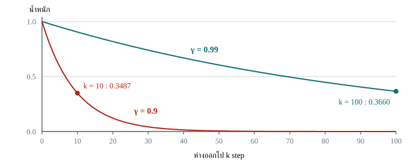

## บทที่ 8 · return และ objective — รวมคะแนนของหลาย step ให้เป็นเลขตัวเดียว

> [!INTRO]
> ในตารางตัวอย่าง env 1 ได้ reward 0.5 แล้ว 1.0 แล้ว −2.0 ก่อนจะล้ม episode นี้ดีหรือแย่ และถ้ามี policy สองตัว เราจะบอกได้อย่างไรว่าตัวใดดีกว่า reward ทีละ step ตอบไม่ได้ เราต้องรวมมันเป็นตัวเลขตัวเดียวก่อน
>
> บทนี้สร้างตัวเลขสองตัว ตัวแรกคือ return $G_t$ ซึ่งรวม reward ตั้งแต่ step หนึ่งไปจนจบ episode โดยใช้ $\gamma$ ซึ่งเป็นช่องที่ห้าของแบบฟอร์ม MDP ตัวที่สองคือ objective $J$ ซึ่งเป็นค่าเฉลี่ยของ return แล้วเราใช้มันเขียนโจทย์ทั้งหมดของวิชานี้เป็นสมการ (2)
>
> ของที่ต้องรู้มาก่อน: ค่าคาดหวังและความเป็นเชิงเส้นของมันจากบทที่ 4 · reward $r_t$ และ $\gamma$ จากบทที่ 5 · step, episode, done และตารางตัวอย่างจากบทที่ 7
>
> จบบทนี้แล้ว เราคำนวณ $G_t$ ของ episode ที่จบแล้วได้ด้วยมือ บอกได้ว่า $\gamma$ ทำให้ agent มองไปข้างหน้าไกลเพียงใด และอ่านสมการ (2) ออกเป็นประโยคได้

### ของที่ต้องมีก่อนเริ่ม

บทนี้ใช้สองแถวของตารางตัวอย่าง คือ $r$ และ done ตัวหนาคือ step ที่ env 1 ล้ม ตารางตัวอย่างใช้ $\gamma = 0.9$ ส่วน Tron1 ใช้ 0.99

| | | t=0 | t=1 | t=2 | t=3 |
| --- | --- | --- | --- | --- | --- |
| **env 0** | $r$ | 1.0 | 0.5 | 1.0 | 0.5 |
| | done | 0 | 0 | 0 | 0 |
| **env 1** | $r$ | 0.5 | 1.0 | **−2.0** | 0.0 |
| | done | 0 | 0 | **1** | 0 |

สัญลักษณ์ที่ใช้ในบทนี้ เรียงตามลำดับที่จะพบ

| สัญลักษณ์ | ชนิด | ความหมาย |
| --- | --- | --- |
| $r_t$ **reward** | scalar | คะแนนของ step เดียว รู้ทันที |
| $\gamma$ **discount** | ค่าคงที่ | อนาคตหนึ่งก้าวถัดไปมีค่ากี่เปอร์เซ็นต์ของตอนนี้ · toy 0.9 · Tron1 0.99 (`gamma` `limx_rsl_rl_ppo_cfg.py:102`) |
| $G_t$ **return** | scalar | ผลรวมรางวัลถ่วง $\gamma$ ตั้งแต่ $t$ จนจบ episode เป็นข้อเท็จจริง รู้ได้ต่อเมื่อ episode จบ |
| $J(\pi)$ **objective** | ฟังก์ชัน ซึ่งรับ policy แล้วคืนจำนวนจริง | ผลตอบแทนคาดหวังทั้ง episode มองเป็นฟังก์ชันของ policy · สิ่งที่อยากให้สูงขึ้น |
| $\arg\max_{\pi}$ | ตัวดำเนินการ | อ่านว่า "หา $\pi$ ที่ทำให้สิ่งที่ตามมามีค่ามากที่สุด" |
| $\pi^*$ | ฟังก์ชัน | policy ที่ดีที่สุด ดาวหมายถึงตัวที่ทำให้ objective สูงสุด |

ในตารางสัญลักษณ์ของเล่มนี้ คำว่า toy หมายถึงค่าในตารางตัวอย่าง ตามที่บทนำตกลงไว้

### ปัญหา: บวกกันตรง ๆ ไม่พอ

วิธีที่ง่ายที่สุดในการรวมคะแนนของ episode คือบวก reward ทุก step เข้าด้วยกัน episode แรกของ env 1 ได้ 0.5 + 1.0 − 2.0 = −0.5 วิธีนี้ติดสองข้อ

**ข้อแรก ผลรวมอาจไม่มีขอบเขต** บทที่ 7 แสดงว่า episode จบได้เพราะหมดเวลา ซึ่งในกรณีนั้นหุ่นยังเดินต่อได้ ถ้าเราต้องการวัดว่าหุ่นที่เดินได้ดีนั้นดีแค่ไหน เราต้องนึกถึง reward ที่มันจะได้ต่อไปเรื่อย ๆ ถ้าทุก step ได้ reward 1 ผลรวมหลัง 1000 step คือ 1000 หลังหนึ่งล้าน step คือหนึ่งล้าน ตัวเลขที่โตตามเวลาที่เรายอมนั่งดูใช้เทียบความดีไม่ได้

**ข้อที่สอง ผลรวมไม่สนใจว่าอะไรเกิดก่อน** ลำดับ reward 0.5, 1.0, −2.0 กับลำดับ −2.0, 1.0, 0.5 มีผลรวม −0.5 เท่ากัน แต่ agent ที่อยู่ ณ step แรกควรมองสองลำดับนี้ต่างกัน ผลที่อยู่ใกล้เป็นผลของ action ที่กำลังจะสั่งมากกว่า และแน่นอนกว่า ผลที่อยู่ไกลออกไปผ่าน action อีกหลายตัวและผ่านความสุ่มของโลกอีกหลายชั้น

ทั้งสองข้อแก้ได้ด้วยการคูณ reward ของ step ที่อยู่ไกลออกไปด้วยตัวเลขที่เล็กลงเรื่อย ๆ ตัวเลขนั้นมาจาก $\gamma$

### return: ผลรวมที่ถ่วงด้วย $\gamma$

เรายืนอยู่ที่ step $t$ แล้วมองไปข้างหน้า reward ของ step นี้ได้น้ำหนัก 1 ของ step ถัดไปได้น้ำหนัก $\gamma$ ของ step ถัดจากนั้นได้น้ำหนัก $\gamma^2$ และต่อไปเรื่อย ๆ จนจบ episode

> [!KEY] return
> $$G_t = r_t + \gamma\,r_{t+1} + \gamma^2\,r_{t+2} + \cdots = \sum_{k \ge 0} \gamma^k\,r_{t+k}$$
>
> | | |
> | --- | --- |
> | $k$ | จำนวน step ที่นับจาก step ปัจจุบันไปข้างหน้า |
> | ผลรวม | หยุดที่ step ซึ่ง done เป็น 1 |

สมการนี้บอกว่า return ของ step หนึ่งคือ reward ทั้งหมดที่จะได้ตั้งแต่ step นั้นจนจบ episode โดย reward ที่อยู่ไกลออกไปหนึ่ง step มีค่าเหลือ $\gamma$ เท่า

ผลรวมนี้คิดจากหลังมาหน้าได้ง่ายกว่า เพราะ return ของ step หนึ่งมี return ของ step ถัดไปซ่อนอยู่

| สมการ | หมายเหตุ |
| --- | --- |
| $G_t = r_t + \gamma\,r_{t+1} + \gamma^2\,r_{t+2} + \cdots$ | นิยาม |
| $= r_t + \gamma\,\big(r_{t+1} + \gamma\,r_{t+2} + \cdots\big)$ | ดึง $\gamma$ ออกจากทุกพจน์หลังพจน์แรก |
| $= r_t + \gamma\,G_{t+1}$ | วงเล็บคือนิยามของ $G_{t+1}$ |

ที่ step สุดท้ายของ episode ไม่มี step ถัดไป return จึงเท่ากับ reward ของ step นั้น

> [!EXAMPLE] จงหา $G_t$ ของ episode แรกของ env 1 ทั้งสาม step
> episode นี้คือ t0 ถึง t2 และจบที่ t2 เราเริ่มที่ step สุดท้ายแล้วเดินย้อนขึ้นมา
>
> $$\begin{aligned}
> G_2 &= r_2 &&= -2.00 \\
> G_1 &= r_1 + 0.9\,G_2 = 1.0 + 0.9 \times (-2.00) &&= -0.80 \\
> G_0 &= r_0 + 0.9\,G_1 = 0.5 + 0.9 \times (-0.80) &&= -0.22
> \end{aligned}$$
>
> ตรวจ $G_0$ ด้วยนิยาม
>
> $$G_0 = 0.5 + 0.9 \times 1.0 + 0.9^2 \times (-2.0) = 0.50 + 0.90 - 1.62 = -0.22$$

ผลรวมแบบบวกตรง ๆ ของ episode นี้คือ −0.5 ส่วน $G_0$ คือ −0.22 การล้มที่ t2 ยังถูกนับ แต่เมื่อมองจาก t0 มันอยู่ไกลออกไปสอง step น้ำหนักจึงเหลือ $0.9^2 = 0.81$

การถ่วงทำให้ลำดับมีผล ถ้าสลับ reward ชุดเดียวกันเป็น −2.0, 1.0, 0.5 เราได้ $G_0 = -2.0 + 0.90 + 0.405 = -0.695$ ซึ่งแย่กว่า −0.22 เพราะ reward ติดลบมาอยู่ใกล้

> [!WARNING] $G_t$ รู้ได้ต่อเมื่อ episode จบ
> ลองทำแบบเดียวกันกับ env 0 episode ของ env 0 ยังไม่จบเมื่อตารางเต็ม เราบวกได้เพียงสี่พจน์ที่เห็น
>
> $$1.0 + 0.9 \times 0.5 + 0.9^2 \times 1.0 + 0.9^3 \times 0.5 = 1.0 + 0.45 + 0.81 + 0.3645 = 2.6245$$
>
> ตัวเลขนี้ยังไม่ใช่ $G_0$ ส่วนที่ขาดคือ $0.9^4 \times G_4 = 0.6561 \times G_4$ และ $G_4$ เป็นเรื่องของ step ที่อยู่นอกตาราง ซึ่งเรายังไม่เห็น บทที่ 9 แก้ปัญหานี้

return เป็นข้อเท็จจริงของ episode ที่เกิดขึ้นแล้ว ไม่มีคำทำนายใดปนอยู่ ข้อดีนี้มาพร้อมราคา คือต้องรอ

### $\gamma$ ทำให้มองไกลแค่ไหน

น้ำหนักของ reward ที่อยู่ห่างออกไป $k$ step คือ $\gamma^k$ ค่าของ $\gamma$ จึงกำหนดว่า agent สนใจอนาคตไกลเพียงใด

| ห่างออกไป $k$ step | $0.9^k$ (toy) | $0.99^k$ (Tron1) |
| --- | --- | --- |
| 1 | 0.9000 | 0.9900 |
| 5 | 0.5905 | 0.9510 |
| 10 | 0.3487 | 0.9044 |
| 22 | 0.0985 | 0.8016 |
| 50 | 0.0052 | 0.6050 |
| 100 | 0.0000 | 0.3660 |
| 230 | 0.0000 | 0.0991 |

ตัวเลขที่ใช้สรุปตารางนี้คือ $1/(1-\gamma)$ ซึ่งเท่ากับผลรวมของน้ำหนักทั้งหมด เราเรียกตัวเลขนี้ว่า**ระยะมอง**

$$1 + \gamma + \gamma^2 + \cdots = \frac{1}{1-\gamma}$$

| | toy | Tron1 |
| --- | --- | --- |
| $\gamma$ | 0.9 | 0.99 |
| $1/(1-\gamma)$ | 10 step | 100 step |
| เป็นเวลา เมื่อหนึ่ง step คือ 0.02 วินาที | 0.2 วินาที | 2.0 วินาที |
| น้ำหนักที่ระยะนั้น | $0.9^{10} = 0.3487$ | $0.99^{100} = 0.3660$ |

ค่า 0.99 ของ Tron1 จึงแปลว่า agent มองไปข้างหน้าราว 2 วินาที reward ที่อยู่ไกลกว่านั้นยังถูกนับ แต่ด้วยน้ำหนักที่น้อยลงเรื่อย ๆ ตารางตัวอย่างใช้ 0.9 เพื่อให้เห็นผลของการถ่วงภายใน 4 step

ผลรวมของน้ำหนักที่มีค่าจำกัดนี้แก้ข้อติดข้อแรกของหัวข้อปัญหา ถ้า reward ทุก step เป็น 1 ไปตลอด return ไม่ได้โตไม่สิ้นสุด มันเท่ากับ $1/(1-\gamma)$ คือ 10 เมื่อ $\gamma = 0.9$ และ 100 เมื่อ $\gamma = 0.99$

| ค่า $\gamma$ | return กลายเป็น | agent ที่ได้ |
| --- | --- | --- |
| 0 | $G_t = r_t$ | สนใจเฉพาะ reward ของ step นี้ |
| 1 | ผลรวมแบบบวกตรง ๆ | สนใจทุก step เท่ากัน และผลรวมอาจไม่มีขอบเขต |
| ระหว่าง 0 กับ 1 | ผลรวมที่ถ่วงน้ำหนัก | สนใจอนาคตใกล้มากกว่าอนาคตไกล |

> [!REMARK]
> $\gamma$ เทียบได้กับอัตราคิดลดทางการเงิน คือเงินที่จะได้ในปีหน้ามีค่าน้อยกว่าเงินจำนวนเดียวกันในวันนี้ การเทียบนี้ใช้ได้กับรูปของสูตร แต่เทียบไม่ได้ตรงที่มาของตัวเลข อัตราคิดลดวัดได้จากตลาด ส่วน $\gamma$ เป็นค่าที่ผู้ออกแบบเลือก และเมื่อเปลี่ยนค่า โจทย์ที่ agent พยายามแก้ก็เปลี่ยนตาม

### objective: จาก episode เดียว ถึงค่าเฉลี่ย

$G_0$ ของ episode หนึ่งบอกว่า episode นั้นดีแค่ไหน แต่เราต้องการรู้ว่า*policy* ดีแค่ไหน และ policy ตัวเดียวกันให้ episode ที่ต่างกันทุกครั้ง command ถูกสุ่มใหม่ ท่าเริ่มต้นของหุ่นต่างกัน และการลองผิดลองถูกทำให้ action ไม่เหมือนเดิม $G_0$ ก่อนที่ episode จะเกิดจึงเป็นตัวแปรสุ่ม เช่นเดียวกับตัวเลขบนบัตรก่อนจับ

บทที่ 4 ให้เครื่องมือสำหรับเรื่องนี้ไว้แล้ว ตัวเลขที่เป็นสมบัติของ policy และไม่เปลี่ยนเมื่อทดลองซ้ำ คือค่าคาดหวังของ return ตัวเลขนี้เรียกว่า **objective** เขียนว่า $J(\pi)$

$$J(\pi) = \mathbb{E}_{\pi}\Big[\sum_{t=0}^{T} \gamma^t\,r_t\Big]$$

ผลรวมในวงเล็บคือ $G_0$ ของ episode หนึ่ง และ $\mathbb{E}$ เฉลี่ยมันเหนือทุก episode ที่ policy $\pi$ อาจสร้างขึ้น objective เป็นฟังก์ชัน เราป้อน policy หนึ่งตัวเข้าไป แล้วได้ตัวเลขหนึ่งตัวออกมา policy ที่ดีกว่าให้ตัวเลขที่สูงกว่า

เมื่อมีตัวเลขสำหรับเทียบ policy แล้ว โจทย์ทั้งหมดของวิชานี้เขียนได้ในบรรทัดเดียว

> [!KEY] โจทย์ของ RL
> $$\pi^* = \arg\max_{\pi}\ \mathbb{E}_{\pi}\Big[\sum_{t=0}^{T} \gamma^t\,r_t\Big] \tag{2}$$
>
> | | |
> | --- | --- |
> | $T$ | step สุดท้ายของ episode ไม่รู้ล่วงหน้า |
> | $\pi^*$ | policy ที่ทำให้ค่าทางขวาสูงที่สุด |
> | $\mathbb{E}_{\pi}$ | ค่าคาดหวังเหนือ episode ที่ action ทุกตัวมาจาก $\pi$ ตัวห้อยบอกว่าเฉลี่ยใต้ policy ใด |

สมการนี้บอกว่า ในบรรดา policy ทั้งหมดที่เป็นไปได้ ให้เลือกตัวที่เมื่อนำไปเดินแล้ว ผลรวมของ reward ที่ถ่วงด้วย $\gamma$ มีค่าเฉลี่ยสูงที่สุด

เราอ่านสมการ (2) ด้วยวิธีสามรอบของบทที่ 4

| รอบ | ทำอะไร | ผลที่ได้ |
| --- | --- | --- |
| 1 หาโครง | มองข้ามตัวห้อย หาตัวดำเนินการหลัก | $\arg\max\ \mathbb{E}[\ \sum\ ]$ คือหาตัวที่ทำให้ค่าเฉลี่ยของผลรวมสูงสุด |
| 2 เติมชื่อ | แทนสัญลักษณ์ด้วยคำ | หา policy ที่ทำให้ค่าคาดหวังของ return สูงสุด |
| 3 ถามชนิด | แต่ละชิ้นเป็นของชนิดใด | ผลรวมเป็น scalar ของ episode หนึ่ง · ค่าคาดหวังของมันเป็น scalar ของ policy หนึ่งตัว · ผลของ $\arg\max$ เป็นฟังก์ชัน คือตัว policy เอง |

ชนิดของวัตถุเปลี่ยนไปตามลำดับที่เราสร้างมันขึ้น

| ของ | ชนิด | เป็นสมบัติของ |
| --- | --- | --- |
| $r_t$ | scalar | step หนึ่ง |
| $G_t$ | scalar | episode หนึ่ง ตั้งแต่ step $t$ |
| $J(\pi)$ | ฟังก์ชัน ซึ่งคืน scalar | policy หนึ่งตัว |
| $\pi^*$ | ฟังก์ชัน | โจทย์ทั้งหมด |

> [!WARNING] objective คือตัวเลข ไม่ใช่ทั้งสมการ
> $J(\pi)$ คือค่าคาดหวังทางขวาของ $\arg\max$ เป็นตัวเลขที่อยากให้สูง ส่วนสมการ (2) ทั้งบรรทัดคือปัญหาการหาค่าที่ดีที่สุด ซึ่งนิยาม $\pi^*$ การเทรนคือการทำ $\arg\max$ ทีละน้อย โดยพยายามปรับ policy ให้ $J$ สูงขึ้นในแต่ละ iteration

> [!WARNING] ตัวอักษร $T$ มีสองความหมาย
> | | $T$ ในสมการ (2) | $T$ ในบทที่ 7 |
> | --- | --- | --- |
> | หมายถึง | step สุดท้ายของ episode | จำนวนแถวของตาราง |
> | ค่าของ Tron1 | ไม่รู้ล่วงหน้า มากที่สุดคือ 1000 | 24 เสมอ |
> | กำหนดโดย | environment | config ของวิธีเทรน |
>
> เมื่อเล่มนี้พูดถึงตาราง $T$ หมายถึงจำนวนแถวเสมอ ส่วนในสมการ (2) ซึ่งพูดถึง episode ทั้งอัน $T$ หมายถึง step สุดท้ายของ episode

### จากสมการถึงโค้ด

สมการ (2) เป็นโจทย์ของทั้งเล่ม แต่ไม่มีบรรทัดใดในโค้ดคำนวณ $G_t$ หรือ $J$ เพราะทั้งสองต้องรอ episode จบ และบทที่ 7 แสดงแล้วว่าอัลกอริทึมไม่รอ

| ในสมการ | ในโค้ด | บรรทัด |
| --- | --- | --- |
| $\gamma$ | `gamma=0.99` | `limx_rsl_rl_ppo_cfg.py:102` |
| $G_t$ | ไม่มี ตัวแปรชื่อ `returns` ในโค้ดเป็นของอีกอย่างหนึ่ง ซึ่งบทที่ 22 สร้าง | `rollout_storage.py:201` |
| $J(\pi)$ | ไม่มี ตัวเลขที่ใกล้ที่สุดคือ `Mean reward` | `on_policy_runner.py:200-205` และ `:326` |
| $\arg\max_{\pi}$ | ลูปของ iteration ซึ่งปรับ policy ทีละน้อย 15,000 ครั้ง | `on_policy_runner.py:170` |

`Mean reward` ที่พิมพ์ออกมาระหว่างเทรนต่างจาก $J$ สองข้อ

| | $J(\pi)$ | `Mean reward` |
| --- | --- | --- |
| การถ่วง | ถ่วงด้วย $\gamma^t$ | ไม่ถ่วง เป็นผลรวมแบบบวกตรง ๆ |
| การเฉลี่ย | ค่าคาดหวังเหนือทุก episode ที่เป็นไปได้ | ค่าเฉลี่ยของ episode ที่จบล่าสุด ไม่เกิน 100 อัน (`:160`) |
| episode แรกของ env 1 | $G_0 = -0.22$ | −0.5 |

`Mean reward` จึงเป็นเข็มที่เราใช้ดูว่าการเทรนไปได้ดีหรือไม่ แต่ไม่ใช่ตัวเลขที่อัลกอริทึมใช้ปรับ policy ตัวเลขที่อัลกอริทึมใช้สร้างขึ้นในบทที่ 9 และบทที่ 22

> [!SUMMARY]
> - return $G_t$ คือผลรวมของ reward ตั้งแต่ step $t$ จนจบ episode โดย reward ที่ห่างออกไป $k$ step ถูกคูณด้วย $\gamma^k$
> - $G_t = r_t + \gamma\,G_{t+1}$ จึงคิดย้อนจาก step สุดท้ายได้ แต่ต้องรอ episode จบก่อน
> - $\gamma$ กำหนดระยะมอง คือ $1/(1-\gamma)$ ซึ่งเป็น 10 step ในตารางตัวอย่าง และ 100 step หรือ 2 วินาทีใน Tron1
> - objective $J(\pi)$ คือค่าคาดหวังของ return เป็นตัวเลขที่ใช้เทียบ policy และสมการ (2) สั่งให้หา policy ที่ทำให้มันสูงสุด
> - ไม่มีบรรทัดใดในโค้ดคำนวณ $G_t$ หรือ $J$ และ `Mean reward` เป็นผลรวมที่ไม่ถ่วง
>
> ประโยคที่ควรจำ: **โจทย์ของ RL คือหา policy ที่ทำให้ผลรวมของ reward ซึ่งถ่วงด้วย $\gamma$ มีค่าเฉลี่ยสูงที่สุด และผลรวมนั้นรู้ได้ต่อเมื่อ episode จบ**

### แบบฝึกหัด

1. ข้อใดถูกต้อง
    1. $G_t$ ของ step สุดท้ายของ episode เท่ากับ $r_t$ ของ step นั้น
    2. $G_t$ คำนวณได้ทันทีที่ step $t$ จบ
    3. เมื่อ $\gamma = 0$ จะได้ $G_t = r_t$
    4. $G_0$ ของ env 0 คำนวณได้ครบจากตารางตัวอย่าง
    5. $J(\pi)$ เป็นตัวแปรสุ่ม
    6. reward ที่อยู่ห่างออกไป 2 step ถูกคูณด้วย $\gamma^2$
    7. Tron1 ใช้ $\gamma = 0.9$
    8. `Mean reward` ในโค้ดคือ $J(\pi)$
    9. $T$ ในสมการ (2) คือจำนวนแถวของตาราง
    10. $\pi^*$ เป็นฟังก์ชัน

2. จงหา $G_0$, $G_1$ และ $G_2$ ของ episode แรกของ env 1 เมื่อ [05 §1.7]
    1. $\gamma = 0.5$
    2. $\gamma = 1$
    3. $\gamma = 0$

    <!--space:34-->

3. สมมติว่า reward ที่ e1 t2 เป็น −5.0 แทน −2.0 จงหา $G_0$, $G_1$ และ $G_2$ ของ env 1 ด้วย $\gamma = 0.9$ <!--space:24-->

4. สำหรับ env 0 จงหาผลรวมถ่วงน้ำหนักของ reward ที่เห็นในตาราง เมื่อเริ่มนับจาก t1 และบอกว่า return ของ step ที่อยู่นอกตารางจะถูกคูณด้วยน้ำหนักเท่าไร [05 §1.7] <!--space:20-->

5. หุ่นตัวหนึ่งได้ reward 1 ทุก step จงหา return ของมัน เมื่อ
    1. $\gamma = 0.9$ และเดินไปไม่มีที่สิ้นสุด
    2. $\gamma = 0.99$ และเดินไปไม่มีที่สิ้นสุด
    3. $\gamma = 1$ และเดิน 1000 step

    <!--space:18-->

6. เมื่อ $\gamma = 0.99$ reward ที่อยู่ห่างออกไป 50 step มีน้ำหนักเท่าไร และ 50 step เท่ากับกี่วินาทีของ Tron1 <!--space:12-->

7. episode หนึ่งมี reward 0.5, 1.0, −2.0 อีก episode หนึ่งมี reward −2.0, 1.0, 0.5 จงหา $G_0$ ของทั้งสอง episode ด้วย $\gamma = 0.9$ และอธิบายว่าเหตุใดจึงต่างกัน ทั้งที่ผลรวมแบบบวกตรง ๆ เท่ากัน <!--space:22-->

8. จงอธิบายว่าเหตุใดจึงไม่มีบรรทัดใดในโค้ดคำนวณ $G_t$ <!--space:12-->

9. `Mean reward` ต่างจาก $J(\pi)$ อย่างไร จงตอบสองข้อ [on_policy_runner.py:200-205] <!--space:12-->

10. จงอธิบายความต่างระหว่าง objective กับสมการ (2) <!--space:12-->

<!-- เฉลย -->

1. ข้อที่ถูก: 1, 3, 6, 10

    - ข้อ 2 ผิด: ต้องรอ episode จบ
    - ข้อ 4 ผิด: episode ของ env 0 ยังไม่จบ ได้เพียง 2.6245 กับส่วนที่ขาด
    - ข้อ 5 ผิด: เป็นค่าคาดหวัง จึงเป็น scalar ที่ไม่เปลี่ยนสำหรับ policy หนึ่งตัว
    - ข้อ 7 ผิด: Tron1 ใช้ 0.99 ส่วน 0.9 เป็นของตารางตัวอย่าง
    - ข้อ 8 ผิด: ไม่ถ่วงด้วย $\gamma$ และเป็นค่าเฉลี่ยของ episode ที่เพิ่งจบ
    - ข้อ 9 ผิด: คือ step สุดท้ายของ episode

2. คิดย้อนจาก $G_2 = -2.0$ ทุกข้อ

    1. $G_1 = 1.0 + 0.5(-2.0) = 0.0$ และ $G_0 = 0.5 + 0.5(0.0) = 0.5$
    2. $G_1 = 1.0 - 2.0 = -1.0$ และ $G_0 = 0.5 - 1.0 = -0.5$
    3. $G_1 = 1.0$ และ $G_0 = 0.5$ เท่ากับ reward ของแต่ละ step

3. $G_2 = -5.0$ · $G_1 = 1.0 + 0.9(-5.0) = -3.5$ · $G_0 = 0.5 + 0.9(-3.5) = -2.65$

4. $0.5 + 0.9 \times 1.0 + 0.9^2 \times 0.5 = 0.5 + 0.9 + 0.405 = 1.805$ ส่วนที่อยู่นอกตารางถูกคูณด้วย $0.9^3 = 0.729$

5. return ของแต่ละข้อ

    1. $1/(1-0.9) = 10$
    2. $1/(1-0.99) = 100$
    3. 1000

6. $0.99^{50} = 0.6050$ และ 50 × 0.02 = 1.0 วินาที

7. ลำดับแรกได้ $0.5 + 0.9 - 1.62 = -0.22$ ลำดับที่สองได้ $-2.0 + 0.9 + 0.405 = -0.695$ ในลำดับที่สอง reward ติดลบอยู่ที่ step แรก จึงได้น้ำหนักเต็ม 1 ส่วนในลำดับแรกมันอยู่ห่างออกไปสอง step จึงได้น้ำหนัก 0.81

8. $G_t$ ต้องรอให้ episode จบ ซึ่งยาวได้ถึง 1000 step ขณะที่อัลกอริทึมทำงานต่อตาราง 24 แถว และไม่รอ episode

9. `Mean reward` ไม่ถ่วงด้วย $\gamma$ และเป็นค่าเฉลี่ยของ episode ที่เพิ่งจบ ไม่ใช่ค่าคาดหวังเหนือทุก episode ที่เป็นไปได้

10. objective คือ $J(\pi)$ เป็นตัวเลขที่บอกว่า policy หนึ่งตัวดีแค่ไหน ส่วนสมการ (2) คือปัญหาที่สั่งให้หา policy ซึ่งทำให้ตัวเลขนั้นสูงที่สุด
