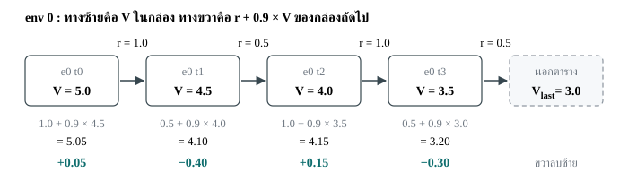

## บทที่ 9 · value function และ advantage — ทำนายคะแนนก่อนที่ episode จะจบ

> [!INTRO]
> ที่ step แรกของตารางตัวอย่าง env 1 ยืนอยู่ในท่าหนึ่ง อีกสอง step มันจะล้ม แต่ตอนนั้นยังไม่มีใครรู้ return ของ step นี้คือ −0.22 ซึ่งจะรู้ได้ก็ต่อเมื่อล้มไปแล้ว agent ที่ต้องปรับ policy ทุก 24 step รอไม่ได้ มันต้องการตัวเลขที่บอกว่าท่านี้ดีแค่ไหน*ตอนนี้*
>
> บทนี้สร้างตัวเลขนั้น คือ value function $V$ ซึ่งเป็นค่าคาดหวังของ return แล้วสร้างต่ออีกสองตัว คือ $Q$ ซึ่งให้ค่ากับ action และ advantage ซึ่งบอกว่า action หนึ่งดีกว่าปกติเท่าไร ทั้งหมดอยู่ในสมการ (3) ถึง (8) เราจะรู้ด้วยว่าแถว $V$ ของตารางตัวอย่างมาจากไหน
>
> ของที่ต้องรู้มาก่อน: ค่าคาดหวังแบบมีเงื่อนไข กฎการเฉลี่ยสองชั้น และความเป็นเชิงเส้น จากบทที่ 4 · Markov property จากบทที่ 6 · ตารางตัวอย่างจากบทที่ 7 · return $G_t$ และ $\gamma$ จากบทที่ 8
>
> จบบทนี้แล้ว เราบอกชนิดและความหมายของ $r_t$, $G_t$, $V$, $Q$ และ advantage ได้โดยไม่สับสน ตรวจแถว $V$ ของตารางด้วยสมการ Bellman ได้ และรู้ว่าตัวใดมีอยู่ในโค้ด ตัวใดไม่มี

### ของที่ต้องมีก่อนเริ่ม

บทนี้ใช้สามแถวของตารางตัวอย่าง คือ $r$, $V$ และ done พร้อมคอลัมน์ $V_{last}$ ซึ่งบทที่ 7 แสดงไว้โดยยังไม่ได้อธิบาย ตารางตัวอย่างใช้ $\gamma = 0.9$

| | | t=0 | t=1 | t=2 | t=3 | $V_{last}$ |
| --- | --- | --- | --- | --- | --- | --- |
| **env 0** | $r$ | 1.0 | 0.5 | 1.0 | 0.5 | |
| | $V$ | 5.0 | 4.5 | 4.0 | 3.5 | 3.0 |
| | done | 0 | 0 | 0 | 0 | |
| **env 1** | $r$ | 0.5 | 1.0 | **−2.0** | 0.0 | |
| | $V$ | 3.0 | 2.0 | 1.0 | 4.0 | 3.5 |
| | done | 0 | 0 | **1** | 0 | |

และใช้ return ของ episode แรกของ env 1 ที่คำนวณไว้ในบทที่ 8 คือ $G_0 = -0.22$, $G_1 = -0.80$ และ $G_2 = -2.00$

สัญลักษณ์ที่ใช้ในบทนี้ เรียงตามลำดับที่จะพบ

| สัญลักษณ์ | ชนิด | ความหมาย |
| --- | --- | --- |
| $V^\pi(s)$ **value function** | ฟังก์ชัน $\mathcal{S}\to\mathbb{R}$ | คำทำนายของ $G_t$ ถ้าเริ่มจาก $s$ แล้วเดินตาม $\pi$ |
| **critic** | ฟังก์ชัน | โครงข่ายที่ทำหน้าที่ทำนาย $V$ ใช้เฉพาะตอนเทรน |
| **Bellman equation** | สมการ | $V$ ของวันนี้ เท่ากับรางวัลก้าวเดียว บวก $\gamma$ คูณ $V$ ของพรุ่งนี้ |
| **bootstrapping** | แนวคิด | ใช้คำทำนายของตัวเองแทนอนาคตที่ยังไม่รู้ |
| $V_{last}$ | เวกเตอร์ `(B, 1)` | critic ทำนายจากสถานะหลัง step สุดท้าย เพราะแถวที่ $T$ ไม่มีใครให้ดู |
| $Q^\pi(s,a)$ **action-value** | ฟังก์ชัน $\mathcal{S}\times\mathcal{A}\to\mathbb{R}$ | เหมือน $V$ แต่ล็อก action แรกไว้ก่อน |
| $A^\pi(s,a)$ **advantage** | ฟังก์ชัน $\mathcal{S}\times\mathcal{A}\to\mathbb{R}$ | action นี้ดีกว่าค่าเฉลี่ยของ $s$ เท่าไร · เขียนมีวงเล็บเสมอ |

ลูกศรในคอลัมน์ชนิดอ่านว่า "รับของทางซ้าย แล้วคืนของทางขวา" $\mathcal{S}\to\mathbb{R}$ คือฟังก์ชันที่รับสถานะหนึ่งตัวแล้วคืนจำนวนจริงหนึ่งตัว ส่วน $\mathcal{S}\times\mathcal{A}$ หมายถึงรับสองอย่างพร้อมกัน คือสถานะกับ action

### ปัญหา: return มาช้า และมาครั้งละค่าเดียว

บทที่ 8 ให้ $G_t$ เป็นตัววัดว่า episode ดีแค่ไหนตั้งแต่ step $t$ ถ้าเราจะใช้มันตัดสินว่าสถานะหนึ่งดีแค่ไหน เราติดสองข้อ

**ข้อแรก มันมาช้า** $G_0$ ของ env 1 รู้ได้หลังจาก t2 และ $G_0$ ของ env 0 ยังไม่รู้เลยเมื่อตารางเต็ม สำหรับ Tron1 episode ยาวได้ถึง 1000 step แต่ตารางมี 24 แถว

**ข้อที่สอง มันเป็นค่าเดียวจากหลายค่าที่เป็นไปได้** ถ้าวางหุ่นในสถานะเดียวกันอีกครั้ง แล้วให้ policy ตัวเดิมเดินต่อ เราจะได้ return อีกค่าหนึ่ง $G_t$ ที่เห็นเป็นเหมือนบัตรใบเดียวที่จับได้ในบทที่ 4 มันบอกเรื่องของครั้งนั้น ไม่ได้บอกเรื่องของสถานะ

บทที่ 4 แก้ปัญหาแบบที่สองไว้แล้วด้วยค่าคาดหวัง สิ่งที่เป็นสมบัติของสถานะ คือค่าเฉลี่ยของ return จากทุกครั้งที่เริ่มที่สถานะนั้น

### value function: ค่าคาดหวังของ return

**value function** คือฟังก์ชันที่รับสถานะหนึ่งตัว แล้วคืนตัวเลขหนึ่งตัว ตัวเลขนั้นคือค่าคาดหวังของ return เมื่อรู้ว่าเริ่มที่สถานะนั้น

> [!KEY] value function ในรูปของ return
> $$V^{\pi}(s) = \mathbb{E}\big[G_t \mid s_t = s\big] \tag{7}$$
>
> | | |
> | --- | --- |
> | $s_t = s$ | เงื่อนไข คือรู้แล้วว่าที่ step $t$ หุ่นอยู่ในสถานะ $s$ |
> | ตัวยก $\pi$ | อ่านว่า "ภายใต้ policy นี้" |

สมการนี้อ่านว่า ค่าของสถานะ $s$ คือ return ที่จะได้โดยเฉลี่ย ถ้าเริ่มที่ $s$ แล้วให้ policy $\pi$ เลือก action ต่อไปจนจบ episode

ตัวยก $\pi$ จำเป็น เพราะสถานะเดียวกันมีค่าต่างกันเมื่อ policy ต่างกัน ท่าที่เอียงเล็กน้อยมีค่าสูงสำหรับ policy ที่แก้การเอียงเป็น และมีค่าต่ำสำหรับ policy ที่แก้ไม่เป็น

เมื่อแทน $G_t$ ด้วยนิยามของมันจากบทที่ 8 เราได้รูปเต็ม

> [!KEY] นิยามของ value function
> $$V^{\pi}(s) = \mathbb{E}_{\pi}\Big[\sum_{k \ge 0} \gamma^{k}\,r_{t+k} \ \Big|\ s_t = s\Big] \tag{3}$$

ตัวห้อย $\pi$ ใต้ $\mathbb{E}$ บอกเรื่องเดียวกับตัวยก คือการเฉลี่ยนี้ทำเหนือ episode ที่ action ทุกตัวหลังจากนี้มาจาก $\pi$

| | $G_t$ | $V^\pi(s)$ |
| --- | --- | --- |
| ชนิด | scalar | ฟังก์ชัน ซึ่งคืน scalar |
| คืออะไร | ข้อเท็จจริงของ episode ที่เกิดขึ้นแล้ว | ค่าเฉลี่ยของข้อเท็จจริงนั้น เหนือทุก episode ที่เริ่มจาก $s$ |
| รู้ได้เมื่อไร | เมื่อ episode จบ | ตามนิยามแล้วต้องรู้การแจกแจงของอนาคตทั้งหมด ซึ่งไม่มีใครรู้ |
| ต้องระบุ action หรือไม่ | ไม่ต้อง action ถูกสั่งไปแล้ว | ไม่ต้อง action ทุกตัวในอนาคตถูกเฉลี่ยไปแล้ว |

แถวที่สามบอกว่าเรายังไม่ได้แก้ข้อแรกของหัวข้อปัญหา สมการ (3) และ (7) บอกว่า $V$ *ต้องเป็น*อะไร แต่ไม่ได้บอกวิธีหาค่าของมัน

### critic: ผู้ทำนาย $V$

ในโค้ดของ Tron1 ไม่มีใครคำนวณสมการ (3) สิ่งที่มีคือโครงข่ายหนึ่งตัวที่*ทำนาย* $V$ โครงข่ายนี้ชื่อ **critic** มันคือสิ่งที่บทที่ 2 และบทที่ 6 เรียกว่าโครงข่ายอีกตัวที่ใช้เฉพาะตอนเทรน

critic เป็นฟังก์ชัน เราป้อนสิ่งที่มันมองเห็นเข้าไป แล้วได้ตัวเลขหนึ่งตัวออกมาทันที ไม่ต้องรอ episode จบ (`actor_critic.py:170-172`) agent เรียกมันทุก step พร้อมกับการเลือก action (`ppo.py:144`) แล้วเก็บตัวเลขที่ได้ลงตาราง (`rollout_storage.py:143`)

**แถว $V$ ของตารางตัวอย่างคือตัวเลขที่ critic ทำนายไว้ในแต่ละ step** สำหรับ env 0 มันทำนาย 5.0, 4.5, 4.0 และ 3.5

| | $V^\pi(s)$ ในสมการ | $V$ ในตาราง |
| --- | --- | --- |
| คืออะไร | ค่าคาดหวังจริงของ return | คำทำนายของ critic |
| ผิดได้หรือไม่ | ไม่ได้ มันคือนิยาม | ได้ และผิดมากเมื่อเริ่มเทรน |
| มีในโค้ดหรือไม่ | ไม่มี | มี ทุกช่องของตาราง |

ตั้งแต่บทนี้ เมื่อเล่มนี้เขียน $V$ พร้อมตัวเลขจากตาราง หมายถึงคำทำนายของ critic

> [!EXAMPLE] จงเทียบคำทำนายของ critic กับ return จริง ที่ episode แรกของ env 1
> episode นี้จบแล้ว เราจึงมี return ครบทั้งสาม step
>
> | step | $V$ ที่ critic ทำนาย | $G_t$ ที่เกิดจริง | ทำนายเกินไป |
> | --- | --- | --- | --- |
> | t0 | 3.0 | −0.22 | 3.22 |
> | t1 | 2.0 | −0.80 | 2.80 |
> | t2 | 1.0 | −2.00 | 3.00 |
>
> ที่ t0 critic ทำนายว่าจะได้ 3.0 แต่ที่เกิดจริงคือ −0.22 มันทำนายสูงเกินไป 3.22 เพราะไม่รู้ว่าอีกสอง step หุ่นจะล้ม

ตัวอย่างนี้ต้องอ่านอย่างระวัง ความต่าง 3.22 ยังไม่ได้พิสูจน์ว่า critic ผิดไป 3.22 เพราะ $V$ คือค่าเฉลี่ย ส่วน $G_0$ คือผลของครั้งเดียว แต่ถ้าเราเก็บความต่างแบบนี้จากช่องจำนวนมาก มันบอกได้ว่า critic ควรถูกปรับไปทางใด บทที่ 24 ใช้ความคิดนี้สอน critic

> [!NOTE]
> critic ไม่ได้รับ input ชุดเดียวกับ policy บรรทัด `ppo.py:144` ป้อนตัวแปรชื่อ `critic_obs` ซึ่งประกอบจากกลุ่ม `CriticCfg` ของบทที่ 6 ต่อด้วย command (`ppo.py:134`) และมีความเร็วของลำตัวอยู่ด้วย critic จึงเห็นมากกว่า policy ทำได้เช่นนี้เพราะ critic ไม่ต้องไปถึงชั้น deploy บทที่ 20 อธิบายเรื่องนี้เต็ม

### สมการ Bellman: ตรวจคำทำนายโดยไม่ต้องรอ

เรามีคำทำนายแล้ว แต่ยังตรวจมันได้เฉพาะเมื่อ episode จบ ทางออกมาจากการสังเกตว่า return มีโครงเวียนเกิด บทที่ 8 แสดงว่า $G_t = r_t + \gamma\,G_{t+1}$ เมื่อใส่ค่าคาดหวังทั้งสองข้าง โครงเดียวกันปรากฏกับ $V$

| สมการ | หมายเหตุ |
| --- | --- |
| $V^{\pi}(s) = \mathbb{E}\big[G_t \mid s_t = s\big]$ | สมการ (7) |
| $= \mathbb{E}\big[r_t + \gamma\,G_{t+1} \mid s_t = s\big]$ | แทน $G_t$ ด้วยรูปเวียนเกิดของบทที่ 8 |
| $= \mathbb{E}\big[r_t \mid s_t = s\big] + \gamma\,\mathbb{E}\big[G_{t+1} \mid s_t = s\big]$ | ความเป็นเชิงเส้นของค่าคาดหวัง |
| $= \mathbb{E}\big[r_t \mid s_t = s\big] + \gamma\,\mathbb{E}\big[V^{\pi}(s_{t+1}) \mid s_t = s\big]$ | กฎการเฉลี่ยสองชั้น โดยแบ่งกรณีตามสถานะถัดไป |
| $= \mathbb{E}\big[r_t + \gamma\,V^{\pi}(s_{t+1}) \mid s_t = s\big]$ | รวมกลับเป็นค่าคาดหวังเดียว |

กฎสองข้อของบทที่ 4 เขียนไว้โดยไม่มีเงื่อนไข ความเป็นเชิงเส้นใช้ได้เหมือนเดิมเมื่อค่าคาดหวังทุกตัวมีเงื่อนไขเดียวกันอยู่ทางขวาของขีดตั้ง ส่วนกฎการเฉลี่ยสองชั้น เมื่อมีเงื่อนไข $C$ อยู่ก่อนแล้ว เงื่อนไขนั้นตามเข้าไปอยู่ในทุกพจน์

$$\mathbb{E}[X \mid C] = \sum_{k} P(K = k \mid C) \cdot \mathbb{E}[X \mid K = k,\ C]$$

แถวที่สี่คือขั้นที่ต้องคิด ค่าเฉลี่ยของ $G_{t+1}$ คิดได้เป็นสองชั้น โดยให้ $X$ คือ $G_{t+1}$ ให้ $K$ คือสถานะถัดไป $s_{t+1}$ และให้ $C$ คือ $s_t = s$ สถานะของ Tron1 เป็นจำนวนจริง ผลรวมในกฎจึงกลายเป็นการเฉลี่ยแบบต่อเนื่อง แต่ผลเหมือนกัน ชั้นในเฉลี่ยภายในแต่ละกรณี ซึ่งได้ $V^{\pi}(s_{t+1})$ ตามสมการ (7) ชั้นนอกเฉลี่ยข้ามกรณี ขั้นนี้ใช้ Markov property ของบทที่ 6 ด้วย เพราะมันถือว่าเมื่อรู้ $s_{t+1}$ แล้ว return ต่อจากนั้นไม่ขึ้นกับว่าหุ่นมาถึง $s_{t+1}$ ได้อย่างไร

> [!KEY] สมการ Bellman
> $$V^{\pi}(s) = \mathbb{E}\big[r_t + \gamma\,V^{\pi}(s_{t+1}) \mid s_t = s\big] \tag{4}$$

สมการนี้อ่านได้ว่า

ค่าของสถานะนี้ = reward ของ step นี้ + $\gamma$ × ค่าของสถานะถัดไป โดยเฉลี่ย

ทางขวาของสมการ (4) ใช้ของเพียงสองอย่างที่รู้ได้ภายใน step เดียว คือ $r_t$ กับค่าของสถานะถัดไป เราจึงใช้มันตรวจคำทำนายของ critic ได้ทีละ step โดยไม่ต้องรอ episode จบ ถ้า critic ทำนายถูก ทางซ้ายกับทางขวาต้องเท่ากันโดยเฉลี่ย

> [!EXAMPLE] จงตรวจคำทำนายของ critic ที่ env 0 ด้วยสมการ (4) สำหรับ t0, t1 และ t2
> ทางซ้ายคือ $V$ ของช่องนั้น ทางขวาคือ $r$ ของช่องนั้น บวก 0.9 คูณ $V$ ของช่องถัดไป
>
> | ช่อง | ทางซ้าย | ทางขวา | ขวาลบซ้าย |
> | --- | --- | --- | --- |
> | e0 t0 | 5.0 | $1.0 + 0.9 \times 4.5 = 5.05$ | +0.05 |
> | e0 t1 | 4.5 | $0.5 + 0.9 \times 4.0 = 4.10$ | −0.40 |
> | e0 t2 | 4.0 | $1.0 + 0.9 \times 3.5 = 4.15$ | +0.15 |
>
> ที่ e0 t0 สองข้างต่างกันเพียง 0.05 ที่ e0 t1 ทางขวาต่ำกว่าทางซ้าย 0.40 คือสิ่งที่เกิดจริงใน step นั้นแย่กว่าที่ critic ทำนายไว้

คอลัมน์ขวาสุดคือสิ่งที่เราได้จากสมการ Bellman มันเป็นตัววัดว่า critic ทำนายพลาดเท่าไร ซึ่งคำนวณได้ทันทีที่ step จบ ให้เก็บตัวเลขสามตัวนี้ไว้ บทที่ 17 ตั้งชื่อให้มัน และคำนวณให้ครบทั้ง 8 ช่อง

ทางขวาของแต่ละแถวใช้ตัวอย่างเพียงครั้งเดียว ไม่ได้เป็นค่าเฉลี่ย ขวาลบซ้ายจึงไม่จำเป็นต้องเป็นศูนย์แม้ critic จะทำนายถูก เช่นเดียวกับที่บัตรใบเดียวไม่จำเป็นต้องเท่ากับค่าคาดหวัง

> [!WARNING] สมการ (3) และ (4) เป็นเงื่อนไข ไม่ใช่วิธีคำนวณ
> ทางขวาของสมการ (3) เป็นค่าเฉลี่ยเหนืออนาคตที่ยังไม่เกิด ทางขวาของสมการ (4) มี $V^{\pi}$ ซึ่งเป็นตัวที่เรากำลังหาอยู่ ทั้งสองสมการจึงใช้คำนวณ $V$ ตรง ๆ ไม่ได้ มันเป็นเงื่อนไขที่ $V^{\pi}$ ตัวจริงต้องเป็นไปตามนั้นทุกสถานะพร้อมกัน ในโค้ด ตัวเลข $V$ ทุกตัวมาจากคำทำนายของ critic และสมการ (4) ถูกใช้เป็นไม้บรรทัดสำหรับตรวจคำทำนายนั้น

### bootstrapping: ใช้คำทำนายแทนอนาคต

การตรวจในตัวอย่างข้างบนใช้ $V$ ของช่องถัดไปแทน return ทั้งหมดที่เหลือ การใช้คำทำนายของตัวเองแทนอนาคตที่ยังไม่รู้เช่นนี้เรียกว่า **bootstrapping**

ช่อง e0 t3 เป็นกรณีที่เห็นชัดที่สุด มันเป็นแถวสุดท้ายของตาราง สถานะถัดไปของมันอยู่นอกตาราง โค้ดจึงให้ critic ทำนายค่าของสถานะนั้นไว้หนึ่งครั้งหลังตารางเต็ม (`ppo.py:176-178`) ตัวเลขนี้คือ $V_{last}$ ซึ่งเป็น 3.0 สำหรับ env 0

$$0.5 + 0.9 \times 3.0 = 3.20$$

ทางขวาของช่อง e0 t3 จึงเป็น 3.20 เทียบกับทางซ้าย 3.5

bootstrapping ตอบคำถามที่บทที่ 8 ทิ้งไว้ด้วย $G_0$ ของ env 0 คำนวณไม่ได้เพราะ episode ยังไม่จบ เรามีเพียงผลรวมของสี่พจน์ที่เห็น คือ 2.6245 กับส่วนที่ขาดซึ่งถูกคูณด้วย $0.9^4 = 0.6561$ เมื่อใช้ $V_{last}$ แทนส่วนที่ขาด เราได้ตัวเลขที่ใช้งานได้

$$2.6245 + 0.6561 \times 3.0 = 4.5928$$

ตัวเลข 4.5928 ไม่ใช่ $G_0$ มันคือ reward จริงสี่ step ต่อด้วยคำทำนายของ critic

| | รอผลจริง | bootstrapping |
| --- | --- | --- |
| ใช้อะไรแทนอนาคต | reward จริงทุก step จนจบ episode | reward จริงไม่กี่ step แล้วต่อด้วยคำทำนายของ critic |
| ได้ตัวเลขเมื่อไร | เมื่อ episode จบ | ทันที |
| ถ้า critic ทำนายผิด | ไม่กระทบ ไม่ได้ใช้ critic | ความผิดของ critic เข้ามาอยู่ในตัวเลขด้วย |

แถวสุดท้ายคือราคาของ bootstrapping บทที่ 17 และ 22 ชั่งน้ำหนักระหว่างสองคอลัมน์นี้เป็นตัวเลข

### $Q$: ค่าของสถานะเมื่อล็อก action แรกไว้

$V$ บอกว่าสถานะดีแค่ไหน แต่ agent ต้องเลือก action นึกถึงหุ่นสองตัวที่อยู่ในสถานะเดียวกันทุกประการ ตัวหนึ่งกำลังจะย่อเข่าซ้าย อีกตัวกำลังจะก้าวขาขวา สถานะเดียวกัน action แรกต่างกัน อนาคตจึงต่างกัน $V$ แยกสองตัวนี้ไม่ได้ เพราะมันเฉลี่ย action แรกทุกตัวที่ policy อาจเลือกไปแล้ว

ฟังก์ชันที่แยกได้คือ **action-value** เขียนว่า $Q$ มันรับทั้งสถานะและ action แล้วคืนตัวเลขหนึ่งตัว

> [!KEY] นิยามของ action-value
> $$Q^{\pi}(s, a) = \mathbb{E}_{\pi}\Big[\sum_{k \ge 0} \gamma^{k}\,r_{t+k} \ \Big|\ s_t = s,\ a_t = a\Big] \tag{5}$$

สมการ (5) ต่างจากสมการ (3) ที่เดียว คือมี $a_t = a$ เพิ่มเข้ามาทางขวาของขีดตั้ง ในภาษาของบทที่ 4 เรารู้เพิ่มอีกหนึ่งอย่าง คือ action แรกเป็น $a$ ส่วน action หลังจากนั้นยังมาจาก $\pi$ ตามเดิม

เมื่อทำแบบเดียวกับการ derive สมการ Bellman เราได้รูปก้าวเดียวของ $Q$

| สมการ | หมายเหตุ |
| --- | --- |
| $Q^{\pi}(s,a) = \mathbb{E}\big[r_t + \gamma\,G_{t+1} \mid s_t = s,\ a_t = a\big]$ | แยก reward แรกออก เหมือนเดิม |
| $= \mathbb{E}\big[r_t + \gamma\,V^{\pi}(s_{t+1}) \mid s_t = s,\ a_t = a\big]$ | หลัง step แรก policy กลับมาเลือกเอง ส่วนที่เหลือจึงเป็น $V^{\pi}$ ไม่ใช่ $Q^{\pi}$ |

> [!KEY] action-value ในรูปก้าวเดียว
> $$Q^{\pi}(s, a) = \mathbb{E}\big[r_t + \gamma\,V^{\pi}(s_{t+1}) \mid s_t = s,\ a_t = a\big] \tag{6}$$

สมการ (6) กับสมการ (4) มีทางขวาหน้าตาเหมือนกัน ต่างกันที่เงื่อนไข สมการ (4) เฉลี่ยเหนือ action แรกทุกตัว สมการ (6) ล็อก action แรกไว้ที่ $a$

ที่ช่อง e0 t0 action ที่สั่งไปจริงให้ reward 1.0 และพาไปสู่สถานะที่ critic ให้ค่า 4.5 ค่าประมาณก้าวเดียวของ $Q$ สำหรับ action นั้นจึงเป็น

$$1.0 + 0.9 \times 4.5 = 5.05$$

นี่คือตัวเลขเดียวกับทางขวาของการตรวจ Bellman ที่ช่องนั้น ซึ่งไม่ใช่เรื่องบังเอิญ ตัวเลขนี้มาจาก action ที่เกิดขึ้นจริงเพียงตัวเดียว ค่าเฉลี่ยของมันเมื่อรู้ทั้งสถานะและ action ตัวนั้นคือ $Q$ ตามสมการ (6) และเมื่อเฉลี่ยต่อไปเหนือ action ทุกตัวที่ policy อาจเลือก เราได้ $V$ ตามสมการ (4) ตัวเลขตัวเดียวกันจึงเป็นตัวอย่างหนึ่งครั้งของทั้งสองสมการ

> [!WARNING] Tron1 ไม่เคยคำนวณ $Q$
> ในโฟลเดอร์ `rsl_rl/` ไม่มี Q-function อยู่ที่ใดเลย critic ทำนาย $V$ เท่านั้น เรานิยาม $Q$ ไว้เพราะหัวข้อถัดไปต้องใช้มันนิยาม advantage แล้วบทที่ 22 จะประมาณ advantage ด้วยวิธีที่ไม่ต้องมี $Q$

### advantage: action นี้ดีกว่าปกติเท่าไร

คำถามที่ agent ต้องตอบตอนเรียนรู้ ไม่ใช่ว่าสถานะนี้ดีหรือไม่ แต่คือ action ที่เพิ่งสั่งไปดีกว่าหรือแย่กว่า action ทั่วไปจากสถานะเดียวกัน สองคำถามนี้ต่างกัน เพราะหุ่นที่ยืนมั่นคงอยู่แล้วได้ reward สูงโดยไม่เกี่ยวกับ action ล่าสุดเลย

ตัววัดของคำถามที่สองคือ **advantage** มันคือค่าของสถานะเมื่อล็อก action นี้ไว้ ลบด้วยค่าของสถานะโดยเฉลี่ย

> [!KEY] นิยามของ advantage
> $$A^{\pi}(s, a) = Q^{\pi}(s, a) - V^{\pi}(s) \tag{8}$$

สมการนี้บอกว่า advantage คือส่วนที่ action หนึ่งทำได้ดีกว่าหรือแย่กว่า สิ่งที่ policy ทำได้โดยเฉลี่ยจากสถานะเดียวกัน

| ค่าของ $A^{\pi}(s,a)$ | แปลว่า | สิ่งที่การเรียนรู้ควรทำ |
| --- | --- | --- |
| มากกว่า 0 | action นี้ดีกว่าที่ policy ทำโดยเฉลี่ยจากสถานะนี้ | ทำให้ policy เลือก action นี้บ่อยขึ้น |
| เท่ากับ 0 | action ธรรมดา | ไม่ต้องเปลี่ยน |
| น้อยกว่า 0 | action นี้แย่กว่าปกติ | ทำให้ policy เลือก action นี้น้อยลง |

advantage เป็นค่าสัมพัทธ์ มันเทียบกับ $V$ ของสถานะเดียวกัน ไม่ได้เทียบกับศูนย์ หุ่นที่ยืนดีมากมี $V$ สูง ถ้ามันสั่ง action ธรรมดา มันได้ advantage ใกล้ศูนย์ แม้ reward ของ step นั้นจะสูง นี่คือเหตุผลที่บทที่ 3 บอกไว้ว่าตัวเลขที่ใช้ปรับ policy ไม่ใช่ reward ดิบ

ที่ช่อง e0 t0 ค่าประมาณก้าวเดียวของ $Q$ คือ 5.05 และ $V$ คือ 5.0

$$A^{\pi}(s_0, a_0) \approx 5.05 - 5.0 = +0.05$$

action ที่ e0 t0 จึงดีกว่าที่ critic คาดไว้เล็กน้อย ค่านี้เป็นค่าประมาณที่หยาบมาก เพราะดูอนาคตเพียง step เดียวแล้วเชื่อ critic ทั้งหมด ตัวประมาณที่ PPO ใช้จริงอยู่ในบทที่ 22 ซึ่งให้ตัวเลขอีกค่าหนึ่งสำหรับช่องเดียวกัน แต่มีความหมายเดียวกัน

> [!NOTE]
> ตัวอักษร A มีสองตัวที่ต้องแยก $\mathcal{A}$ ตัวเขียนคือเซตของ action จากบทที่ 5 ส่วน $A^{\pi}(s,a)$ คือ advantage เล่มนี้จึงไม่เขียน A ลอย ๆ โดยไม่มีวงเล็บหรือตัวห้อย

### คะแนนสี่ระดับ

เรามีคำสี่คำที่แปลว่าคะแนนได้ทั้งหมด แต่อยู่คนละระดับ และเป็นของคนละชนิด

| คำ | ชนิด | เป็นคะแนนของอะไร | รู้ค่าได้เมื่อไร | ในตารางตัวอย่าง | ในโค้ด |
| --- | --- | --- | --- | --- | --- |
| **reward** $r_t$ | scalar | step เดียว | ทันที | แถว $r$ · e0 t0 คือ 1.0 | `rewards` `rollout_storage.py:141` |
| **return** $G_t$ | scalar | ตั้งแต่ step นี้จนจบ episode เป็นข้อเท็จจริง | เมื่อ episode จบ | env 1 มี $G_0 = -0.22$ | ไม่มี |
| **value** $V^{\pi}(s)$ | ฟังก์ชัน ซึ่งคืน scalar | สถานะ เป็นค่าคาดหวังของ return | ทันที ในรูปคำทำนาย ซึ่งอาจผิด | แถว $V$ · e0 t0 คือ 5.0 | critic `actor_critic.py:170-172` |
| **advantage** $A^{\pi}(s,a)$ | ฟังก์ชัน ซึ่งคืน scalar | action หนึ่งตัว เทียบกับค่าเฉลี่ยของสถานะ | ต้องมี $Q$ หรือตัวประมาณ | e0 t0 ประมาณหยาบได้ +0.05 | ไม่มีตามนิยาม ใช้ตัวประมาณของบทที่ 22 |

reward คือแต้มที่เพิ่งได้ return คือแต้มรวมของเกมที่จบไปแล้ว value คือการทายแต้มรวมขณะที่เกมยังเล่นอยู่ และ advantage คือส่วนที่ action หนึ่งทำให้แต้มรวมดีกว่าที่ทายไว้

### จากสมการถึงโค้ด

| ในสมการ | มีในโค้ดหรือไม่ | บรรทัด | โค้ด |
| --- | --- | --- | --- |
| $V$ คำทำนายของ critic | มี | `actor_critic.py:170-172` | `value = self.critic(critic_observations)` |
| ทำนายทุก step | มี | `ppo.py:144` | `self.transition.values = self.actor_critic.evaluate(critic_obs).detach()` |
| เก็บลงตาราง | มี | `rollout_storage.py:143` | `self.values[self.step].copy_(transition.values)` |
| $V_{last}$ | มี | `ppo.py:177` | `last_values = self.actor_critic.evaluate(last_critic_obs).detach()` |
| ทางขวาลบทางซ้ายของ (4) | มี | `rollout_storage.py:195-199` | รายละเอียดอยู่ในบทที่ 17 |
| $V^{\pi}$ ตามสมการ (3) | ไม่มี | | ต้องรู้อนาคตทั้งหมด |
| $Q^{\pi}$ ตามสมการ (5) | ไม่มี | | ไม่มี Q-function ใน `rsl_rl/` |
| $A^{\pi}$ ตามสมการ (8) | ไม่มี | | ใช้ตัวประมาณของบทที่ 22 |

โครงข่ายของ critic ถูกสร้างที่ `actor_critic.py:92-111` ชั้นสุดท้ายของมันให้ตัวเลขออกมาตัวเดียว (`:98`) ซึ่งตรงกับชนิดของ $V$ ที่คืนจำนวนจริงหนึ่งตัวต่อสถานะหนึ่งตัว ข้างในโครงข่ายเป็นอย่างไรเป็นเรื่องของบทที่ 13

> [!SUMMARY]
> - $V^{\pi}(s)$ คือค่าคาดหวังของ return เมื่อเริ่มที่ $s$ ตามสมการ (3) และ (7) ส่วนตัวเลข $V$ ในตารางคือคำทำนายของ critic ซึ่งผิดได้
> - สมการ Bellman (4) บอกว่าค่าของสถานะนี้เท่ากับ reward ของ step นี้ บวก $\gamma$ คูณค่าของสถานะถัดไป โดยเฉลี่ย และใช้เป็นไม้บรรทัดตรวจ critic ได้ทีละ step
> - bootstrapping คือการใช้คำทำนายแทนอนาคตที่ยังไม่รู้ เช่น $V_{last}$ ที่ขอบตาราง ได้ตัวเลขทันที แต่ความผิดของ critic ติดเข้ามาด้วย
> - $Q^{\pi}(s,a)$ ตามสมการ (5) และ (6) คือ $V$ ที่ล็อก action แรกไว้ และ Tron1 ไม่เคยคำนวณมัน
> - advantage ตามสมการ (8) คือ $Q$ ลบ $V$ เป็นค่าสัมพัทธ์ที่บอกว่า action หนึ่งดีกว่าปกติเท่าไร และเป็นตัวที่การเรียนรู้ใช้
>
> ประโยคที่ควรจำ: **reward คือแต้มที่เพิ่งได้ return คือแต้มรวมที่เกิดจริง value คือการทายแต้มรวมจากสถานะ และ advantage คือส่วนที่ action หนึ่งทำได้ดีกว่าที่ทายไว้**

### แบบฝึกหัด

1. ข้อใดถูกต้อง
    1. $V^{\pi}(s)$ เป็นค่าคาดหวังของ $G_t$ เมื่อรู้ว่า $s_t = s$
    2. แถว $V$ ของตารางตัวอย่างคำนวณจากสมการ (3)
    3. critic ให้ตัวเลขได้ทันที โดยไม่ต้องรอ episode จบ
    4. สมการ Bellman ใช้คำนวณ $V^{\pi}$ ได้โดยตรงจากทางขวา
    5. $V_{last}$ คือคำทำนายของ critic สำหรับสถานะหลัง step สุดท้ายของตาราง
    6. $Q^{\pi}(s,a)$ รับ input สองอย่าง คือสถานะกับ action
    7. โค้ดของ Tron1 มีโครงข่ายที่ทำนาย $Q$
    8. advantage ที่เป็นบวกแปลว่า reward ของ step นั้นเป็นบวก
    9. bootstrapping ทำให้ความผิดของ critic เข้ามาอยู่ในตัวเลขที่ได้
    10. $G_t$ กับ $V^{\pi}$ เป็นของชนิดเดียวกัน

2. จงตรวจคำทำนายของ critic ที่ env 1 ด้วยสมการ (4) สำหรับ t0 และ t1 โดยเขียนทางซ้าย ทางขวา และขวาลบซ้าย [05 §1.6] <!--space:24-->

3. จงทำแบบเดียวกันสำหรับช่อง e1 t3 ซึ่งต้องใช้ $V_{last}$ ของ env 1 [05 §1.6] <!--space:14-->

4. ช่อง e1 t2 เป็น step สุดท้ายของ episode จึงไม่มีสถานะถัดไปใน episode นี้ ทางขวาของการตรวจเหลือเพียง $r$ ของช่องนั้น จงหาขวาลบซ้าย [05 §1.6] <!--space:12-->

5. จงหาค่าประมาณก้าวเดียวของ $Q$ และค่าประมาณหยาบของ advantage สำหรับ action ที่ [05 §1.7]
    1. e1 t0
    2. e1 t1

    <!--space:18-->

6. สำหรับ env 0 จงประมาณ return จาก t2 ด้วย bootstrapping คือใช้ reward ที่เห็นในตาราง แล้วต่อด้วย $V_{last}$ และเทียบกับคำทำนายของ critic ที่ t2 [05 §1.6] <!--space:18-->

7. จงประมาณค่าของสถานะที่ e0 t0 โดยใช้ reward จริงสอง step คือ t0 และ t1 แล้วต่อด้วย $V$ ของ t2 <!--space:14-->

8. ที่ episode แรกของ env 1 critic ทำนาย $V = 3.0$ ที่ t0 แต่ $G_0 = -0.22$ จงอธิบายว่าเหตุใดความต่างนี้เพียงครั้งเดียวจึงยังไม่พิสูจน์ว่า critic ทำนายผิด <!--space:16-->

9. หุ่นตัวหนึ่งอยู่ในสถานะที่ดีมาก และสั่ง action ที่ธรรมดา reward ของ step นั้นสูง advantage ของ action นั้นน่าจะเป็นอย่างไร เพราะอะไร <!--space:14-->

10. จงอธิบายว่าเหตุใดเล่มนี้จึงนิยาม $Q$ ทั้งที่โค้ดไม่เคยคำนวณ <!--space:12-->

<!-- เฉลย -->

1. ข้อที่ถูก: 1, 3, 5, 6, 9

    - ข้อ 2 ผิด: เป็นคำทำนายของ critic
    - ข้อ 4 ผิด: ทางขวามี $V^{\pi}$ ซึ่งเป็นตัวที่กำลังหา สมการนี้เป็นเงื่อนไข ไม่ใช่วิธีคำนวณ
    - ข้อ 7 ผิด: ไม่มี Q-function ใน `rsl_rl/`
    - ข้อ 8 ผิด: advantage เทียบกับ $V$ ของสถานะเดียวกัน ไม่ได้เทียบกับศูนย์
    - ข้อ 10 ผิด: $G_t$ เป็น scalar ของ episode ที่เกิดแล้ว ส่วน $V^{\pi}$ เป็นฟังก์ชัน และค่าที่มันคืนเป็นค่าคาดหวัง

2. การตรวจที่ env 1

    | ช่อง | ทางซ้าย | ทางขวา | ขวาลบซ้าย |
    | --- | --- | --- | --- |
    | e1 t0 | 3.0 | $0.5 + 0.9 \times 2.0 = 2.30$ | −0.70 |
    | e1 t1 | 2.0 | $1.0 + 0.9 \times 1.0 = 1.90$ | −0.10 |

3. ทางซ้ายคือ 4.0 ทางขวาคือ $0.0 + 0.9 \times 3.5 = 3.15$ ขวาลบซ้ายคือ −0.85

4. ทางซ้ายคือ 1.0 ทางขวาคือ −2.0 ขวาลบซ้ายคือ −3.00

5. ค่าประมาณของแต่ละช่อง

    1. $Q \approx 0.5 + 0.9 \times 2.0 = 2.30$ และ advantage ประมาณ $2.30 - 3.0 = -0.70$
    2. $Q \approx 1.0 + 0.9 \times 1.0 = 1.90$ และ advantage ประมาณ $1.90 - 2.0 = -0.10$

6. reward ที่เห็นจาก t2 คือ $1.0 + 0.9 \times 0.5 = 1.45$ ส่วนที่ขาดถูกคูณด้วย $0.9^2 = 0.81$ จึงได้ $1.45 + 0.81 \times 3.0 = 3.88$ ส่วน critic ทำนายไว้ 4.0 ต่างกัน −0.12

7. $1.0 + 0.9 \times 0.5 + 0.9^2 \times 4.0 = 1.0 + 0.45 + 3.24 = 4.69$

8. $V$ คือค่าคาดหวังของ return จากสถานะนั้น ส่วน $G_0$ คือ return ของ episode เดียว ซึ่งเป็นค่าหนึ่งจากหลายค่าที่เป็นไปได้ ค่าเดียวอยู่ห่างจากค่าเฉลี่ยได้โดยที่ค่าเฉลี่ยไม่ผิด ต้องดูความต่างจากหลายช่องจึงจะบอกได้ว่า critic ทำนายสูงหรือต่ำเกินไปอย่างเป็นระบบ

9. น่าจะใกล้ศูนย์ เพราะ advantage คือ $Q$ ลบ $V$ สถานะที่ดีมากมี $V$ สูงอยู่แล้ว action ธรรมดาให้ $Q$ ใกล้กับ $V$ reward ที่สูงมาจากสถานะ ไม่ได้มาจาก action นั้น

10. advantage นิยามจาก $Q$ ตามสมการ (8) ถ้าไม่มี $Q$ เราบอกไม่ได้ว่า advantage หมายถึงอะไร เมื่อรู้ความหมายแล้ว บทที่ 22 จึงสร้างตัวประมาณของ advantage ที่ใช้เพียง reward กับคำทำนายของ critic โดยไม่ต้องมี $Q$
