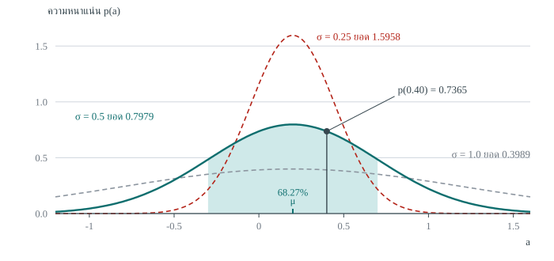

## บทที่ 10 · พื้นฐาน ๒ ระฆัง Gaussian และ log — ความน่าจะเป็นของค่าที่ต่อเนื่อง

> [!INTRO]
> บทที่ 4 นิยามการแจกแจงด้วยกล่องบัตร บัตรมีแปดใบ เราจึงถามได้ว่าบัตร 1.0 ออกบ่อยแค่ไหน และได้คำตอบเป็นเศษส่วน แต่ action ของข้อต่อหนึ่งข้อเป็นจำนวนจริง ค่า 0.40 กับ 0.4001 เป็นคนละค่า และระหว่างสองค่านั้นยังมีค่าอื่นอีกนับไม่ถ้วน คำถามว่า "ค่า 0.40 ออกบ่อยแค่ไหน" จึงต้องตอบด้วยเครื่องมือใหม่
>
> บทนี้สร้างเครื่องมือนั้น คือความหนาแน่น แล้วใช้มันกับการแจกแจงตัวเดียวที่ Tron1 ใช้ คือระฆัง Gaussian ที่มีลูกบิดสองตัว $\mu$ กับ $\sigma$ เราจะได้สมการ (13) ซึ่งให้ความสูงของระฆัง และสมการ (14) ซึ่งเป็นรูป log ของมัน และเป็นรูปที่โค้ดคำนวณจริง
>
> ของที่ต้องรู้มาก่อน: ตัวแปรสุ่ม การแจกแจง และ $\sim$ จากบทที่ 4 · action เป็นจำนวนจริงหนึ่งตัวต่อข้อต่อ จากบทที่ 5 · ตารางตัวอย่างจากบทที่ 7
>
> จบบทนี้แล้ว เราคำนวณความสูงของระฆังที่จุดใดก็ได้ด้วยมือ อธิบายได้ว่าทำไมความหนาแน่นเกิน 1 ได้ และชี้ได้ว่าแต่ละพจน์ของสมการ (14) อยู่บรรทัดไหนของ PyTorch

### ของที่ต้องมีก่อนเริ่ม

บทนี้ใช้แถว $\mu$ ของตารางตัวอย่าง และแถวใหม่หนึ่งแถว คือ $a$ ซึ่งเป็น action ที่แต่ละช่องสั่งออกไปจริง บทที่ 12 จะแสดงว่าแถว $a$ คำนวณจากแถว $\mu$ และ $\varepsilon$ อย่างไร ในบทนี้เรารับมันมาเป็นตัวเลขเฉย ๆ ตารางตัวอย่างมี action เพียงหนึ่งมิติ เราจึงคิดเหมือนหุ่นมีข้อต่อข้อเดียว

| | | t=0 | t=1 | t=2 | t=3 |
| --- | --- | --- | --- | --- | --- |
| **env 0** | $\mu$ | 0.20 | 0.30 | 0.10 | 0.40 |
| | $a$ | 0.40 | 0.20 | 0.50 | 0.40 |
| **env 1** | $\mu$ | −0.10 | 0.00 | 0.20 | −0.30 |
| | $a$ | −0.40 | 0.40 | 0.30 | −0.10 |

ตารางตัวอย่างใช้ $\sigma = 0.5$ ทุกช่อง

สัญลักษณ์ที่ใช้ในบทนี้ เรียงตามลำดับที่จะพบ

| สัญลักษณ์ | ชนิด | ความหมาย |
| --- | --- | --- |
| **ความหนาแน่น** $p(a)$ | scalar | ความสูงของระฆัง ณ $a$ · เกิน 1 ได้ เพราะสิ่งที่ต้องเป็น 1 คือพื้นที่ ไม่ใช่ความสูง |
| $\mathcal{N}(\mu, \sigma)$ **Gaussian** | การแจกแจง | ระฆังที่วางจุดกลางไว้ที่ $\mu$ และกว้าง $\sigma$ |
| $\mu$ **จุดกลาง** (mean) | scalar ต่อข้อต่อ | ตำแหน่งยอดของระฆัง |
| $\sigma$ **ส่วนเบี่ยงเบนมาตรฐาน** | scalar ต่อข้อต่อ | ความกว้างของระฆัง · ไม่ใช่ความแปรปรวน ($\sigma^2$) |
| $z$ **ระยะมาตรฐาน** | scalar ต่อข้อต่อ | $a$ ห่างจาก $\mu$ กี่เท่าของ $\sigma$ |
| $\log p(a)$ | scalar | log ของความหนาแน่น |

ในเล่มนี้ log หมายถึง log ฐาน $e$ เสมอ บางบรรทัดเขียน $\ln$ ซึ่งเป็นตัวเดียวกัน

### ปัญหา: ความน่าจะเป็นของค่าเดียวเป็นศูนย์

กล่องบัตรของบทที่ 4 มีบัตร 1.0 สามใบจากแปดใบ คำตอบของ $P(X = 1.0)$ จึงเป็น $3/8$ วิธีนี้ใช้ได้เพราะค่าที่ออกได้มีจำนวนนับได้ เราไล่ทุกค่าได้ และความน่าจะเป็นของทุกค่ารวมกันได้ 1

action ของข้อต่อหนึ่งข้อไม่เป็นแบบนั้น ถ้าเราสั่งให้ระบบสุ่ม action ซ้ำล้านครั้ง ไม่มีครั้งใดได้ 0.40 พอดีทุกหลักทศนิยม ค่าที่ได้จะเป็น 0.3998 หรือ 0.40017 หรือค่าใกล้เคียงอื่น ถ้าเราให้ค่าทุกค่ามีความน่าจะเป็นเป็นบวก แม้เพียงเล็กน้อย ผลรวมของค่าที่นับไม่ถ้วนจะเกิน 1 ทันที

ทางเดียวที่เข้ากันได้คือ

$$P(a = 0.40) = 0$$

และเป็นศูนย์สำหรับทุกค่า คำตอบนี้ถูก แต่ใช้งานไม่ได้ มันไม่ได้บอกว่าแถว 0.40 ออกบ่อยกว่าแถว 1.5 แม้เราจะรู้ว่าบางย่านออกบ่อยกว่าบางย่าน

ทางออกคือเลิกถามถึงค่าเดียว แล้วถามถึง**ช่วง** ความน่าจะเป็นที่ $a$ ตกอยู่ระหว่าง 0.39 กับ 0.41 ไม่เป็นศูนย์ และยิ่งช่วงแคบ ความน่าจะเป็นก็ยิ่งเล็กตามสัดส่วนความกว้างของช่วง ตัวเลขที่บอกว่า "ต่อความกว้างหนึ่งหน่วย ย่านนี้หนาแน่นแค่ไหน" คือสิ่งที่บทนี้ต้องการ

### ความหนาแน่น: ความน่าจะเป็นคือพื้นที่

**ความหนาแน่น** คือฟังก์ชัน $p$ ที่รับค่า $a$ แล้วคืนความสูงของกราฟ ณ จุดนั้น โดยมีกติกาเดียว คือความน่าจะเป็นที่ $a$ ตกในช่วงใด เท่ากับพื้นที่ใต้กราฟของช่วงนั้น

| ถาม | ตอบด้วย |
| --- | --- |
| $a$ ตกในช่วง $[u, v]$ บ่อยแค่ไหน | พื้นที่ใต้กราฟ $p$ จาก $u$ ถึง $v$ |
| $a$ ตกที่ไหนสักแห่ง | พื้นที่ใต้กราฟทั้งหมด ซึ่งต้องเท่ากับ 1 |
| $a$ เท่ากับค่าหนึ่งพอดี | ศูนย์ เพราะช่วงกว้างศูนย์มีพื้นที่ศูนย์ |
| ย่านไหนออกบ่อยกว่า | ย่านที่กราฟสูงกว่า |

เขียนกติกาข้อที่สองเป็นสมการได้

$$\int_{-\infty}^{\infty} p(a)\,da = 1$$

ช่วงที่แคบมากมีพื้นที่ใกล้กับสี่เหลี่ยมผืนผ้า ความกว้างคูณความสูง

ความน่าจะเป็นของช่วงแคบ ≈ ความหนาแน่น × ความกว้างของช่วง

> [!NOTE]
> ความหนาแน่นมวลของน้ำคือ 1000 kg/m³ ตัวเลข 1000 ไม่ได้แปลว่าน้ำหนัก 1000 kg ต้องคูณกับปริมาตรก่อน ความหนาแน่นของความน่าจะเป็นอ่านแบบเดียวกัน คือต้องคูณกับความกว้างของช่วงก่อนจึงจะได้ความน่าจะเป็น การเทียบนี้ไม่ได้ตรงที่มวลรวมของน้ำจะเป็นเท่าไรก็ได้ ส่วนพื้นที่รวมใต้กราฟความหนาแน่นถูกบังคับให้เป็น 1 เสมอ

กติกานี้มีผลที่แปลกตาหนึ่งข้อ ความหนาแน่นไม่ใช่ความน่าจะเป็น จึงไม่มีอะไรบังคับให้มันไม่เกิน 1 ถ้ากราฟแคบมาก มันต้องสูงมากเพื่อให้พื้นที่ยังเป็น 1 เราจะเห็นตัวเลขจริงของเรื่องนี้ในหัวข้อถัดไป

### ระฆัง Gaussian: ลูกบิดสองตัว

การแจกแจงแบบต่อเนื่องมีได้หลายรูปร่าง Tron1 ใช้รูปเดียว คือระฆังที่สมมาตรรอบจุดกลาง เรียกว่า **Gaussian** หรือการแจกแจงปกติ เขียนว่า $\mathcal{N}(\mu, \sigma)$ ระฆังทุกใบในตระกูลนี้มีรูปทรงเดียวกัน ต่างกันเพียงสองอย่าง

| ลูกบิด | ชื่อ | ทำอะไรกับระฆัง |
| --- | --- | --- |
| $\mu$ | จุดกลาง | เลื่อนทั้งใบไปซ้ายหรือขวา โดยไม่เปลี่ยนรูป |
| $\sigma$ | ส่วนเบี่ยงเบนมาตรฐาน | บีบให้แคบและสูง หรือยืดให้กว้างและเตี้ย |

> [!WARNING] ช่องที่สองของ $\mathcal{N}$ คือ $\sigma$ ไม่ใช่ $\sigma^2$
> ตำราส่วนใหญ่เขียน $\mathcal{N}(\mu, \sigma^2)$ ช่องที่สองคือความแปรปรวน เล่มนี้เขียน $\mathcal{N}(\mu, \sigma)$ ช่องที่สองคือส่วนเบี่ยงเบนมาตรฐาน ตรงกับช่อง `scale` ของ `torch.distributions.Normal` ระฆังที่เล่มนี้เขียนว่า $\mathcal{N}(0.20, 0.5)$ คือระฆังที่ตำราเขียนว่า $\mathcal{N}(0.20, 0.25)$ ถ้าอ่านสลับกัน เราจะได้ความกว้างผิดไปหนึ่งกำลังสอง

ความสูงของระฆังที่จุดใดก็ได้มีสูตรปิด เราเขียนเป็นผลคูณของสองส่วน เพราะแต่ละส่วนมีหน้าที่ของตัวเอง

> [!KEY] ความหนาแน่นของ Gaussian
> $$p(a) = \frac{1}{\sigma\sqrt{2\pi}}\,\exp\!\Big(-\frac{(a-\mu)^2}{2\sigma^2}\Big) \tag{13}$$

| ส่วน | ขึ้นกับอะไร | ทำหน้าที่ | ช่วงค่า |
| --- | --- | --- | --- |
| $\dfrac{1}{\sigma\sqrt{2\pi}}$ | $\sigma$ อย่างเดียว | ความสูงของยอด | เท่าไรก็ได้ จึงเกิน 1 ได้ |
| $\exp\!\Big(-\dfrac{(a-\mu)^2}{2\sigma^2}\Big)$ | ระยะจาก $a$ ถึง $\mu$ เทียบกับ $\sigma$ | ตัวลดทอนตามระยะ | 0 ถึง 1 เสมอ |

สมการนี้อ่านได้ว่า

ความสูงที่จุด a = ความสูงของยอด × ส่วนที่เหลือเมื่อห่างจากยอด

ส่วนแรกบอกว่าทำไมระฆังแคบต้องสูง ยิ่ง $\sigma$ เล็ก ตัวหารยิ่งเล็ก ยอดยิ่งสูง

| $\sigma$ | ความสูงของยอด | |
| --- | --- | --- |
| 1.0 | 0.3989 | ค่าเริ่มต้นของ Tron1 (บทที่ 11 แสดงที่มา) |
| 0.5 | 0.7979 | ตารางตัวอย่าง |
| 0.3 | 1.3298 | เกิน 1 แล้ว |
| 0.25 | 1.5958 | |
| 0.1 | 3.9894 | |

ส่วนที่สองขึ้นกับระยะ $a - \mu$ หารด้วย $\sigma$ เท่านั้น ระยะที่วัดเป็นจำนวนเท่าของ $\sigma$ มีชื่อของมันเอง

$$z = \frac{a - \mu}{\sigma}$$

**ระยะมาตรฐาน** $z$ คือ $a$ ห่างจาก $\mu$ กี่เท่าของ $\sigma$ เมื่อแทนลงไป ตัวลดทอนกลายเป็น $\exp(-z^2/2)$ ซึ่งไม่ขึ้นกับ $\mu$ หรือ $\sigma$ อีกแล้ว ตารางเดียวจึงใช้ได้กับระฆังทุกใบ

| ห่างจากยอด | $z$ | $\exp(-z^2/2)$ | เหลือกี่เปอร์เซ็นต์ของยอด |
| --- | --- | --- | --- |
| ที่ยอดพอดี | 0 | 1.0000 | 100% |
| | 0.4 | 0.9231 | 92.3% |
| หนึ่ง $\sigma$ | 1 | 0.6065 | 60.7% |
| สอง $\sigma$ | 2 | 0.1353 | 13.5% |
| สาม $\sigma$ | 3 | 0.0111 | 1.1% |

พื้นที่ก็อ่านด้วย $z$ ได้เช่นกัน พื้นที่ภายในหนึ่ง $\sigma$ รอบจุดกลางคือ 68.27% ภายในสอง $\sigma$ คือ 95.45% และภายในสาม $\sigma$ คือ 99.73% ไม่ว่าระฆังจะวางที่ไหนและกว้างเท่าไร

> [!EXAMPLE] จงหาความสูงของระฆัง $\mathcal{N}(0.20, 0.5)$ ที่ $a = 0.40$ ซึ่งเป็นช่อง e0 t0
>
> | ขั้น | คำนวณ | ผล | เหตุผล |
> | --- | --- | --- | --- |
> | 1 | $\sigma\sqrt{2\pi} = 0.5 \times 2.50663$ | 1.25331 | ตัวหารของส่วนแรก |
> | 2 | $1 / 1.25331$ | **0.79788** | ความสูงของยอด |
> | 3 | $a - \mu = 0.40 - 0.20$ | 0.20 | ห่างจากยอดเท่าไร |
> | 4 | $(a - \mu)^2$ | 0.04 | ยกกำลังสอง ซ้ายและขวาของยอดจึงได้ค่าเท่ากัน |
> | 5 | $2\sigma^2 = 2 \times 0.25$ | 0.5 | ตัวหารที่ปรับตามความกว้าง |
> | 6 | $-0.04 / 0.5$ | −0.08 | เลขชี้กำลัง |
> | 7 | $\exp(-0.08)$ | **0.92312** | ตัวลดทอน เหลือ 92.3% ของยอด |
> | 8 | $0.79788 \times 0.92312$ | **0.73654** | คำตอบ |
>
> ระยะมาตรฐานของจุดนี้คือ $z = 0.20 / 0.5 = 0.40$ ตรงกับแถว $z = 0.4$ ของตารางตัวลดทอน ความหนาแน่นที่ $a = 0.40$ จึงเป็น 0.7365

ตัวเลข 0.7365 ไม่ได้แปลว่าโอกาส 73.65% เมื่อนำไปคูณกับความกว้างของช่วงแคบรอบ 0.40 เราจึงได้ความน่าจะเป็น

$$P(0.39 < a < 0.41) \approx 0.7365 \times 0.02 = 0.0147$$

ค่านี้ตรงกับพื้นที่จริงใต้กราฟจนถึงทศนิยมตำแหน่งที่ห้า ถ้าขยายช่วงเป็น 0.30 ถึง 0.50 การประมาณด้วยสี่เหลี่ยมให้ 0.1473 ขณะที่พื้นที่จริงคือ 0.1465 ช่วงที่กว้างขึ้นทำให้กราฟภายในช่วงไม่แบนพอที่จะแทนด้วยสี่เหลี่ยมได้

ระฆังใบเดียวกันให้ความสูงที่ทุกจุดบนแกน ไม่ได้ให้เพียงจุดเดียว

| $a$ | −1.0 | 0.0 | 0.20 | 0.40 | 1.5 |
| --- | --- | --- | --- | --- | --- |
| $p(a)$ | 0.0448 | 0.7365 | 0.7979 | 0.7365 | 0.0272 |

สองจุด 0.0 และ 0.40 อยู่ห่างจากยอด 0.20 เท่ากันคนละข้าง จึงได้ความสูงเท่ากัน

### ความหนาแน่นเกิน 1 ได้

ที่ $\sigma = 0.25$ ยอดของระฆังสูง 1.5958 ซึ่งเกิน 1 ไม่มีอะไรผิด กติกาที่ระฆังต้องทำตามคือพื้นที่รวมเป็น 1 ระฆังที่กว้างเพียงครึ่งหนึ่งของใบเดิมจึงต้องสูงเป็นสองเท่า

| | ความน่าจะเป็น (บทที่ 4) | ความหนาแน่น (บทนี้) |
| --- | --- | --- |
| ใช้กับ | ค่าที่นับได้ เช่นบัตรแปดใบ | ค่าที่ต่อเนื่อง เช่น action |
| ค่าของจุดเดียว | ความน่าจะเป็นของค่านั้น | ความสูงของกราฟ ณ จุดนั้น |
| ของที่รวมได้ 1 | ผลรวมของทุกค่า | พื้นที่ใต้กราฟทั้งหมด |
| เกิน 1 ได้หรือไม่ | ไม่ได้ | ได้ |
| ได้ความน่าจะเป็นอย่างไร | อ่านได้เลย | คูณกับความกว้างของช่วง หรือหาพื้นที่ |

ทั้งสองคอลัมน์ตอบคำถามเดียวกันว่า "ค่าแถวนี้ออกบ่อยแค่ไหน" คอลัมน์แรกตอบด้วยตัวเลขที่อ่านได้ทันที คอลัมน์ที่สองตอบด้วยตัวเลขที่ต้องคูณความกว้างก่อน เมื่อบทหลังพูดว่า "policy ให้ความน่าจะเป็นกับ action" ในความหมายที่เคร่งครัด มันคือความหนาแน่น

### log: เปลี่ยนการคูณให้เป็นการบวก

สมการ (13) มีการคูณและ $\exp$ ในโค้ด PyTorch ไม่ได้คำนวณสมการนี้ตรง ๆ มันคำนวณ log ของสมการนี้ เหตุผลมีสามข้อ

| เหตุผล | ตัวอย่าง |
| --- | --- |
| log ของผลคูณคือผลบวกของ log | บทที่ 11 จะคูณความหนาแน่นของข้อต่อ 8 ข้อเข้าด้วยกัน ในรูป log มันคือการบวก 8 พจน์ |
| ผลคูณของตัวเลขน้อยกว่า 1 หลายตัวเล็กลงเร็วมาก | ความหนาแน่น 0.7365 แปดตัวคูณกันได้ 0.0866 ส่วน log ของมันคือ −2.4463 ซึ่งยังเป็นตัวเลขขนาดปกติ |
| log ทำให้ $\exp$ หายไป | เหลือเพียงการลบ การคูณ และการยกกำลังสอง |

เราได้รูป log ของสมการ (13) ด้วยกฎของ log สองข้อ คือ $\log(xy) = \log x + \log y$ และ $\log e^{u} = u$

| สมการ | หมายเหตุ |
| --- | --- |
| $\log p(a) = \log\dfrac{1}{\sigma\sqrt{2\pi}} + \log\exp\!\Big(-\dfrac{(a-\mu)^2}{2\sigma^2}\Big)$ | log ของผลคูณ แยกเป็นผลบวก |
| $= -\log\sigma - \log\sqrt{2\pi} - \dfrac{(a-\mu)^2}{2\sigma^2}$ | $\log(1/x) = -\log x$ และ $\log e^{u} = u$ |
| $= -\tfrac{1}{2}\ln 2\pi - \ln\sigma - \dfrac{(a-\mu)^2}{2\sigma^2}$ | $\log\sqrt{2\pi} = \tfrac12\ln 2\pi$ แล้วเรียงพจน์ใหม่ |

> [!KEY] log ของความหนาแน่นสามพจน์
> $$\log p(a) = -\tfrac{1}{2}\ln 2\pi - \ln\sigma - \frac{(a-\mu)^2}{2\sigma^2} \tag{14}$$

| พจน์ | ขึ้นกับอะไร | ค่าในตารางตัวอย่าง |
| --- | --- | --- |
| $-\tfrac12\ln 2\pi$ | ไม่ขึ้นกับอะไรเลย | −0.9189 |
| $-\ln\sigma$ | $\sigma$ อย่างเดียว | $-\ln 0.5 = +0.6931$ |
| $-\dfrac{(a-\mu)^2}{2\sigma^2}$ | ระยะจาก $a$ ถึง $\mu$ | ต่างกันทุกช่อง |

ในตารางตัวอย่าง $\sigma$ เป็น 0.5 ทุกช่อง สองพจน์แรกจึงรวมเป็นค่าคงที่ตัวเดียว คือ $-0.9189 + 0.6931 = -0.2258$ ซึ่งเป็น log ของความสูงยอด 0.7979 พอดี เหลือเพียงพจน์ที่สามที่ต้องคิดใหม่ทุกช่อง

พจน์ที่สามคือ $-z^2/2$ เมื่อเขียนด้วยระยะมาตรฐาน มันเป็นศูนย์ที่ยอด และติดลบมากขึ้นเมื่อ $a$ ห่างจาก $\mu$ log ของความหนาแน่นจึงสูงสุดที่ยอดเช่นเดียวกับตัวความหนาแน่น

> [!EXAMPLE] จงหา $\log p(a)$ ของทั้งสี่ช่องของ env 0 เมื่อ $\sigma = 0.5$
> ตัวหาร $2\sigma^2$ คือ 0.5 และค่าคงที่ของสองพจน์แรกคือ −0.2258
>
> | ช่อง | $\mu$ | $a$ | $a - \mu$ | $(a-\mu)^2/0.5$ | $\log p(a) = -0.2258 -$ พจน์ที่สาม |
> | --- | --- | --- | --- | --- | --- |
> | e0 t0 | 0.20 | 0.40 | +0.20 | 0.0800 | **−0.3058** |
> | e0 t1 | 0.30 | 0.20 | −0.10 | 0.0200 | **−0.2458** |
> | e0 t2 | 0.10 | 0.50 | +0.40 | 0.3200 | **−0.5458** |
> | e0 t3 | 0.40 | 0.40 | 0.00 | 0.0000 | **−0.2258** |
>
> ตรวจ e0 t0 กับตัวอย่างก่อนหน้า $\ln 0.73654 = -0.3058$ ตรงกัน ช่อง e0 t3 มี $a = \mu$ พอดี จึงได้ค่าของยอดคือ −0.2258 ซึ่งสูงที่สุดในสี่ช่อง ช่อง e0 t2 อยู่ห่างที่สุด คือ $z = 0.8$ จึงต่ำที่สุด

log ของความหนาแน่นติดลบในทุกช่อง เพราะความหนาแน่นทุกตัวต่ำกว่า 1 ถ้าระฆังแคบจนยอดสูงเกิน 1 log ของมันจะเป็นบวก ที่ $\sigma = 0.25$ log ของยอดคือ $+0.4674$ ไม่มีอะไรผิดปกติ มันเป็น log ของความหนาแน่น ไม่ใช่ log ของความน่าจะเป็น

| | ความหนาแน่น $p(a)$ | $\log p(a)$ |
| --- | --- | --- |
| ช่วงค่า | ตั้งแต่ 0 ขึ้นไป | ทุกจำนวนจริง |
| สูงสุดที่ไหน | ที่ยอด $a = \mu$ | ที่เดียวกัน |
| ของหลายข้อต่อรวมกันอย่างไร | คูณ | บวก |
| โค้ดเก็บตัวไหน | ไม่เก็บ | ตัวนี้ |

### จากสมการถึงโค้ด

บรรทัด `actor_critic.py:157` ที่บทที่ 4 ชี้ไว้ สร้างระฆังด้วย `Normal(...)` ของ PyTorch เมื่อถามความสูงของระฆังนั้น โค้ดเรียกเมธอด `log_prob` ซึ่งเขียนสมการ (14) ไว้ทีละพจน์ (`normal.py` ของ PyTorch เวอร์ชัน 2.5.1 ที่ติดตั้งใน conda env `tron1` เลขบรรทัดเปลี่ยนได้เมื่อเวอร์ชันเปลี่ยน)

| บรรทัด | โค้ด | สมการ |
| --- | --- | --- |
| `normal.py:84` | `var = self.scale**2` | $\sigma^2$ จากช่อง `scale` ซึ่งเก็บ $\sigma$ |
| `normal.py:89` | `-((value - self.loc) ** 2) / (2 * var)` | $-\dfrac{(a-\mu)^2}{2\sigma^2}$ โดย `loc` คือ $\mu$ และ `value` คือ $a$ |
| `normal.py:90` | `- log_scale` | $-\ln\sigma$ |
| `normal.py:91` | `- math.log(math.sqrt(2 * math.pi))` | $-\tfrac12\ln 2\pi = -0.9189$ |
| `actor_critic.py:164` | `self.distribution.log_prob(actions).sum(dim=-1)` | เรียกบรรทัดข้างบน แล้วรวมทุกข้อต่อ บทที่ 11 อธิบาย `.sum` |

ไม่มีบรรทัดใดในโค้ดคำนวณสมการ (13) ตรง ๆ ความหนาแน่นในรูปปกติมีอยู่เฉพาะในหนังสือ ในโค้ดมีแต่ log ของมัน

> [!SUMMARY]
> - ค่าที่ต่อเนื่องมีความน่าจะเป็นของค่าเดียวเป็นศูนย์ เราจึงใช้ความหนาแน่น ความน่าจะเป็นของช่วงคือพื้นที่ใต้กราฟ และพื้นที่ทั้งหมดเป็น 1
> - ระฆัง Gaussian $\mathcal{N}(\mu, \sigma)$ มีลูกบิดสองตัว $\mu$ เลื่อนตำแหน่ง $\sigma$ คุมความกว้าง และช่องที่สองของเล่มนี้คือ $\sigma$ ไม่ใช่ $\sigma^2$
> - สมการ (13) คือความสูงของยอดคูณตัวลดทอน ตัวลดทอนขึ้นกับระยะมาตรฐาน $z$ อย่างเดียว ที่ e0 t0 ได้ 0.7365
> - ความหนาแน่นเกิน 1 ได้ เพราะสิ่งที่ต้องเป็น 1 คือพื้นที่ ไม่ใช่ความสูง
> - สมการ (14) คือรูป log ซึ่งมีสามพจน์ สองพจน์แรกคงที่เมื่อ $\sigma$ คงที่ และโค้ดคำนวณรูปนี้เท่านั้น
>
> ประโยคที่ควรจำ: **ความหนาแน่นคือความสูง ความน่าจะเป็นคือพื้นที่ และโค้ดเก็บแต่ log ของความสูง**

### แบบฝึกหัด

1. ข้อใดถูกต้อง
    1. ถ้า $a$ เป็นจำนวนจริงที่สุ่มจาก Gaussian แล้ว $P(a = 0.40) = 0$
    2. ความหนาแน่นทุกค่าต้องไม่เกิน 1
    3. พื้นที่ใต้กราฟความหนาแน่นทั้งหมดเท่ากับ 1
    4. $\mathcal{N}(0.20, 0.5)$ ในเล่มนี้มีความแปรปรวน 0.5
    5. การเพิ่ม $\mu$ ทำให้ระฆังแคบลง
    6. ตัวลดทอน $\exp(-z^2/2)$ มีค่าอยู่ระหว่าง 0 ถึง 1 เสมอ
    7. log ของความหนาแน่นเป็นบวกได้
    8. ที่ $\sigma = 0.5$ ค่า $\log p(a)$ สูงสุดคือ −0.2258
    9. โค้ดของ PyTorch คำนวณสมการ (13) แล้วจึงหา log
    10. ความหนาแน่น 0.7365 แปลว่ามีโอกาส 73.65% ที่จะได้ค่านั้น

2. จงหา $\log p(a)$ ของทั้งสี่ช่องของ env 1 เมื่อ $\sigma = 0.5$ [07 §2.2]
    1. e1 t0
    2. e1 t1
    3. e1 t2
    4. e1 t3

    <!--space:30-->

3. จงหาความหนาแน่น $p(a)$ ของช่อง e1 t0 ด้วยสมการ (13) โดยแสดงความสูงของยอดและตัวลดทอนแยกกัน [05 §2.3] <!--space:24-->

4. จงหาระยะมาตรฐาน $z$ ของทั้งสี่ช่องของ env 1 แล้วบอกว่าช่องใดอยู่ใกล้ยอดที่สุด และช่องใดอยู่ไกลที่สุด <!--space:16-->

5. จงหาความสูงของยอดเมื่อ $\sigma = 0.3$ และเมื่อ $\sigma = 0.1$ แล้วอธิบายว่าทำไมทั้งสองค่าเกิน 1 ได้ [05 §2.3] <!--space:16-->

6. ระฆัง $\mathcal{N}(0.20, 0.5)$ มีความหนาแน่น 0.7365 ที่ $a = 0.40$ จงประมาณ $P(0.39 < a < 0.41)$ และอธิบายว่าทำไม $P(a = 0.40)$ จึงเป็นศูนย์ ทั้งที่ความหนาแน่นที่จุดนั้นไม่เป็นศูนย์ <!--space:18-->

7. ที่ $\sigma = 0.25$ จงหา $\log p(a)$ ที่ยอดของระฆัง แล้วอธิบายว่าเครื่องหมายของคำตอบบอกอะไร <!--space:14-->

8. ความหนาแน่น 0.7365 แปดตัวคูณกันได้ 0.0866 จงหาผลบวกของ log ทั้งแปดตัว แล้วแสดงว่าสองคำตอบนี้สอดคล้องกัน <!--space:14-->

9. จงอธิบายว่าทำไมพื้นที่ภายในหนึ่ง $\sigma$ รอบจุดกลางจึงเป็น 68.27% สำหรับระฆังทุกใบ ไม่ว่า $\mu$ และ $\sigma$ จะเป็นเท่าไร <!--space:16-->

10. ตำราเล่มหนึ่งเขียนว่า $\mathcal{N}(0.20, 0.25)$ อีกเล่มหนึ่งเขียนว่า $\mathcal{N}(0.20, 0.5)$ จงอธิบายว่าสองเล่มอาจหมายถึงระฆังใบเดียวกันได้อย่างไร และเล่มนี้ใช้ธรรมเนียมแบบใด <!--space:14-->

<!-- เฉลย -->

1. ข้อที่ถูก: 1, 3, 6, 7, 8

    - ข้อ 2 ผิด: ความหนาแน่นเกิน 1 ได้ เช่นยอดที่ $\sigma = 0.25$ สูง 1.5958
    - ข้อ 4 ผิด: ช่องที่สองของเล่มนี้คือ $\sigma$ ความแปรปรวนคือ $0.5^2 = 0.25$
    - ข้อ 5 ผิด: $\mu$ เลื่อนตำแหน่งโดยไม่เปลี่ยนรูป ความกว้างคุมด้วย $\sigma$
    - ข้อ 9 ผิด: `log_prob` คำนวณสมการ (14) ทีละพจน์โดยตรง
    - ข้อ 10 ผิด: ความหนาแน่นต้องคูณกับความกว้างของช่วงก่อนจึงจะเป็นความน่าจะเป็น

2. ใช้ $\log p(a) = -0.2258 - (a-\mu)^2/0.5$

    1. $a - \mu = -0.30$ พจน์ที่สาม 0.1800 ได้ −0.4058
    2. $a - \mu = +0.40$ พจน์ที่สาม 0.3200 ได้ −0.5458
    3. $a - \mu = +0.10$ พจน์ที่สาม 0.0200 ได้ −0.2458
    4. $a - \mu = +0.20$ พจน์ที่สาม 0.0800 ได้ −0.3058

3. ความสูงของยอดคือ 0.7979 ตัวลดทอนคือ $\exp(-0.09/0.5) = \exp(-0.18) = 0.83527$ ความหนาแน่นคือ $0.79788 \times 0.83527 = 0.66645$ ปัดเป็น 0.6664 จากค่าเต็ม 0.666449 และ $\ln 0.6664 = -0.4058$ ตรงกับข้อ 2

4. $z = -0.60, +0.80, +0.20, +0.40$ ตามลำดับ ช่อง e1 t2 อยู่ใกล้ยอดที่สุด ($|z| = 0.2$) ช่อง e1 t1 อยู่ไกลที่สุด ($|z| = 0.8$)

5. $1/(0.3\sqrt{2\pi}) = 1.3298$ และ $1/(0.1\sqrt{2\pi}) = 3.9894$ เกิน 1 ได้เพราะระฆังที่แคบลงต้องสูงขึ้นเพื่อให้พื้นที่ยังเป็น 1 ความสูงไม่ใช่ความน่าจะเป็น

6. $0.7365 \times 0.02 = 0.0147$ ความน่าจะเป็นคือพื้นที่ ช่วงที่มีความกว้างศูนย์มีพื้นที่ศูนย์ ไม่ว่ากราฟจะสูงเท่าไร

7. $\log(1/(0.25\sqrt{2\pi})) = \log 1.5958 = +0.4674$ เป็นบวกเพราะความหนาแน่นที่ยอดเกิน 1 ไม่ได้บอกว่ามีอะไรผิด

8. $8 \times \ln 0.73654 = 8 \times (-0.305792) = -2.4463$ และ $e^{-2.4463} = 0.0866$ log ของผลคูณคือผลบวกของ log

9. พื้นที่ภายในหนึ่ง $\sigma$ คือพื้นที่ที่ $|z| < 1$ เมื่อเขียนด้วย $z$ ระฆังทุกใบมีรูปเดียวกัน คือความสูงของยอดคูณ $\exp(-z^2/2)$ การเลื่อน $\mu$ ไม่เปลี่ยนรูป ส่วนการเปลี่ยน $\sigma$ ยืดแกนนอนและบีบแกนตั้งด้วยอัตราส่วนเดียวกัน พื้นที่ของช่วงที่วัดเป็นจำนวนเท่าของ $\sigma$ จึงไม่เปลี่ยน

10. เล่มแรกเขียนช่องที่สองเป็นความแปรปรวน $\sigma^2 = 0.25$ เล่มที่สองเขียนเป็นส่วนเบี่ยงเบนมาตรฐาน $\sigma = 0.5$ ทั้งสองคือระฆังที่มีจุดกลาง 0.20 และกว้าง 0.5 เล่มนี้ใช้แบบที่สอง ตรงกับช่อง `scale` ของ PyTorch
