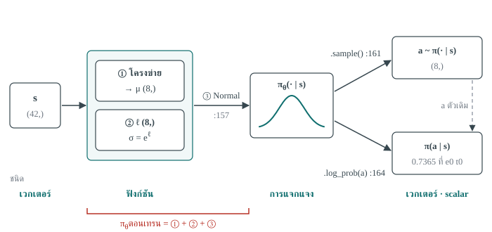

## บทที่ 11 · policy คืออะไร — ฟังก์ชัน การแจกแจง เวกเตอร์ และ scalar

> [!INTRO]
> บทที่ 3 ให้ความหมายของ policy ว่าเป็นกฎที่บอกว่าในสถานะนี้ควรทำอะไร และบทที่ 1 เรียกมันว่าตัวควบคุม ทั้งสองคำพอสำหรับส่วนที่ 2 แต่ไม่พอสำหรับการอ่านโค้ด เพราะในโค้ดและในตำรา คำว่า policy ถูกใช้กับของอย่างน้อยสี่ชิ้นที่เป็นคนละชนิดกัน ประโยค "policy ให้ action" "policy คือโครงข่าย" และ "policy ให้ความน่าจะเป็นของ action" ถูกทั้งสามประโยค แต่ถูกคนละความหมาย
>
> บทนี้แยกของสี่ชิ้นนั้นด้วยชนิดของมัน เริ่มจากบรรทัดประกาศชนิด $\pi_\theta : \mathcal{S} \to \Delta(\mathcal{A})$ แล้วประกอบ policy ของ Tron1 จากสามชิ้นตามสมการ (9) และรวมข้อต่อ 8 ข้อด้วยสมการ (15) เราจะรู้ด้วยว่าแถว $\mu$ ของตารางตัวอย่างมาจากไหน
>
> ของที่ต้องรู้มาก่อน: สายชนิด ฟังก์ชัน → การแจกแจง → เวกเตอร์ → scalar และขีดตั้ง จากบทที่ 4 · $\mathcal{S}$ และ $\mathcal{A} = \mathbb{R}^8$ จากบทที่ 5 · ระฆัง $\mathcal{N}(\mu, \sigma)$ ความหนาแน่น และ log จากบทที่ 10
>
> จบบทนี้แล้ว เราบอกชนิดของ $\pi_\theta$, $\pi_\theta(\cdot \mid s)$, $a$ และ $\pi_\theta(a \mid s)$ ได้โดยไม่สับสน ชี้บรรทัดโค้ดที่ทำให้ชนิดเปลี่ยนแต่ละครั้งได้ และบอกได้ว่าตอนไหนที่โครงข่ายเดี่ยว ๆ เป็น policy และตอนไหนไม่เป็น

### ของที่ต้องมีก่อนเริ่ม

บทนี้ใช้แถว $\mu$ และ $a$ ของตารางตัวอย่าง กับ $\log p(a)$ ที่คำนวณไว้ในบทที่ 10 ตารางตัวอย่างใช้ $\sigma = 0.5$ ทุกช่อง

| | | t=0 | t=1 | t=2 | t=3 |
| --- | --- | --- | --- | --- | --- |
| **env 0** | $\mu$ | 0.20 | 0.30 | 0.10 | 0.40 |
| | $a$ | 0.40 | 0.20 | 0.50 | 0.40 |
| | $\log p(a)$ | −0.3058 | −0.2458 | −0.5458 | −0.2258 |
| **env 1** | $\mu$ | −0.10 | 0.00 | 0.20 | −0.30 |
| | $a$ | −0.40 | 0.40 | 0.30 | −0.10 |
| | $\log p(a)$ | −0.4058 | −0.5458 | −0.2458 | −0.3058 |

สัญลักษณ์ที่ใช้ในบทนี้ เรียงตามลำดับที่จะพบ

| สัญลักษณ์ | ชนิด | ความหมาย |
| --- | --- | --- |
| $\pi_\theta$ **policy ตัวนี้** | ฟังก์ชัน $\mathcal{S}\to\Delta(\mathcal{A})$ | รับ $s$ คืนการแจกแจงบน $\mathcal{A}$ ไม่ได้คืน action |
| $\Delta(\mathcal{A})$ | เซต | เซตของการแจกแจงทั้งหมดบน $\mathcal{A}$ คือระฆังทุกใบที่วางบน $\mathcal{A}$ ได้ |
| $\mu_\theta(s)$ **จุดกลาง** | เวกเตอร์ `(8,)` | output ของโครงข่าย คือท่าที่โครงข่ายคิดว่าดีที่สุด · นิพจน์ที่คำนวณใหม่ทุกครั้ง |
| $\ell$ **logstd** | เวกเตอร์ `(8,)` | ลูกบิดคุมความกว้าง หนึ่งตัวต่อข้อต่อ · ตัวแปรที่อยู่ข้างโครงข่าย ไม่ได้อยู่ข้างใน |
| $\sigma$ | เวกเตอร์ `(8,)` | ความกว้างของระฆัง $\sigma = e^{\ell}$ · ไม่ขึ้นกับ $s$ |
| $\theta$ **พารามิเตอร์ของ policy** | เวกเตอร์ยาว | ตัวเลขทั้งหมดที่การเรียนรู้ไปเปลี่ยน คือตัวเลขในโครงข่าย 187,272 ตัว บวก $\ell$ 8 ตัว รวม 187,280 |
| $\pi_\theta(\cdot \mid s)$ **ระฆังหนึ่งใบ** | การแจกแจง | ผลของการใส่ $s$ เข้า $\pi_\theta$ · จุดกลมคือช่องที่ยังไม่เติม |
| $a \sim \pi_\theta(\cdot \mid s)$ | เวกเตอร์ `(8,)` | action ที่สุ่มจากระฆังใบนั้น · สุ่มซ้ำได้ค่าใหม่ |
| $\pi_\theta(a \mid s)$ **ความหนาแน่น ณ จุด a** | scalar | ความสูงของระฆัง ณ $a$ · เกิน 1 ได้ |

### ปัญหา: คำเดียว ของสี่ชิ้น

ลองอ่านสี่ประโยคนี้

| ประโยค | ถูกหรือไม่ |
| --- | --- |
| "policy รับสถานะแล้วสั่ง action" | ถูก ถ้าหมายถึงสิ่งที่หุ่นทำในแต่ละ step |
| "policy คือโครงข่ายที่ export เป็นไฟล์ไปลงหุ่น" | ถูก ถ้าหมายถึงตอนใช้งานบนหุ่นจริง |
| "policy ให้ความน่าจะเป็นของ action" | ถูก ถ้าหมายถึงตอนเทรน |
| "policy สุ่ม action" | ถูก แต่การสุ่มไม่ได้เกิดในโครงข่าย |

สี่ประโยคนี้ไม่ได้ขัดกัน แต่แต่ละประโยคพูดถึงของคนละชิ้น ถ้าเราไม่รู้ว่ากำลังพูดถึงชิ้นไหน เราจะถามคำถามที่ตอบไม่ได้ เช่น "โครงข่ายให้ความน่าจะเป็นออกมาได้อย่างไร" ซึ่งคำตอบคือ มันไม่ได้ให้

วิธีที่บทที่ 4 ใช้กับกล่องบัตรใช้ได้ที่นี่ คือถามชนิดของของแต่ละชิ้นก่อนถามว่ามันทำอะไร

### ประกาศชนิดก่อน: $\pi_\theta : \mathcal{S} \to \Delta(\mathcal{A})$

ในคณิตศาสตร์ เราประกาศชนิดของฟังก์ชันด้วยการบอกว่ามันรับอะไรและคืนอะไร เช่น $f : \mathbb{R} \to \mathbb{R}$ คือฟังก์ชันที่รับจำนวนจริงแล้วคืนจำนวนจริง policy ของ Tron1 ประกาศแบบนี้

$$\pi_\theta : \mathcal{S} \to \Delta(\mathcal{A})$$

| ส่วน | อ่านว่า |
| --- | --- |
| $\pi_\theta$ | ชื่อ $\pi$ คือ policy ตัวห้อย $\theta$ บอกว่าเป็นตัวที่มีพารามิเตอร์ $\theta$ |
| $:$ | มีชนิดเป็น |
| $\mathcal{S}$ | รับสถานะหนึ่งตัว |
| $\to$ | เป็นฟังก์ชันไปยัง |
| $\Delta(\mathcal{A})$ | คืนสมาชิกหนึ่งตัวของเซตนี้ |

บรรทัดนี้ไม่ได้คำนวณอะไร มันบอกเพียงว่าของชิ้นนี้เป็นอะไร เหมือนการระบุชนิดของตัวแปรในโปรแกรม

**$\Delta(\mathcal{A})$ คือเซตของการแจกแจงทั้งหมดบน $\mathcal{A}$** สมาชิกแต่ละตัวของเซตนี้ไม่ใช่ตัวเลข แต่เป็นการแจกแจงหนึ่งตัว สำหรับ Tron1 ซึ่งมี $\mathcal{A} = \mathbb{R}^8$ สมาชิกแต่ละตัวคือระฆังหนึ่งใบที่วางบนปริภูมิ 8 มิติ policy จึงไม่ได้คืน action มันคืนระฆัง

> [!REMARK]
> ตัวอักษร $\Delta$ มาจากรูปของเซตนี้เมื่อ action มีสามทางเลือก การแจกแจงหนึ่งตัวคือตัวเลขสามตัว $(p_1, p_2, p_3)$ ที่ไม่ติดลบและรวมได้ 1 จุดทั้งหมดที่ทำตามเงื่อนไขนี้เรียงตัวเป็นสามเหลี่ยมในปริภูมิสามมิติ ตำราเรียกรูปนี้ว่า simplex สำหรับ action ที่ต่อเนื่องอย่างของ Tron1 เซตนี้วาดไม่ได้ แต่ความหมายเหมือนเดิม $\Delta$ ตัวใหญ่ที่นี่ไม่ใช่ผลต่าง และไม่เกี่ยวกับตัวเล็ก $\delta$ ที่บทหลังจะใช้

เมื่อพูดถึง $\Delta(\mathcal{A})$ เราใช้คำว่าการแจกแจง**บน** $\mathcal{A}$ ส่วนเมื่อพูดถึงสิ่งที่สุ่มได้ เราใช้คำว่าการแจกแจง**ของ** $a$ คำทดสอบมีข้อเดียว คือถามว่าสิ่งนั้นสุ่มได้หรือไม่ $\mathcal{A}$ เป็นรายการของทางเลือกทั้งหมด สุ่มไม่ได้ จึงใช้ "บน" ส่วน $a$ เป็นค่าที่สุ่มใหม่ได้ค่าใหม่ จึงใช้ "ของ"

### สมการ (9): policy ของ Tron1 ประกอบจากสามชิ้น

บรรทัดประกาศชนิดบอกว่า policy ต้องคืนการแจกแจง แต่ไม่ได้บอกว่าการแจกแจงหน้าตาอย่างไร Tron1 ตอบด้วยของสามชิ้น

| ชิ้น | คืออะไร | ให้อะไรกับระฆัง | จำนวนตัวเลข | ถูกเรียนรู้หรือไม่ | โค้ด |
| --- | --- | --- | --- | --- | --- |
| ① โครงข่าย | ฟังก์ชันที่รับ 42 ค่า คืน 8 ค่า | ตำแหน่ง $\mu_\theta(s)$ | 187,272 | ใช่ | `self.actor` `actor_critic.py:90` |
| ② `logstd` | ตัวเลข 8 ตัว หนึ่งตัวต่อข้อต่อ | ความกว้าง $\sigma = e^{\ell}$ | 8 | ใช่ | `self.logstd` `actor_critic.py:118` |
| ③ สูตร $\mathcal{N}$ | บรรทัดโค้ดที่ประกอบ $\mu$ กับ $\sigma$ เป็นระฆัง | รูปทรง | 0 | ไม่ ตายตัว | `Normal(...)` `actor_critic.py:157` |

ข้างในโครงข่ายมีอะไร และ 187,272 มาจากไหน เป็นเรื่องของบทที่ 13 ในบทนี้เรารู้เพียงว่ามันเป็นฟังก์ชันที่รับเวกเตอร์ 42 ค่า แล้วคืนเวกเตอร์ 8 ค่า

$$\mu_\theta : \mathbb{R}^{42} \to \mathbb{R}^{8}$$

ประกอบสามชิ้นเข้าด้วยกัน ได้สมการแรกของส่วนนี้

> [!KEY] policy ของ Tron1
> $$\pi_\theta(\cdot \mid s) = \mathcal{N}\big(\mu_\theta(s),\ \sigma\big), \qquad \sigma = e^{\ell} \tag{9}$$

สมการนี้อ่านว่า

ระฆังของสถานะ s = ระฆัง Gaussian ที่วางที่ คำตอบของโครงข่ายเมื่อป้อน s และกว้าง e ยกกำลังลูกบิด ℓ

$\theta$ คือตัวเลขของสองชิ้นแรกรวมกัน $187{,}272 + 8 = 187{,}280$ ตัว เมื่อเราพูดว่าการเรียนรู้ปรับ policy หมายถึงปรับตัวเลขทั้งหมดนี้พร้อมกัน ส่วนชิ้นที่ ③ ไม่มีอะไรให้ปรับ

**สังเกตว่า $\mu_\theta(s)$ มี $(s)$ ต่อท้าย แต่ $\sigma$ ไม่มี** การเขียนต่างกันนี้ตั้งใจ $\mu$ คำนวณใหม่จาก $s$ ทุกครั้ง ระฆังจึงย้ายตำแหน่งเมื่อสถานะเปลี่ยน ส่วน $\ell$ เป็นตัวเลข 8 ตัวที่ไม่รับ input ใดเลย ทุกสถานะและทุก env ใช้ความกว้างชุดเดียวกัน

| | $\mu_\theta(s)$ | $\ell$ |
| --- | --- | --- |
| คืออะไร | นิพจน์ ผลของการป้อน $s$ เข้าโครงข่าย | ตัวแปร มีค่าของตัวเอง |
| ขึ้นกับ $s$ หรือไม่ | ขึ้น | ไม่ขึ้น |
| อยู่นานแค่ไหน | คำนวณใหม่ทุกครั้งที่เรียก แล้วทิ้ง | ค้างตลอดการเทรน เปลี่ยนเมื่อการเรียนรู้เขียนทับเท่านั้น |
| บรรทัด | `mean = self.actor(observations)` `actor_critic.py:156` | `self.logstd = nn.Parameter(torch.zeros(num_actions))` `actor_critic.py:118` |

**ทำไมเก็บ $\ell$ แทนที่จะเก็บ $\sigma$ ตรง ๆ** การเรียนรู้ลากตัวเลขไปทางไหนก็ได้ รวมถึงติดลบ ถ้าเก็บ $\sigma$ ตรง ๆ แล้วมันถูกลากจนติดลบหรือเป็นศูนย์ พจน์ $\ln\sigma$ ของสมการ (14) จะคำนวณไม่ได้ เมื่อเก็บ $\ell$ แล้วยกกำลัง $e$ ทุกครั้ง $\sigma$ เป็นบวกเสมอไม่ว่า $\ell$ จะเป็นเท่าไร

| $\ell$ | $\sigma = e^{\ell}$ | |
| --- | --- | --- |
| 0 | 1.0 | ค่าเริ่มต้นของ Tron1 |
| −0.6931 | 0.5 | ค่าของตารางตัวอย่าง คือ $\ln 0.5$ |
| −2.3026 | 0.1 | แคบมาก |
| +0.5 | 1.649 | กว้างกว่าค่าเริ่มต้น |
| −100 | $3.72 \times 10^{-44}$ | เกือบศูนย์ แต่ไม่ถึงศูนย์ |

> [!NOTE]
> config ของ Tron1 ตั้ง `init_noise_std=1.0` (`limx_rsl_rl_ppo_cfg.py:87`) แต่บรรทัดที่ใช้ค่านี้ถูกคอมเมนต์ทิ้งไว้ (`actor_critic.py:117`) บรรทัดที่รันจริงคือ `:118` ซึ่งตั้ง $\ell$ เป็นศูนย์ทุกตัว จึงได้ $\sigma = e^{0} = 1.0$ ค่าใน config กับค่าที่ใช้จริงบังเอิญตรงกัน ถ้าแก้ค่าใน config เป็นอย่างอื่น ความกว้างเริ่มต้นจะไม่เปลี่ยน

> [!EXAMPLE] จงประกอบระฆังของช่อง e0 t0 ตามสมการ (9)
> ① โครงข่ายรับสถานะของ e0 t0 แล้วคืน $\mu = 0.20$ ซึ่งคือแถว $\mu$ ของตารางตัวอย่าง
>
> ② ตารางตัวอย่างตั้ง $\ell = \ln 0.5 = -0.6931$ ไว้ตลอด จึงได้ $\sigma = e^{-0.6931} = 0.5$
>
> ③ ประกอบเป็นระฆัง
>
> $$\pi_\theta(\cdot \mid s_0) = \mathcal{N}(0.20,\ 0.5)$$
>
> ระฆังใบนี้คือคำตอบของ policy ต่อสถานะของ e0 t0 ยอดของมันอยู่ที่ 0.20 และสูง 0.7979 ตามบทที่ 10

**แถว $\mu$ ของตารางตัวอย่างคือตำแหน่งของระฆังทั้งแปดใบ** บทที่ 7 บอกไว้เพียงว่าเป็นค่าที่ policy คำนวณได้ก่อนเลือก action ตอนนี้เรารู้แล้วว่ามันคือ output ของชิ้นที่ ① และทุกช่องมีระฆังของตัวเอง ทั้งแปดใบกว้าง 0.5 เท่ากัน ต่างกันที่ตำแหน่งเท่านั้น ตัวอย่างไม่มีโครงข่ายจริง ตัวเลขในแถว $\mu$ จึงถูกตั้งไว้ให้ ไม่ได้คำนวณ

### สายชนิด: ฟังก์ชัน → การแจกแจง → เวกเตอร์ → scalar

เมื่อมีระฆังแล้ว เรายังไม่ได้ action กว่าจะได้ action ต้องผ่านอีกขั้นหนึ่ง และขั้นนั้นมีสองทางให้เลือก ของที่เกิดขึ้นตลอดทางเปลี่ยนชนิดทุกครั้งที่ข้ามลูกศร

| ขั้น | เขียนว่า | ชนิด | ในโค้ด |
| --- | --- | --- | --- |
| policy ทั้งตัว | $\pi_\theta$ | ฟังก์ชัน $\mathcal{S}\to\Delta(\mathcal{A})$ | ① + ② + ③ ไม่มีอ็อบเจกต์เดียวในโค้ดที่เท่ากับมัน |
| ใส่ $s$ เข้าไป | $\pi_\theta(\cdot \mid s)$ | การแจกแจง | `self.distribution` อ็อบเจกต์ `Normal` ที่ `actor_critic.py:157` สร้าง |
| ทางที่ 1 สุ่ม | $a \sim \pi_\theta(\cdot \mid s)$ | เวกเตอร์ `(8,)` | `self.distribution.sample()` `actor_critic.py:161` |
| ทางที่ 2 แทนค่า | $\pi_\theta(a \mid s)$ | scalar | `self.distribution.log_prob(actions).sum(dim=-1)` `actor_critic.py:164` คืนในรูป log |

บทที่ 4 เดินสายเดียวกันนี้ด้วยกล่องบัตร กฎที่รับเลขกล่องแล้วคืนตารางของกล่องนั้นคือฟังก์ชัน ตารางของกล่องคือการแจกแจง บัตรที่จับได้คือค่าที่สุ่มได้ และการถามว่าบัตรใบนั้นออกบ่อยแค่ไหนได้ scalar policy เดินสายเดียวกัน โดยเลขกล่องกลายเป็นสถานะ ตารางของกล่องกลายเป็นระฆัง และบัตรใบเดียวกลายเป็นเวกเตอร์ 8 ค่า การเทียบนี้ใช้ไม่ได้ตรงที่กล่องมีบัตรนับได้ ค่าที่ได้จากขั้นสุดท้ายจึงเป็นความน่าจะเป็น ส่วนระฆังให้ความหนาแน่น ซึ่งเกิน 1 ได้

**จุดกลม $\cdot$ คือช่องที่ยังไม่เติม** ความต่างระหว่าง $\pi_\theta(\cdot \mid s)$ กับ $\pi_\theta(a \mid s)$ คือความต่างเดียวกับ $f$ กับ $f(3)$ ถ้า $f(x) = x^2$ แล้ว $f$ คือกฎทั้งเส้น ซึ่งเราพูดถึงได้ เช่น "กราฟของ $f$ เป็นพาราโบลา" แต่ตอบเป็นตัวเลขไม่ได้ ส่วน $f(3) = 9$ เป็นตัวเลขตัวเดียว ระฆัง $\pi_\theta(\cdot \mid s)$ คือกราฟทั้งเส้น ส่วน $\pi_\theta(a \mid s)$ คือความสูงของกราฟที่จุดเดียว

> [!EXAMPLE] จงแสดงว่าระฆังของช่อง e0 t0 ให้ตัวเลขได้ทุกค่าของ $a$ และระบุว่าตัวเลขใดคือ $\pi_\theta(a \mid s)$ ของ action ที่ช่องนี้สั่งจริง
> ระฆังคือ $\mathcal{N}(0.20, 0.5)$ เราคำนวณความสูงด้วยสมการ (13) ของบทที่ 10
>
> | $a$ | −1.0 | 0.0 | 0.20 | 0.40 | 1.5 |
> | --- | --- | --- | --- | --- | --- |
> | $\pi_\theta(a \mid s_0)$ | 0.0448 | 0.7365 | 0.7979 | **0.7365** | 0.0272 |
>
> ตารางทั้งแถว ซึ่งยาวไม่รู้จบถ้าเขียนครบทุกค่าของ $a$ คือ $\pi_\theta(\cdot \mid s_0)$ หนึ่งช่องของตารางคือ $\pi_\theta(a \mid s_0)$ หนึ่งค่า action ที่ช่องนี้สั่งจริงคือ $a = 0.40$ ตัวเลขที่ policy ให้กับ action นี้จึงเป็น 0.7365 และ log ของมันคือ −0.3058

### ตำแหน่งของ $a$ บอกลำดับเวลา

สองบรรทัดล่างของสายชนิดหน้าตาคล้ายกันมาก แต่ $a$ อยู่คนละที่

| เขียนว่า | $a$ อยู่ที่ไหน | แปลว่า |
| --- | --- | --- |
| $a \sim \pi_\theta(\cdot \mid s)$ | หน้า $\sim$ | ยังไม่มี $a$ กำลังสร้างมันขึ้นมา |
| $\pi_\theta(a \mid s)$ | ในวงเล็บ | มี $a$ อยู่แล้ว กำลังถามระฆังว่าที่จุดนั้นสูงเท่าไร |

ลำดับในโค้ดจึงบังคับ สุ่มก่อน แล้วจึงแทนค่า ตอนเก็บข้อมูลแต่ละ step โค้ดสุ่ม action ที่ `ppo.py:137-139` แล้วนำ action ตัวเดิมไปถามความหนาแน่นที่ `ppo.py:147-149` ค่าที่ได้ถูกเก็บลงตาราง `.log_prob` ไม่ได้สร้าง $a$ เอง มันรับ $a$ ที่มีอยู่แล้วเข้าไป

**$\sim$ ไม่ใช่การเรียกฟังก์ชัน** ฟังก์ชันต้องคืนค่าเดิมเมื่อได้ input เดิม `.sample()` ละเมิดข้อนี้ เรียกสองครั้งด้วยระฆังใบเดิมได้ action คนละค่า เพราะมันใช้เลขสุ่มจากภายนอกระฆัง ซึ่งเป็นเรื่องของบทที่ 12 ส่วน `.log_prob(a)` เป็นฟังก์ชันจริง $a$ เดิมได้คำตอบเดิมเสมอ

> [!NOTE]
> ลูกเต๋าที่ถ่วงน้ำหนักไว้ช่วยแยกสองการกระทำนี้ได้ การทอยลูกเต๋าคือ $a \sim \pi_\theta(\cdot \mid s)$ ทอยใหม่ได้หน้าใหม่ การเปิดตารางดูว่าหน้า 6 มีโอกาสเท่าไรคือ $\pi_\theta(6 \mid s)$ เปิดกี่ครั้งก็ได้ตัวเลขเดิม การเทียบนี้ใช้ไม่ได้ตรงที่ลูกเต๋ามีหกหน้าและตัวเลขในตารางเป็นความน่าจะเป็น ส่วน action เป็นจำนวนจริงและตัวเลขของระฆังเป็นความหนาแน่น

### สามช่องในวงเล็บ

นิพจน์ $\pi_\theta(a \mid s)$ มีของสามชิ้นในตำแหน่งต่างกัน แต่ละตำแหน่งตรงกับโครงสร้างโค้ดหนึ่งแบบ

| ตำแหน่ง | ของ | บทบาท | ในโค้ด |
| --- | --- | --- | --- |
| ตัวห้อย | $\theta$ | พารามิเตอร์ที่อยู่ในตัว policy | อยู่ใน `self` ของ `ActorCritic` ไม่ได้ส่งเข้าไป |
| ขวาของขีดตั้ง | $s$ | เงื่อนไข ใช้กำหนดว่าระฆังหน้าตาอย่างไร | input ของ `update_distribution(observations)` `actor_critic.py:155` |
| ซ้ายของขีดตั้ง | $a$ | ค่าที่ถามว่าความหนาแน่นเท่าไร | input ของ `get_actions_log_prob(actions)` `actor_critic.py:163` |

ขีดตั้งในวงเล็บมีความหมายเดียวกับบทที่ 4 ทางขวาคือสิ่งที่ตรึงไว้ ทางซ้ายคือสิ่งที่ยังสุ่มอยู่ พื้นที่ใต้ระฆังเมื่อรวมทางซ้ายทุกค่าเป็น 1 สำหรับทุก $s$ แต่การรวมทางขวาทุกค่าไม่มีความหมาย ในโค้ด สองตำแหน่งนี้แยกเป็นสองเมธอด เพราะระฆังที่ `update_distribution` สร้างไว้ใน `self.distribution` ถูกถามซ้ำหลายคำถาม ทั้งความหนาแน่น (`actor_critic.py:163-164`) จุดกลาง ความกว้าง และคำถามอื่นที่บทหลังจะใช้ (`:143-153`) โดยไม่ต้องสร้างระฆังใหม่

### เครื่องหมาย $=$ ในสมการ (9)

ทางซ้ายของสมการ (9) คือระฆังที่ policy คืนออกมา ทางขวาคือระฆัง Gaussian ที่มีพารามิเตอร์สองตัว ทั้งสองข้างเป็นการแจกแจงเหมือนกัน การเท่ากันของการแจกแจงหมายถึงเท่ากันที่ทุกจุด

$$\pi_\theta(a \mid s) = \mathcal{N}(a;\ \mu_\theta(s),\ \sigma)$$

สำหรับ $a$ ทุกค่า ทางขวาเขียน $\mathcal{N}(a;\ \mu, \sigma)$ หมายถึงความสูงของระฆัง $\mathcal{N}(\mu, \sigma)$ ที่จุด $a$ ตามสมการ (13)

สมการ (9) ไม่ได้มาจากการพิสูจน์ มันเป็นการเลือกของผู้ออกแบบ ทางซ้ายบอกบทบาท คือการแจกแจงที่ policy ใช้เลือก action ทางขวาบอกว่าใครมารับบทนั้น ถ้าเลือกการแจกแจงแบบอื่น ทางซ้ายเหมือนเดิม ทางขวาเปลี่ยน

| ถ้าเลือก | ใช้เมื่อ |
| --- | --- |
| Gaussian $\mathcal{N}(\mu, \sigma)$ | action ต่อเนื่องและไม่มีขอบ ซึ่ง Tron1 ใช้ |
| Beta | action มีขอบชัด เช่นอยู่ในช่วง $[-1, 1]$ |
| Categorical | action เป็นตัวเลือกที่นับได้ เช่นปุ่มของเกม |

การเลือก Gaussian ไม่ได้ลดความสามารถของชิ้นที่ ① ซึ่งยังคำนวณ $\mu_\theta(s)$ ที่ซับซ้อนเท่าใดก็ได้ แต่มันจำกัดสิ่งที่ระฆังแสดงได้ ระฆังมียอดเดียว กว้างเท่ากันทุกสถานะ และข้อต่อแต่ละข้อสุ่มแยกกัน ซึ่งเป็นเรื่องของหัวข้อถัดไป ระฆังของ Tron1 จึงเป็น Gaussian ตั้งแต่วินาทีแรกของการเทรนจนวินาทีสุดท้าย สิ่งที่การเรียนรู้เปลี่ยนคือระฆังควรวางที่ไหนสำหรับแต่ละสถานะ และควรกว้างเท่าไร

### สมการ (15): แปดข้อต่อ

ตารางตัวอย่างมีข้อต่อเดียว Tron1 มีแปด ระฆังของ Tron1 จึงเป็นระฆังแปดมิติ คือมี $\mu$ แปดค่าและ $\sigma$ แปดค่า โค้ดถือว่าข้อต่อแต่ละข้อสุ่มอิสระจากกัน ความหนาแน่นของท่าทั้งตัวจึงเป็นผลคูณของความหนาแน่นของแต่ละข้อ และในรูป log ผลคูณกลายเป็นผลบวกตามบทที่ 10

> [!KEY] รวมแปดข้อต่อที่อิสระต่อกัน
> $$\log\pi_\theta(a \mid s) = \sum_{i=1}^{8} \log\pi(a_i \mid s) \tag{15}$$

| | ความหมาย |
| --- | --- |
| $a_i$ | ค่าของข้อต่อที่ $i$ ใน action |
| $\log\pi(a_i \mid s)$ | log ของความหนาแน่นของข้อต่อที่ $i$ ตามสมการ (14) โดยใช้ $\mu_i$ และ $\sigma_i$ ของข้อนั้น |

ในโค้ด `log_prob(actions)` คืน log ของแต่ละข้อต่อเป็นเวกเตอร์ 8 ค่า แล้ว `.sum(dim=-1)` บวกทั้ง 8 ค่าเป็นตัวเลขตัวเดียว (`actor_critic.py:164`) ตารางตัวอย่างมีข้อต่อเดียว ผลบวกจึงมีพจน์เดียว ซึ่งคือ $\log p(a)$ ของบทที่ 10

> [!EXAMPLE] ให้ข้อต่อที่ 1 ของหุ่นคือช่อง e0 t0 และข้อต่ออีกเจ็ดข้อมีค่าตามตารางข้างล่าง จงหา $\log\pi_\theta(a \mid s)$ และ $\pi_\theta(a \mid s)$ ของท่าทั้งตัว
> ตัวเลขชุดนี้คือส่วนขยายแปดมิติของตารางตัวอย่าง ทุกข้อใช้ $\sigma = 0.5$ ค่าคงที่ของสองพจน์แรกจึงเป็น −0.2258 ทุกข้อ
>
> | ข้อต่อ $i$ | 1 | 2 | 3 | 4 | 5 | 6 | 7 | 8 |
> | --- | --- | --- | --- | --- | --- | --- | --- | --- |
> | $\mu_i$ | 0.20 | −0.30 | 0.10 | 0.40 | −0.10 | 0.60 | −0.50 | 0.30 |
> | $a_i$ | 0.40 | −0.40 | 0.40 | 0.40 | −0.40 | 1.20 | −0.90 | 0.40 |
> | $\log\pi(a_i \mid s)$ | −0.3058 | −0.2458 | −0.4058 | −0.2258 | −0.4058 | −0.9458 | −0.5458 | −0.2458 |
>
> บวกทั้งแปดพจน์ตามสมการ (15) โดยใช้ค่าเต็มก่อนปัด ผลบวกของค่าที่ปัดแล้วในตารางคือ −3.3264 ต่างจากค่าจริงที่หลักสุดท้าย
>
> $$\log\pi_\theta(a \mid s) = -3.3263, \qquad \pi_\theta(a \mid s) = e^{-3.3263} = 0.03592$$
>
> ถ้าคูณความหนาแน่นทั้งแปดตัวตรง ๆ ก็ได้ 0.03592 เช่นกัน ข้อต่อที่ 6 อยู่ห่างจากจุดกลางมากที่สุด ($z = 1.2$) จึงดึงผลรวมลงมากที่สุด

การสมมติว่าข้อต่อเป็นอิสระต่อกันทำให้คำนวณง่าย แต่มีราคา policy แบบนี้แสดงไม่ได้ว่า "ถ้าเข่าซ้ายเบี่ยงขึ้น สะโพกซ้ายควรเบี่ยงลงด้วย" การเบี่ยงของแต่ละข้อเกิดขึ้นแยกกัน ความสัมพันธ์ระหว่างข้อต่อทั้งหมดต้องอยู่ใน $\mu_\theta(s)$ แทน

### stochastic กับ deterministic

policy ที่คืนการแจกแจงแล้วสุ่มเรียกว่า **stochastic** policy ที่คืน action ตรง ๆ เรียกว่า **deterministic** Tron1 ใช้ทั้งสองแบบ คนละช่วงเวลา

| | stochastic | deterministic |
| --- | --- | --- |
| เขียนว่า | $a \sim \pi_\theta(\cdot \mid s)$ | $a = \mu_\theta(s)$ |
| ชนิดของ policy | $\mathcal{S} \to \Delta(\mathcal{A})$ | $\mathcal{S} \to \mathcal{A}$ |
| ใช้ชิ้นไหน | ① + ② + ③ | ① อย่างเดียว ② ถูกทิ้ง ③ ไม่ถูกเรียก |
| Tron1 ใช้ตอน | เทรน | ใช้งานบนหุ่นจริง |
| ในโค้ด | `act` `actor_critic.py:159-161` | `act_inference` `actor_critic.py:166-168` คืน `self.actor(observations)` แล้วจบ |
| e0 t0 สั่ง | 0.40 ซึ่งเป็นค่าที่สุ่มได้ | 0.20 ซึ่งคือ $\mu$ |

สองแบบต่างกันที่เครื่องหมายเดียว คือ $\sim$ กับ $=$ ตอนใช้งานบนหุ่นจริงไม่มีการสุ่ม และไม่มีการถามความหนาแน่น ความกว้าง $\sigma$ จึงไม่ถูกใช้เลย ไม่ใช่ถูกตั้งเป็นศูนย์ รายละเอียดของการนำไปใช้บนหุ่นจริงอยู่ในบทที่ 30

เส้นแบ่งนี้ตอบคำถามว่าโครงข่ายเดี่ยว ๆ เป็น policy หรือไม่ คำตอบขึ้นกับว่าเราอยู่ช่วงไหน

| คำว่า policy ในปากของ | หมายถึง | ตรงกับ |
| --- | --- | --- |
| ตำรา RL | ฟังก์ชัน $\mathcal{S} \to \Delta(\mathcal{A})$ | ① + ② + ③ |
| โปรแกรมเมอร์ | โครงข่ายที่นำไปลงหุ่น | ① อย่างเดียว |
| ไฟล์ `policy.onnx` | โครงข่ายที่ export แล้ว | ① อย่างเดียว (`play.py:111-116` export `actor_critic.actor` ในชื่อ `"policy"`) |

สามความหมายนี้ตรงกันพอดีตอนใช้งานบนหุ่นจริง เพราะเหลือเพียง ① ส่วนตอนเทรน `self.actor(obs)` คืนเวกเตอร์ ไม่ได้คืนระฆัง มันจึงเป็นเพียงชิ้นส่วนของ policy เกณฑ์ที่ใช้ได้ทุกครั้งคือถามว่าสิ่งนั้นคืนการแจกแจงหรือคืนเวกเตอร์ ถ้าประโยคใดพูดถึงความน่าจะเป็นหรือการสุ่ม ประโยคนั้นใช้ความหมายของตำรา

### จากสมการถึงโค้ด

| ในสมการ | ชนิด | บรรทัด | โค้ด |
| --- | --- | --- | --- |
| $\ell$ | เวกเตอร์ `(8,)` | `actor_critic.py:118` | `self.logstd = nn.Parameter(torch.zeros(num_actions))` |
| $\mu_\theta(s)$ | เวกเตอร์ `(B, 8)` | `actor_critic.py:156` | `mean = self.actor(observations)` |
| สมการ (9) $\pi_\theta(\cdot \mid s)$ | การแจกแจง | `actor_critic.py:157` | `self.distribution = Normal(mean, mean * 0.0 + torch.exp(self.logstd))` |
| $a \sim \pi_\theta(\cdot \mid s)$ | เวกเตอร์ `(B, 8)` | `actor_critic.py:161` | `return self.distribution.sample()` |
| สมการ (15) $\log\pi_\theta(a \mid s)$ | `(B,)` | `actor_critic.py:164` | `return self.distribution.log_prob(actions).sum(dim=-1)` |
| $a = \mu_\theta(s)$ | เวกเตอร์ `(B, 8)` | `actor_critic.py:166-168` | `act_inference` คืน `self.actor(observations)` |
| สุ่มแล้วแทนค่าตัวเดิม | | `ppo.py:137-139` แล้ว `ppo.py:147-149` | `act(...)` แล้ว `get_actions_log_prob(self.transition.actions)` |

ในโค้ดทุกก้อนมี $B$ นำหน้า คือทุก env ทำพร้อมกัน `self.distribution` จึงเป็นอ็อบเจกต์ `Normal` ตัวเดียวที่ถือระฆังแปดมิติ $B$ ใบ หนึ่งใบต่อ env และ `.sum(dim=-1)` คืนตัวเลขหนึ่งตัวต่อ env ส่วนตารางสัญลักษณ์ของบทนี้เขียนขนาดต่อหนึ่ง env เพราะกำลังพูดถึงชนิด ไม่ใช่ขนาด

> [!SUMMARY]
> - $\pi_\theta : \mathcal{S} \to \Delta(\mathcal{A})$ คือฟังก์ชันที่รับสถานะแล้วคืนการแจกแจงหนึ่งตัว ไม่ได้คืน action
> - สมการ (9) ประกอบ policy ของ Tron1 จากสามชิ้น โครงข่ายให้ $\mu_\theta(s)$ ลูกบิด $\ell$ ให้ $\sigma = e^{\ell}$ และสูตร $\mathcal{N}$ ให้รูปทรง $\theta$ มี 187,280 ตัว
> - ของบนทางเปลี่ยนชนิดทุกครั้ง $\pi_\theta$ เป็นฟังก์ชัน $\pi_\theta(\cdot \mid s)$ เป็นการแจกแจง $a$ เป็นเวกเตอร์ และ $\pi_\theta(a \mid s)$ เป็น scalar
> - สุ่มก่อนแล้วจึงแทนค่า และสมการ (15) รวมแปดข้อต่อด้วยการบวก log เพราะถือว่าข้อต่ออิสระต่อกัน
> - ตอนเทรน policy เป็น stochastic และโครงข่ายเดี่ยว ๆ ยังไม่ใช่ policy ตอนใช้งานบนหุ่นจริง policy เป็น deterministic และโครงข่ายคือ policy ทั้งตัว
>
> ประโยคที่ควรจำ: **policy ไม่ได้เลือก action มันให้ระฆังหนึ่งใบ การเลือกเป็นอีกขั้นที่ตามมา ตอนเทรนขั้นนั้นคือการสุ่ม ตอนใช้งานจริงขั้นนั้นคือการหยิบจุดกลาง**

### แบบฝึกหัด

1. ข้อใดถูกต้อง
    1. $\pi_\theta$ คืน action หนึ่งตัวเมื่อได้รับสถานะหนึ่งตัว
    2. $\pi_\theta(\cdot \mid s)$ เป็นการแจกแจง
    3. $\pi_\theta(a \mid s)$ เป็น scalar
    4. `self.actor(obs)` คืนระฆัง
    5. $\sigma$ ของ Tron1 ขึ้นกับสถานะ
    6. $\theta$ รวมตัวเลขในโครงข่ายและ $\ell$
    7. เรียก `.sample()` สองครั้งด้วยระฆังใบเดิม ได้ action เดิมเสมอ
    8. สมการ (9) พิสูจน์ได้จากนิยามของ policy
    9. ตอนใช้งานบนหุ่นจริง $\sigma$ ถูกตั้งเป็นศูนย์
    10. สมการ (15) บวก log เพราะถือว่าข้อต่ออิสระต่อกัน

2. จงบอกชนิดของแต่ละนิพจน์ โดยเลือกจาก ฟังก์ชัน การแจกแจง เวกเตอร์ scalar เซต [06 §3.5.0]
    1. $\pi_\theta$
    2. $\pi_\theta(\cdot \mid s)$
    3. $a$
    4. $\pi_\theta(a \mid s)$
    5. $\mu_\theta(s)$
    6. $\Delta(\mathcal{A})$
    7. $\log\pi_\theta(a \mid s)$
    8. $\ell$

    <!--space:20-->

3. จงเขียนระฆังของทั้งสี่ช่องของ env 1 ในรูป $\mathcal{N}(\mu, \sigma)$ และเขียน $\log\pi_\theta(a \mid s)$ ของ action ที่แต่ละช่องสั่งจริง [05 §2.1] <!--space:24-->

4. จงหา $\sigma$ เมื่อ $\ell = 0$, $\ell = -2.3026$ และ $\ell = +0.5$ แล้วอธิบายว่าทำไมโค้ดจึงเก็บ $\ell$ แทน $\sigma$ [06 §3.4] <!--space:18-->

5. จากตัวอย่างแปดข้อต่อ จงหา $\log\pi$ และ $\pi$ ของสี่ข้อต่อแรกรวมกัน แล้วตรวจคำตอบด้วยการคูณความหนาแน่นของสี่ข้อนั้นตรง ๆ <!--space:20-->

6. ถ้าทั้งแปดข้อต่อสุ่มได้ค่าตรงกับ $\mu_i$ ของตัวเองพอดี จงหา $\log\pi_\theta(a \mid s)$ และอธิบายว่าทำไมนี่คือค่าที่สูงที่สุดที่เป็นไปได้เมื่อ $\sigma = 0.5$ <!--space:16-->

7. ถ้า env 1 ใช้ policy แบบ deterministic จงบอก action ที่ทั้งสี่ช่องจะสั่ง และบอกว่าใช้ชิ้นใดของ policy บ้าง [05 §2.1] <!--space:14-->

8. ในโค้ด บรรทัด `ppo.py:147-149` นำ action ไปถาม `.log_prob` จงอธิบายว่า action นั้นมาจากไหน และทำไมลำดับของ `ppo.py:137-139` กับ `ppo.py:147-149` จึงสลับกันไม่ได้ [ppo.py:137-149] <!--space:16-->

9. จงอธิบายว่าทำไมประโยค "โครงข่ายคือ policy" จึงผิดตอนเทรน แต่ถูกตอนใช้งานบนหุ่นจริง <!--space:16-->

10. จงอธิบายว่าเครื่องหมาย $=$ ในสมการ (9) หมายความว่าอะไร และทำไมมันเป็นการเลือก ไม่ใช่ผลของการพิสูจน์ <!--space:16-->

<!-- เฉลย -->

1. ข้อที่ถูก: 2, 3, 6, 10

    - ข้อ 1 ผิด: $\pi_\theta$ คืนการแจกแจง action ต้องสุ่มจากมันอีกขั้นหนึ่ง
    - ข้อ 4 ผิด: `self.actor(obs)` คืนเวกเตอร์ $\mu$ ระฆังถูกประกอบที่ `actor_critic.py:157`
    - ข้อ 5 ผิด: $\sigma = e^{\ell}$ และ $\ell$ ไม่รับ input ใดเลย
    - ข้อ 7 ผิด: `.sample()` ใช้เลขสุ่มจากภายนอกระฆัง เรียกซ้ำได้ค่าใหม่
    - ข้อ 8 ผิด: เป็นการเลือกของผู้ออกแบบ
    - ข้อ 9 ผิด: $\sigma$ ไม่ถูกใช้เลย `act_inference` คืน $\mu$ โดยไม่สร้างระฆัง

2. ชนิดของแต่ละนิพจน์

    1. ฟังก์ชัน
    2. การแจกแจง
    3. เวกเตอร์
    4. scalar
    5. เวกเตอร์
    6. เซต
    7. scalar
    8. เวกเตอร์

3. $\mathcal{N}(-0.10, 0.5)$ ได้ −0.4058 · $\mathcal{N}(0.00, 0.5)$ ได้ −0.5458 · $\mathcal{N}(0.20, 0.5)$ ได้ −0.2458 · $\mathcal{N}(-0.30, 0.5)$ ได้ −0.3058

4. $\sigma = 1.0$, $0.1$ และ $1.649$ ตามลำดับ การเรียนรู้ลากตัวเลขไปทางไหนก็ได้ ถ้าเก็บ $\sigma$ ตรง ๆ มันอาจติดลบหรือเป็นศูนย์ ซึ่งทำให้ $\ln\sigma$ ในสมการ (14) คำนวณไม่ได้ ส่วน $e^{\ell}$ เป็นบวกเสมอ

5. $-0.3058 - 0.2458 - 0.4058 - 0.2258 = -1.1832$ และ $e^{-1.1832} = 0.3063$ ส่วนผลคูณตรง ๆ คือ $0.7365 \times 0.7821 \times 0.6664 \times 0.7979 = 0.3063$ ตรงกัน

6. ทุกข้อได้ค่าของยอด −0.2258 รวมเป็น $8 \times (-0.225791) = -1.8063$ เป็นค่าสูงสุดเพราะพจน์ที่สามของสมการ (14) ไม่เป็นบวก และเป็นศูนย์เฉพาะเมื่อ $a_i = \mu_i$

7. −0.10, 0.00, 0.20 และ −0.30 คือแถว $\mu$ ใช้เฉพาะชิ้นที่ ① คือโครงข่าย

8. action มาจาก `.sample()` ที่ `ppo.py:137-139` ซึ่งเพิ่งสุ่มใน step เดียวกัน `.log_prob` ต้องรับ $a$ ที่มีอยู่แล้ว ถ้ายังไม่สุ่มก็ไม่มี $a$ ให้ถาม

9. ตอนเทรน policy ต้องคืนการแจกแจง แต่โครงข่ายคืนเวกเตอร์ $\mu$ ต้องมี $\ell$ และสูตร $\mathcal{N}$ จึงจะครบชนิด ตอนใช้งานจริง policy เป็น deterministic ชนิด $\mathcal{S} \to \mathcal{A}$ ซึ่งเป็นชนิดเดียวกับโครงข่าย สองอย่างจึงเป็นของชิ้นเดียวกัน

10. หมายถึงการแจกแจงทางซ้ายเท่ากับระฆังทางขวาที่ทุกจุด $a$ ทางซ้ายบอกบทบาท ทางขวาบอกว่าใครรับบทนั้น ผู้ออกแบบเลือก Gaussian เพราะ action ต่อเนื่องและไม่มีขอบ ถ้าเลือกการแจกแจงแบบอื่น ทางซ้ายยังเหมือนเดิม
