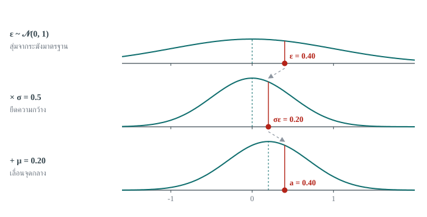

## บทที่ 12 · การสุ่ม action — explore และ exploit ในสมการเดียว

> [!INTRO]
> บทที่ 11 จบที่ระฆังหนึ่งใบต่อหนึ่งสถานะ และบอกว่า action ได้จากการสุ่มจากระฆังนั้น แต่ยังไม่ได้บอกว่าสุ่มอย่างไร และยังไม่ได้ตอบคำถามที่บทที่ 3 ทิ้งไว้ ว่าทำไมต้องสุ่มตั้งแต่แรก ทั้งที่ $\mu$ คือท่าที่โครงข่ายคิดว่าดีที่สุดอยู่แล้ว
>
> บทนี้ตอบทั้งสองข้อ ข้อแรกด้วยสมการ (16) ซึ่งสร้าง action จากตัวเลขสุ่ม $\varepsilon$ ด้วยการคูณและการบวกเพียงสองครั้ง ข้อที่สองด้วยการแยกสมการนั้นเป็นสองส่วน คือส่วนที่ใช้สิ่งที่รู้แล้ว กับส่วนที่ลองของใหม่ เราจะได้แถว $a$ ที่บทที่ 10 รับมาโดยไม่ได้อธิบาย และรู้ว่าแถว $\varepsilon$ ของตารางตัวอย่างคืออะไร
>
> ของที่ต้องรู้มาก่อน: เหตุผลที่ RL ต้องลองของที่ต่างกัน จากบทที่ 3 · ระฆัง $\mathcal{N}(\mu, \sigma)$ และระยะมาตรฐาน $z$ จากบทที่ 10 · สมการ (9) $\ell$ และ $\sigma$ จากบทที่ 11
>
> จบบทนี้แล้ว เราคำนวณ action ของทุกช่องในตารางตัวอย่างได้ อธิบายได้ว่า explore กับ exploit อยู่ในสมการเดียวกันอย่างไร และอ่านตัวเลข `Mean action noise std` ในล็อกของการเทรนได้

### ของที่ต้องมีก่อนเริ่ม

บทนี้ใช้แถว $\mu$ และแถว $\varepsilon$ ของตารางตัวอย่าง ซึ่งบทที่ 7 บอกไว้เพียงว่าเป็นตัวเลขสุ่มที่ใช้เลือก action ตารางตัวอย่างใช้ $\sigma = 0.5$ ทุกช่อง

| | | t=0 | t=1 | t=2 | t=3 |
| --- | --- | --- | --- | --- | --- |
| **env 0** | $\mu$ | 0.20 | 0.30 | 0.10 | 0.40 |
| | $\varepsilon$ | +0.40 | −0.20 | +0.80 | 0.00 |
| **env 1** | $\mu$ | −0.10 | 0.00 | 0.20 | −0.30 |
| | $\varepsilon$ | −0.60 | +0.80 | +0.20 | +0.40 |

สัญลักษณ์ที่ใช้ในบทนี้ เรียงตามลำดับที่จะพบ

| สัญลักษณ์ | ชนิด | ความหมาย |
| --- | --- | --- |
| $\mathcal{N}(0, 1)$ **ระฆังมาตรฐาน** | การแจกแจง | ระฆังที่จุดกลางอยู่ที่ 0 และกว้าง 1 |
| $\varepsilon$ **noise มาตรฐาน** | เวกเตอร์ `(8,)` | เลขสุ่มจาก $\mathcal{N}(0,1)$ ที่ทำให้ $a \ne \mu$ · $\varepsilon$ หมายถึงสิ่งนี้เท่านั้น |
| $\odot$ | ตัวดำเนินการ | คูณทีละตัวตรงตำแหน่ง ในโค้ดคือ `*` |
| **exploit** | แนวคิด | ใช้สิ่งที่รู้แล้วว่าดี |
| **explore** | แนวคิด | ลองสิ่งที่ต่างออกไปจากที่รู้ |

### ปัญหา: ถ้าไม่สุ่ม ก็ไม่มีอะไรให้เทียบ

สมมติว่าเราส่ง $\mu$ ออกไปเป็น action ตรง ๆ หุ่นในสถานะของ e0 t0 จะสั่ง 0.20 ทุกครั้งที่มันอยู่ในสถานะนั้น ข้อมูลที่เก็บได้จะมีแต่ "สั่ง 0.20 แล้วได้ reward เท่านี้" ซ้ำไปเรื่อย ๆ

บทที่ 3 บอกไว้ว่า reward บอกได้เพียงว่าของที่ลองไปแล้วดีแค่ไหน มันไม่บอกว่าค่าที่ดีกว่าอยู่ทางไหน ถ้าไม่เคยลอง 0.40 เราก็ไม่มีทางรู้ว่า 0.40 ดีกว่า 0.20 หรือไม่ และถ้าไม่มีข้อมูลของค่าที่ต่างกัน การเรียนรู้ก็ไม่รู้ว่าควรเลื่อน $\mu$ ไปทางไหน

การลองผิดลองถูกที่บทที่ 3 และบทที่ 8 พูดถึง ต้องมีกลไกที่ทำให้ action ต่างจาก $\mu$ บ้าง กลไกนั้นคือการสุ่มจากระฆังของบทที่ 11 คำถามที่เหลือคือ เครื่องคอมพิวเตอร์สุ่มค่าจากระฆังที่มีพารามิเตอร์ใด ๆ ได้อย่างไร

### สมการ (16): สุ่มจากระฆังมาตรฐาน แล้วยืดและเลื่อน

ระฆังทุกใบในตระกูล Gaussian มีรูปทรงเดียวกัน บทที่ 10 แสดงว่าเมื่อวัดระยะเป็นจำนวนเท่าของ $\sigma$ ระฆังทุกใบกลายเป็นใบเดียวกัน ความจริงข้อนี้ให้วิธีสุ่มที่ง่ายที่สุด คือสุ่มจากระฆังใบมาตรฐานใบเดียว แล้วยืดและเลื่อนผลลัพธ์ไปยังระฆังที่ต้องการ

> [!KEY] การสุ่ม action
> $$a = \mu + \sigma \odot \varepsilon, \qquad \varepsilon \sim \mathcal{N}(0, 1) \tag{16}$$

| | |
| --- | --- |
| $\varepsilon$ | เลขสุ่มจากระฆังมาตรฐาน หนึ่งตัวต่อข้อต่อ สุ่มใหม่ทุกครั้ง |
| $\sigma \odot \varepsilon$ | ยืดให้กว้างเท่ากับระฆังที่ต้องการ |
| $\mu + \cdots$ | เลื่อนไปที่จุดกลางของระฆังที่ต้องการ |

อภิธานศัพท์เขียนการสุ่มของทั้งแปดข้อต่อรวมกันว่า $\mathcal{N}(0, I)$ ซึ่งหมายถึงแต่ละข้อสุ่มจาก $\mathcal{N}(0, 1)$ แยกกัน $\odot$ คือการคูณทีละตัวตรงตำแหน่ง ข้อต่อที่ $i$ ได้ $a_i = \mu_i + \sigma_i\,\varepsilon_i$ แต่ละข้อใช้ $\varepsilon_i$ ของตัวเอง ตารางตัวอย่างมีข้อต่อเดียว $\odot$ จึงเป็นการคูณธรรมดา

$\varepsilon$ ที่นี่คือ noise มาตรฐานเท่านั้น เล่มนี้ใช้ตัวอักษร $\epsilon$ อีกแบบหนึ่งกับเรื่องอื่นในบทที่ 23 สองตัวนี้หน้าตาคล้ายกันแต่ไม่เกี่ยวกัน

> [!EXAMPLE] จงหา action ของทั้งสี่ช่องของ env 0 ด้วยสมการ (16) เมื่อ $\sigma = 0.5$
>
> | ช่อง | $\mu$ | $\varepsilon$ | $\sigma\varepsilon = 0.5 \times \varepsilon$ | $a = \mu + \sigma\varepsilon$ |
> | --- | --- | --- | --- | --- |
> | e0 t0 | 0.20 | +0.40 | +0.20 | **0.40** |
> | e0 t1 | 0.30 | −0.20 | −0.10 | **0.20** |
> | e0 t2 | 0.10 | +0.80 | +0.40 | **0.50** |
> | e0 t3 | 0.40 | 0.00 | 0.00 | **0.40** |
>
> ทั้งสี่ค่าตรงกับแถว $a$ ที่บทที่ 10 และ 11 ใช้ ช่อง e0 t3 สุ่มได้ $\varepsilon = 0$ จึงได้ action เท่ากับ $\mu$ พอดี



**$\varepsilon$ คือระยะมาตรฐาน $z$ ของบทที่ 10** ย้ายข้างสมการ (16) จะได้

$$\varepsilon = \frac{a - \mu}{\sigma} = z$$

แถว $\varepsilon$ ของตารางตัวอย่างจึงบอกว่าแต่ละ action อยู่ห่างจากจุดกลางของระฆังตัวเองกี่เท่าของ $\sigma$ และเพราะพจน์ที่สามของสมการ (14) คือ $-z^2/2$ เมื่อ $\sigma = 0.5$ ซึ่งให้ค่าคงที่ −0.2258 log ของความหนาแน่นของทุกช่องคำนวณได้จาก $\varepsilon$ ตัวเดียว

$$\log\pi_\theta(a \mid s) = -0.2258 - \frac{\varepsilon^2}{2}$$

ที่ e0 t0 ได้ $-0.2258 - 0.08 = -0.3058$ ตรงกับบทที่ 10 ช่องที่สุ่มได้ $\varepsilon$ ใกล้ศูนย์จะได้ log ของความหนาแน่นสูง เพราะ action อยู่ใกล้ยอดของระฆัง

### ในโค้ด: `.sample()` ทำอะไร

บรรทัดที่บทที่ 4 ชี้ไว้มีสองบรรทัด บรรทัดแรกสร้างระฆัง บรรทัดที่สองสุ่มจากมัน

```text
def update_distribution(self, observations):
    mean = self.actor(observations)
    self.distribution = Normal(mean, mean * 0.0 + torch.exp(self.logstd))

def act(self, observations, **kwargs):
    self.update_distribution(observations)
    return self.distribution.sample()
```

โค้ดข้างบนคือ `actor_critic.py:155-161` นิพจน์ `mean * 0.0 + torch.exp(self.logstd)` ใน `:157` ให้ผลเท่ากับ $\sigma$ การคูณ `mean` ด้วยศูนย์ทำเพียงให้ $\sigma$ ซึ่งมี 8 ค่า ขยายเป็นขนาด `(B, 8)` เท่ากับ `mean` ไม่มีความหมายทางคณิตศาสตร์

`.sample()` ของ PyTorch ไม่ได้เขียนสมการ (16) ตรงตัว มันเรียก `torch.normal(self.loc, self.scale)` (`normal.py:73`) ซึ่งสุ่มจากระฆัง $\mathcal{N}(\mu, \sigma)$ โดยตรง ผลที่ได้มีการแจกแจงเดียวกับ $\mu + \sigma\varepsilon$ ทุกประการ สมการ (16) จึงเป็นวิธีที่เราใช้คิดและคำนวณด้วยมือ ส่วนเมธอด `.rsample()` ที่อยู่ถัดลงไป (`normal.py:75-78`) เขียน `self.loc + eps * self.scale` ตรงตัว แต่ Tron1 ไม่ได้เรียกเมธอดนี้

เมื่อเทรนด้วยคำสั่ง `--num_envs 2048` ของบทที่ 7 การสุ่มหนึ่งครั้งต่อ step สร้างตัวเลขสุ่ม $2048 \times 8 = 16{,}384$ ตัวพร้อมกัน หนึ่งตัวต่อข้อต่อต่อ env ในคำสั่งเดียว

### explore และ exploit ไม่ใช่สองโหมด

เมื่อแยกสมการ (16) เป็นสองพจน์ เราได้คำตอบของคำถามว่าทำไมต้องสุ่ม

$$a = \underbrace{\mu}_{\text{exploit}} + \underbrace{\sigma\varepsilon}_{\text{explore}}$$

**exploit** คือการใช้สิ่งที่รู้แล้วว่าดี ซึ่งก็คือ $\mu$ ท่าที่โครงข่ายคิดว่าดีที่สุดตอนนี้ **explore** คือการลองสิ่งที่ต่างออกไป ซึ่งก็คือ $\sigma\varepsilon$ การเบี่ยงออกจากท่านั้นเล็กน้อย ทุก action ที่ Tron1 สั่งตอนเทรนมีทั้งสองส่วนเสมอ ไม่มี step ใดที่หุ่นทำแบบสุ่มล้วน ๆ และไม่มี step ใดที่มันไม่ลองเลย

ตำรา RL หลายเล่มสอน explore และ exploit ด้วยวิธีอีกแบบหนึ่ง ซึ่งเรียกว่า epsilon-greedy วิธีนั้นสลับระหว่างสองโหมดจริง ๆ

| | epsilon-greedy | Gaussian ของ Tron1 |
| --- | --- | --- |
| explore คือ | เลือก action ใดก็ได้แบบสุ่มทั้งตัว | เบี่ยงออกจาก $\mu$ ตามขนาด $\sigma$ |
| exploit คือ | เลือก action ที่ดีที่สุดที่รู้ | จุดกลาง $\mu$ |
| สลับโหมดหรือไม่ | สลับ แต่ละ step เป็นโหมดใดโหมดหนึ่ง | ไม่สลับ ทุก step มีทั้งสองส่วน |
| ใช้กับ action แบบไหน | ทางเลือกที่นับได้ | จำนวนจริงต่อเนื่อง |
| ปรับความกล้าลองอย่างไร | คนตั้งตารางลดอัตราการสลับ | $\sigma$ ถูกเรียนรู้พร้อมกับ $\mu$ |

การเทียบนี้มีไว้แยกสองความคิดออกจากกัน ไม่ได้บอกว่าแบบหนึ่งดีกว่าอีกแบบ epsilon-greedy ใช้ไม่ได้ตรง ๆ กับ action ที่เป็นจำนวนจริง 8 ตัว เพราะ "action ที่ดีที่สุดที่รู้" ของมันต้องเลือกจากรายการที่นับได้

### $\sigma$ คุมความกล้าลอง

ขนาดของการเบี่ยงคือ $\sigma$ คูณ $\varepsilon$ ส่วน $\varepsilon$ มาจากระฆังมาตรฐานเสมอ ความถี่ที่ $\varepsilon$ ออกห่างจากศูนย์จึงคงที่ และอ่านได้จากพื้นที่ของบทที่ 10

| $\lvert\varepsilon\rvert$ เกิน | เกิดบ่อยแค่ไหน |
| --- | --- |
| 0.5 | 61.71% |
| 1 | 31.73% |
| 2 | 4.55% |
| 3 | 0.27% |

ส่วนที่เปลี่ยนได้คือ $\sigma$ ซึ่งแปลงตัวเลขเหล่านี้เป็นระยะจริงบนแกน action ตัวอย่างเช่น $\varepsilon = +0.80$ ของ e0 t2 ให้การเบี่ยงต่างกันตาม $\sigma$

| $\sigma$ | $a - \mu = \sigma \times 0.80$ | |
| --- | --- | --- |
| 1.0 | 0.800 | ค่าเริ่มต้นของ Tron1 |
| 0.5 | 0.400 | ตารางตัวอย่าง |
| 0.25 | 0.200 | |
| 0.1 | 0.080 | |

ที่ $\sigma = 1.0$ action ประมาณหนึ่งในสามเบี่ยงจาก $\mu$ เกิน 1 ซึ่งเป็นการลองที่กว้างมาก เหมาะกับช่วงแรกที่โครงข่ายยังไม่รู้อะไร เมื่อ $\sigma$ เล็กลง การลองแคบลงรอบ $\mu$ ที่เก่งขึ้น

$\sigma$ ของ Tron1 ไม่ได้ถูกตั้งตารางให้ลดลงตามเวลา บทที่ 11 บอกว่า $\ell$ เป็นส่วนหนึ่งของ $\theta$ การเรียนรู้จึงปรับมันพร้อมกับตัวเลขในโครงข่าย ถ้าการลองกว้าง ๆ ทำให้ได้ผลแย่ การเรียนรู้จะลด $\ell$ ลง ซึ่งทำให้ $\sigma$ เล็กลง บทที่ 24 จะแสดงแรงอีกตัวหนึ่งที่ต้านไม่ให้ $\sigma$ หดเร็วเกินไป

เราดูค่า $\sigma$ ได้ระหว่างการเทรน ทุก iteration โปรแกรมคำนวณค่าเฉลี่ยของ $\sigma$ ทั้ง 8 ข้อต่อ (`on_policy_runner.py:269`) แล้วพิมพ์ออกหน้าจอในชื่อ `Mean action noise std` (`:324`) และบันทึกลงไฟล์ล็อกที่เปิดดูเป็นกราฟได้ (TensorBoard) ในชื่อ `Policy/mean_noise_std` (`:284`) ค่านี้เริ่มที่ 1.0 เพราะ $\ell$ เริ่มที่ศูนย์ ถ้ามันลดลงระหว่างการเทรน แปลว่าการลองแคบลง ตัวเลขนี้บอกเพียงความกว้างของการลอง มันไม่ได้บอกว่า $\mu$ เก่งขึ้นหรือไม่ ซึ่งต้องดูจาก reward ทั้งหมดนี้เกิดขึ้นโดยไม่มีจุดใดที่สลับโหมด

### ตอนใช้งานบนหุ่นจริงไม่มี $\varepsilon$

บทที่ 11 แยก policy แบบ stochastic กับ deterministic ไว้แล้ว ในภาษาของบทนี้ ความต่างคือ $\varepsilon$

| | ตอนเทรน | ตอนใช้งานบนหุ่นจริง |
| --- | --- | --- |
| action | $\mu + \sigma\varepsilon$ | $\mu$ |
| สุ่ม $\varepsilon$ หรือไม่ | สุ่มทุก step | ไม่สุ่ม |
| ส่วน explore | มี | ไม่มี |
| e0 t0 สั่ง | 0.40 | 0.20 |

บนหุ่นจริงไม่มีการเรียนรู้แล้ว ข้อมูลที่การลองสร้างขึ้นจึงไม่ถูกใช้ หุ่นสั่งเฉพาะส่วน exploit ซึ่งเป็นท่าที่โครงข่ายคิดว่าดีที่สุด

### จากสมการถึงโค้ด

| ในสมการ | บรรทัด | โค้ด |
| --- | --- | --- |
| $\mu$ | `actor_critic.py:156` | `mean = self.actor(observations)` |
| $\sigma = e^{\ell}$ ขยายเป็น `(B, 8)` | `actor_critic.py:157` | `mean * 0.0 + torch.exp(self.logstd)` |
| สมการ (16) $a = \mu + \sigma\varepsilon$ | `actor_critic.py:161` | `self.distribution.sample()` |
| การสุ่มจริงข้างใน | `normal.py:73` | `torch.normal(self.loc.expand(shape), self.scale.expand(shape))` |
| $\mu + \sigma\varepsilon$ ตรงตัว ซึ่ง Tron1 ไม่ใช้ | `normal.py:75-78` | `.rsample()` |
| ค่าเฉลี่ยของ $\sigma$ ในล็อก | `on_policy_runner.py:269` | `torch.exp(self.alg.actor_critic.logstd).mean()` |

> [!SUMMARY]
> - ถ้าไม่สุ่ม ข้อมูลมีแต่ผลของ action เดิม การเรียนรู้จึงไม่รู้ว่าค่าที่ดีกว่าอยู่ทางไหน
> - สมการ (16) สุ่ม $\varepsilon$ จากระฆังมาตรฐาน แล้วยืดด้วย $\sigma$ และเลื่อนด้วย $\mu$ ที่ e0 t0 ได้ $0.20 + 0.5 \times 0.40 = 0.40$
> - $\varepsilon$ คือระยะมาตรฐานของ action จากจุดกลาง เมื่อ $\sigma = 0.5$ log ของความหนาแน่นของทุกช่องจึงเป็น $-0.2258 - \varepsilon^2/2$
> - $\mu$ คือส่วน exploit และ $\sigma\varepsilon$ คือส่วน explore ทุก action มีทั้งสองส่วน ไม่มีการสลับโหมด
> - $\sigma$ ถูกเรียนรู้เพราะ $\ell$ อยู่ใน $\theta$ และดูได้จาก `Mean action noise std` ในล็อก
>
> ประโยคที่ควรจำ: **$\mu$ คือสิ่งที่ policy รู้ $\sigma\varepsilon$ คือสิ่งที่มันลอง และตอนเทรนทุก action มีทั้งสองอย่างเสมอ**

### แบบฝึกหัด

1. ข้อใดถูกต้อง
    1. $\varepsilon$ ถูกสุ่มจาก $\mathcal{N}(\mu, \sigma)$
    2. ถ้า $\varepsilon = 0$ แล้ว $a = \mu$
    3. `.sample()` ของ PyTorch เขียน `loc + eps * scale` ตรงตัว
    4. ทุก action ที่ Tron1 สั่งตอนเทรนมีทั้งส่วน explore และส่วน exploit
    5. epsilon-greedy กับ Gaussian ของ Tron1 สลับโหมดเหมือนกัน
    6. $\varepsilon$ ของแต่ละช่องในตารางตัวอย่างเท่ากับระยะมาตรฐาน $z$ ของช่องนั้น
    7. $\sigma$ ของ Tron1 ลดลงตามตารางที่คนตั้งไว้
    8. ตอนใช้งานบนหุ่นจริงไม่มีการสุ่ม $\varepsilon$
    9. ความถี่ที่ $\lvert\varepsilon\rvert$ เกิน 1 ขึ้นกับ $\sigma$
    10. `Mean action noise std` ในล็อกคือค่าเฉลี่ยของ $\sigma$ ทั้ง 8 ข้อต่อ

2. จงหา action ของทั้งสี่ช่องของ env 1 ด้วยสมการ (16) โดยแสดง $\sigma\varepsilon$ ของแต่ละช่อง [07 §2.1]
    1. e1 t0
    2. e1 t1
    3. e1 t2
    4. e1 t3

    <!--space:24-->

3. จงหา $\log\pi_\theta(a \mid s)$ ของทั้งสี่ช่องของ env 1 จาก $\varepsilon$ โดยตรง แล้วเทียบกับคำตอบของบทที่ 10 แบบฝึกหัดข้อ 2 <!--space:18-->

4. ข้อต่อแปดข้อของหุ่นมี $\mu = [0.20, -0.30, 0.10, 0.40, -0.10, 0.60, -0.50, 0.30]$ และสุ่มได้ $\varepsilon = [0.40, -0.20, 0.60, 0.00, -0.60, 1.20, -0.80, 0.20]$ จงหา action ทั้งแปดค่าเมื่อ $\sigma = 0.5$ ทุกข้อ [06 §3.5.5] <!--space:16-->

5. ใช้ $\mu$ และ $\varepsilon$ ชุดเดียวกับข้อ 4 แต่ $\sigma = 1.0$ ทุกข้อ ซึ่งเป็นค่าเริ่มต้นของ Tron1 จงหา action ทั้งแปดค่า และบอกว่าข้อต่อใดเบี่ยงจาก $\mu$ มากที่สุด <!--space:16-->

6. ช่อง e1 t1 สุ่มได้ $\varepsilon = +0.80$ จงหา $a - \mu$ เมื่อ $\sigma = 1.0$, $0.25$ และ $0.1$ <!--space:12-->

7. ถ้า $\sigma = 0.5$ action จะเบี่ยงจาก $\mu$ เกิน 1.0 บ่อยแค่ไหน และถ้า $\sigma = 1.0$ จะเบี่ยงเกิน 1.0 บ่อยแค่ไหน <!--space:14-->

8. ช่อง e0 t3 สุ่มได้ $\varepsilon = 0$ และสั่ง action เท่ากับ $\mu$ พอดี ข้อนี้แปลว่า policy ไม่ได้ explore ที่ step นั้นใช่หรือไม่ จงอธิบาย <!--space:16-->

9. จงอธิบายความต่างระหว่าง epsilon-greedy กับการสุ่มด้วยสมการ (16) ในแง่ของการสลับโหมด <!--space:14-->

10. จงอธิบายว่าทำไมโครงข่ายจึงสร้างความสุ่มเองไม่ได้ ต่อให้มันมีชั้นจำนวนมาก และบอกว่าความสุ่มของ Tron1 มาจากไหน <!--space:16-->

<!-- เฉลย -->

1. ข้อที่ถูก: 2, 4, 6, 8, 10

    - ข้อ 1 ผิด: $\varepsilon$ มาจากระฆังมาตรฐาน $\mathcal{N}(0, 1)$
    - ข้อ 3 ผิด: `.sample()` เรียก `torch.normal(loc, scale)` ส่วนที่เขียนตรงตัวคือ `.rsample()` ซึ่ง Tron1 ไม่ใช้
    - ข้อ 5 ผิด: epsilon-greedy สลับโหมด ส่วน Gaussian มีทั้งสองส่วนในทุก step
    - ข้อ 7 ผิด: $\sigma = e^{\ell}$ และ $\ell$ ถูกเรียนรู้
    - ข้อ 9 ผิด: $\varepsilon$ มาจากระฆังมาตรฐานเสมอ ความถี่นี้คือ 31.73% ไม่ว่า $\sigma$ เป็นเท่าไร

2. ใช้ $a = \mu + 0.5\varepsilon$

    1. $\sigma\varepsilon = -0.30$ ได้ $a = -0.10 - 0.30 = -0.40$
    2. $\sigma\varepsilon = +0.40$ ได้ $a = 0.00 + 0.40 = 0.40$
    3. $\sigma\varepsilon = +0.10$ ได้ $a = 0.20 + 0.10 = 0.30$
    4. $\sigma\varepsilon = +0.20$ ได้ $a = -0.30 + 0.20 = -0.10$

3. $-0.2258 - \varepsilon^2/2$ ได้ $-0.2258 - 0.18 = -0.4058$ · $-0.2258 - 0.32 = -0.5458$ · $-0.2258 - 0.02 = -0.2458$ · $-0.2258 - 0.08 = -0.3058$ ตรงกับบทที่ 10 ทุกช่อง

4. $a = [0.40, -0.40, 0.40, 0.40, -0.40, 1.20, -0.90, 0.40]$

5. $a = [0.60, -0.50, 0.70, 0.40, -0.70, 1.80, -1.30, 0.50]$ ข้อต่อที่ 6 เบี่ยงมากที่สุด คือ 1.20 เพราะมี $\lvert\varepsilon\rvert$ ใหญ่ที่สุด

6. 0.800, 0.200 และ 0.080 ตามลำดับ

7. ที่ $\sigma = 0.5$ การเบี่ยงเกิน 1.0 คือ $\lvert\varepsilon\rvert > 2$ เกิดขึ้น 4.55% ที่ $\sigma = 1.0$ คือ $\lvert\varepsilon\rvert > 1$ เกิดขึ้น 31.73%

8. ไม่ใช่ explore คือการที่ action มาจากระฆังที่มีความกว้าง ไม่ใช่การที่ผลการสุ่มครั้งหนึ่งต้องห่างจาก $\mu$ ครั้งนี้ $\varepsilon$ บังเอิญออกที่ศูนย์ ซึ่งเป็นผลหนึ่งที่เป็นไปได้ ถ้าสุ่มใหม่จะได้ค่าอื่น ตัวเลข 0.00 พอดีของตารางตัวอย่างเป็นค่าที่ตั้งไว้ให้คิดง่าย

9. epsilon-greedy แบ่งแต่ละ step เป็นโหมดใดโหมดหนึ่ง คือเลือกสุ่มทั้งตัว หรือเลือกตัวที่ดีที่สุด การสุ่มด้วยสมการ (16) ไม่แบ่ง action ทุกตัวคือ $\mu$ บวกการเบี่ยง $\sigma\varepsilon$ จึงมีทั้งสองส่วนพร้อมกันเสมอ

10. โครงข่ายเป็นฟังก์ชัน ป้อนสถานะเดิมได้ $\mu$ เดิมทุกครั้ง การมีหลายชั้นทำให้ฟังก์ชันซับซ้อนขึ้น แต่ไม่ทำให้มันคืนค่าต่างกันเมื่อ input เหมือนกัน ความสุ่มของ Tron1 มาจากตัวสร้างเลขสุ่มของ PyTorch ที่ `torch.normal` เรียกใช้ ซึ่งอยู่นอกโครงข่าย
