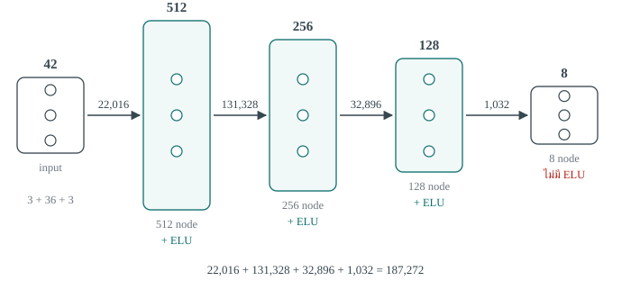
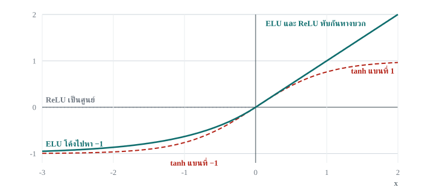

## บทที่ 13 · ข้างในโครงข่าย — node ชั้น และตัวเลข 187,272 ตัว

> [!INTRO]
> บทที่ 11 ปฏิบัติต่อโครงข่ายของ policy เหมือนกล่องดำ เรารู้เพียงว่ามันรับเวกเตอร์ 42 ค่าแล้วคืน $\mu$ 8 ค่า และมีตัวเลข 187,272 ตัวที่การเรียนรู้ปรับได้ บทที่ 9 ทำแบบเดียวกันกับ critic ซึ่งรับสิ่งที่มันเห็นแล้วคืนตัวเลขตัวเดียว
>
> บทนี้เปิดกล่องนั้น ข้างในมีหน่วยคำนวณที่เรียบง่ายมากชนิดเดียว คือ node ตามสมการ (10) ซ้อนกันเป็นชั้น และคั่นด้วยฟังก์ชัน ELU ตามสมการ (11) เราจะนับตัวเลข 187,272 ตัวด้วยมือ และรู้ว่าตัวเลขใดในโครงข่ายถูกกำหนดโดยโจทย์ ตัวใดคนเลือก และตัวใดการเรียนรู้ปรับ
>
> ของที่ต้องรู้มาก่อน: observation 36 ค่า command 3 ค่า และ action 8 ค่า จากบทที่ 5 · critic จากบทที่ 9 · สมการ (9) และชิ้นที่ ① ของ policy จากบทที่ 11
>
> จบบทนี้แล้ว เรานับจำนวนตัวเลขของโครงข่ายใดก็ได้จากขนาดของชั้น อธิบายได้ว่าทำไมต้องมี ELU ระหว่างชั้น และทำไมชั้นสุดท้ายไม่มี

### ของที่ต้องมีก่อนเริ่ม

บทนี้ไม่ใช้ตัวเลขจากตารางตัวอย่าง ตารางตัวอย่างไม่มีโครงข่ายจริง แถว $\mu$ ของมันถูกตั้งไว้ให้ ตัวเลขของบทนี้อ่านจากโค้ดทั้งหมด

| ของ | ค่า | ที่มา |
| --- | --- | --- |
| input ของโครงข่าย | 42 = 3 + 36 + 3 | `ppo.py:137-139` |
| output | 8 หนึ่งค่าต่อข้อต่อ | จำนวนข้อต่อของรุ่น SF |
| ขนาดของชั้นกลาง | 512, 256, 128 | `actor_hidden_dims` `limx_rsl_rl_ppo_cfg.py:88` |
| ฟังก์ชันระหว่างชั้น | `"elu"` | `activation` `limx_rsl_rl_ppo_cfg.py:90` |

สัญลักษณ์ที่ใช้ในบทนี้ เรียงตามลำดับที่จะพบ

| สัญลักษณ์ | ชนิด | ความหมาย |
| --- | --- | --- |
| $x_1, \dots, x_n$ | scalar $n$ ตัว | input ของ node หนึ่งตัว |
| $w_1, \dots, w_n$ **weight** | scalar $n$ ตัว | น้ำหนักของ input แต่ละตัว · ถูกเรียนรู้ |
| $b$ **bias** | scalar | ค่าชดเชยของ node · ถูกเรียนรู้ |
| $f$ **activation** | ฟังก์ชัน $\mathbb{R}\to\mathbb{R}$ | ฟังก์ชันไม่เชิงเส้นที่ผลรวมถูกส่งผ่านก่อนออกจาก node |
| **node** | แนวคิด | หน่วยคำนวณหนึ่งตัว: ผลรวมถ่วงน้ำหนัก บวกค่าชดเชย แล้วผ่านฟังก์ชันกระตุ้น |
| **layer** (ชั้น) | แนวคิด | node หลายตัวที่รับ input ชุดเดียวกัน |
| **ELU** | ฟังก์ชัน | $x$ ถ้า $x > 0$ และ $e^{x} - 1$ ถ้าไม่ |
| **parameter** · **hyperparameter** | แนวคิด | parameter คือตัวเลขที่การเรียนรู้เขียนทับ · hyperparameter คือตัวเลขที่คนตั้งใน config และไม่ถูกเรียนรู้ |

### ปัญหา: กล่องที่รับ 42 ค่าแล้วคืน 8 ค่า

บทที่ 11 ต้องการฟังก์ชัน $\mu_\theta : \mathbb{R}^{42} \to \mathbb{R}^{8}$ ที่ให้ท่าที่ดีสำหรับทุกสถานะ เราไม่รู้ล่วงหน้าว่าฟังก์ชันนั้นหน้าตาอย่างไร รู้เพียงว่ามันน่าจะซับซ้อน การยืนบนขาข้างเดียวแล้วเหวี่ยงอีกข้างไปข้างหน้า ไม่ได้เป็นเส้นตรงของมุมข้อต่อและความเร็ว

ถ้าเราเลือกฟังก์ชันที่ง่ายที่สุด คือ $\mu$ แต่ละตัวเป็นผลรวมถ่วงน้ำหนักของ input ทั้ง 42 ค่า เราได้ตัวเลขที่ปรับได้ $42 \times 8 + 8 = 344$ ตัว ฟังก์ชันแบบนี้เป็นเส้นตรง ถ้ามุมเข่าเพิ่มสองเท่า ผลของมันต่อ $\mu$ ก็เพิ่มสองเท่าเสมอ มันแสดงความคิดแบบ "ถ้าเอียงซ้ายเล็กน้อยให้ทำอย่างหนึ่ง ถ้าเอียงมากให้ทำอีกอย่าง" ไม่ได้

เราต้องการฟังก์ชันที่งอได้ และยังมีตัวเลขให้การเรียนรู้ปรับ โครงข่ายประสาทเทียมคือคำตอบที่ Tron1 ใช้

### node: หน่วยคำนวณหนึ่งตัว

**node** คือหน่วยคำนวณที่รับตัวเลขหลายตัว คูณแต่ละตัวด้วยน้ำหนักของมัน บวกกันทั้งหมด บวกค่าชดเชยอีกหนึ่งตัว แล้วส่งผลรวมผ่านฟังก์ชันหนึ่งก่อนส่งออกไป

> [!KEY] หนึ่ง node
> $$y = f\big(w_1 x_1 + w_2 x_2 + \cdots + w_n x_n + b\big) \tag{10}$$

| | |
| --- | --- |
| $x_1, \dots, x_n$ | input จากชั้นก่อนหน้า หรือจาก observation ถ้าเป็นชั้นแรก |
| $w_1, \dots, w_n$ | **weight** บอกว่า input แต่ละตัวสำคัญต่อ node นี้แค่ไหน และไปทางบวกหรือลบ |
| $b$ | **bias** เลื่อนผลรวมขึ้นหรือลง ทำให้ node ตอบสนองแม้ input เป็นศูนย์ทั้งหมด |
| $f$ | **activation** ฟังก์ชันไม่เชิงเส้นที่ทำให้ผลไม่เป็นเส้นตรง |
| $y$ | output ของ node ตัวเลขหนึ่งตัว |

weight และ bias คือตัวเลขที่การเรียนรู้ปรับ ส่วน $f$ ถูกเลือกไว้ตั้งแต่ต้น และไม่มีตัวเลขให้ปรับ

**layer** หรือชั้น คือ node หลายตัวที่รับ input ชุดเดียวกัน แต่ละตัวมี weight และ bias ของตัวเอง ชั้นที่มี 512 node รับ input 42 ค่าเข้าไปทุก node แล้วคืน output 512 ค่า หนึ่งค่าต่อ node คำว่าชั้นของโครงข่ายเป็นคนละเรื่องกับชั้น train, deploy และ simulate ของบทที่ 1 ซึ่งเป็นการแบ่งกลุ่มของ repo

ใน PyTorch ส่วนผลรวมถ่วงน้ำหนักของทั้งชั้นคือ `nn.Linear(in, out)` หนึ่งตัว ซึ่งเก็บ weight เป็นตาราง `(out, in)` และ bias เป็นเวกเตอร์ `(out,)` ส่วน $f$ เป็นอีกบรรทัดหนึ่งที่ต่อท้าย

ตัวเลขของหนึ่งชั้น = in × out (weight) + out (bias)

### โครงข่ายของ policy: สี่ชั้นต่อกัน

ชั้นหลายชั้นต่อกันเป็นสาย output ของชั้นหนึ่งเป็น input ของชั้นถัดไป โครงข่ายแบบนี้เรียกว่า **MLP** (multilayer perceptron) ซึ่งเป็นชื่อที่โค้ดพิมพ์ออกมาตอนสร้างโครงข่าย (`actor_critic.py:113`)

input 42 ค่าและ output 8 ค่าถูกกำหนดโดยโจทย์ ไม่ใช่ทางเลือก

| | ค่า | มาจาก |
| --- | --- | --- |
| input | 42 = 3 + 36 + 3 | `torch.cat((encoder_out, obs, commands), dim=-1)` `ppo.py:137-139` คือค่าสามตัวจากโครงข่ายตัวที่สามซึ่ง LimX เพิ่มเข้ามา (บทที่ 21) ต่อด้วย observation 36 ค่าและ command 3 ค่าของบทที่ 5 |
| output | 8 | จำนวนข้อต่อของรุ่น SF ซึ่งเป็นจำนวนมอเตอร์จริงบนหุ่น |

ส่วนขนาดของชั้นกลาง 512, 256 และ 128 เป็นตัวเลขที่ผู้ออกแบบเลือก ไม่มีสูตรใดคำนวณขนาดที่ถูกต้องออกมาได้ และ repo ไม่ได้บันทึกว่าเลือกมาอย่างไร

> [!EXAMPLE] จงนับตัวเลขที่ปรับได้ทั้งหมดของโครงข่ายของ policy
> ใช้กติกา in × out + out ทีละชั้น
>
> | ชั้น | weight | bias | รวม |
> | --- | --- | --- | --- |
> | `Linear(42, 512)` | $42 \times 512 = 21{,}504$ | 512 | 22,016 |
> | `Linear(512, 256)` | $512 \times 256 = 131{,}072$ | 256 | 131,328 |
> | `Linear(256, 128)` | $256 \times 128 = 32{,}768$ | 128 | 32,896 |
> | `Linear(128, 8)` | $128 \times 8 = 1{,}024$ | 8 | 1,032 |
> | **รวม** | 186,368 | 904 | **187,272** |
>
> นี่คือตัวเลข 187,272 ที่บทที่ 11 ใช้ เมื่อบวก $\ell$ อีก 8 ตัว ได้ $\theta$ ทั้งหมด 187,280 ตัว ชั้นที่สองมีตัวเลขมากที่สุด คือ 70.1% ของทั้งโครงข่าย เพราะเป็นชั้นที่ทั้ง input และ output กว้าง

**ขนาดของข้อมูลที่ไหลผ่าน** ถ้าป้อนสถานะของ 2 env พร้อมกัน เหมือนตารางตัวอย่าง ข้อมูลเปลี่ยนขนาดดังนี้

$$(2, 42) \to (2, 512) \to (2, 256) \to (2, 128) \to (2, 8)$$

มิติแรกคือจำนวน env ซึ่งไม่เปลี่ยนตลอดทาง มิติที่สองคือจำนวนค่าต่อ env ซึ่งเปลี่ยนทุกชั้น `nn.Linear` คำนวณทุก env พร้อมกันด้วยการคูณเมทริกซ์ครั้งเดียว ตอนเก็บข้อมูลด้วย `--num_envs 2048` ของบทที่ 7 มิติแรกจึงเป็น 2048 ส่วนตอนที่การเรียนรู้คำนวณซ้ำจากข้อมูลที่เก็บไว้ มิติแรกเป็นจำนวนแถวของข้อมูลที่ป้อนเข้าไปในครั้งนั้น ซึ่งบทที่ 28 ไล่ให้ดู

### ELU: ทำไมต้องงอ

หัวข้อปัญหาข้างบนต้องการโครงข่ายที่งอได้ ความงอนั้นมาจาก $f$ ในสมการ (10) ถ้าไม่มีมัน การซ้อนชั้นไม่ได้อะไรเพิ่ม เพราะชั้นเชิงเส้นสองชั้นต่อกันยังเป็นชั้นเชิงเส้นชั้นเดียว

| สมการ | หมายเหตุ |
| --- | --- |
| $y = W_2\,(W_1 x + b_1) + b_2$ | สองชั้นเชิงเส้นต่อกัน โดยไม่มี $f$ |
| $= (W_2 W_1)\,x + (W_2 b_1 + b_2)$ | กระจายวงเล็บ |
| $= W x + b$ | ผลคูณของเมทริกซ์เป็นเมทริกซ์ตัวเดียว |

ถ้าถอด $f$ ออกจากทุกชั้น โครงข่ายสี่ชั้นของ policy จะยุบเหลือ `Linear(42, 8)` ชั้นเดียว ซึ่งทำได้เท่ากับฟังก์ชันเส้นตรง 344 ตัวเลขในหัวข้อปัญหา ตัวเลขอีกหลายแสนตัวไม่ได้เพิ่มความสามารถใดเลย

$f$ ที่ Tron1 ใช้คือ **ELU** (exponential linear unit) ตั้งใน config เป็น `activation="elu"` และแปลงเป็น `nn.ELU()` ที่ `actor_critic.py:175-177`

> [!KEY] ELU
> $$\text{ELU}(x) = \begin{cases} x & x > 0 \\ e^{x} - 1 & x \le 0 \end{cases} \tag{11}$$

ทางบวก ELU ปล่อยค่าผ่านตรง ๆ ทางลบมันโค้งลงอย่างเรียบไปหา −1 แต่ไม่ถึง ที่ $x = 0$ ความชันของทั้งสองข้างเป็น 1 เท่ากัน เส้นจึงต่อกันอย่างเรียบ ไม่มีมุมหัก ความงอของ ELU มาจากส่วนโค้งเลขชี้กำลังทางลบ ซึ่งความชันลดลงเรื่อย ๆ จาก 1 ไปหา 0

เทียบกับฟังก์ชันอีกสองตัวที่ใช้กันมาก คือ tanh ซึ่งบีบค่าให้อยู่ระหว่าง −1 กับ 1 และ ReLU ซึ่งคือ $\max(0, x)$ สิ่งที่ต้องดูคือความชันของเส้นโค้ง เพราะบทที่ 14 จะแสดงว่าการเรียนรู้เดินตามความชัน ตัวเลขที่ความชันเป็นศูนย์จะไม่ถูกปรับ

> [!EXAMPLE] จงหาค่าและความชันของ ELU, tanh และ ReLU ที่ $x = 2.0$, $x = -1.0$ และ $x = -3.0$
> ความชันของ ELU คือ 1 ทางบวก และ $e^{x}$ ทางลบ ความชันของ tanh คือ $1 - \tanh^2 x$ ความชันของ ReLU คือ 1 ทางบวก และ 0 ทางลบ
>
> | $x$ | ELU | ความชัน | tanh | ความชัน | ReLU | ความชัน |
> | --- | --- | --- | --- | --- | --- | --- |
> | 2.0 | 2.0000 | 1.0000 | 0.9640 | 0.0707 | 2.0 | 1 |
> | −1.0 | −0.6321 | 0.3679 | −0.7616 | 0.4200 | 0 | 0 |
> | −3.0 | −0.9502 | 0.0498 | −0.9951 | 0.0099 | 0 | 0 |
>
> ที่ $x = 2.0$ tanh แบนแล้ว ความชันเหลือ 0.07 ส่วน ELU ยังชัน 1 เต็ม ที่ทางลบ ReLU ชันศูนย์พอดี ส่วน ELU ชันน้อยลงแต่ไม่เป็นศูนย์

| ฟังก์ชัน | ทางบวก | ทางลบ |
| --- | --- | --- |
| ELU | ไม่อิ่มตัว ความชัน 1 | โค้งเรียบ ความชัน $e^{x}$ ซึ่งเป็นบวกเสมอ |
| tanh | อิ่มตัวที่ 1 ความชันเข้าใกล้ศูนย์ | อิ่มตัวที่ −1 ความชันเข้าใกล้ศูนย์ |
| ReLU | ความชัน 1 | ศูนย์พอดี ความชัน 0 |

ELU จึงเป็นทางสายกลาง มันงอทางลบ ไม่แบนทางบวกเหมือน tanh และไม่ตายทางลบเหมือน ReLU

### ชั้นสุดท้ายไม่มี activation

ในโค้ด ชั้นกลางทุกชั้นตามด้วย ELU (`actor_critic.py:74`, `:88`) แต่ชั้นสุดท้าย `nn.Linear(128, 8)` ไม่มี (`actor_critic.py:77`) การไม่มีนี้ตั้งใจ ไม่ใช่ลืม เหตุผลมาจากการแยกหน้าที่ของ activation เป็นสองข้อ

| หน้าที่ | คืออะไร | ต้องการที่ไหน |
| --- | --- | --- |
| ทำให้งอ | ทำให้การซ้อนชั้นมีความหมาย | ระหว่างชั้นเท่านั้น |
| บีบช่วงของ output | เช่น tanh บีบให้อยู่ระหว่าง −1 กับ 1 | เฉพาะเมื่ออยากให้ output มีขอบ |

ที่ชั้นสุดท้ายไม่มีชั้นใดต่อจากมัน หน้าที่แรกจึงไม่มีความหมาย เหลือเพียงหน้าที่ที่สอง ซึ่ง Tron1 ไม่ต้องการ ด้วยสองเหตุผล

**ข้อแรก $\mu$ เป็นจุดกลางของระฆัง** ซึ่งเป็นจำนวนจริงค่าใดก็ได้ตามบทที่ 10 ถ้าบีบ $\mu$ ด้วย tanh ท่าที่ต้องการ action 1.5 จะไปไม่ถึงเลย

**ข้อที่สอง tanh แบนใกล้ขอบ** ถ้าท่าที่ดีที่สุดต้องการ $\mu = 0.99$ ค่าก่อนเข้า tanh ต้องเป็น 2.647 และความชันที่จุดนั้นเหลือ 0.0199 ถ้าต้องการ 0.999 ค่าก่อนเข้าต้องเป็น 3.800 และความชันเหลือ 0.0020 ยิ่งคำตอบที่ดีอยู่ใกล้ขอบ การเรียนรู้ยิ่งเดินเข้าไปหามันช้า

ขอบเขตของการเคลื่อนไหวจริงจึงอยู่ที่อื่น ไม่ได้อยู่ในโครงข่าย บทที่ 15 จะแสดงว่า action ถูกคูณด้วย 0.25 ก่อนเป็นมุม และตัวจำลองจำกัดแรงบิดของข้อต่อไว้ที่ 80 N·m

critic ก็ไม่มี activation ที่ชั้นสุดท้ายด้วยเหตุผลเดียวกัน `nn.Linear(128, 1)` (`actor_critic.py:98`) คืนตัวเลขตัวเดียวที่เป็นค่าใดก็ได้ เพราะค่าของสถานะตามบทที่ 9 ไม่มีขอบที่รู้ล่วงหน้าพอจะบีบไว้ในโครงข่าย

### parameter กับ hyperparameter

ตัวเลขในโครงข่ายมีสองประเภทที่หน้าตาคล้ายกัน แต่ถูกกำหนดคนละวิธี

| | parameter | hyperparameter |
| --- | --- | --- |
| ตัวอย่าง | weight และ bias 187,272 ตัว และ $\ell$ 8 ตัว | ขนาดชั้น 512, 256, 128 · ชนิดของ activation |
| ใครกำหนด | การเรียนรู้เขียนทับระหว่างเทรน | คนตั้งใน config ก่อนเทรน |
| การเรียนรู้เปลี่ยนมันหรือไม่ | เปลี่ยนตลอด | ไม่เปลี่ยน (บางตัวมีกฎที่คนเขียนไว้ปรับให้ระหว่างเทรน บทที่ 26 แสดงตัวอย่าง) |
| ทดสอบผลอย่างไร | การเรียนรู้ปรับให้เองภายในการเทรนหนึ่งครั้ง | เทรนใหม่หลายครั้งด้วยค่าต่างกันแล้วเทียบผล |
| ที่อยู่ | `actor_critic.py:69-90` และ `:118` | `limx_rsl_rl_ppo_cfg.py:88-90` |

ขนาดของโครงข่ายมีผลต่อผลลัพธ์ โครงข่ายที่เล็กเกินไปอาจเรียนท่าเดินที่ซับซ้อนไม่ได้ ที่ใหญ่เกินไปเทรนช้าลง แต่ผลของมันไม่ได้ถูกปรับภายในการเทรน มันถูกเลือกจากนอกการเทรน บทที่ 14 อธิบายว่าการเรียนรู้ปรับ parameter อย่างไร

### จากสมการถึงโค้ด

| ในสมการ | บรรทัด | โค้ด |
| --- | --- | --- |
| ชั้นแรก 42 → 512 | `actor_critic.py:71` | `nn.Linear(num_actor_obs, actor_hidden_dims[0])` |
| $f$ หลังชั้นแรก | `actor_critic.py:74` | `actor_layers.append(activation)` |
| ชั้นกลาง | `actor_critic.py:82-88` | `nn.Linear(actor_hidden_dims[l], actor_hidden_dims[l + 1])` ตามด้วย activation |
| ชั้นสุดท้าย ไม่มี $f$ | `actor_critic.py:77` | `nn.Linear(actor_hidden_dims[l], num_actions)` |
| ต่อทั้งหมดเป็นสาย | `actor_critic.py:90` | `self.actor = nn.Sequential(*actor_layers)` |
| ชั้นสุดท้ายของ critic | `actor_critic.py:98` | `nn.Linear(critic_hidden_dims[l], 1)` |
| สมการ (11) | `actor_critic.py:175-177` | `if act_name == "elu": return nn.ELU()` |
| ขนาดชั้นและ activation | `limx_rsl_rl_ppo_cfg.py:88-90` | `actor_hidden_dims=[512, 256, 128]` · `activation="elu"` |

ทุกครั้งที่บทที่ 11 เขียน $\mu_\theta(s)$ โค้ดเรียก `self.actor(observations)` (`actor_critic.py:156`) ซึ่งส่งข้อมูลผ่าน `nn.Sequential` ทั้งสายจากชั้นแรกถึงชั้นสุดท้าย

> [!SUMMARY]
> - node หนึ่งตัวคือผลรวมถ่วงน้ำหนัก บวกค่าชดเชย แล้วผ่าน activation ตามสมการ (10) ชั้นหนึ่งคือ node หลายตัวที่รับ input ชุดเดียวกัน
> - ตัวเลขของชั้นหนึ่งคือ in × out + out โครงข่ายของ policy $42 \to 512 \to 256 \to 128 \to 8$ มี 187,272 ตัว
> - 42 และ 8 ถูกกำหนดโดยโจทย์ ส่วน 512, 256, 128 เป็น hyperparameter ที่คนเลือก
> - ถ้าไม่มี activation การซ้อนชั้นยุบเหลือชั้นเดียว ELU ตามสมการ (11) ทำให้งอ โดยความชันไม่เป็นศูนย์ทั้งสองข้าง
> - ชั้นสุดท้ายของทั้ง policy และ critic ไม่มี activation เพราะ $\mu$ และค่าของสถานะเป็นจำนวนจริงใดก็ได้
>
> ประโยคที่ควรจำ: **โครงข่ายคือผลรวมถ่วงน้ำหนักซ้อนกันหลายชั้น โดยมีฟังก์ชันที่งอคั่นอยู่ ถ้าเอาฟังก์ชันนั้นออก ทุกชั้นจะยุบเหลือเส้นตรงเส้นเดียว**

### แบบฝึกหัด

1. ข้อใดถูกต้อง
    1. node หนึ่งตัวคืนตัวเลขหนึ่งตัว
    2. ชั้นที่มี 512 node รับ input ชุดเดียวกันทุก node
    3. activation มีตัวเลขที่การเรียนรู้ปรับ
    4. ชั้นเชิงเส้นสองชั้นที่ไม่มี activation คั่น ทำได้เท่ากับชั้นเชิงเส้นชั้นเดียว
    5. ความชันของ ELU ทางลบเป็นศูนย์
    6. ชั้นสุดท้ายของโครงข่ายของ policy มี ELU
    7. ขนาดชั้น 512, 256, 128 เป็น hyperparameter
    8. input 42 ค่าเลือกได้ตามใจผู้ออกแบบ
    9. `nn.Linear(42, 512)` เก็บ weight เป็นตาราง `(512, 42)`
    10. ReLU ความชันเป็นศูนย์ตลอดทางลบ

2. จงนับตัวเลขที่ปรับได้ของ critic ซึ่งรับ input 230 ค่า มีชั้นกลาง 512, 256, 128 และคืน 1 ค่า โดยแสดงทีละชั้น บทที่ 20 จะอธิบายว่า 230 มาจากไหน [05 §2.1] <!--space:28-->

3. จงหาผลรวมของตัวเลขที่ปรับได้ของโครงข่ายของ policy ของ critic และ $\ell$ <!--space:10-->

4. ค่าปริยายของคลาส `ActorCritic` คือชั้นกลาง `[256, 256, 256]` (`actor_critic.py:49`) ซึ่ง config ของ Tron1 เขียนทับไว้ จงนับตัวเลขของโครงข่ายของ policy ถ้าใช้ค่าปริยายนี้ โดยให้ input และ output เท่าเดิม [actor_critic.py:49] <!--space:20-->

5. จงนับตัวเลขของโครงข่ายของ policy ถ้าชั้นกลางเป็น `[1024, 512, 256]` และถ้าเป็น `[128, 64]` <!--space:24-->

6. จงหาค่าและความชันของ ELU ที่ $x = 0.5$, $x = -0.5$ และ $x = -2.0$ <!--space:16-->

7. ถ้าถอด ELU ออกจากโครงข่ายของ policy ทุกชั้น โครงข่ายจะทำได้เท่ากับชั้นเชิงเส้นชั้นเดียวที่มีตัวเลขกี่ตัว จงแสดงเหตุผล <!--space:16-->

8. จงเขียนขนาดของข้อมูลหลังแต่ละชั้นของ critic เมื่อป้อนสถานะของ 2 env พร้อมกัน <!--space:12-->

9. จงอธิบายว่าทำไมชั้นสุดท้ายของโครงข่ายของ policy จึงไม่ควรมี tanh โดยใช้ตัวเลขความชันประกอบ <!--space:18-->

10. จงอธิบายว่าทำไมการเรียนรู้ระหว่างการเทรนจึงเปลี่ยนขนาดของชั้นไม่ได้ ทั้งที่ขนาดของชั้นมีผลต่อผลลัพธ์ <!--space:16-->

<!-- เฉลย -->

1. ข้อที่ถูก: 1, 2, 4, 7, 9, 10

    - ข้อ 3 ผิด: activation ถูกเลือกไว้ตั้งแต่ต้น ไม่มีตัวเลขให้ปรับ
    - ข้อ 5 ผิด: ความชันทางลบคือ $e^{x}$ ซึ่งเป็นบวกเสมอ
    - ข้อ 6 ผิด: ชั้นสุดท้าย `Linear(128, 8)` ไม่มี activation (`actor_critic.py:77`)
    - ข้อ 8 ผิด: 42 = 3 + 36 + 3 ถูกกำหนดโดยสิ่งที่ policy ได้รับ

2. นับทีละชั้น

    | ชั้น | weight | bias | รวม |
    | --- | --- | --- | --- |
    | `Linear(230, 512)` | 117,760 | 512 | 118,272 |
    | `Linear(512, 256)` | 131,072 | 256 | 131,328 |
    | `Linear(256, 128)` | 32,768 | 128 | 32,896 |
    | `Linear(128, 1)` | 128 | 1 | 129 |
    | **รวม** | | | **282,625** |

3. $187{,}272 + 282{,}625 + 8 = 469{,}905$

4. $(42 \times 256 + 256) + 2 \times (256 \times 256 + 256) + (256 \times 8 + 8)$ $= 11{,}008 + 131{,}584 + 2{,}056$ $= 144{,}648$

5. `[1024, 512, 256]` ได้ 702,216 ตัว และ `[128, 64]` ได้ 14,280 ตัว

6. $x = 0.5$: ค่า 0.5000 ความชัน 1 · $x = -0.5$: ค่า $e^{-0.5} - 1 = -0.3935$ ความชัน 0.6065 · $x = -2.0$: ค่า −0.8647 ความชัน 0.1353

7. ชั้นเชิงเส้นที่ต่อกันยุบเป็นชั้นเดียวเสมอ เพราะผลคูณของเมทริกซ์เป็นเมทริกซ์ตัวเดียว ชั้นนั้นรับ 42 คืน 8 จึงมี $42 \times 8 + 8 = 344$ ตัว

8. $(2, 230) \to (2, 512) \to (2, 256) \to (2, 128) \to (2, 1)$

9. $\mu$ เป็นจุดกลางของระฆัง จึงควรเป็นค่าใดก็ได้ tanh จำกัดไว้ระหว่าง −1 กับ 1 และใกล้ขอบมันแบน ถ้าต้องการ $\mu = 0.99$ ความชันเหลือ 0.0199 และถ้าต้องการ 0.999 เหลือ 0.0020 การเรียนรู้ซึ่งเดินตามความชันจึงเข้าใกล้คำตอบนั้นช้ามาก

10. การเรียนรู้ปรับเฉพาะตัวเลขที่อยู่ในโครงข่ายแล้ว คือ weight, bias และ $\ell$ ขนาดของชั้นกำหนดว่ามีตัวเลขเหล่านั้นกี่ตัว มันจึงต้องถูกตั้งก่อนเริ่มเทรน ผลของขนาดทดสอบได้ด้วยการเทรนใหม่หลายครั้งด้วยขนาดต่างกันแล้วเทียบผล
