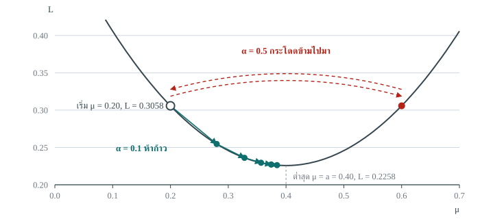

## บทที่ 14 · พื้นฐาน 3 loss gradient และ gradient descent — หมุนลูกบิดทีละน้อยไปทางที่ดีขึ้น

> [!INTRO]
> บทที่ 13 นับตัวเลขในโครงข่ายของ policy ได้ 187,272 ตัว และบอกว่าการเรียนรู้เป็นผู้ปรับมัน แต่ยังไม่ได้บอกว่าปรับอย่างไร ตัวเลขมีหลายแสนตัว เราลองหมุนทีละตัวแล้วดูผลไม่ได้ และไม่มีใครรู้ล่วงหน้าว่าตัวไหนควรเพิ่ม ตัวไหนควรลด
>
> บทนี้ให้เครื่องมือสามชิ้นที่ตอบคำถามนั้น ชิ้นแรกคือ loss $L$ ตัวเลขตัวเดียวที่บอกว่าตอนนี้แย่แค่ไหน ชิ้นที่สองคือ gradient ซึ่งบอกว่าถ้าหมุนตัวเลขแต่ละตัวนิดเดียว $L$ จะเปลี่ยนเท่าไร ชิ้นที่สามคือ gradient descent ตามสมการ (12) ซึ่งหมุนตัวเลขทุกตัวพร้อมกันไปทางที่ $L$ ลด เราจะลองทั้งหมดด้วยมือบนช่อง e0 t0
>
> ของที่ต้องรู้มาก่อน: สมการ (14) จากบทที่ 10 · $\mu$, $\ell$ และ $\theta$ จากบทที่ 11 · weight bias และชั้นสุดท้ายที่ไม่มี activation จากบทที่ 13
>
> จบบทนี้แล้ว เราหาความชันของ loss อย่างง่ายได้ด้วยมือ ทำ gradient descent ได้ทีละก้าว อธิบายได้ว่า learning rate ที่ใหญ่เกินไปทำให้เกิดอะไร และชี้ได้ว่าโค้ดหมุนลูกบิดที่บรรทัดไหน

### ของที่ต้องมีก่อนเริ่ม

บทนี้ใช้ช่อง e0 t0 ช่องเดียวในตัวอย่าง และช่องอื่นของตารางในแบบฝึกหัด

| | $\mu$ | $a$ | $\sigma$ | $\ell = \ln\sigma$ | $\log\pi_\theta(a \mid s)$ |
| --- | --- | --- | --- | --- | --- |
| e0 t0 | 0.20 | 0.40 | 0.5 | −0.6931 | −0.3058 |

ตารางตัวอย่างใช้ learning rate $\alpha = 0.1$ เพื่อให้เห็นตัวเลขชัด Tron1 เริ่มที่ $10^{-3}$

สัญลักษณ์ที่ใช้ในบทนี้ เรียงตามลำดับที่จะพบ

| สัญลักษณ์ | ชนิด | ความหมาย |
| --- | --- | --- |
| $L$ **loss** | scalar | เข็มวัดความแย่ ยิ่งน้อยยิ่งดี · ไม่ใช่ $\ell$ |
| $\dfrac{\partial L}{\partial x}$ | scalar | ความชัน: ถ้าเพิ่ม $x$ นิดเดียว $L$ เปลี่ยนเท่าไร |
| $\nabla_\theta L$ **gradient** | เวกเตอร์ยาว | ความชันของ $L$ เทียบกับลูกบิดทุกตัว |
| $\alpha$ **learning rate** | scalar (ปรับได้) | ก้าวยาวแค่ไหน · hyperparameter |
| **gradient descent** | สมการ | หมุนลูกบิดสวนทางความชันของ $L$ |
| **gradient step** | หน่วยนับ | การหมุนลูกบิดทุกตัวหนึ่งครั้ง · ในบทที่ 14 คือการใช้สมการ (12) หนึ่งครั้ง · ในโค้ดคือสี่บรรทัด `ppo.py:287-290` |
| **backpropagation** | แนวคิด | คำนวณความชันของลูกบิดทุกตัวย้อนกลับตามทางที่ค่าไหลมา ด้วย chain rule |

### ภาพก่อนสัญลักษณ์: ลูกบิดกับเข็ม

นึกถึงเครื่องผสมเสียงที่มีลูกบิดจำนวนมาก และมีเข็มหนึ่งอันบอกว่าเสียงเพี้ยนแค่ไหน งานของเราคือหมุนลูกบิดจนเข็มลงต่ำที่สุด

| ในภาพ | ใน Tron1 |
| --- | --- |
| ลูกบิด | ตัวเลขที่การเรียนรู้ปรับได้ คือโครงข่ายของ policy 187,272 ตัว critic 282,625 ตัว และ $\ell$ 8 ตัว รวม 469,905 ตัว |
| เข็ม | loss $L$ ตัวเลขตัวเดียว |
| การหมุน | gradient step หนึ่งครั้ง ซึ่งขยับลูกบิดทุกตัวพร้อมกันทีละนิด |

ภาพนี้ใช้ไม่ได้ตรงที่คนหมุนเครื่องผสมเสียงทีละลูกบิดแล้วฟังผล แต่ลูกบิดสี่แสนกว่าตัวหมุนทีละตัวไม่ไหว gradient คือเครื่องมือที่บอกทิศของลูกบิดทุกตัวในการคำนวณครั้งเดียว ส่วนโครงข่ายตัวที่สามที่ LimX เพิ่มเข้ามามีลูกบิดและเข็มของตัวเองแยกออกไป บทที่ 21 จะกลับมาที่เรื่องนี้

### $L$: เข็มวัดความแย่

**loss** $L$ คือตัวเลขตัวเดียวที่บอกว่าตอนนี้ลูกบิดทั้งหมดอยู่ในตำแหน่งที่แย่แค่ไหน ยิ่งน้อยยิ่งดี

วงการนี้ตกลงกันว่าจะ*ลด*ตัวเลขเสมอ ไม่ใช่เพิ่ม ถ้าสิ่งที่เราต้องการคือให้บางอย่างมากขึ้น เราใส่เครื่องหมายลบหน้ามันแล้วลดแทน การลด $-x$ คือการเพิ่ม $x$ บทที่ 8 ตั้งโจทย์ของ RL ว่าหา policy ที่ทำให้ objective $J$ สูงที่สุด loss ของ PPO ในบทที่ 23 และ 24 จึงมีเครื่องหมายลบอยู่ข้างในด้วยเหตุผลนี้

> [!WARNING] $L$ ตัวใหญ่ไม่ใช่ $\ell$ ตัวเล็ก
> $L$ คือ loss เป็น scalar ตัวเดียวของทั้งระบบ เป็นเข็ม $\ell$ คือ `logstd` เป็นเวกเตอร์ 8 ตัว เป็นลูกบิด 8 ตัวในบรรดาลูกบิดทั้งหมด ลูกบิดไปขยับเข็ม ทั้งสองไม่ใช่ของชนิดเดียวกัน

loss ไม่ได้มีมาเอง เราเป็นผู้ออกแบบมัน ให้มันต่ำเมื่อสิ่งที่ต้องการเกิดขึ้น loss ของ PPO มีสามพจน์ และต้องใช้ความรู้จากบทที่ 17 ถึง 22 ก่อน บทนี้จึงใช้ loss ที่ง่ายกว่ามากตัวหนึ่ง เพื่อดูกลไกของการหมุนลูกบิดอย่างเดียว

### loss ของบทนี้

ช่อง e0 t0 สั่ง action $a = 0.40$ สมมติว่าเราต้องการให้ policy ชอบ action นี้มากขึ้น คือให้ระฆังสูงขึ้นที่ $a = 0.40$ ความหนาแน่นยิ่งสูง log ของมันยิ่งสูง เมื่อใส่เครื่องหมายลบ เราได้ loss ที่ต่ำลงเมื่อระฆังสูงขึ้นที่จุดนั้น

$$L = -\log\pi_\theta(a \mid s)$$

แทนสมการ (14) และใช้ $\ln\sigma = \ell$

$$L = \frac{(a - \mu)^2}{2\sigma^2} + \ell + \tfrac12\ln 2\pi$$

ที่ e0 t0 ได้ $L = 0.08 - 0.6931 + 0.9189 = 0.3058$ คือ log ของความหนาแน่นที่กลับเครื่องหมาย

> [!WARNING] loss ตัวนี้ไม่ใช่ loss ของ PPO
> loss ตัวนี้ดึงระฆังเข้าหา action ที่สั่งไปแล้วเสมอ ไม่ว่า action นั้นจะดีหรือแย่ PPO ต้องดึงเข้าหา action ที่ดี และผลักออกจาก action ที่แย่ บทที่ 23 จะสร้าง loss ที่ทำแบบนั้น บทนี้ใช้ loss ตัวนี้เพียงเพราะเราคำนวณความชันของมันได้ด้วยมือ

**ลูกบิดที่จะหมุน** ตารางตัวอย่างไม่มีโครงข่ายจริง แต่บทที่ 13 บอกว่าชั้นสุดท้ายของโครงข่ายของ policy ไม่มี activation $\mu$ ของข้อต่อนี้จึงเป็นผลรวมถ่วงน้ำหนักตามสมการ (10) บวกกับ bias $b$ ของ node นั้นตรง ๆ

$$\mu = w_1 y_1 + w_2 y_2 + \cdots + w_{128}\,y_{128} + b$$

โดย $y_1, \dots, y_{128}$ คือ output ของ node ทั้ง 128 ตัวในชั้นก่อนหน้า ตามสมการ (10) ถ้า $b$ เพิ่มขึ้นเท่าไร $\mu$ ก็เพิ่มขึ้นเท่านั้น เราจึงเลือก $b$ เป็นลูกบิดตัวแรก และ $\ell$ เป็นลูกบิดตัวที่สอง ทั้งสองตัวเป็นส่วนหนึ่งของ $\theta$ จริง

### ความชัน: หมุนนิดเดียว เข็มขยับเท่าไร

ความชันของ $L$ เทียบกับลูกบิด $x$ เขียนว่า $\partial L / \partial x$ อ่านว่า ถ้าเพิ่ม $x$ นิดเดียวโดยไม่แตะลูกบิดตัวอื่น $L$ จะเปลี่ยนไปกี่เท่าของที่เพิ่ม เครื่องหมายของมันบอกทิศที่ควรหมุน

| ถ้า $\partial L / \partial x$ | แปลว่า | ควร |
| --- | --- | --- |
| เป็นบวก | เพิ่ม $x$ แล้ว $L$ เพิ่ม คือแย่ลง | ลด $x$ |
| เป็นลบ | เพิ่ม $x$ แล้ว $L$ ลด คือดีขึ้น | เพิ่ม $x$ |
| เป็นศูนย์ | $x$ ไม่มีผลต่อ $L$ ณ ตำแหน่งนี้ | ไม่ต้องแตะ |

ความชันของ $L$ เทียบกับ $b$ ต้องผ่าน $\mu$ ก่อน $L$ ขึ้นกับ $\mu$ และ $\mu$ ขึ้นกับ $b$ ความชันของสายแบบนี้คือผลคูณของความชันของแต่ละข้อต่อในสาย ซึ่งเรียกว่า **chain rule**

| สมการ | หมายเหตุ |
| --- | --- |
| $\dfrac{\partial L}{\partial \mu} = -\dfrac{a - \mu}{\sigma^2}$ | หาอนุพันธ์ของพจน์ $(a-\mu)^2/(2\sigma^2)$ พจน์อื่นไม่มี $\mu$ |
| $\dfrac{\partial \mu}{\partial b} = 1$ | $b$ บวกเข้า $\mu$ ตรง ๆ |
| $\dfrac{\partial L}{\partial b} = \dfrac{\partial L}{\partial \mu} \cdot \dfrac{\partial \mu}{\partial b}$ | chain rule |
| $= -\dfrac{0.40 - 0.20}{0.25} \times 1 = -0.80$ | แทนค่า e0 t0 |

ความชันเป็นลบ ตารางเครื่องหมายบอกว่าควรเพิ่ม $b$ ซึ่งคือการเลื่อน $\mu$ ไปทาง 0.40 ตรงกับสามัญสำนึก ระฆังจะสูงขึ้นที่ 0.40 เมื่อยอดของมันขยับเข้าไปใกล้

เราตรวจความชันได้โดยไม่ต้องใช้แคลคูลัส คือคำนวณ $L$ ที่สองข้างของจุดเดิมแล้วหารด้วยระยะ $(L(\mu = 0.21) - L(\mu = 0.19)) / 0.02 = -0.8000$ ตรงกัน

### สมการ (12): ก้าวสวนทางความชัน

เมื่อรู้ความชันของลูกบิดทุกตัวแล้ว เรารวมมันเป็นเวกเตอร์หนึ่งตัว เรียกว่า **gradient** เขียนว่า $\nabla_\theta L$ แต่ละช่องของมันคือความชันของ $L$ เทียบกับลูกบิดหนึ่งตัวของ $\theta$ gradient จึงมีขนาดเท่ากับจำนวนลูกบิด กฎการหมุนที่ง่ายที่สุดใช้มันโดยตรง

> [!KEY] gradient descent
> $$\theta \leftarrow \theta - \alpha\,\nabla_\theta L \tag{12}$$

| | |
| --- | --- |
| $\leftarrow$ | เขียนทับค่าเดิมด้วยค่าทางขวา |
| $\nabla_\theta L$ | ทิศที่ทำให้ $L$ เพิ่มเร็วที่สุด |
| เครื่องหมายลบ | เดินสวนทางนั้น $L$ จึงลด |
| $\alpha$ | **learning rate** ความยาวของก้าว |
| $\theta$ | ลูกบิดชุดที่ถูกหมุน ในบทนี้คือ $b$ กับ $\ell$ ส่วน optimizer ของ Tron1 ซึ่งคืออ็อบเจกต์ในโค้ดที่ทำหน้าที่หมุนลูกบิด (บทที่ 25 เปิดดูข้างใน) หมุน $\theta$ ของ policy พร้อมกับตัวเลขของ critic |

สมการนี้อ่านว่า

<div class="wordeq"><span>ลูกบิดใหม่</span> = <span>ลูกบิดเดิม</span> − <span>ความยาวก้าว</span> × <span>ความชันของเข็มเทียบกับลูกบิดนั้น</span></div>

การใช้สมการ (12) หนึ่งครั้งเรียกว่า **gradient step** การเทรนคือการทำ gradient step ซ้ำหลายครั้ง สมการนี้มีชื่อว่า gradient descent ซึ่งหมายถึงการไถลลงตามความชัน

เครื่องหมายลบตัวเดียวถูกทั้งสองกรณี

| ถ้าความชัน | สมการ (12) ทำ | ผล |
| --- | --- | --- |
| +3 | $x - \alpha \times 3$ | ลด $x$ ตรงกับตารางเครื่องหมาย |
| −3 | $x - \alpha \times (-3) = x + 3\alpha$ | เพิ่ม $x$ ตรงกับตารางเครื่องหมาย |

เมื่อก้าวด้วยสมการ (12) ลูกบิดที่มีผลต่อ $L$ มากมีความชันใหญ่ จึงถูกหมุนมาก ลูกบิดที่แทบไม่มีผลมีความชันใกล้ศูนย์ จึงแทบไม่ถูกแตะ ไม่มีใครเลือกว่าจะหมุนตัวไหน ตัวเลขในเวกเตอร์ gradient บอกเองว่าตัวไหนควรหมุนมากหรือน้อย

> [!EXAMPLE] จงทำ gradient descent กับลูกบิด $b$ ที่ช่อง e0 t0 ด้วย $\alpha = 0.1$ ห้าก้าว โดยตรึง $\sigma = 0.5$
> ก้าวแรก $b$ เปลี่ยน $-0.1 \times (-0.80) = +0.08$ $\mu$ จึงเลื่อนจาก 0.20 เป็น 0.28 ก้าวต่อไปคำนวณความชันใหม่ที่ตำแหน่งใหม่
>
> | ก้าว $k$ | $\mu$ | $a - \mu$ | $L$ | $\partial L / \partial b$ | $\mu$ เปลี่ยน |
> | --- | --- | --- | --- | --- | --- |
> | 0 | 0.20000 | 0.20000 | 0.3058 | −0.8000 | +0.08000 |
> | 1 | 0.28000 | 0.12000 | 0.2546 | −0.4800 | +0.04800 |
> | 2 | 0.32800 | 0.07200 | 0.2362 | −0.2880 | +0.02880 |
> | 3 | 0.35680 | 0.04320 | 0.2295 | −0.1728 | +0.01728 |
> | 4 | 0.37408 | 0.02592 | 0.2271 | −0.1037 | +0.01037 |
> | 5 | 0.38445 | 0.01555 | 0.2263 | | |
>
> $L$ ลดทุกก้าว และก้าวสั้นลงเรื่อย ๆ เพราะความชันเล็กลงเมื่อเข้าใกล้ก้นหุบ ระยะ $a - \mu$ เหลือ 0.6 เท่าของก้าวก่อนทุกครั้ง จึงเขียนได้ว่า $\mu_k = 0.40 - 0.20 \times 0.6^{k}$ จุดต่ำสุดคือ $\mu = 0.40$ ซึ่งให้ $L = 0.2258$



### $\alpha$: ก้าวยาวแค่ไหน

ตัวเลข 0.6 ในตัวอย่างมาจาก $1 - \alpha/\sigma^2 = 1 - 0.1/0.25$ เมื่อเปลี่ยน $\alpha$ ตัวเลขนี้เปลี่ยน และพฤติกรรมของการเดินเปลี่ยนตาม

| $\alpha$ | $1 - \alpha/\sigma^2$ | $\mu$ ห้าก้าวแรก | พฤติกรรม |
| --- | --- | --- | --- |
| 0.1 | +0.6 | 0.200 · 0.280 · 0.328 · 0.357 · 0.374 · 0.384 | ไถลลงอย่างนุ่มนวล |
| 0.25 | 0.0 | 0.200 · 0.400 · 0.400 · 0.400 · 0.400 · 0.400 | ถึงก้นหุบในก้าวเดียว |
| 0.5 | −1.0 | 0.200 · 0.600 · 0.200 · 0.600 · 0.200 · 0.600 | กระโดดข้ามไปมาไม่จบ |
| 0.6 | −1.4 | 0.200 · 0.680 · 0.008 · 0.949 · −0.368 · 1.476 | กระโดดไกลขึ้นทุกก้าว |

$\alpha$ ที่ 0.25 ดูดีที่สุดในตารางนี้ แต่มันดีเพราะ loss ตัวนี้เป็นพาราโบลาที่เรารู้รูปร่างทั้งหมด loss ของโครงข่ายจริงมีลูกบิดหลายแสนตัวและไม่มีใครรู้รูปร่าง ก้าวที่พอดีสำหรับลูกบิดตัวหนึ่งอาจยาวเกินไปสำหรับอีกตัว Tron1 จึงเริ่มด้วย $\alpha = 10^{-3}$ (`learning_rate=1.0e-3` `limx_rsl_rl_ppo_cfg.py:100`) ซึ่งเล็กกว่าตัวอย่าง 100 เท่า $\alpha$ เป็น hyperparameter ตามความหมายของบทที่ 13 คนตั้งมัน การเรียนรู้ไม่ได้เรียนมัน บทที่ 26 จะแสดงกฎที่ Tron1 ใช้ปรับ $\alpha$ ระหว่างทาง

### gradient เป็นเวกเตอร์: หมุนสองลูกบิดพร้อมกัน

ตอนนี้ให้ $\ell$ หมุนได้ด้วย $L$ มี $\ell$ อยู่สองที่ คือในตัวหาร $2\sigma^2 = 2e^{2\ell}$ และเป็นพจน์ $+\ell$ เดี่ยว ๆ

| สมการ | หมายเหตุ |
| --- | --- |
| $L = \tfrac12 (a-\mu)^2 e^{-2\ell} + \ell + \tfrac12\ln 2\pi$ | เขียน $1/\sigma^2$ เป็น $e^{-2\ell}$ |
| $\dfrac{\partial L}{\partial \ell} = -(a-\mu)^2 e^{-2\ell} + 1$ | อนุพันธ์ของ $e^{-2\ell}$ คือ $-2e^{-2\ell}$ |
| $= 1 - z^2$ | $(a-\mu)^2/\sigma^2 = z^2$ ระยะมาตรฐานยกกำลังสอง |
| $= 1 - 0.40^2 = +0.84$ | แทนค่า e0 t0 ซึ่งมี $z = 0.40$ |

gradient ของลูกบิดสองตัวนี้คือเวกเตอร์ $\nabla L = (-0.80,\ +0.84)$ สมการ (12) หมุนทั้งสองพร้อมกัน

| ลูกบิด | ความชัน | เปลี่ยน $-0.1 \times$ ความชัน | ค่าใหม่ |
| --- | --- | --- | --- |
| $b$ | −0.80 | +0.080 | $\mu = 0.28$ |
| $\ell$ | +0.84 | −0.084 | $\ell = -0.7771$ คือ $\sigma = 0.4597$ |

$L$ ลดจาก 0.3058 เป็น 0.1759 มากกว่าการหมุน $b$ ตัวเดียว ซึ่งได้ 0.2546 หรือการหมุน $\ell$ ตัวเดียว ซึ่งได้ 0.2364 การหมุนทุกลูกบิดพร้อมกันตามความชันของแต่ละตัวทำให้เข็มลงเร็วกว่าการหมุนทีละตัว

ความชันของ $\ell$ เป็นบวก การเรียนรู้จึงลด $\ell$ ระฆังแคบลง ทำไม เพราะ $a$ อยู่ภายในหนึ่ง $\sigma$ ของจุดกลาง ($z = 0.40 < 1$) ระฆังที่แคบลงสูงขึ้นที่ยอด และจุดที่อยู่ใกล้ยอดก็สูงขึ้นตาม ถ้า $a$ อยู่ไกลกว่าหนึ่ง $\sigma$ ความชัน $1 - z^2$ จะติดลบ และการเรียนรู้จะทำให้ระฆังกว้างขึ้นเพื่อเอื้อมไปถึงจุดนั้น

> [!REMARK]
> loss ตัวนี้ไม่มีจุดต่ำสุด เมื่อ $a = \mu$ พอดี $L = \ell + 0.9189$ ซึ่งลดลงได้ไม่สิ้นสุดเมื่อ $\ell$ ลด ถ้า $\alpha$ เล็กพอ การหมุนทั้งสองลูกบิดไปเรื่อย ๆ จะพา $\mu$ เข้าหา 0.40 และหุบระฆังเข้าหาเส้นเดียว ถ้า $\alpha = 0.1$ เกิดอีกแบบหนึ่ง ตัวคูณ $1 - \alpha/\sigma^2$ ของหัวข้อก่อนหน้าออกนอกช่วง −1 ถึง 1 เมื่อ $\sigma < 0.2236$ ซึ่ง $\sigma$ ผ่านจุดนั้นที่ก้าวที่ 9 และที่ก้าวที่ 19 $\mu$ หนีไปถึง −10.6 ทั้งสองแบบบอกว่า loss ตัวนี้ไม่ใช่ loss ที่ใช้เทรน ข้อมูลหนึ่งช่องบอกให้ระฆังหุบเข้าหาจุดเดียว policy จริงต้องเรียนจากหลายช่องพร้อมกัน และบทที่ 24 จะเพิ่มแรงที่ต้านไม่ให้ระฆังหุบเร็วเกินไป

### ความชันศูนย์ทำให้ลูกบิดไม่ขยับ

chain rule ทำให้ความชันของลูกบิดลึก ๆ ในโครงข่ายเป็นผลคูณของความชันของทุกข้อต่อในสายที่อยู่ระหว่างมันกับ $L$ ถ้าข้อต่อใดในสายชันเกือบศูนย์ ผลคูณทั้งสายก็เกือบศูนย์ และเมื่อก้าวด้วยสมการ (12) ลูกบิดตัวนั้นแทบไม่ขยับ ไม่ว่ามันควรถูกปรับมากแค่ไหน

นี่คือเหตุผลที่บทที่ 13 สนใจความชันของ activation ถ้าชั้นสุดท้ายมี tanh และ $\mu = \tanh(u)$ สายจะมีข้อต่อ $\partial\mu/\partial u = 1 - \mu^2$ เพิ่มเข้ามา

| $\mu = \tanh(u)$ | $\partial\mu / \partial u$ | ความชันของลูกบิดก่อน tanh เหลือกี่เปอร์เซ็นต์ |
| --- | --- | --- |
| 0.5 | 0.7500 | 75% |
| 0.9 | 0.1900 | 19% |
| 0.99 | 0.0199 | 2% |

ELU ทางบวกชัน 1 เต็ม ส่วนทางลบชัน $e^{x}$ ซึ่งเล็กลงได้แต่ไม่เป็นศูนย์ สายของความชันจึงไม่ถูกตัดขาดที่ชั้นใด

### backpropagation: ความชันของทุกลูกบิดในคำสั่งเดียว

ในตัวอย่าง เราหาความชันของลูกบิดสองตัวด้วยมือ โครงข่ายจริงมีลูกบิดหลายแสนตัว ซึ่งแต่ละตัวมีสายของ chain rule ยาวหลายชั้น การคำนวณความชันของทุกตัวทำได้ในการคำนวณครั้งเดียว โดยเริ่มจาก $L$ แล้วเดินย้อนกลับทีละชั้นไปหา input คูณความชันของแต่ละข้อต่อสะสมไปตลอดทาง วิธีนี้เรียกว่า **backpropagation**

PyTorch ทำ backpropagation ให้เอง ระหว่างที่ค่าไหลไปข้างหน้าจาก input ถึง $L$ มันบันทึกว่าค่าแต่ละตัวมาจากการคำนวณใด เมื่อเรียก `loss.backward()` มันเดินย้อนตามบันทึกนั้น ในโค้ดของ Tron1 หนึ่ง gradient step คือสี่บรรทัดนี้ (`ppo.py:287-290`)

```text
self.optimizer.zero_grad()
loss.backward()
nn.utils.clip_grad_norm_(self.actor_critic.parameters(), self.max_grad_norm)
self.optimizer.step()
```

| บรรทัด | ทำอะไร | สมการ (12) ส่วนไหน |
| --- | --- | --- |
| `zero_grad()` | ล้างความชันของรอบก่อน | |
| `loss.backward()` | backpropagation หาความชันของลูกบิดทุกตัว | $\nabla_\theta L$ |
| `clip_grad_norm_(...)` | ย่อ gradient ถ้ามันยาวเกินกำหนด | บทที่ 25 |
| `optimizer.step()` | หมุนลูกบิดทุกตัวตามความชัน | $\theta \leftarrow \theta - \alpha\,\nabla_\theta L$ |

`optimizer` ของ Tron1 ไม่ได้ทำสมการ (12) ตรงตัว มันคือ Adam (`ppo.py:85`) ซึ่งหมุนไปทางที่ลด $L$ เหมือนกัน แต่แทนความชันด้วยค่าเฉลี่ยสะสมของมัน และหารก้าวของลูกบิดแต่ละตัวด้วยขนาดความชันที่ผ่านมาของตัวนั้น บทที่ 25 อธิบาย Adam ในบทนี้ สมการ (12) พอสำหรับอ่านทิศของการหมุน

> [!NOTE]
> สมการ (12) ที่คำนวณ $L$ จากข้อมูลเพียงบางส่วนแทนข้อมูลทั้งหมดเรียกว่า **SGD** (stochastic gradient descent) คำว่า stochastic หมายถึงการสุ่มเลือกข้อมูลส่วนนั้นมา บทที่ 27 จะแสดงว่า Tron1 แบ่งตารางหนึ่งใบเป็นหลายส่วนอย่างไร และเพราะอะไร

### จากสมการถึงโค้ด

| ในสมการ | บรรทัด | โค้ด |
| --- | --- | --- |
| optimizer ซึ่งเป็น Adam ไม่ใช่สมการ (12) ตรงตัว | `ppo.py:85` | `optim.Adam([{"params": self.actor_critic.parameters()}], lr=learning_rate)` |
| ลูกบิดที่ถูกหมุน | `ppo.py:85` | `self.actor_critic.parameters()` คือโครงข่ายของ policy, critic และ $\ell$ รวม 469,905 ตัว |
| ค่าเริ่มของ $\alpha$ | `limx_rsl_rl_ppo_cfg.py:100` | `learning_rate=1.0e-3` |
| $\nabla_\theta L$ | `ppo.py:288` | `loss.backward()` |
| การหมุนลูกบิด ซึ่งบทนี้อ่านด้วยสมการ (12) | `ppo.py:290` | `self.optimizer.step()` |

> [!SUMMARY]
> - loss $L$ คือตัวเลขตัวเดียวที่บอกว่าลูกบิดทั้งหมดอยู่ในตำแหน่งที่แย่แค่ไหน อะไรที่อยากเพิ่ม ใส่เครื่องหมายลบแล้วลด
> - ความชัน $\partial L / \partial x$ บอกว่าเพิ่มลูกบิดนิดเดียวแล้ว $L$ เปลี่ยนเท่าไร ความชันของสายหาด้วย chain rule
> - สมการ (12) หมุนลูกบิดทุกตัวสวนทางความชันของตัวเองด้วยก้าว $\alpha$ ที่ e0 t0 ก้าวแรกเลื่อน $\mu$ จาก 0.20 เป็น 0.28
> - $\alpha$ ที่ใหญ่เกินไปทำให้กระโดดข้ามจุดต่ำสุด ที่ $\alpha = 0.5$ $\mu$ แกว่งระหว่าง 0.20 กับ 0.60 ไม่จบ
> - backpropagation หาความชันของลูกบิดทุกตัวในการเดินย้อนครั้งเดียว ในโค้ดคือ `loss.backward()` และการหมุนคือ `optimizer.step()`
>
> ประโยคที่ควรจำ: **gradient บอกว่าหมุนลูกบิดตัวไหนไปทางไหนแล้วเข็มขึ้นเร็วที่สุด gradient descent หมุนทุกตัวพร้อมกันไปทางตรงข้าม ทีละก้าวยาว $\alpha$**

### แบบฝึกหัด

1. ข้อใดถูกต้อง
    1. $L$ เป็นเวกเตอร์ที่มีขนาดเท่ากับจำนวนลูกบิด
    2. $\nabla_\theta L$ มีขนาดเท่ากับจำนวนลูกบิด
    3. ถ้า $\partial L / \partial x$ เป็นบวก สมการ (12) จะลด $x$
    4. $\alpha$ ถูกเรียนรู้พร้อมกับ $\theta$
    5. `loss.backward()` เปลี่ยนค่าของลูกบิด
    6. `optimizer.step()` คือบรรทัดที่หมุนลูกบิด
    7. loss ของบทนี้ดึงระฆังเข้าหา action ที่สั่งไปแล้วเสมอ
    8. ถ้าความชันของข้อต่อหนึ่งในสายเป็นศูนย์ ลูกบิดก่อนหน้านั้นในสายจะไม่ขยับ
    9. $\alpha$ ยิ่งใหญ่ยิ่งถึงจุดต่ำสุดเร็วเสมอ
    10. Tron1 ใช้ Adam ซึ่งหมุนลูกบิดไปทางที่ลด $L$ แต่คำนวณก้าวต่างจากสมการ (12)

2. ช่อง e1 t0 มี $\mu = -0.10$, $a = -0.40$ และ $\sigma = 0.5$ ใช้ loss ของบทนี้ จงหา $L$, $\partial L / \partial b$ และ $\mu$ หลัง gradient step หนึ่งครั้งด้วย $\alpha = 0.1$ [05 §2.2] <!--space:22-->

3. ช่อง e1 t2 มี $\mu = 0.20$, $a = 0.30$ และ $\sigma = 0.5$ จงหาความชันของลูกบิด $b$ และ $\ell$ แล้วหา $\mu$, $\ell$ และ $\sigma$ หลัง gradient step หนึ่งครั้งด้วย $\alpha = 0.1$ <!--space:24-->

4. ช่อง e0 t3 สุ่มได้ $a = \mu$ พอดี จงหา $\partial L / \partial b$ และ $\partial L / \partial \ell$ แล้วบอกว่า gradient step หนึ่งครั้งทำอะไรกับ $\mu$ และ $\sigma$ <!--space:16-->

5. ความชัน $\partial L / \partial \ell = 1 - z^2$ เป็นบวกในทุกช่องของตารางตัวอย่าง จงบอกว่า $\lvert z \rvert$ ต้องเป็นเท่าไรความชันนี้จึงจะติดลบ และอธิบายความหมายของกรณีนั้นในแง่ของความกว้างของระฆัง <!--space:16-->

6. ที่ช่อง e0 t0 จงหา $\mu$ หลังก้าวแรกและก้าวที่สองเมื่อ $\alpha = 0.25$ และเมื่อ $\alpha = 0.5$ โดยตรึง $\sigma = 0.5$ <!--space:18-->

7. จากสูตร $\mu_k = 0.40 - 0.20 \times 0.6^{k}$ จงหา $\mu_3$ แล้วตรวจกับตารางในตัวอย่าง และหาว่าต้องกี่ก้าว ระยะ $a - \mu$ จึงเหลือน้อยกว่า 0.01 <!--space:16-->

8. ถ้าชั้นสุดท้ายมี tanh และ $\mu = 0.9$ ความชันที่ส่งผ่าน tanh เหลือกี่เปอร์เซ็นต์ และถ้า $\mu = 0.99$ เหลือกี่เปอร์เซ็นต์ <!--space:12-->

9. จงอธิบายว่าเหตุใดเครื่องหมายลบในสมการ (12) จึงพาลูกบิดไปทางที่ถูกเสมอ ไม่ว่าความชันจะเป็นบวกหรือลบ <!--space:14-->

10. ถ้าเราหมุนทั้ง $b$ และ $\ell$ ด้วย loss ของบทนี้ไปเรื่อย ๆ โดยใช้เพียงช่อง e0 t0 จะเกิดอะไรกับระฆัง จงอธิบาย และบอกว่าข้อนี้สอนอะไรเกี่ยวกับการออกแบบ loss <!--space:18-->

<!-- เฉลย -->

1. ข้อที่ถูก: 2, 3, 6, 7, 8, 10

    - ข้อ 1 ผิด: $L$ เป็น scalar ตัวเดียว
    - ข้อ 4 ผิด: $\alpha$ เป็น hyperparameter คนตั้งไว้
    - ข้อ 5 ผิด: `backward()` คำนวณความชันเท่านั้น การหมุนเกิดที่ `optimizer.step()`
    - ข้อ 9 ผิด: $\alpha$ ที่ใหญ่เกินไปทำให้กระโดดข้ามไปมาหรือหนีออกไปไกลขึ้น

2. $L = 0.09/0.5 + 0.2258 = 0.4058$ · $\partial L / \partial b = -(-0.40 + 0.10)/0.25 = +1.20$ · $\mu$ ใหม่ $= -0.10 - 0.1 \times 1.20 = -0.22$ ความชันเป็นบวก $\mu$ จึงลดลงไปหา $-0.40$

3. $\partial L / \partial b = -(0.10)/0.25 = -0.40$ · $z = 0.20$ จึงได้ $\partial L / \partial \ell = 1 - 0.04 = 0.96$ · $\mu = 0.20 + 0.04 = 0.24$ · $\ell = -0.6931 - 0.096 = -0.7891$ · $\sigma = 0.4542$

4. $\partial L / \partial b = 0$ และ $\partial L / \partial \ell = 1 - 0 = 1$ $\mu$ ไม่ขยับ ส่วน $\ell$ ลด 0.1 เป็น −0.7931 คือ $\sigma = 0.4524$ ระฆังแคบลงเพราะ $a$ อยู่ที่ยอดพอดี การทำให้ระฆังแคบลงทำให้ยอดสูงขึ้น

5. $\lvert z \rvert > 1$ คือ action อยู่ห่างจากจุดกลางเกินหนึ่ง $\sigma$ ความชันติดลบ สมการ (12) จึงเพิ่ม $\ell$ ระฆังกว้างขึ้นเพื่อให้จุดที่อยู่ไกลนั้นสูงขึ้น

6. $\alpha = 0.25$: ก้าวแรก $\mu = 0.20 + 0.25 \times 0.8 = 0.40$ ก้าวที่สองความชันเป็นศูนย์ $\mu$ คงที่ 0.40 · $\alpha = 0.5$: ก้าวแรก $\mu = 0.20 + 0.40 = 0.60$ ก้าวที่สองความชันคือ $-(0.40 - 0.60)/0.25 = +0.80$ จึงได้ $\mu = 0.60 - 0.40 = 0.20$ กลับที่เดิม

7. $\mu_3 = 0.40 - 0.20 \times 0.216 = 0.3568$ ตรงกับตาราง ระยะคือ $0.20 \times 0.6^{k}$ ที่ $k = 5$ ได้ 0.0156 และที่ $k = 6$ ได้ 0.0093 จึงต้อง 6 ก้าว

8. $1 - 0.81 = 0.19$ คือ 19% และ $1 - 0.9801 = 0.0199$ คือประมาณ 2%

9. ถ้าความชันเป็นบวก การเพิ่มลูกบิดทำให้ $L$ เพิ่ม เราต้องลด และการลบความชันที่เป็นบวกคือการลด ถ้าความชันเป็นลบ เราต้องเพิ่ม และการลบความชันที่เป็นลบคือการบวก เครื่องหมายลบตัวเดียวจึงถูกทั้งสองกรณีโดยไม่ต้องแยกเงื่อนไข

10. เมื่อ $\mu$ เข้าใกล้ 0.40 จะได้ $L \approx \ell + 0.9189$ ซึ่งลดได้ไม่สิ้นสุดเมื่อ $\ell$ ลด การหมุนจึงหุบระฆังลงเรื่อย ๆ ถ้า $\alpha$ เล็กพอ ระฆังหุบเข้าหาเส้นเดียวที่ 0.40 ถ้า $\alpha = 0.1$ ตัวคูณ $1 - \alpha/\sigma^2$ ออกนอกช่วง −1 ถึง 1 เมื่อ $\sigma < 0.2236$ แล้ว $\mu$ กระโดดหนีออกไป loss ที่ลดได้ไม่มีขอบเขตบอกว่าการออกแบบยังขาดบางอย่าง การเรียนจากช่องเดียวทำให้ policy ยึดติดกับ action เดียว loss ที่ใช้เทรนจริงต้องเรียนจากหลายช่องพร้อมกัน และต้องมีแรงที่ต้านการหุบของระฆัง
