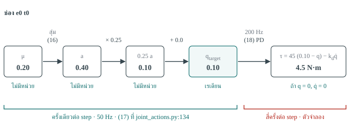

## บทที่ 15 · จาก μ ถึงมอเตอร์ — action กลายเป็นมุมและแรงบิด

> [!INTRO]
> บทที่ 5 บอกว่าตัวเลขใน action ไม่มีหน่วย มันไม่ใช่มุมและไม่ใช่แรงบิด และชี้ไปที่ `limx_base_env_cfg.py:119-120` ว่าเป็นที่ที่มันถูกแปลง บทที่ 12 ให้ action ของทุกช่องในตารางตัวอย่าง เช่น 0.40 ที่ e0 t0 แต่มอเตอร์ของหุ่นไม่รู้ว่า 0.40 แปลว่าอะไร
>
> บทนี้ไล่ตัวเลข 0.40 ไปจนถึงมอเตอร์ มันผ่านสองขั้น ขั้นแรกคือสมการ (17) ซึ่งแปลง action เป็นมุมเป้าหมายของข้อต่อ ขั้นที่สองคือสมการ (18) ซึ่งเป็นตัวควบคุมแบบ PD ที่แปลงมุมเป้าหมายเป็นแรงบิด ขั้นที่สองไม่เกี่ยวกับ RL เลย และในตัวจำลองมันทำงานเร็วกว่า policy สี่เท่า
>
> ของที่ต้องรู้มาก่อน: ช่อง $\mathcal{A}$ และ action ไม่มีหน่วย จากบทที่ 5 · step และเวลา 0.02 วินาทีต่อ step จากบทที่ 7 · deterministic จากบทที่ 11 · สมการ (16) และแถว $a$ จากบทที่ 12
>
> จบบทนี้แล้ว เราแปลง action ของทุกช่องเป็นมุมเป้าหมายและแรงบิดได้ด้วยมือ อธิบายได้ว่าทำไมต้องคูณด้วย 0.25 และบอกได้ว่าตัวเลขเปลี่ยนเป็นเรเดียนที่บรรทัดไหน

### ของที่ต้องมีก่อนเริ่ม

บทนี้ใช้แถว $\mu$ และ $a$ ของตารางตัวอย่าง

| | | t=0 | t=1 | t=2 | t=3 |
| --- | --- | --- | --- | --- | --- |
| **env 0** | $\mu$ | 0.20 | 0.30 | 0.10 | 0.40 |
| | $a$ | 0.40 | 0.20 | 0.50 | 0.40 |
| **env 1** | $\mu$ | −0.10 | 0.00 | 0.20 | −0.30 |
| | $a$ | −0.40 | 0.40 | 0.30 | −0.10 |

และค่าคงที่จากโค้ดของรุ่น SF

| ค่า | ตัวเลข | ที่มา |
| --- | --- | --- |
| `scale` | 0.25 | `limx_base_env_cfg.py:119` |
| `use_default_offset` | True | `limx_base_env_cfg.py:120` |
| มุมของท่าเริ่มต้น | 0.0 ทุกข้อต่อ | `solefoot_cfg.py:32-34` |
| `stiffness` $k_p$ | 45.0 ทุกข้อต่อ | `solefoot_cfg.py:50`, `:61` |
| `damping` $k_d$ | 1.5 ขา · 0.8 ข้อเท้า | `solefoot_cfg.py:51`, `:62` |
| `effort_limit` | 80.0 N·m | `solefoot_cfg.py:48`, `:59` |
| `decimation` · `sim.dt` | 4 · 0.005 s | `limx_base_env_cfg.py:497`, `:501` |

สัญลักษณ์ที่ใช้ในบทนี้ เรียงตามลำดับที่จะพบ

| สัญลักษณ์ | ชนิด | ความหมาย |
| --- | --- | --- |
| **scale** 0.25 | ค่าคงที่ | ตัวคูณที่แปลง action ไร้หน่วยเป็นขนาดของมุม |
| $q_{\text{default}}$ | scalar ต่อข้อต่อ | มุมของท่าเริ่มต้น ซึ่งเป็น 0.0 ทุกข้อใน config ของรุ่น SF ที่เล่มนี้อ่าน |
| $q_{\text{target}}$ | scalar ต่อข้อต่อ | มุมเป้าหมายที่ policy สั่ง หน่วยเรเดียน |
| $q$ · $\dot q$ | scalar ต่อข้อต่อ | มุมและความเร็วเชิงมุมที่วัดได้ตอนนี้ |
| $\tau$ | scalar ต่อข้อต่อ | แรงบิดที่มอเตอร์ออก หน่วย N·m |
| **PD** · $k_p$ · $k_d$ | ฟังก์ชัน · ค่าคงที่ | ตัวควบคุมที่แปลงความคลาดของมุมเป็นแรงบิด $k_p$ คือความแข็ง $k_d$ คือการหน่วง |

### ปัญหา: ตัวเลข 0.40 แปลว่าอะไร

policy คืนตัวเลขแปดตัวต่อ step ตัวเลขเหล่านี้ต้องกลายเป็นสิ่งที่มอเตอร์ทำตามได้ ก่อนจะแปลง เราต้องตอบสองคำถาม

| คำถาม | ทางเลือก |
| --- | --- |
| ตัวเลขนี้คือปริมาณอะไร | มุมเป้าหมาย ความเร็วเป้าหมาย หรือแรงบิดโดยตรง |
| หนึ่งหน่วยของตัวเลขเท่ากับเท่าไร | เช่น 1.0 คือ 1 เรเดียน หรือ 0.25 เรเดียน |

Tron1 ตอบคำถามแรกว่ามุมเป้าหมาย และตอบคำถามที่สองว่า 1.0 คือ 0.25 เรเดียน เมื่อนับรวมขั้นที่บทที่ 11 และ 12 ทำไว้แล้ว ทางจาก policy ถึงมอเตอร์มีห้าขั้น



| ขั้น | ทำอะไร | e0 t0 | หน่วย |
| --- | --- | --- | --- |
| 1 | โครงข่ายคืน $\mu$ (บทที่ 13) | 0.20 | ไม่มี |
| 2 | สุ่มด้วยสมการ (16) (บทที่ 12) | 0.40 | ไม่มี |
| 3 | คูณ scale | $0.40 \times 0.25 = 0.10$ | ไม่มี |
| 4 | บวกมุมเริ่มต้น | $0.10 + 0.0 = 0.10$ | เรเดียน |
| 5 | PD แปลงเป็นแรงบิด | สมการ (18) | N·m |

### สมการ (17): action เป็นมุมเป้าหมาย

ขั้น 3 และ 4 รวมเป็นสมการเดียว

> [!KEY] action เป็นมุมเป้าหมาย
> $$q_{\text{target}} = 0.25\,a + q_{\text{default}} \tag{17}$$

สมการนี้อ่านว่า มุมเป้าหมายของข้อต่อคือมุมของท่าเริ่มต้น บวกกับ action ที่ย่อลงเหลือหนึ่งในสี่

ในโค้ด สมการนี้คือบรรทัดเดียวของ Isaac Lab (`joint_actions.py:134`)

```text
self._processed_actions = self._raw_actions * self._scale + self._offset
```

`_scale` คือ 0.25 จาก config และ `_offset` คือมุมของท่าเริ่มต้น เพราะ `use_default_offset=True` ทำให้บรรทัด `joint_actions.py:155-156` ตั้ง `_offset` เป็น `default_joint_pos` ของหุ่น config ของรุ่น SF ที่เล่มนี้อ่านตั้งมุมเริ่มต้นของทุกข้อต่อไว้ที่ 0.0 ขั้น 4 ของ Tron1 จึงไม่เปลี่ยนตัวเลข แต่หุ่นที่ท่าเริ่มต้นไม่ใช่ศูนย์จะได้ผลต่างจากนี้มาก

> [!EXAMPLE] จงหามุมเป้าหมายของทั้งสี่ช่องของ env 0 เป็นเรเดียนและองศา
> ใช้ $q_{\text{target}} = 0.25\,a + 0$ และ 1 เรเดียน $= 57.30$ องศา
>
> | ช่อง | $a$ | $q_{\text{target}}$ (rad) | องศา |
> | --- | --- | --- | --- |
> | e0 t0 | 0.40 | 0.1000 | 5.73 |
> | e0 t1 | 0.20 | 0.0500 | 2.86 |
> | e0 t2 | 0.50 | 0.1250 | 7.16 |
> | e0 t3 | 0.40 | 0.1000 | 5.73 |
>
> มุมเป้าหมายทุกช่องเป็นการขยับไม่กี่องศาจากท่าเริ่มต้น

### ทำไมต้องคูณ 0.25

ช่วงแรกของการเทรน $\sigma = 1.0$ และโครงข่ายยังไม่รู้อะไร บทที่ 12 คำนวณไว้ว่า action ประมาณหนึ่งในสามจะเบี่ยงจาก $\mu$ เกิน 1 ถ้าไม่มี scale ตัวเลขขนาดนั้นจะกลายเป็นมุมเป้าหมายที่ใหญ่มาก

| $a$ | ไม่คูณ scale | คูณ 0.25 |
| --- | --- | --- |
| 0.40 | 0.40 rad = 22.9° | 0.10 rad = 5.7° |
| 1.0 | 1.00 rad = 57.3° | 0.25 rad = 14.3° |
| 2.0 | 2.00 rad = 114.6° | 0.50 rad = 28.6° |

มุมเป้าหมาย 57 องศาที่สั่งใน step เดียว ซึ่งยาว 0.02 วินาที ให้แรงบิดเริ่มต้น $45 \times 1.0 = 45$ N·m ถ้าข้อต่อนิ่งอยู่ที่ท่าเริ่มต้น ซึ่งเกินครึ่งของขีด 80 N·m และที่ $a = 2.0$ แรงบิดชนขีด เรายังไม่ได้วัดว่าหุ่นจะล้มหรือไม่ แต่คำสั่งที่กระตุกแรงขนาดนี้ทุก step ทำให้การเดินที่นุ่มนวลเกิดได้ยาก ถ้าเกือบทุก action ให้ผลแย่พอ ๆ กัน reward ก็แทบไม่ต่างกัน และการเรียนรู้จะไม่มีสัญญาณให้เดินตาม

อีกมุมหนึ่ง scale คือการแบ่งงาน โครงข่ายคืนตัวเลขในย่านราว ±1 ได้ตามธรรมชาติ ส่วน scale แปลงย่านนั้นเป็นขนาดของมุมที่เหมาะกับ step ยาว 0.02 วินาที ถ้าไม่มี scale โครงข่ายต้องเรียนรู้เองให้คืนตัวเลขเล็กลงสี่เท่า ซึ่งทำได้ แต่เสียการเรียนรู้ไปกับเรื่องของขนาด แทนที่จะใช้กับรูปแบบของการเดิน ค่า 0.25 เป็น hyperparameter ในความหมายของบทที่ 13 คนตั้งมันไว้ใน config

### ตัวเลขกลายเป็นเรเดียนที่ไหน

ตัวเลข 0.10 ที่ได้จากสมการ (17) ยังเป็นเลขทศนิยมธรรมดาใน tensor ไม่มีอะไรในการคูณ 0.25 ที่ทำให้มันเป็นเรเดียน มันกลายเป็นเรเดียนเมื่อถูกส่งเข้าฟังก์ชันที่ถือว่า input ของมันเป็นเรเดียน

| บรรทัด | โค้ด | ตัวเลข | ตัวเลขนี้คืออะไร |
| --- | --- | --- | --- |
| `actor_critic.py:161` | `self.distribution.sample()` | 0.40 | เลขไร้หน่วย |
| `joint_actions.py:134` | `raw * scale + offset` | 0.10 | ยังเป็นเลขไร้หน่วย |
| `joint_actions.py:160` | `set_joint_position_target(...)` | 0.10 | เป้าหมายของมุมข้อต่อ ซึ่งตัวจำลองตีความเป็นเรเดียน |

> [!NOTE]
> ค่าที่อ่านจากตัวแปลงสัญญาณแอนะล็อกเป็นดิจิทัลเป็นเพียงตัวเลข ถ้าเราเขียน `temp_c = adc_value * 25.0` การคูณ 25 ไม่ได้ทำให้ตัวเลขเป็นองศาเซลเซียส คนเขียนโค้ดเป็นผู้ตัดสินว่าตัวเลขนั้นจะถูกใช้เป็นองศาเซลเซียส การเทียบนี้ใช้ไม่ได้ตรงที่ตัวแปลงสัญญาณมีสูตรทางฟิสิกส์ที่บอกค่า 25 ส่วน 0.25 ของ Tron1 ไม่ได้มาจากฟิสิกส์ มันเป็นค่าที่คนเลือก

ผลที่ตามมาคือโครงข่ายไม่เคยรู้จักคำว่าเรเดียน มันเรียนรู้เพียงว่าคืนตัวเลขแบบใดแล้วได้ reward สูง ทางจาก action ถึงมุมคงที่ตลอดการเทรน ถ้าเราเปลี่ยน scale เป็น 0.5 แล้วเทรนใหม่ และการเรียนรู้หาท่าเดินแบบเดิมได้ มุม 0.10 เรเดียนจะมาจาก action 0.20 แทน 0.40 หน่วยเป็นเรื่องของคนที่ออกแบบทาง ไม่ใช่เรื่องของโครงข่าย

### สมการ (18): มุมเป้าหมายเป็นแรงบิด

มอเตอร์ไม่ได้ไปถึงมุมเป้าหมายเอง มันต้องถูกบอกว่าให้ออกแรงเท่าไร ตัวควบคุมที่ทำหน้าที่นี้คือ **PD controller** (proportional–derivative) ซึ่งเป็นตัวควบคุมคลาสสิกที่ไม่เกี่ยวกับ RL

> [!KEY] ตัวควบคุม PD
> $$\tau = k_p\,(q_{\text{target}} - q) - k_d\,\dot q \tag{18}$$

| | | ค่าของรุ่น SF |
| --- | --- | --- |
| $q_{\text{target}} - q$ | ความคลาดของมุม ยังขาดอีกเท่าไรจึงถึงเป้า | |
| $k_p$ | ความแข็ง คลาดหนึ่งเรเดียนออกแรงกี่ N·m | 45.0 |
| $\dot q$ | ข้อต่อกำลังหมุนเร็วแค่ไหน | |
| $k_d$ | การหน่วง หมุนหนึ่งเรเดียนต่อวินาทีถูกต้านกี่ N·m | 1.5 ขา · 0.8 ข้อเท้า |
| $\tau$ | แรงบิดที่มอเตอร์ออก | ตัวจำลองจำกัดที่ ±80 N·m |

สมการนี้อ่านว่า

<div class="wordeq"><span>แรงบิด</span> = <span>ความแข็ง</span> × <span>ยังห่างเป้าเท่าไร</span> − <span>การหน่วง</span> × <span>กำลังหมุนเร็วแค่ไหน</span></div>

พจน์แรกดึงข้อต่อเข้าหาเป้า ยิ่งห่างยิ่งดึงแรง พจน์ที่สองต้านการหมุน ทำหน้าที่เหมือนเบรก ไม่ให้ข้อต่อพุ่งเลยเป้าไป

> [!EXAMPLE] สมมติว่าข้อต่อของ e0 t0 อยู่ที่มุมของท่าเริ่มต้นพอดีและนิ่งอยู่ จงหาแรงบิดที่ PD ออกในขณะแรก
> $q = 0$, $\dot q = 0$ และ $q_{\text{target}} = 0.10$ จากตัวอย่างก่อนหน้า
>
> $$\tau = 45 \times (0.10 - 0) - k_d \times 0 = 4.5 \text{ N·m}$$
>
> พจน์การหน่วงเป็นศูนย์เพราะข้อต่อยังไม่หมุน ค่า $k_d$ ของขาหรือของข้อเท้าจึงให้คำตอบเดียวกัน

ข้อสมมติ $q = 0$ และ $\dot q = 0$ เป็นเพียงจุดเริ่มต้นสำหรับคิดด้วยมือ ในการเทรนจริง ทุกครั้งที่ episode เริ่มใหม่ หุ่นถูกวางด้วยมุมที่สุ่มเบี่ยงไป ±0.2 เรเดียน และความเร็วที่สุ่มไป ±0.5 เรเดียนต่อวินาที (`limx_base_env_cfg.py:327-333`) และระหว่าง episode ข้อต่อก็ไม่ได้อยู่ที่ศูนย์ ค่า $k_p$ และ $k_d$ ในตารางข้างบนก็เป็นค่าที่ config ตั้งไว้เช่นกัน ตอนเทรนค่าเหล่านี้ถูกคูณด้วยตัวเลขสุ่มทุกครั้งที่ episode เริ่มใหม่ ซึ่งบทที่ 29 ไล่ให้ดู

**ขีดจำกัดของแรงบิด** ตัวจำลองจำกัดแรงบิดของทุกข้อต่อไว้ที่ 80 N·m (`effort_limit`) ค่านี้เป็นค่าที่ config ตั้งให้ตัวจำลอง เล่มนี้ไม่ได้ตรวจว่าตรงกับสเปกของมอเตอร์จริงหรือไม่ เมื่อข้อต่อนิ่ง แรงบิดชนขีดนี้เมื่อความคลาดเกิน $80 / 45 = 1.7778$ เรเดียน หรือประมาณ 102 องศา จากท่าเริ่มต้น ความคลาดขนาดนั้นต้องใช้ $\lvert a \rvert > 7.11$ ถ้า $\mu$ อยู่ใกล้ศูนย์และ $\sigma = 1.0$ ต้องสุ่มได้ $\lvert\varepsilon\rvert$ เกิน 7 ซึ่งแทบไม่เกิดขึ้น แต่ไม่มีอะไรห้ามโครงข่ายคืน $\mu$ ที่ใหญ่ ขีดนี้จึงเป็นด่านสุดท้ายในตัวจำลองที่กันไม่ให้คำสั่งใดสร้างแรงเกินกำหนด

### PD ทำงานที่ไหน และบ่อยแค่ไหน

policy ตัดสินใจหนึ่งครั้งต่อ step คือทุก 0.02 วินาที แต่ตัวจำลองคำนวณฟิสิกส์ทุก 0.005 วินาที ซึ่งเป็นสี่เท่าของความถี่ของ policy โค้ดของ Isaac Lab แยกสองจังหวะนี้ไว้ชัดเจน

| บรรทัด | ทำอะไร | บ่อยแค่ไหน |
| --- | --- | --- |
| `manager_based_rl_env.py:173` | `process_action` คำนวณสมการ (17) | หนึ่งครั้งต่อ step คือ 50 Hz |
| `manager_based_rl_env.py:182` | `for _ in range(self.cfg.decimation):` วนสี่ก้าวย่อย | |
| `manager_based_rl_env.py:185` | `apply_action` เขียนมุมเป้าหมายเดิมลงที่พัก (ผ่าน `joint_actions.py:160`) | ทุกก้าวย่อย คือ 200 Hz |
| `manager_based_rl_env.py:187` | `self.scene.write_data_to_sim()` ส่งค่าจากที่พักเข้าตัวจำลอง | ทุกก้าวย่อย คือ 200 Hz |
| `manager_based_rl_env.py:189` | `self.sim.step(...)` ตัวจำลองคำนวณสมการ (18) และฟิสิกส์ | ทุกก้าวย่อย คือ 200 Hz |

ภายในหนึ่ง step มุมเป้าหมายคงที่ แต่ $q$ และ $\dot q$ เปลี่ยนทุกก้าวย่อย PD จึงคำนวณแรงบิดใหม่สี่ครั้ง ข้อต่อค่อย ๆ เข้าหาเป้า แรงบิดลดลงตามความคลาดที่เหลือ และการหน่วงคอยเบรก

ข้อต่อทั้งแปดของรุ่น SF ใช้ตัวควบคุมแบบ `ImplicitActuatorCfg` (`solefoot_cfg.py:39`, `:54`) ซึ่งให้ตัวจำลองคำนวณ PD ไปพร้อมกับฟิสิกส์ บนหุ่นจริงไม่มีตัวจำลอง ใครคำนวณ PD และใช้ค่า $k_p$, $k_d$ และขีดแรงบิดเท่าไร เป็นเรื่องที่ repo นี้ไม่ได้บอก บทที่ 30 จะตรวจจากโค้ดฝั่งใช้งานจริง

**policy ไม่เคยสั่งแรงบิดโดยตรง** policy ที่สั่งแรงบิดมีอยู่จริง แต่ต้องเรียนรู้เองว่าแรงเท่าไรพาข้อต่อไปถึงมุมที่ต้องการ และแรงที่สั่งค้างไว้ตลอด 0.02 วินาทีโดยไม่มีใครแก้ระหว่างทาง การสั่งเป็นมุมเป้าหมายแบ่งงานนี้ให้ PD ซึ่งแก้แรงทุก 0.005 วินาทีตามมุมและความเร็วที่วัดได้ policy จึงเรียนรู้เฉพาะว่าควรไปที่มุมไหน

### ตอนเทรนกับตอนใช้งานกับหุ่นจริง

บทที่ 11 บอกว่าตอนใช้งานกับหุ่นจริง policy เป็น deterministic action คือ $\mu$ ไม่ใช่ค่าที่สุ่มได้ มุมเป้าหมายจึงต่างจากตอนเทรน

| ช่อง | ตอนเทรน $a$ | $q_{\text{target}}$ | ตอนใช้งานจริง $\mu$ | $q_{\text{target}}$ |
| --- | --- | --- | --- | --- |
| e0 t0 | 0.40 | 0.1000 | 0.20 | 0.0500 |
| e0 t1 | 0.20 | 0.0500 | 0.30 | 0.0750 |
| e0 t2 | 0.50 | 0.1250 | 0.10 | 0.0250 |
| e0 t3 | 0.40 | 0.1000 | 0.40 | 0.1000 |

ช่อง e0 t3 ได้มุมเดียวกันทั้งสองแบบ เพราะ $\varepsilon = 0$ ทำให้ $a = \mu$ ตารางนี้ใช้สมการ (17) แบบเดียวกันทั้งสองคอลัมน์ ค่าคงที่ที่ชั้น deploy ใช้ต่างจากของตัวจำลองบางตัว บทที่ 30 เทียบทีละค่า

### จากสมการถึงโค้ด

| ในสมการ | บรรทัด | โค้ด |
| --- | --- | --- |
| scale และ offset | `limx_base_env_cfg.py:116-121` | `JointPositionActionCfg(..., scale=0.25, use_default_offset=True)` |
| $q_{\text{default}}$ | `solefoot_cfg.py:32-34` | `joint_pos={".*_Joint": 0.0}` |
| offset = $q_{\text{default}}$ | `joint_actions.py:155-156` | `self._offset = self._asset.data.default_joint_pos[...]` |
| สมการ (17) | `joint_actions.py:134` | `self._raw_actions * self._scale + self._offset` |
| ส่ง $q_{\text{target}}$ เข้าตัวจำลอง | `joint_actions.py:160` | `set_joint_position_target(self.processed_actions, ...)` |
| $k_p$, $k_d$, ขีดแรงบิด | `solefoot_cfg.py:48-51`, `:59-62` | `effort_limit=80.0` · `stiffness=45.0` · `damping=1.5` หรือ `0.8` |
| สมการ (18) สี่ครั้งต่อ step | `manager_based_rl_env.py:182-189` | `for _ in range(self.cfg.decimation):` แล้ว `apply_action()` และ `sim.step()` |

> [!SUMMARY]
> - action ไม่มีหน่วย สมการ (17) แปลงมันเป็นมุมเป้าหมาย $q_{\text{target}} = 0.25\,a + q_{\text{default}}$ ที่ e0 t0 ได้ 0.10 เรเดียน
> - scale 0.25 ทำให้ action ในย่าน ±1 กลายเป็นมุมไม่กี่องศาที่เหมาะกับ step ยาว 0.02 วินาที และเป็น hyperparameter
> - ตัวเลขกลายเป็นเรเดียนเพราะถูกส่งเข้า `set_joint_position_target` ไม่ใช่เพราะการคูณ
> - สมการ (18) เป็นตัวควบคุม PD ที่แปลงความคลาดของมุมเป็นแรงบิด ในตัวจำลองมันทำงานสี่ครั้งต่อ step ที่ 200 Hz และถูกจำกัดที่ 80 N·m
> - policy ไม่เคยสั่งแรงบิด มันสั่งมุมเป้าหมาย ตอนใช้งานใช้ $\mu$ แทน $a$ และผ่านสมการ (17) รูปเดิม ส่วนใครคำนวณสมการ (18) และด้วยค่าคงที่ชุดใด เป็นเรื่องของบทที่ 30
>
> ประโยคที่ควรจำ: **policy สั่งมุมเป้าหมาย ไม่ได้สั่งแรง PD เป็นผู้แปลงมุมเป็นแรงบิด และหน่วยเรเดียนเกิดจากช่องที่ตัวเลขถูกส่งเข้าไป ไม่ใช่จากการคูณ**

### แบบฝึกหัด

1. ข้อใดถูกต้อง
    1. policy ของ Tron1 คืนแรงบิดของมอเตอร์
    2. ตัวเลข 0.10 หลังการคูณ 0.25 กลายเป็นเรเดียนทันทีที่ `joint_actions.py:134`
    3. ใน config ของชั้น train มุมของท่าเริ่มต้นของรุ่น SF เป็นศูนย์ทุกข้อต่อ
    4. PD ทำงานสี่ครั้งต่อหนึ่ง step ของ policy
    5. มุมเป้าหมายเปลี่ยนทุกก้าวย่อยของตัวจำลอง
    6. $k_d$ ของข้อเท้าน้อยกว่าของขา
    7. scale 0.25 ถูกเรียนรู้ระหว่างเทรน
    8. ตอนใช้งานกับหุ่นจริง มุมเป้าหมายคำนวณจาก $\mu$
    9. ในตัวจำลอง แรงบิดที่ PD ออกถูกจำกัดไว้ที่ ±80 N·m
    10. ถ้าข้อต่อนิ่งและอยู่ที่เป้าพอดี PD ออกแรงบิดเป็นศูนย์

2. จงหามุมเป้าหมายของทั้งสี่ช่องของ env 1 เป็นเรเดียนและองศา [05 §2.5]
    1. e1 t0
    2. e1 t1
    3. e1 t2
    4. e1 t3

    <!--space:22-->

3. สมมติว่าข้อต่อของทุกช่องใน env 1 อยู่ที่มุมเริ่มต้นและนิ่งอยู่ จงหาแรงบิดของแต่ละช่อง <!--space:16-->

4. ถ้า policy ของ env 1 เป็นแบบ deterministic และค่าคงที่เท่ากับตอนเทรน จงหามุมเป้าหมายของทั้งสี่ช่อง <!--space:14-->

5. สมมติว่าขณะหนึ่งข้อต่ออยู่ที่ $q = 0.05$ rad กำลังหมุนด้วย $\dot q = +1.0$ rad/s และ $q_{\text{target}} = 0.10$ จงหาแรงบิดถ้าข้อต่อนี้เป็นเข่า และถ้าเป็นข้อเท้า แล้วอธิบายว่าทำไมสองค่าต่างกัน [solefoot_cfg.py:51] <!--space:20-->

6. ใช้ $k_p = 45$ และ $k_d = 1.5$ จงหาแรงบิดในสองกรณี แล้วอธิบายความหมายของเครื่องหมาย
    1. ข้อต่อถึง $q = 0.10$ ซึ่งเท่ากับเป้าแล้ว แต่ยังหมุนด้วย $\dot q = +0.5$ rad/s
    2. ข้อต่อเลยเป้าไปอยู่ที่ $q = 0.12$ และนิ่งอยู่

    <!--space:22-->

7. เมื่อข้อต่อนิ่ง ความคลาดของมุมต้องเกินเท่าไรแรงบิดจึงชนขีด 80 N·m และ action ต้องมีขนาดเท่าไรจึงสร้างความคลาดนั้นได้จากท่าเริ่มต้น [solefoot_cfg.py:48] <!--space:14-->

8. ถ้าเปลี่ยน scale เป็น 0.5 แล้วเทรนใหม่ action เท่าไรจะให้มุมเป้าหมาย 0.10 เรเดียน และโครงข่ายต้องรู้หรือไม่ว่า scale เปลี่ยน จงอธิบาย <!--space:14-->

9. จงอธิบายว่าทำไม policy ของ Tron1 จึงสั่งมุมเป้าหมาย แทนที่จะสั่งแรงบิดโดยตรง <!--space:14-->

10. จงอธิบายประโยค "ตัวเลขกลายเป็นเรเดียนเพราะช่องที่มันถูกส่งเข้าไป ไม่ใช่เพราะการคูณ" โดยอ้างบรรทัดโค้ด <!--space:16-->

<!-- เฉลย -->

1. ข้อที่ถูก: 3, 4, 6, 8, 9, 10

    - ข้อ 1 ผิด: policy คืน action ซึ่งกลายเป็นมุมเป้าหมาย แรงบิดมาจาก PD
    - ข้อ 2 ผิด: ที่บรรทัดนั้นยังเป็นเลขไร้หน่วย มันถูกตีความเป็นเรเดียนเมื่อส่งเข้า `set_joint_position_target` ที่ `:160`
    - ข้อ 5 ผิด: มุมเป้าหมายคำนวณครั้งเดียวต่อ step และคงที่ตลอดสี่ก้าวย่อย
    - ข้อ 7 ผิด: scale เป็น hyperparameter คนตั้งใน config

2. $q_{\text{target}} = 0.25\,a$

    1. −0.1000 rad คือ −5.73°
    2. 0.1000 rad คือ 5.73°
    3. 0.0750 rad คือ 4.30°
    4. −0.0250 rad คือ −1.43°

3. $\tau = 45 \times q_{\text{target}}$ ได้ −4.5, 4.5, 3.375 และ −1.125 N·m ตามลำดับ

4. $0.25\,\mu$ ได้ −0.0250, 0.0000, 0.0500 และ −0.0750 rad

5. เข่า: $45 \times 0.05 - 1.5 \times 1.0 = 0.75$ N·m · ข้อเท้า: $45 \times 0.05 - 0.8 \times 1.0 = 1.45$ N·m ข้อเท้ามี $k_d$ น้อยกว่า การหน่วงจึงหักแรงออกน้อยกว่า

6. แรงบิดในสองกรณี

    1. $45 \times 0 - 1.5 \times 0.5 = -0.75$ N·m เครื่องหมายลบคือต้านการหมุน ข้อต่อถึงเป้าแล้วแต่ยังหมุนต่อ PD จึงเบรก
    2. $45 \times (0.10 - 0.12) = -0.90$ N·m เครื่องหมายลบคือดึงกลับ ข้อต่อเลยเป้าไป PD จึงดึงมันกลับมา

7. ความคลาดเกิน $80 / 45 = 1.7778$ rad ประมาณ 102° action ต้องมี $\lvert a \rvert > 1.7778 / 0.25 = 7.11$

8. $0.10 / 0.5 = 0.20$ โครงข่ายไม่ต้องรู้ มันเรียนรู้เพียงว่าคืนตัวเลขแบบใดแล้วได้ reward สูง ถ้าการเรียนรู้หาท่าเดินแบบเดิมได้ มันจะคืนตัวเลขที่เล็กลงครึ่งหนึ่งเอง

9. ถ้าสั่งแรงบิด policy ต้องเรียนรู้เองว่าแรงเท่าไรพาข้อต่อไปถึงมุมที่ต้องการ และแรงที่สั่งค้างไว้ตลอด step โดยไม่มีใครแก้ การสั่งมุมเป้าหมายแบ่งงานให้ PD ซึ่งแก้แรงทุก 0.005 วินาทีตามมุมและความเร็วที่วัดได้ policy ทำงานเพียง 50 Hz และเรียนรู้เฉพาะรูปแบบของการเคลื่อนไหว

10. `joint_actions.py:134` คูณและบวกตัวเลขใน tensor ผลยังเป็นเลขธรรมดาที่ไม่มีหน่วย บรรทัด `:160` ส่งมันเข้า `set_joint_position_target` ซึ่งตัวจำลองใช้เป็นเป้าหมายของมุมข้อต่อในหน่วยเรเดียน ถ้าส่งตัวเลขเดียวกันเข้าช่องอื่น มันจะมีความหมายอื่น
