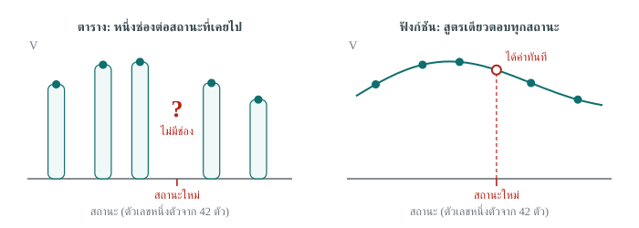

## บทที่ 16 · วิธีแบบตาราง — ทำไมค่าของสถานะเก็บลงตารางไม่ได้

> [!INTRO]
> บทที่ 9 ให้สมการ Bellman ซึ่งเป็นเงื่อนไขที่ $V$ ตัวจริงต้องเป็นไปตาม วิธี RL ยุคแรกแก้เงื่อนไขนี้ตรง ๆ คือเปิดตารางหนึ่งใบ ให้หนึ่งช่องต่อหนึ่งสถานะ แล้วปรับตัวเลขในช่องซ้ำไปจนสองข้างของสมการเท่ากัน วิธีนี้ง่าย และให้คำตอบที่ถูกต้องพอดี แต่ในโค้ดของ Tron1 ไม่มีตารางแบบนั้นอยู่เลย
>
> บทนี้ลองทำวิธีแบบตารางด้วยมือกับคอลัมน์หนึ่งของตารางตัวอย่าง ให้เห็นว่ามันใช้ได้เมื่อไร แล้วนับว่าตารางของ Tron1 ต้องมีกี่ช่อง ผลของการนับคือเหตุผลที่ policy และ critic ต้องเป็นโครงข่าย
>
> ของที่ต้องรู้มาก่อน: $\mathcal{S}$, $\mathcal{A}$ และ $P$ จากบทที่ 5 · ตารางตัวอย่าง transition และ iteration จากบทที่ 7 · สมการ Bellman สมการ (4) และ bootstrapping จากบทที่ 9 · โครงข่ายและจำนวน parameter จากบทที่ 13 · gradient descent จากบทที่ 14
>
> จบบทนี้แล้ว เราทำ dynamic programming บนโลกเล็ก ๆ ได้ด้วยมือ บอกได้ว่าวิธีแบบตารางต้องการอะไรสามอย่างที่ Tron1 ไม่มี และอธิบายได้ว่าโครงข่ายแทนตารางได้อย่างไร โดยต้องยอมเสียอะไร

### ของที่ต้องมีก่อนเริ่ม

บทนี้ใช้สามแถวของตารางตัวอย่าง คือ $r$, $V$ และ done พร้อมคอลัมน์ $V_{last}$ ตารางตัวอย่างใช้ $\gamma = 0.9$

| | | t=0 | t=1 | t=2 | t=3 | $V_{last}$ |
| --- | --- | --- | --- | --- | --- | --- |
| **env 0** | $r$ | 1.0 | 0.5 | 1.0 | 0.5 | |
| | $V$ | 5.0 | 4.5 | 4.0 | 3.5 | 3.0 |
| | done | 0 | 0 | 0 | 0 | |
| **env 1** | $r$ | 0.5 | 1.0 | **−2.0** | 0.0 | |
| | $V$ | 3.0 | 2.0 | 1.0 | 4.0 | 3.5 |
| | done | 0 | 0 | **1** | 0 | |

สัญลักษณ์และคำที่ใช้ในบทนี้ เรียงตามลำดับที่จะพบ

| คำ | ชนิด | ความหมาย |
| --- | --- | --- |
| **tabular** วิธีแบบตาราง | แนวคิด | ตาราง หนึ่งช่องต่อสถานะ |
| **DP** dynamic programming | แนวคิด | วิธีแก้ MDP แบบตารางที่รู้แบบจำลองของโลกครบ |
| **function approximator** | แนวคิด | ฟังก์ชันที่สรุปรวม ใช้แทนตาราง · ใน Tron1 คือโครงข่าย |

### ปัญหา: สมการ (4) บอกเงื่อนไข ไม่ได้บอกค่า

บทที่ 9 เตือนไว้ว่าสมการ Bellman เป็นเงื่อนไข ไม่ใช่วิธีคำนวณ ทางขวาของมันมี $V^\pi$ ซึ่งเป็นตัวที่เรากำลังหาอยู่

$$V^{\pi}(s) = \mathbb{E}_{\pi}\big[r_t + \gamma\,V^{\pi}(s_{t+1}) \mid s_t = s\big]$$

นึกถึงแผ่นตารางคำนวณที่มีหนึ่งช่องต่อหนึ่งสถานะ เราใส่ตัวเลขอะไรก็ได้ลงไปก่อน แล้วไล่ทีละช่อง เขียนทับช่องนั้นด้วยทางขวาของสมการ ซึ่งคำนวณจากตัวเลขที่อยู่ในช่องอื่น เมื่อทำซ้ำจนไม่มีช่องใดเปลี่ยน ทุกช่องก็เป็นไปตามเงื่อนไขพร้อมกัน เราได้ $V^\pi$ โดยไม่ต้องแก้สมการ

วิธีที่เก็บค่าไว้หนึ่งช่องต่อหนึ่งสถานะเช่นนี้เรียกว่า **tabular** หรือวิธีแบบตาราง ความคิดนี้ตรงไปตรงมา แต่มันต้องการของสามอย่าง หัวข้อถัดไปทำให้เห็นทั้งสามอย่างด้วยมือ

### โลกเล็กสี่สถานะ: ทำตารางด้วยมือ

เราจะยืมคอลัมน์ env 0 ของตารางตัวอย่างมาสร้างโลกเล็ก ๆ หนึ่งใบ โดยตั้งข้อสมมติสามข้อ ซึ่งใช้เฉพาะในหัวข้อนี้

1. โลกนี้มีสถานะเพียงสี่ตัว เรียกว่า $s_0$, $s_1$, $s_2$ และ $s_3$
2. เรารู้กติกาของโลกครบ คือจาก $s_0$ ไป $s_1$ เสมอ จาก $s_1$ ไป $s_2$ เสมอ และต่อไปตามลำดับ โดยได้ reward 1.0, 0.5, 1.0 และ 0.5 ทุกครั้ง ไม่มีการสุ่ม
3. สถานะที่ตามหลัง $s_3$ มีค่า 3.0 ซึ่งเรารู้อยู่แล้ว คือ $V_{last}$ ของ env 0

ข้อสมมติข้อ 2 คือสิ่งที่บทที่ 5 เรียกว่า $P$ ในตารางตัวอย่างตัวจริง คอลัมน์หนึ่งเป็นเพียงทางเดินหนึ่งครั้งที่เกิดขึ้น ไม่ใช่กติกา ในหัวข้อนี้เราสมมติว่ามันเป็นกติกา

เมื่อไม่มีการสุ่ม ค่าคาดหวังทางขวาของสมการ (4) มีกรณีเดียว การเขียนทับหนึ่งช่องจึงเป็น

$$V(s_t) \leftarrow r_t + \gamma\,V(s_{t+1})$$

การเขียนทับครบทุกช่องหนึ่งรอบ โดยใช้ตัวเลขของรอบก่อนหน้าทางขวา เราเรียกว่าหนึ่งรอบกวาด

> [!EXAMPLE] จงเริ่มจากคำทำนายของ critic ที่ env 0 แล้วกวาดตารางจนไม่มีช่องใดเปลี่ยน
> รอบที่ 0 คือแถว $V$ ของตารางตัวอย่าง แต่ละรอบถัดไปคำนวณจากรอบก่อนหน้า เช่นรอบที่ 1 ของ $s_0$ คือ $1.0 + 0.9 \times 4.5 = 5.05$ และรอบที่ 2 ของ $s_0$ คือ $1.0 + 0.9 \times 4.10 = 4.69$
>
> | รอบกวาด | $V(s_0)$ | $V(s_1)$ | $V(s_2)$ | $V(s_3)$ |
> | --- | --- | --- | --- | --- |
> | 0 | 5.0000 | 4.5000 | 4.0000 | 3.5000 |
> | 1 | 5.0500 | 4.1000 | 4.1500 | **3.2000** |
> | 2 | 4.6900 | 4.2350 | **3.8800** | 3.2000 |
> | 3 | 4.8115 | **3.9920** | 3.8800 | 3.2000 |
> | 4 | **4.5928** | 3.9920 | 3.8800 | 3.2000 |
> | 5 | 4.5928 | 3.9920 | 3.8800 | 3.2000 |
>
> รอบที่ 5 เหมือนรอบที่ 4 ทุกช่อง ตารางนิ่งแล้ว ตัวหนาคือรอบที่ช่องนั้นได้ค่าสุดท้าย

รอบที่ 1 คือตัวเลขที่บทที่ 9 เรียกว่าทางขวาของการตรวจ คือ 5.05, 4.10, 4.15 และ 3.20 บทที่ 9 หยุดที่รอบนี้ เพราะต้องการเพียงตรวจคำทำนาย ในบทนี้เราเขียนทับแล้วทำต่อ

ค่าที่ถูกต้องเดินมาจากท้ายตาราง $s_3$ ได้ค่าสุดท้ายในรอบที่ 1 เพราะมันอิงกับ 3.0 ซึ่งเรารู้แน่ จากนั้น $s_2$ ได้ค่าสุดท้ายในรอบที่ 2 เพราะมันอิงกับ $s_3$ ที่ถูกแล้ว และต่อไปทีละช่อง ค่าสุดท้ายของ $s_0$ คือ 4.5928 ซึ่งเป็นตัวเลขเดียวกับที่บทที่ 9 ได้จากการบวก reward สี่ step แล้วต่อด้วย $V_{last}$ ตัวเลขตรงกัน แต่ฐานะของมันต่างกัน ในบทที่ 9 ค่า 3.0 เป็นคำทำนายของ critic ผลบวกจึงมีคำทำนายปนอยู่ ที่นี่เราสมมติว่า 3.0 ถูกต้อง ผลบวกจึงเป็นค่าจริงของโลกเล็กใบนี้

เมื่อตารางนิ่ง ทางซ้ายกับทางขวาของสมการ (4) เท่ากันทุกช่อง เช่นที่ $s_1$ ได้ $0.5 + 0.9 \times 3.88 = 3.992$ ตัวเลขในตารางจึงไม่ใช่คำทำนายอีกต่อไป มันคือ $V^\pi$ ของโลกเล็กใบนี้

การกวาดตารางโดยใช้กติกาของโลกเช่นนี้มีชื่อว่า **dynamic programming** ย่อว่า **DP** คือวิธีแก้ MDP แบบตารางที่รู้แบบจำลองของโลกครบ

### ของสามอย่างที่โลกเล็กมี

ตัวอย่างข้างบนสำเร็จเพราะมีของสามอย่างพร้อมกัน

| ของที่ต้องมี | ในโลกเล็กสี่สถานะ | ใน Tron1 |
| --- | --- | --- |
| สถานะนับได้ และมีน้อยพอจะเปิดหนึ่งช่องต่อหนึ่งสถานะ | 4 ช่อง | $\mathcal{S}$ ต่อเนื่อง และสิ่งที่ policy รับแทนสถานะคือจำนวนจริง 42 ตัว |
| รู้กติกาของโลกครบ คือรู้ว่าจากสถานะใด จะไปสถานะใด ด้วยโอกาสเท่าไร | ข้อสมมติข้อ 2 | $P$ คือตัวจำลองฟิสิกส์ ไม่มีใครเขียนมันเป็นตารางได้ |
| ปรับได้ทุกช่อง รอบแล้วรอบเล่า | กวาด 4 ช่อง 4 รอบ | ไปถึงได้เพียงสถานะที่หุ่นเดินผ่านจริง |

สามหัวข้อถัดไปดูทีละแถว

### นับช่องของตาราง Tron1

บทที่ 13 แสดงว่าสิ่งที่โครงข่ายของ policy รับเข้าไปคือตัวเลข 42 ตัว แต่ละตัวเป็นจำนวนจริง หุ่นที่เอียง 0.001 เรเดียนกับหุ่นที่เอียง 0.002 เรเดียนอยู่คนละสถานะ ตารางที่มีหนึ่งช่องต่อหนึ่งสถานะจึงต้องมีช่องไม่จำกัด

เราอาจลองลดความละเอียดลง โดยแบ่งตัวเลขแต่ละตัวเป็นระดับ แล้วถือว่าสถานะที่ตกระดับเดียวกันทุกตัวเป็นสถานะเดียวกัน

> [!EXAMPLE] ถ้าแบ่งตัวเลขแต่ละตัวอย่างหยาบที่สุด คือสองระดับ ตารางของ Tron1 มีกี่แถว และตลอดการเทรนหุ่นไปเยือนได้มากที่สุดกี่แถว
> ขั้นที่ 1 นับแถว ตัวเลข 42 ตัว ตัวละสองระดับ
>
> $$2^{42} = 4{,}398{,}046{,}511{,}104$$
>
> ขั้นที่ 2 นับ transition ของการเทรนทั้งหมด ตารางหนึ่งใบมี 24 แถว (`limx_rsl_rl_ppo_cfg.py:81`) คูณ 2048 env ซึ่งเป็นค่าที่บทที่ 7 ใช้ และการเทรนมี 15,000 iteration (`:82`)
>
> $$24 \times 2048 \times 15{,}000 = 737{,}280{,}000$$
>
> ขั้นที่ 3 เทียบกัน
>
> $$\frac{4{,}398{,}046{,}511{,}104}{737{,}280{,}000} \approx 5{,}965$$
>
> ตารางมีแถวมากกว่าจำนวน transition ของการเทรนทั้งหมดเกือบหกพันเท่า ต่อให้ทุก transition ไปตกคนละแถว หุ่นก็ไปเยือนได้ไม่เกินร้อยละ 0.0168 ของตาราง

การนับนี้ใช้ 42 ตัว คือสิ่งที่โครงข่ายของ policy รับ ตารางของ $V$ ที่จะแทน critic ต้องนับจาก 230 ตัวที่ critic รับ ซึ่งใหญ่กว่านี้อีกมาก ตัวเลข $2^{42}$ จึงเป็นขอบล่าง

ตารางสองระดับนี้ใช้งานไม่ได้อยู่แล้ว เพราะมันบอกได้เพียงว่าตัวเลขแต่ละตัวสูงหรือต่ำ หุ่นที่เอียงเล็กน้อยกับหุ่นที่กำลังจะล้มอาจตกแถวเดียวกัน เมื่อเพิ่มความละเอียด จำนวนแถวโตเร็วมาก

| ระดับต่อตัวเลขหนึ่งตัว | จำนวนแถวของตาราง $V$ | เทียบกับ transition ทั้งการเทรน |
| --- | --- | --- |
| 2 | $2^{42} \approx 4.4 \times 10^{12}$ | มากกว่าราว $6 \times 10^{3}$ เท่า |
| 3 | $3^{42} \approx 1.1 \times 10^{20}$ | มากกว่าราว $1.5 \times 10^{11}$ เท่า |
| 10 | $10^{42}$ | มากกว่าราว $1.4 \times 10^{33}$ เท่า |

ตารางของ $Q$ แย่กว่านี้อีก เพราะบทที่ 9 แสดงว่า $Q$ รับทั้งสถานะและ action ซึ่ง $\mathcal{A}$ ของ Tron1 ก็ต่อเนื่องเช่นกัน action หนึ่งตัวเพิ่มตัวเลขอีก 8 ตัว ที่สองระดับตารางมี $2^{50} \approx 1.1 \times 10^{15}$ ช่อง

### กติกาของโลกเขียนเป็นตารางไม่ได้

DP ต้องรู้ $P$ คือรู้ว่าจากสถานะหนึ่ง เมื่อสั่ง action หนึ่ง สถานะถัดไปแต่ละตัวมีโอกาสเกิดเท่าไร ในโลกเล็กของเรา คำตอบสั้นมาก คือไปสถานะถัดไปในลำดับเสมอ

$P$ ของ Tron1 คือตัวจำลองฟิสิกส์ สิ่งที่เราทำกับมันได้คือส่ง action เข้าไปหนึ่งชุด แล้วรับสถานะถัดไปกลับมาหนึ่งตัว (`on_policy_runner.py:177`) นั่นคือการสุ่มตัวอย่างหนึ่งครั้งจาก $P$ ตามความหมายของบทที่ 4 เราไม่มีรายการของสถานะถัดไปทุกตัวพร้อมโอกาสของมัน และไม่มีทางสร้างรายการนั้น เพราะทั้งสถานะและ action ต่อเนื่อง

> [!NOTE]
> วิธีแบบตารางบางวิธีไม่ต้องรู้ $P$ วิธีที่รู้จักกันมากที่สุดชื่อ Q-learning ซึ่งปรับตารางของ $Q$ จากตัวอย่างที่เก็บได้ทีละ step แต่มันยังต้องมีหนึ่งช่องต่อหนึ่งคู่ของสถานะกับ action จึงติดที่การนับช่องในหัวข้อก่อนหน้าเหมือนเดิม

### function approximator: ฟังก์ชันแทนตาราง

ทางออกคือเลิกเก็บค่าของแต่ละสถานะ แล้วเก็บ*วิธีคำนวณ*ค่าจากสถานะแทน

**function approximator** คือฟังก์ชันที่มีตัวเลขปรับได้จำนวนคงที่ รับสถานะเข้าไป แล้วคืนค่าที่ต้องการออกมา ฟังก์ชันตัวเดียวตอบได้ทุกสถานะ ไม่ว่าเคยไปเยือนหรือไม่ มันจึงสรุปรวมสิ่งที่เรียนจากสถานะที่เคยไป ไปใช้กับสถานะที่ไม่เคยไป

โครงข่ายของบทที่ 13 คือ function approximator Tron1 มีสองตัวที่ทำหน้าที่แทนตาราง

| แทนตารางของ | function approximator | ตัวเลขที่ปรับได้ | รับ | คืน |
| --- | --- | --- | --- | --- |
| $V$ | critic `actor_critic.py:92-111` | 282,625 ตัว | 230 ค่า | 1 ค่า |
| action ที่ควรสั่ง | โครงข่ายของ policy `actor_critic.py:69-90` | 187,272 ตัว | 42 ค่า | $\mu$ 8 ค่า |

ตัวเลข 187,272 ตัวของโครงข่ายของ policy น้อยกว่าจำนวนแถวของตารางสองระดับราว 23 ล้านเท่า และมันให้คำตอบที่ละเอียดกว่าสองระดับ เพราะ input แต่ละตัวเข้าไปเป็นจำนวนจริง

โครงข่ายตอบสถานะที่ไม่เคยเห็นได้อย่างมีเหตุผล เพราะมันเป็นฟังก์ชันที่ต่อเนื่อง ผลรวมถ่วงน้ำหนักกับ ELU ของบทที่ 13 ไม่มีจุดกระโดด สถานะสองตัวที่ต่างกันเล็กน้อยจึงได้คำตอบที่ต่างกันเล็กน้อย เมื่อ gradient descent ของบทที่ 14 ปรับ weight ให้คำตอบของสถานะหนึ่งดีขึ้น คำตอบของสถานะที่อยู่ใกล้กันก็ขยับตามไปด้วย

สมบัติเดียวกันนี้มีราคา ตารางข้างล่างเทียบสองวิธี

| | ตาราง | function approximator |
| --- | --- | --- |
| สิ่งที่เก็บ | ตัวเลขหนึ่งตัวต่อสถานะ | weight และ bias จำนวนคงที่ |
| จำนวนตัวเลข | เท่าจำนวนสถานะ | ผู้ออกแบบกำหนด |
| สถานะที่ไม่เคยไป | ไม่มีคำตอบ | มีคำตอบเสมอ ซึ่งอาจผิด |
| การปรับหนึ่งครั้ง | แตะช่องเดียว ช่องอื่นไม่เปลี่ยน | แตะ weight จำนวนมาก คำตอบของสถานะอื่นเปลี่ยนตาม |
| ความถูกต้อง | ตรงพอดีเมื่อปรับจนนิ่ง | เป็นค่าประมาณ สองข้างของสมการ (4) ไม่เท่ากันพอดี |
| ใช้ได้เมื่อ | สถานะนับได้ และไปเยือนได้ครบ | มี loss ให้ gradient descent ลด |

แถวที่สี่คือราคา การปรับโครงข่ายเพื่อสถานะหนึ่งอาจทำให้คำตอบของสถานะอื่นที่เคยดีอยู่แล้วแย่ลง ตารางไม่มีปัญหานี้ แถวที่ห้าบอกว่าไม่มีอะไรรับประกันว่า critic ของ Tron1 จะเป็น $V^\pi$ พอดี บทที่ 9 จึงเรียกตัวเลขของมันว่าคำทำนายมาตลอด

> [!REMARK]
> RL ที่ใช้โครงข่ายเป็น function approximator มักเรียกรวมกันว่า deep RL คำว่า deep หมายถึงโครงข่ายที่มีหลายชั้น อัลกอริทึมที่เล่มนี้ประกอบขึ้นในส่วนที่ 5 อยู่ในกลุ่มนี้

### ตารางที่มีอยู่ใน repo ไม่ใช่ตารางของสถานะ

เล่มนี้พูดถึงตารางมาตั้งแต่บทที่ 7 และโค้ดก็มีตารางจริง คือ `RolloutStorage` ตารางนั้นไม่ใช่ตารางของวิธี tabular

| | ตารางของวิธี tabular | ตารางของบทที่ 7 (`RolloutStorage`) |
| --- | --- | --- |
| หนึ่งช่องคือ | สถานะหนึ่งตัว | transition หนึ่งตัว คือสิ่งที่เกิดขึ้นใน step หนึ่งของ env หนึ่ง |
| หาช่องด้วย | ตัวสถานะเอง | เลขแถวของ step กับเลขคอลัมน์ของ env |
| จำนวนช่อง | เท่าจำนวนสถานะ | 24 × 2048 = 49,152 ใน Tron1 และ 8 ในตารางตัวอย่าง |
| อายุของข้อมูล | อยู่ตลอดการเรียนรู้ | หนึ่ง iteration แล้วถูกเขียนทับ |
| ใช้ทำอะไร | เป็นคำตอบ | เป็นวัตถุดิบสำหรับปรับโครงข่าย |

แถวที่สี่ตรวจได้จากโค้ด ท้ายทุก iteration บรรทัด `ppo.py:331` เรียก `self.storage.clear()` ซึ่งทำเพียงตั้งตำแหน่งเขียนกลับไปที่แถวแรก (`rollout_storage.py:184-185`) iteration ถัดไปจึงเขียนทับข้อมูลเดิมทีละแถว (`:131-148`) ค่า $V$ ที่เก็บในตาราง (`:143`) เป็นคำทำนายของ critic ณ step นั้น ไม่ใช่ค่าที่ถูกปรับสะสมไว้

> [!WARNING] ความรู้ของ Tron1 ไม่ได้อยู่ในตาราง
> สิ่งที่หุ่นเรียนรู้ข้ามจาก iteration หนึ่งไปอีก iteration หนึ่งในรูปของตัวเลขที่การเรียนรู้ปรับ คือ weight และ bias ของโครงข่าย กับลูกบิด $\ell$ optimizer ก็มีสถานะของตัวเองที่ข้ามไปด้วย รวมถึง $\alpha$ ที่ถูกปรับระหว่างเทรน (`on_policy_runner.py:360`) แต่นั่นเป็นบันทึกของวิธีหมุนลูกบิด ไม่ใช่ความรู้เรื่องสถานะ ตารางเป็นเพียงที่พักของข้อมูล 24 step ล่าสุด ไฟล์ `model_N.pt` ที่การเทรนบันทึกไว้จึงมีตัวเลขของโครงข่าย $\ell$ และสถานะของ optimizer และไม่มีตารางอยู่ในนั้น (`on_policy_runner.py:355-365`)

### จากแนวคิดถึงโค้ด

| สิ่งที่บทนี้พูดถึง | มีในโค้ดหรือไม่ | บรรทัด |
| --- | --- | --- |
| ตารางค่าของสถานะ | ไม่มี | |
| $P$ ในรูปตาราง | ไม่มี | ตัวจำลองให้ตัวอย่างทีละ step ที่ `on_policy_runner.py:177` |
| function approximator ของ $V$ | มี | `actor_critic.py:92-111` |
| function approximator ของ $\mu$ | มี | `actor_critic.py:69-90` |
| ตารางของ transition | มี | เขียนที่ `rollout_storage.py:131-148` |
| เริ่มเขียนทับตารางใหม่ | มี | `ppo.py:331` เรียก `rollout_storage.py:184-185` |
| จำนวนแถวของตาราง และจำนวน iteration | มี | `limx_rsl_rl_ppo_cfg.py:81-82` |

> [!SUMMARY]
> - วิธี tabular เก็บค่าหนึ่งช่องต่อหนึ่งสถานะ และ DP กวาดตารางด้วยทางขวาของสมการ (4) จนนิ่ง ในโลกเล็กสี่สถานะ ตารางนิ่งหลัง 4 รอบ และ $V(s_0) = 4.5928$
> - วิธีนี้ต้องการของสามอย่าง คือสถานะที่นับได้ กติกาของโลกที่รู้ครบ และการปรับได้ทุกช่อง Tron1 ไม่มีสักอย่าง
> - ตารางของ Tron1 ที่หยาบที่สุดมี $2^{42}$ แถว มากกว่า transition ของการเทรนทั้งหมด 737,280,000 ตัวเกือบหกพันเท่า
> - function approximator เก็บวิธีคำนวณค่าด้วยตัวเลขจำนวนคงที่ จึงตอบได้ทุกสถานะ แต่คำตอบเป็นค่าประมาณ และการปรับหนึ่งครั้งเปลี่ยนคำตอบของสถานะอื่นด้วย
> - ตารางใน repo คือที่พักของ transition ซึ่งถูกเขียนทับทุก iteration สิ่งที่หุ่นเรียนรู้อยู่ในตัวเลขของโครงข่าย
>
> ประโยคที่ควรจำ: **ตารางจำได้เฉพาะสถานะที่เคยไป โครงข่ายสรุปจากสถานะที่เคยไปเพื่อตอบสถานะที่ไม่เคยไป และคำตอบของมันเป็นค่าประมาณ**

### แบบฝึกหัด

1. ข้อใดถูกต้อง
    1. วิธี tabular เก็บตัวเลขหนึ่งตัวต่อหนึ่งสถานะ
    2. DP ใช้ได้โดยไม่ต้องรู้ว่าจากสถานะหนึ่งจะไปสถานะใด
    3. ในโลกเล็กสี่สถานะ ช่องที่ได้ค่าสุดท้ายก่อนคือ $s_0$
    4. เมื่อตารางของโลกเล็กนิ่ง สองข้างของสมการ (4) เท่ากันทุกช่อง
    5. ตารางสองระดับของ Tron1 มีแถวมากกว่า transition ของการเทรนทั้งหมด
    6. critic ให้คำตอบได้เฉพาะสถานะที่เคยอยู่ในตาราง
    7. การปรับ weight ของโครงข่ายเพื่อสถานะหนึ่ง ไม่กระทบคำตอบของสถานะอื่น
    8. `RolloutStorage` เก็บค่า $V$ ของทุกสถานะที่หุ่นเคยไปตั้งแต่เริ่มเทรน
    9. หลัง `storage.clear()` ตัวเลขของโครงข่ายยังอยู่ครบ
    10. function approximator ให้ค่าที่ตรงกับ $V^\pi$ พอดีเสมอ

2. จงสร้างโลกเล็กจากคอลัมน์ env 1 ด้วยข้อสมมติแบบเดียวกัน โดย $s_2$ เป็นสถานะที่ episode จบ จึงไม่มีสถานะถัดไป และสถานะที่ตามหลัง $s_3$ มีค่า 3.5 จงกวาดตารางจากแถว $V$ ของ env 1 จนนิ่ง [05 §3.1] <!--space:40-->

3. จงเทียบค่าสุดท้ายของ $s_0$, $s_1$ และ $s_2$ ในข้อ 2 กับ return ของ episode แรกของ env 1 ที่บทที่ 8 คำนวณไว้ แล้วอธิบายว่าเหตุใดจึงตรงกัน <!--space:18-->

4. ในโลกเล็กของ env 0 ถ้าเราเขียนทับทีละช่องโดยเริ่มจาก $s_3$ แล้วย้อนขึ้นไปถึง $s_0$ และใช้ค่าที่เพิ่งเขียนทับทันที จงคำนวณทั้งสี่ช่อง แล้วบอกว่าต้องกวาดกี่รอบ <!--space:26-->

5. จงทำข้อ 4 ซ้ำ โดยเปลี่ยนเป็น $\gamma = 0.5$ <!--space:22-->

6. ถ้าแบ่งตัวเลขแต่ละตัวเป็นสามระดับ ตาราง $V$ ของ Tron1 มีกี่แถว และมากกว่า transition ของการเทรนทั้งหมดกี่เท่า [05 §3.1] <!--space:16-->

7. ค่าปริยายของจำนวน env ใน config คือ 4096 ถ้าเทรนด้วยค่านี้ครบ 15,000 iteration จะมี transition ทั้งหมดเท่าไร และคิดเป็นร้อยละเท่าไรของตารางสองระดับ [limx_base_env_cfg.py:484] <!--space:16-->

8. สมมติว่าเรามีตารางที่มีจำนวนแถวเท่ากับจำนวนตัวเลขของ critic คือ 282,625 แถว ถ้าแบ่งตัวเลขแต่ละตัวเป็นสองระดับ ตารางนี้แยกแยะตัวเลขได้กี่ตัว จาก 230 ตัวที่ critic รับ <!--space:16-->

9. หลังบรรทัด `ppo.py:331` ทำงาน สิ่งที่หุ่นเรียนรู้จาก 24 step ที่ผ่านมายังอยู่ที่ใด จงอธิบาย [ppo.py:331] <!--space:18-->

10. จงอธิบายว่าเหตุใดการที่โครงข่ายให้คำตอบกับสถานะที่ไม่เคยเห็น จึงเป็นทั้งข้อดีและข้อเสีย <!--space:20-->

<!-- เฉลย -->

1. ข้อที่ถูก: 1, 4, 5, 9

    - ข้อ 2 ผิด: DP ต้องรู้กติกาของโลกครบ
    - ข้อ 3 ผิด: ช่องที่ได้ค่าสุดท้ายก่อนคือ $s_3$ ค่าที่ถูกเดินมาจากท้ายตาราง
    - ข้อ 6 ผิด: critic เป็นฟังก์ชัน ให้คำตอบกับ input ใดก็ได้
    - ข้อ 7 ผิด: weight ตัวเดียวกันถูกใช้คำนวณคำตอบของทุกสถานะ
    - ข้อ 8 ผิด: มันเก็บ transition ของ 24 step ล่าสุด และถูกเขียนทับทุก iteration
    - ข้อ 10 ผิด: เป็นค่าประมาณ

2. ช่อง $s_2$ ไม่มีสถานะถัดไป การเขียนทับของมันจึงเหลือเพียง $V(s_2) \leftarrow r_2 = -2.0$

    | รอบกวาด | $V(s_0)$ | $V(s_1)$ | $V(s_2)$ | $V(s_3)$ |
    | --- | --- | --- | --- | --- |
    | 0 | 3.0000 | 2.0000 | 1.0000 | 4.0000 |
    | 1 | 2.3000 | 1.9000 | −2.0000 | 3.1500 |
    | 2 | 2.2100 | −0.8000 | −2.0000 | 3.1500 |
    | 3 | −0.2200 | −0.8000 | −2.0000 | 3.1500 |
    | 4 | −0.2200 | −0.8000 | −2.0000 | 3.1500 |

    ตารางนิ่งหลังรอบที่ 3 ข่าวของการล้มที่ $s_2$ ใช้สองรอบจึงเดินย้อนไปถึง $s_0$

3. $G_0 = -0.22$, $G_1 = -0.80$ และ $G_2 = -2.00$ ตรงกับค่าสุดท้ายทั้งสามช่อง เพราะ episode จบที่ $s_2$ จึงไม่มีคำทำนายใดเหลืออยู่ในผลรวม และโลกเล็กไม่มีการสุ่ม ค่าคาดหวังของ return จึงเท่ากับ return ครั้งเดียวที่เกิดขึ้น

4. กวาดรอบเดียวพอ เพราะทุกช่องใช้ค่าของช่องถัดไปที่ถูกแล้ว

    $$\begin{aligned}
    V(s_3) &= 0.5 + 0.9 \times 3.0 &&= 3.2000 \\
    V(s_2) &= 1.0 + 0.9 \times 3.2000 &&= 3.8800 \\
    V(s_1) &= 0.5 + 0.9 \times 3.8800 &&= 3.9920 \\
    V(s_0) &= 1.0 + 0.9 \times 3.9920 &&= 4.5928
    \end{aligned}$$

5. $V(s_3) = 0.5 + 0.5 \times 3.0 = 2.00$ · $V(s_2) = 1.0 + 0.5 \times 2.00 = 2.00$ · $V(s_1) = 0.5 + 0.5 \times 2.00 = 1.50$ · $V(s_0) = 1.0 + 0.5 \times 1.50 = 1.75$

6. $3^{42} = 109{,}418{,}989{,}131{,}512{,}359{,}209 \approx 1.09 \times 10^{20}$ แถว มากกว่า 737,280,000 ราว $1.48 \times 10^{11}$ เท่า

7. $24 \times 4096 \times 15{,}000 = 1{,}474{,}560{,}000$ transition คิดเป็นร้อยละ 0.0335 ของ $2^{42}$ แถว

8. $2^{18} = 262{,}144$ และ $2^{19} = 524{,}288$ ตาราง 282,625 แถวจึงแยกแยะได้เพียง 18 ตัว จาก 230 ตัว

9. อยู่ใน weight และ bias ของโครงข่าย และใน $\ell$ ซึ่งถูกปรับไปแล้วระหว่าง iteration `clear()` ตั้งตำแหน่งเขียนของตารางกลับไปที่แถวแรกเท่านั้น และไม่แตะโครงข่าย

10. ข้อดีคือหุ่นไม่ต้องไปเยือนทุกสถานะ สิ่งที่เรียนจากสถานะหนึ่งใช้ได้กับสถานะที่ใกล้กัน ข้อเสียคือคำตอบของสถานะที่ไม่เคยเห็นไม่มีอะไรรับรองว่าถูก และการปรับเพื่อสถานะหนึ่งอาจทำให้คำตอบของสถานะอื่นแย่ลง
