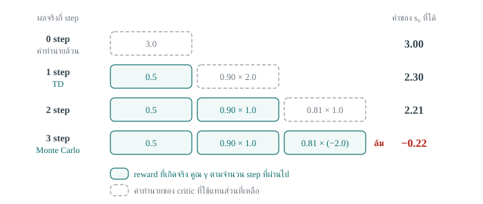

## บทที่ 17 · Monte Carlo กับ TD — รอผลจริง หรือเชื่อคำทำนาย

> [!INTRO]
> ที่ step แรกของ env 1 เรามีตัวเลขสามตัวที่ต่างก็อ้างว่าเป็นค่าของสถานะเดียวกัน critic บอกว่า 3.0 ถ้าดูผลจริงหนึ่ง step แล้วเชื่อ critic ต่อ จะได้ 2.30 และถ้ารอดูผลจริงจนหุ่นล้ม จะได้ −0.22 สามตัวนี้ห่างกันมาก agent ต้องเลือกว่าจะเรียนจากตัวไหน
>
> บทนี้ตั้งชื่อให้ปลายสองข้างของทางเลือกนั้น คือ Monte Carlo กับ TD ชั่งข้อดีข้อเสียของแต่ละข้างเป็นตัวเลข แล้วตั้งชื่อให้ตัวเลขที่บทที่ 9 เรียกว่าทางขวาลบทางซ้าย ชื่อของมันคือ TD error $\delta_t$ ตามสมการ (19) ซึ่งมี mask สำหรับช่องที่ episode จบ
>
> ของที่ต้องรู้มาก่อน: step episode done และตารางตัวอย่าง จากบทที่ 7 · return $G_t$ จากบทที่ 8 · value function critic สมการ Bellman สมการ (4) bootstrapping และ $V_{last}$ จากบทที่ 9
>
> จบบทนี้แล้ว เราเติมแถว $\delta_t$ ของตารางตัวอย่างได้ครบ 8 ช่อง บอกได้ว่า Tron1 ใช้แบบไหน และชี้ได้ว่าโค้ดคำนวณสมการ (19) ที่บรรทัดใด

### ของที่ต้องมีก่อนเริ่ม

บทนี้ใช้สามแถวของตารางตัวอย่าง คือ $r$, $V$ และ done พร้อมคอลัมน์ $V_{last}$ ตารางตัวอย่างใช้ $\gamma = 0.9$

| | | t=0 | t=1 | t=2 | t=3 | $V_{last}$ |
| --- | --- | --- | --- | --- | --- | --- |
| **env 0** | $r$ | 1.0 | 0.5 | 1.0 | 0.5 | |
| | $V$ | 5.0 | 4.5 | 4.0 | 3.5 | 3.0 |
| | done | 0 | 0 | 0 | 0 | |
| **env 1** | $r$ | 0.5 | 1.0 | **−2.0** | 0.0 | |
| | $V$ | 3.0 | 2.0 | 1.0 | 4.0 | 3.5 |
| | done | 0 | 0 | **1** | 0 | |

และใช้ return ของ episode แรกของ env 1 จากบทที่ 8 คือ $G_0 = -0.22$, $G_1 = -0.80$ และ $G_2 = -2.00$

สัญลักษณ์และคำที่ใช้ในบทนี้ เรียงตามลำดับที่จะพบ

| สัญลักษณ์ | ชนิด | ความหมาย |
| --- | --- | --- |
| **Monte Carlo** ย่อว่า MC | แนวคิด | รอผลจริงจนจบ · ไม่เอนเอียง แต่แกว่ง |
| **TD** temporal difference | แนวคิด | ใช้ก้าวเดียว แล้ว bootstrap · นิ่ง แต่เอนเอียงตาม critic |
| $\delta_t$ **TD error** | scalar ต่อช่อง | ผลจริงก้าวนี้ + $\gamma$ × ทำนายพรุ่งนี้ − ทำนายวันนี้ = critic พลาดเท่าไร |
| **mask** $(1-\text{done}_t)$ | เวกเตอร์ | ตัดพจน์ bootstrap ทิ้งเมื่อ episode จบที่ช่องนี้ |
| $V_{last}$ | เวกเตอร์ `(B,1)` | critic ทำนายจากสถานะหลัง step สุดท้าย เพราะแถวที่ $T$ ไม่มีใครให้ดู |

### ปัญหา: ตัวเลขสามตัวของสถานะเดียวกัน

ให้ $s_0$ คือสถานะของ env 1 ที่ step แรก เราอยากรู้ $V^\pi(s_0)$ คือ return ที่จะได้โดยเฉลี่ยจากสถานะนี้ ไม่มีใครรู้ค่านี้ สิ่งที่มีคือตัวประมาณสามตัว

| ตัวประมาณ | คำนวณ | ค่า | ผลจริงกี่ step |
| --- | --- | --- | --- |
| คำทำนายของ critic | อ่านจากแถว $V$ | 3.0 | 0 |
| ผลจริงหนึ่ง step แล้วต่อด้วย critic | $0.5 + 0.9 \times 2.0$ | 2.30 | 1 |
| ผลจริงจนจบ episode | $0.5 + 0.9(1.0) + 0.81(-2.0)$ | −0.22 | 3 จนล้ม |

ทั้งสามตัวมีหน่วยเดียวกัน คือ reward สะสมที่ลดด้วย $\gamma$ จึงเทียบกันตรง ๆ ได้ สิ่งที่ต่างกันมีอย่างเดียว คือใช้ผลจริงกี่ step ก่อนจะยกส่วนที่เหลือให้ critic ทำนาย จำนวน step นั้นเป็นเท่าไรก็ได้ ถ้าใช้ผลจริงสอง step แล้วต่อด้วย critic เราได้ $0.5 + 0.9(1.0) + 0.81(1.0) = 2.21$

สามแถวแรกของรูปให้ค่าใกล้กัน แถวสุดท้ายต่างออกไปมาก เพราะมันเป็นแถวเดียวที่เห็นการล้ม ปลายสองข้างของรูปนี้มีชื่อ และแต่ละข้างมีปัญหาของตัวเอง

### Monte Carlo: รอผลจริงจนจบ

**Monte Carlo** ย่อว่า **MC** คือการประมาณค่าของสถานะด้วย return ที่เกิดจริง เราปล่อยให้ episode เดินไปจนจบ แล้วใช้ $G_t$ เป็นค่าประมาณของ $V^\pi(s_t)$ แถวล่างสุดของรูปคือ MC ซึ่งได้ −0.22

ข้อดีของ MC คือมันไม่ใช้ critic เลย ถ้า critic ผิด MC ไม่ผิดตาม และเมื่อเฉลี่ย $G_t$ จาก episode จำนวนมากที่เริ่มจากสถานะเดียวกัน ค่าเฉลี่ยเข้าหา $V^\pi$ ตามสมการ (7) MC จึงไม่เอนเอียงไปทางใด

MC มีปัญหาสองข้อ

**ข้อแรก ต้องรอ** env 0 ยังไม่จบ episode เมื่อตารางตัวอย่างเต็ม MC จึงให้ตัวเลขกับ env 0 ไม่ได้สักช่อง สำหรับ Tron1 episode หนึ่งยาวได้ถึง 20 วินาที (`limx_base_env_cfg.py:498`) คือ 1000 step แต่ตารางหนึ่งใบมี 24 แถว (`limx_rsl_rl_ppo_cfg.py:81`) เมื่อถึงเวลาที่ agent ต้องเรียนรู้ ข้อมูลจนจบ episode ยังไม่เกิดขึ้น

**ข้อที่สอง แกว่ง** $G_t$ เป็นผลรวมของ reward ทุก step จนจบ และ reward ทุกตัวขึ้นกับ action ที่สุ่มมา บทที่ 12 แสดงว่าหนึ่ง step สุ่ม $\varepsilon$ หนึ่งตัวต่อข้อต่อ Tron1 มี 8 ข้อต่อ episode ที่ยาว 1000 step จึงมีเลขสุ่ม 8,000 ตัวอยู่ข้างใน $G_0$ ถ้าเริ่มจากสถานะเดียวกันอีกครั้ง เราได้ $G_0$ อีกค่าหนึ่งซึ่งอาจต่างกันมาก $G_0$ ตัวเดียวจึงเป็นเหมือนบัตรใบเดียวของบทที่ 4 ในแง่ที่มันเป็นตัวอย่างหนึ่งครั้งของปริมาณที่เราต้องการค่าเฉลี่ย ต่างกันที่บัตรมาจากการสุ่มสองครั้ง ส่วน $G_0$ มาจากการสุ่มหลายพันครั้งต่อกัน มันจึงแกว่งกว่ามาก

### TD: หนึ่ง step แล้วเชื่อคำทำนาย

**TD** ย่อจาก temporal difference คือการประมาณค่าของสถานะด้วยผลจริงหนึ่ง step แล้วใช้คำทำนายของ critic แทนส่วนที่เหลือ

$$V(s_t) \approx r_t + \gamma\,V(s_{t+1})$$

ทางขวาคือทางขวาของสมการ (4) ที่บทที่ 9 ใช้ตรวจ critic และการใช้ $V(s_{t+1})$ แทนอนาคตคือ bootstrapping ของบทเดียวกัน แถวที่สองของรูปคือ TD ซึ่งได้ 2.30 ชื่อ temporal difference แปลว่าผลต่างข้ามเวลา เพราะมันเทียบคำทำนายของสอง step ที่ติดกัน

TD แก้ปัญหาทั้งสองข้อของ MC มันได้ตัวเลขทันทีที่ step จบ และมีเลขสุ่มอยู่ข้างในเพียง 8 ตัวของ step เดียว ค่าจึงนิ่งกว่ามาก

ราคาที่จ่ายคือ TD เชื่อ critic ตัวเลข 2.30 ใช้ $V(s_1) = 2.0$ ซึ่งเป็นคำทำนาย ถ้า critic ทำนาย $s_1$ สูงเกินไป TD ก็สูงเกินตาม และการเฉลี่ยจากหลายครั้งไม่ช่วย เพราะทุกครั้งใช้คำทำนายตัวเดียวกัน ความผิดแบบนี้เรียกว่าเอนเอียง

| | Monte Carlo | TD |
| --- | --- | --- |
| ผลจริงที่ใช้ | ทุก step จนจบ episode | 1 step |
| ใช้ critic หรือไม่ | ไม่ใช้ | ใช้ สำหรับทุกอย่างหลัง step แรก |
| ได้ตัวเลขเมื่อไร | เมื่อ episode จบ | เมื่อ step จบ |
| แกว่งแค่ไหน | มาก มีเลขสุ่มของทุก step อยู่ข้างใน | น้อย มีเลขสุ่มของ step เดียว |
| เอนเอียงหรือไม่ | ไม่ | เอนเอียงเท่าที่ critic ผิดที่สถานะถัดไป |
| ในตารางตัวอย่าง ค่าของ $s_0$ ของ env 1 | −0.22 | 2.30 |

> [!NOTE]
> ตำราเรียกความแกว่งว่า variance และเรียกความเอนเอียงว่า bias การเลือกระหว่าง MC กับ TD จึงมักถูกเรียกว่าการแลกระหว่าง bias กับ variance

> [!EXAMPLE] จงหาตัวประมาณสามตัวของทุกสถานะใน episode แรกของ env 1
> คอลัมน์ TD ใช้ $r$ ของ step นั้น บวก 0.9 คูณ $V$ ของ step ถัดไป ที่ $s_2$ episode จบ จึงไม่มีสถานะถัดไปใน episode นี้ และเหลือเพียง $r$
>
> | สถานะ | critic | TD | MC |
> | --- | --- | --- | --- |
> | $s_0$ | 3.0 | $0.5 + 0.9 \times 2.0 = 2.30$ | −0.22 |
> | $s_1$ | 2.0 | $1.0 + 0.9 \times 1.0 = 1.90$ | −0.80 |
> | $s_2$ | 1.0 | $-2.0$ | −2.00 |
>
> ที่ $s_2$ ทั้ง TD และ MC ได้ −2.00 ตรงกัน เพราะไม่มีอนาคตเหลือให้ทำนาย

ดูแถว $s_1$ หุ่นจะล้มใน step ถัดไป MC ให้ −0.80 แต่ TD ให้ 1.90 ซึ่งแทบไม่ต่างจากที่ critic ทำนายไว้ TD มองไม่เห็นการล้ม เพราะมันดูผลจริงเพียง step เดียว แล้วเชื่อว่า $s_2$ มีค่า 1.0 ข่าวร้ายที่ $s_2$ เดินย้อนไปถึงสถานะก่อนหน้าได้ครั้งละหนึ่ง step เท่านั้น เหมือนที่การกวาดตารางของบทที่ 16 ส่งค่าที่ถูกย้อนขึ้นไปรอบละหนึ่งช่อง

### TD error: ชื่อของทางขวาลบทางซ้าย

บทที่ 9 ตรวจคำทำนายของ critic ด้วยการเทียบสองข้างของสมการ (4) แล้วเก็บผลต่างไว้โดยยังไม่ตั้งชื่อ ผลต่างนั้นคือค่าประมาณแบบ TD ลบด้วยคำทำนายของ critic ที่สถานะเดียวกัน ชื่อของมันคือ **TD error** เขียนว่า $\delta_t$

$$\delta_t = \underbrace{r_t + \gamma\,V(s_{t+1})}_{\text{TD}} - V(s_t)$$

ที่ step แรกของ env 1 ได้ $\delta_0 = 2.30 - 3.0 = -0.70$

| ค่าของ $\delta_t$ | แปลว่า |
| --- | --- |
| มากกว่า 0 | step นี้ออกมาดีกว่าที่ critic ทำนายไว้ |
| เท่ากับ 0 | ตรงกับที่ทำนายไว้พอดี |
| น้อยกว่า 0 | step นี้ออกมาแย่กว่าที่ critic ทำนายไว้ |

$\delta_t$ อ่านได้สองทาง และทั้งสองทางเป็นตัวเลขตัวเดียวกัน

- **อ่านว่า critic พลาดเท่าไร** โดยวัดจากผลจริงหนึ่ง step บทที่ 24 ใช้การอ่านแบบนี้สอน critic
- **อ่านว่า action นี้ดีกว่าปกติเท่าไร** บทที่ 9 แสดงว่า $r_t + \gamma\,V(s_{t+1})$ เป็นค่าประมาณก้าวเดียวของ $Q$ สำหรับ action ที่สั่งไป เมื่อลบด้วย $V(s_t)$ จึงได้ค่าประมาณแบบหยาบของ advantage ตามสมการ (8) ตัวเลข +0.05 ที่ช่อง e0 t0 ของบทที่ 9 คือ $\delta_0$ ของ env 0

$\delta_t$ มาจากตัวอย่างครั้งเดียว มันจึงไม่จำเป็นต้องเป็นศูนย์แม้ critic จะทำนายถูก เหตุผลเดียวกับที่บทที่ 9 ให้ไว้

### mask: เมื่อ episode จบที่ช่องนี้

สูตรข้างบนใช้ไม่ได้กับช่อง e1 t2 ที่ช่องนั้นหุ่นล้ม และแถวถัดไปคือ t3 เป็น step แรกของ episode ใหม่หลัง reset ค่า $V = 4.0$ ที่ t3 เป็นคำทำนายของท่ายืนใหม่ ไม่ใช่อนาคตของท่าที่กำลังล้ม ถ้าเราใช้สูตรตรง ๆ

$$-2.0 + 0.9 \times 4.0 - 1.0 = +0.60$$

เราได้ค่าบวก ซึ่งอ่านว่าการล้มออกมาดีกว่าที่ critic ทำนายไว้ ผิดจากความจริง

ทางแก้คือคูณพจน์ของสถานะถัดไปด้วยตัวเลขที่เป็น 1 เมื่อ episode ยังไม่จบ และเป็น 0 เมื่อ episode จบที่ช่องนี้ ตัวคูณนั้นคือ $(1 - \text{done}_t)$ เรียกว่า **mask**

> [!KEY] TD error
> $$\delta_t = r_t + (1 - \text{done}_t)\,\gamma\,V(s_{t+1}) - V(s_t) \tag{19}$$
>
> | | |
> | --- | --- |
> | $r_t$ | reward ที่ได้จริงใน step นี้ |
> | $(1 - \text{done}_t)$ | mask เป็น 0 เมื่อ episode จบที่ช่องนี้ |
> | $V(s_{t+1})$ | คำทำนายของ critic ที่ช่องถัดไปในคอลัมน์เดียวกัน ที่แถวสุดท้ายของตารางใช้ $V_{last}$ |
> | $V(s_t)$ | คำทำนายของ critic ที่ช่องนี้ |

สมการนี้อ่านได้ว่า

ความพลาดของ critic ที่ช่องนี้ = reward ที่ได้จริง + $\gamma$ × คำทำนายของช่องถัดไป ถ้า episode ยังไม่จบ − คำทำนายของช่องนี้

> [!EXAMPLE] จงหา $\delta_t$ ของ env 1 ทั้งสี่ช่อง ด้วยสมการ (19)
> ช่อง t2 มี done เป็น 1 mask จึงเป็น 0 ช่อง t3 เป็นแถวสุดท้ายของตาราง จึงใช้ $V_{last} = 3.5$
>
> $$\begin{aligned}
> \delta_0 &= 0.5 + 1 \times 0.9 \times 2.0 - 3.0 &&= -0.70 \\
> \delta_1 &= 1.0 + 1 \times 0.9 \times 1.0 - 2.0 &&= -0.10 \\
> \delta_2 &= -2.0 + 0 \times 0.9 \times 4.0 - 1.0 &&= -3.00 &&\leftarrow\ \text{mask} = 0 \\
> \delta_3 &= 0.0 + 1 \times 0.9 \times 3.5 - 4.0 &&= -0.85
> \end{aligned}$$
>
> ที่ t2 mask ทำให้ได้ −3.00 แทน +0.60 คือการล้มแย่กว่าที่ critic ทำนายไว้มาก

env 0 ไม่มี done เลย mask ของมันเป็น 1 ทุกช่อง ค่าทั้งสี่ช่องคือตัวเลขที่บทที่ 9 คำนวณไว้แล้ว และเป็นแบบฝึกหัดข้อ 2 ของบทนี้ แถว $\delta_t$ ทั้งตารางเป็นดังนี้

| | t=0 | t=1 | t=2 | t=3 |
| --- | --- | --- | --- | --- |
| env 0: $\delta_t$ | +0.05 | −0.40 | +0.15 | −0.30 |
| env 1: $\delta_t$ | −0.70 | −0.10 | **−3.00** | −0.85 |

แปดตัวนี้คือวัตถุดิบของบทที่ 22

> [!WARNING] ถ้าไม่มี mask ความผิดไม่ได้อยู่แค่ช่องเดียว
> ค่า +0.60 ที่ผิดจะบอกการเรียนรู้ว่า action ที่ทำให้ล้มเป็น action ที่ดี และเมื่อบทที่ 22 ส่งความพลาดของช่องนี้ย้อนไปให้ช่องก่อนหน้า ช่องเหล่านั้นจะได้ตัวเลขที่ผิดตามไปด้วย

### ขอบสองแบบ: ขอบตารางกับขอบ episode

สมการ (19) มีสองที่ซึ่งช่องถัดไปไม่ใช่ช่องธรรมดา สองที่นี้ดูคล้ายกัน แต่ถูกจัดการตรงข้ามกัน

| | ขอบตาราง | ขอบ episode |
| --- | --- | --- |
| เกิดที่ใด | แถวสุดท้ายของตาราง | ช่องที่ done เป็น 1 |
| ในตารางตัวอย่าง | e0 t3 และ e1 t3 | e1 t2 |
| อนาคตของหุ่นมีหรือไม่ | มี หุ่นยังเดินต่อ ตารางเพียงเก็บไม่ถึง | ไม่มี หุ่นล้มแล้ว |
| ใช้อะไรเป็น $V(s_{t+1})$ | $V_{last}$ ที่ critic ทำนายไว้หลังตารางเต็ม | ไม่ใช้ mask ตัดทิ้ง |
| ในโค้ด | `rollout_storage.py:190-191` | `rollout_storage.py:194` |

ที่ขอบตารางเรา*ต้อง*ทำนายต่อ เพราะอนาคตมีจริง ที่ขอบ episode เรา*ต้องไม่*ทำนายต่อ เพราะอนาคตไม่มี

> [!NOTE]
> ตารางตัวอย่างมี done จากการล้มเท่านั้น บทที่ 7 แสดงว่า done เกิดจากการหมดเวลาได้ด้วย ซึ่งเป็นกรณีที่อนาคตยังมีแม้ done จะเป็น 1 โค้ดจัดการกรณีนั้นแยกไว้อีกที่หนึ่ง และบทที่ 22 อธิบาย

### ชั่งน้ำหนักเป็นตัวเลข

บทที่ 9 บอกว่าราคาของ bootstrapping คือความผิดของ critic เข้ามาอยู่ในตัวเลข ตอนนี้เราวัดราคานั้นได้ ตารางข้างล่างวัดความพลาดของ critic ใน episode แรกของ env 1 ด้วยสองวิธี

| ช่อง | วัดด้วยผลจริงหนึ่ง step $\delta_t$ | วัดด้วยผลจริงจนจบ $G_t - V(s_t)$ |
| --- | --- | --- |
| e1 t0 | −0.70 | $-0.22 - 3.0 = -3.22$ |
| e1 t1 | −0.10 | $-0.80 - 2.0 = -2.80$ |
| e1 t2 | −3.00 | $-2.00 - 1.0 = -3.00$ |

คอลัมน์ขวาบอกว่า critic ทำนายสูงเกินไปราว 3 ทั้งสามช่อง คอลัมน์ซ้ายเห็นความพลาดนั้นเต็มที่เพียงช่องเดียว คือช่องที่หุ่นล้ม อีกสองช่องเห็นเพียงเล็กน้อย เพราะ $\delta_t$ เชื่อคำทำนายของช่องถัดไป ซึ่งผิดไปทางเดียวกัน

แต่คอลัมน์ขวามีให้ใช้เฉพาะ episode ที่จบภายในตาราง env 0 ไม่มีคอลัมน์นี้เลย เราจึงอยู่ระหว่างตัวเลขที่มีครบทุกช่องแต่เชื่อ critic มากเกินไป กับตัวเลขที่ไม่เชื่อ critic เลยแต่มักไม่มีให้ใช้ บทที่ 22 จะต่อ $\delta_t$ หลายตัวเข้าด้วยกัน เพื่อให้ได้ตัวเลขที่อยู่ระหว่างสองคอลัมน์นี้

### Tron1 ใช้แบบไหน

- **TD ถูกใช้ทุกช่อง** `rollout_storage.py:195-199` คำนวณสมการ (19) ให้ทุก step ของทุก env การคำนวณเกิดครั้งเดียวต่อ iteration หลังตารางเต็ม โดยลูปเก็บข้อมูลเรียก `on_policy_runner.py:225` ซึ่งให้ critic ทำนาย $V_{last}$ ก่อน (`ppo.py:176-178`) แล้วจึงเข้าฟังก์ชัน `compute_returns` (`rollout_storage.py:187`)
- **MC ไม่มีในโค้ด** ไม่มีบรรทัดใดบวก reward ที่ลดด้วย $\gamma$ ไปจนจบ episode ค่า `Mean reward` ของบทที่ 7 เป็นผลรวมของ reward ต่อ episode ที่ไม่ได้ลดด้วย $\gamma$ (`on_policy_runner.py:200-205`) มันถูกใช้แสดงผลเท่านั้น ไม่ใช่ $G_t$ และไม่ได้ถูกใช้เรียนรู้

### จากสมการถึงโค้ด

| บรรทัด | โค้ด | สมการ (19) ส่วนไหน |
| --- | --- | --- |
| `rollout_storage.py:189` | `for step in reversed(range(self.num_transitions_per_env))` | ไล่ทีละแถว จากแถวล่างขึ้นบน |
| `:190-191` | `next_values = last_values` ที่แถวสุดท้าย | $V(s_{t+1})$ ที่ขอบตาราง คือ $V_{last}$ |
| `:192-193` | `next_values = self.values[step + 1]` | $V(s_{t+1})$ ที่แถวอื่น |
| `:194` | `next_is_not_terminal = 1.0 - self.dones[step].float()` | mask $(1 - \text{done}_t)$ |
| `:196` | `self.rewards[step]` | $r_t$ |
| `:197` | `+ next_is_not_terminal * gamma * next_values` | $(1 - \text{done}_t)\,\gamma\,V(s_{t+1})$ |
| `:198` | `- self.values[step]` | $-V(s_t)$ |

ตัวแปร `delta` ที่บรรทัด `:195` คือ $\delta_t$ ของทุก env ในแถวนั้นพร้อมกัน เหตุผลที่ลูปเดินจากแถวล่างขึ้นบนอยู่ในบทที่ 22 สำหรับสมการ (19) อย่างเดียว เดินทางใดก็ได้ค่าเดียวกัน

> [!SUMMARY]
> - MC ใช้ return จริงจนจบ episode ไม่เชื่อ critic เลย แต่ต้องรอ และแกว่ง ส่วน TD ใช้ผลจริงหนึ่ง step แล้วเชื่อ critic ได้ตัวเลขทันทีและนิ่ง แต่เอนเอียงตามความผิดของ critic
> - TD error $\delta_t$ ตามสมการ (19) คือค่าประมาณแบบ TD ลบคำทำนายของ critic ที่ช่องเดียวกัน อ่านได้ว่า critic พลาดเท่าไร หรือ action นี้ดีกว่าปกติเท่าไรโดยประมาณ
> - mask $(1 - \text{done}_t)$ ตัดคำทำนายของช่องถัดไปทิ้งเมื่อ episode จบ ที่ e1 t2 ได้ −3.00 แทน +0.60
> - ที่ขอบตารางใช้ $V_{last}$ เพราะอนาคตยังมี ที่ขอบ episode ใช้ mask เพราะอนาคตไม่มี
> - โค้ดของ Tron1 คำนวณ $\delta_t$ ทุกช่องที่ `rollout_storage.py:195-199` และไม่มี MC อยู่ที่ใด
>
> ประโยคที่ควรจำ: **TD error คือ reward ที่ได้จริง บวกคำทำนายของช่องถัดไปที่ลดด้วย $\gamma$ ลบคำทำนายของช่องนี้ และเมื่อ episode จบที่ช่องนี้ คำทำนายของช่องถัดไปถูกตัดทิ้ง**

### แบบฝึกหัด

1. ข้อใดถูกต้อง
    1. MC ให้ตัวเลขได้ก็ต่อเมื่อ episode จบ
    2. TD ไม่ใช้คำทำนายของ critic
    3. $\delta_t$ ที่เป็นลบแปลว่า reward ของ step นั้นเป็นลบ
    4. mask เป็น 0 ที่ช่องซึ่ง done เป็น 1
    5. ที่แถวสุดท้ายของตาราง สมการ (19) ใช้ $V_{last}$ เป็นคำทำนายของช่องถัดไป
    6. ที่ช่อง e1 t2 ค่า $V = 4.0$ ของ t3 ถูกใช้ในการคำนวณ $\delta_2$
    7. MC ของ env 0 คำนวณได้จากตารางตัวอย่าง
    8. ถ้า critic ทำนายถูกทุกสถานะ $\delta_t$ จะเป็นศูนย์ทุกช่องเสมอ
    9. โค้ดของ Tron1 คำนวณ $\delta_t$ หนึ่งครั้งต่อ iteration หลังตารางเต็ม
    10. `Mean reward` คือ $G_t$

2. จงแสดงวิธีหา $\delta_t$ ของ env 0 ทั้งสี่ช่อง ด้วยสมการ (19) ให้ได้ค่าตรงกับตารางในเนื้อหา [07 §4.2] <!--space:34-->

3. จงประมาณค่าของสถานะแรกของ env 0 ด้วยผลจริง $k$ step แล้วต่อด้วย critic สำหรับ $k = 1, 2, 3$ และ $4$ โดยที่ $k = 4$ ต่อด้วย $V_{last}$ แล้วเทียบกับตารางการกวาดของบทที่ 16 [05 §3.2] <!--space:34-->

4. จงอธิบายว่าเหตุใดข้อ 3 จึงไม่มีค่าประมาณแบบ MC <!--space:14-->

5. สมมติว่าหุ่นของ env 0 ล้มที่ t1 คือ done ของ e0 t1 เป็น 1 โดยตัวเลขอื่นในตารางเหมือนเดิม $\delta_1$ ของ env 0 เป็นเท่าไร <!--space:14-->

6. ถ้าใช้ $\gamma = 0.99$ ของ Tron1 แทน 0.9 จงหา $\delta_0$ ของ env 0 <!--space:14-->

7. ช่อง e1 t3 ใช้ $V_{last} = 3.5$ [rollout_storage.py:190-191]
    1. ถ้า $V_{last}$ เป็น 0 แทน $\delta_3$ เป็นเท่าไร
    2. $V_{last}$ ต้องเป็นเท่าไร $\delta_3$ จึงเป็นศูนย์

    <!--space:20-->

8. episode หนึ่งของ Tron1 จบที่ step ที่ 250 จำนวนเลขสุ่ม $\varepsilon$ ที่อยู่ข้างใน $G_0$ ของ episode นี้มีกี่ตัว และข้างในค่าประมาณแบบ TD ของ step แรกมีกี่ตัว <!--space:14-->

9. ถ้า critic เปลี่ยนคำทำนายที่ e0 t0 จาก 5.0 เป็น 5.05 โดยช่องอื่นเหมือนเดิม $\delta_0$ จะเป็นศูนย์ จงอธิบายว่าเหตุใดเรายังสรุปไม่ได้ว่า critic ทำนายสถานะนี้ถูกแล้ว <!--space:18-->

10. ที่สถานะ $s_1$ ของ env 1 หุ่นจะล้มใน step ถัดไป แต่ TD ให้ค่า 1.90 ซึ่งใกล้กับคำทำนาย 2.0 จงอธิบายว่าเหตุใด TD จึงมองไม่เห็นการล้ม และข้อมูลของการล้มไปปรากฏที่ $\delta$ ของช่องใด <!--space:20-->

<!-- เฉลย -->

1. ข้อที่ถูก: 1, 4, 5, 9

    - ข้อ 2 ผิด: TD ใช้คำทำนายของ critic ที่สถานะถัดไป
    - ข้อ 3 ผิด: $\delta_t$ เทียบกับคำทำนาย e0 t1 มี $r = 0.5$ แต่ $\delta_1 = -0.40$
    - ข้อ 6 ผิด: mask เป็น 0 จึงตัดพจน์นั้นทิ้ง
    - ข้อ 7 ผิด: episode ของ env 0 ยังไม่จบเมื่อตารางเต็ม
    - ข้อ 8 ผิด: $\delta_t$ มาจากตัวอย่างครั้งเดียว จึงเป็นศูนย์เพียงโดยเฉลี่ย
    - ข้อ 10 ผิด: มันเป็นผลรวมต่อ episode ที่ไม่ได้ลดด้วย $\gamma$

2. mask เป็น 1 ทุกช่อง และช่อง t3 ใช้ $V_{last} = 3.0$

    $$\begin{aligned}
    \delta_0 &= 1.0 + 0.9 \times 4.5 - 5.0 &&= +0.05 \\
    \delta_1 &= 0.5 + 0.9 \times 4.0 - 4.5 &&= -0.40 \\
    \delta_2 &= 1.0 + 0.9 \times 3.5 - 4.0 &&= +0.15 \\
    \delta_3 &= 0.5 + 0.9 \times 3.0 - 3.5 &&= -0.30
    \end{aligned}$$

3. ค่าประมาณของสถานะแรกของ env 0

    $$\begin{aligned}
    k = 1:&\quad 1.0 + 0.9(4.5) &&= 5.0500 \\
    k = 2:&\quad 1.0 + 0.9(0.5) + 0.81(4.0) &&= 4.6900 \\
    k = 3:&\quad 1.0 + 0.9(0.5) + 0.81(1.0) + 0.729(3.5) &&= 4.8115 \\
    k = 4:&\quad 1.0 + 0.9(0.5) + 0.81(1.0) + 0.729(0.5) + 0.6561(3.0) &&= 4.5928
    \end{aligned}$$

    สี่ค่านี้ตรงกับคอลัมน์ $V(s_0)$ ของรอบกวาดที่ 1 ถึง 4 ในบทที่ 16 การกวาดหนึ่งรอบจึงเท่ากับการเพิ่มผลจริงเข้าไปอีกหนึ่ง step

4. MC ต้องใช้ reward จนจบ episode แต่ episode ของ env 0 ยังไม่จบเมื่อตารางเต็ม ค่าที่ $k = 4$ ยังต่อด้วยคำทำนาย $V_{last}$ จึงไม่ใช่ MC

5. mask เป็น 0 จึงได้ $\delta_1 = 0.5 + 0 - 4.5 = -4.00$

6. $\delta_0 = 1.0 + 0.99 \times 4.5 - 5.0 = +0.455$

7. ค่าของ $\delta_3$

    1. $\delta_3 = 0.0 + 0.9 \times 0 - 4.0 = -4.00$
    2. ต้องการ $0.9 \times V_{last} = 4.0$ จึงได้ $V_{last} = 4.4444$

8. $G_0$ มี $250 \times 8 = 2{,}000$ ตัว ค่าประมาณแบบ TD ของ step แรกมี 8 ตัว

9. $\delta_0$ คำนวณจากตัวอย่างครั้งเดียว และใช้คำทำนายของช่องถัดไปคือ 4.5 ซึ่งอาจผิดเอง ผลต่างที่เป็นศูนย์บอกเพียงว่าคำทำนายสองช่องนี้สอดคล้องกันสำหรับ step นี้ ไม่ได้บอกว่าทั้งสองตรงกับ $V^\pi$

10. TD ที่ $s_1$ ใช้ผลจริงเพียง step เดียว คือ $r_1 = 1.0$ แล้วเชื่อว่า $s_2$ มีค่า 1.0 ตามที่ critic ทำนาย การล้มเกิดใน step ถัดไป จึงอยู่นอกสิ่งที่ TD ของ $s_1$ มองเห็น ข้อมูลของการล้มปรากฏที่ $\delta_2 = -3.00$
