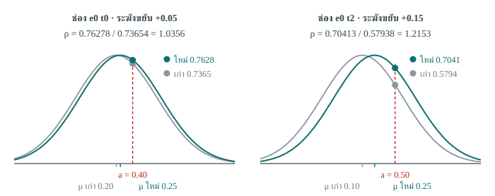

## บทที่ 18 · on-policy กับ off-policy — ข้อมูลของ policy เก่าใช้ได้นานแค่ไหน

> [!INTRO]
> ตารางตัวอย่างทั้งใบถูกเก็บด้วย policy ชุดหนึ่ง ที่ช่อง e0 t0 ระฆังของมันมีจุดกลาง $\mu = 0.20$ และ action ที่สุ่มได้คือ 0.40 สมมติว่า gradient step หนึ่งครั้งเลื่อนจุดกลางของช่องนี้ไปเป็น 0.25 policy หลังการปรับไม่ใช่ตัวที่เก็บข้อมูลแล้ว มันจะสุ่ม 0.40 ออกมาบ่อยไม่เท่าเดิม คำถามคือ 8 ช่องในตารางยังใช้เป็นตัวแทนของ policy ใหม่ได้หรือไม่
>
> บทนี้แบ่งอัลกอริทึมเป็นสองครอบครัวตามคำตอบของคำถามนั้น คือ on-policy กับ off-policy แล้วสร้างเครื่องมือที่ทำให้ข้อมูลของ policy เก่ายังใช้ได้ เครื่องมือนั้นคือ importance sampling ตามสมการ (20) และตัวเลขที่ได้จากมันคือ $\rho_t$ ตามสมการ (21)
>
> ของที่ต้องรู้มาก่อน: การแจกแจง ค่าคาดหวัง และกล่องบัตร จากบทที่ 4 · iteration และ transition จากบทที่ 7 · ความหนาแน่นและสมการ (13) กับ (14) จากบทที่ 10 · $\pi_\theta(\cdot \mid s)$, $\pi_\theta(a \mid s)$ และสมการ (15) จากบทที่ 11 · gradient step จากบทที่ 14
>
> จบบทนี้แล้ว เราคำนวณ $\rho_t$ ของทุกช่องในตารางตัวอย่างได้ บอกได้ว่า PPO อยู่ครอบครัวใดและด้วยหลักฐานอะไรจากโค้ด และอธิบายได้ว่าทำไมข้อมูลของ policy เก่าจึงเชื่อได้เฉพาะเมื่อ policy ใหม่ยังอยู่ใกล้

### ของที่ต้องมีก่อนเริ่ม

บทนี้ใช้สามแถวของตารางตัวอย่าง คือ $\mu$, $a$ และ $\log\pi_\theta(a \mid s)$ ที่บทที่ 10 และ 11 คำนวณไว้ ทุกช่องใช้ $\sigma = 0.5$

| | | t=0 | t=1 | t=2 | t=3 |
| --- | --- | --- | --- | --- | --- |
| **env 0** | $\mu$ | 0.20 | 0.30 | 0.10 | 0.40 |
| | $a$ | 0.40 | 0.20 | 0.50 | 0.40 |
| | $\log\pi_\theta(a \mid s)$ | −0.3058 | −0.2458 | −0.5458 | −0.2258 |
| **env 1** | $\mu$ | −0.10 | 0.00 | 0.20 | −0.30 |
| | $a$ | −0.40 | 0.40 | 0.30 | −0.10 |
| | $\log\pi_\theta(a \mid s)$ | −0.4058 | −0.5458 | −0.2458 | −0.3058 |

บทนี้มีระฆังสองใบต่อหนึ่งช่อง เราเรียกระฆังที่ใช้เก็บข้อมูลว่า**ระฆังเก่า** และเรียกระฆังหลังจากปรับตัวเลขของ policy ไปแล้วว่า**ระฆังใหม่** ค่าในตารางข้างบนเป็นของระฆังเก่าทั้งหมด

ตารางตัวอย่างไม่มีโครงข่ายจริง เราจึงต้องกำหนดเองว่าระฆังใหม่อยู่ที่ใด ตัวอย่างประจำเล่มใช้ $\mu$ ใหม่เท่ากับ $\mu$ เก่าบวก 0.05 ทุกช่อง เป็นข้อสมมติเพื่อให้คำนวณตามได้ gradient step จริงเลื่อนแต่ละช่องไม่เท่ากัน และไม่ไปทางเดียวกัน

สัญลักษณ์และคำที่ใช้ในบทนี้ เรียงตามลำดับที่จะพบ

| สัญลักษณ์ | ชนิด | ความหมาย |
| --- | --- | --- |
| **importance sampling** | แนวคิด | เอาตัวอย่างจากการแจกแจงหนึ่งไปประมาณค่าเฉลี่ยใต้อีกการแจกแจง โดยถ่วงน้ำหนักด้วยอัตราส่วนความหนาแน่น |
| **on-policy** กับ **off-policy** | แนวคิด | on คือข้อมูลต้องมาจาก policy ตัวที่กำลังปรับ · off คือข้อมูลมาจาก policy อื่นได้ |
| $\pi_{old}(a \mid s)$ | scalar | ความหนาแน่นของระฆังเก่า ณ $a$ |
| $\pi_{new}(a \mid s)$ | scalar | ความหนาแน่นของระฆังใหม่ ณ $a$ ตัวเดิม |
| $\rho_t$ **probability ratio** | scalar ต่อช่อง | policy ใหม่ชอบ action เก่านี้มากขึ้นกี่เท่า |

### ปัญหา: ตัวอย่างมาจากเหรียญหนึ่ง แต่อยากรู้ค่าเฉลี่ยของอีกเหรียญหนึ่ง

กลับไปที่กล่องบัตรของบทที่ 4 เราโยนเหรียญเพื่อเลือกกล่อง แล้วจับบัตรหนึ่งใบ เหรียญให้โอกาสกล่องละ 1/2 บัตรทั้ง 8 ใบจึงมีโอกาสถูกจับเท่ากัน และค่าคาดหวังของตัวเลขบนบัตรคือ 0.3125

| กล่อง | บัตรใบที่ 1 | บัตรใบที่ 2 | บัตรใบที่ 3 | บัตรใบที่ 4 |
| --- | --- | --- | --- | --- |
| **กล่อง 0** | 1.0 | 0.5 | 1.0 | 0.5 |
| **กล่อง 1** | 0.5 | 1.0 | −2.0 | 0.0 |

ต่อมามีคนเปลี่ยนเหรียญเป็นเหรียญถ่วง ซึ่งให้กล่อง 0 ด้วยความน่าจะเป็น 3/4 และกล่อง 1 ด้วยความน่าจะเป็น 1/4 เราอยากรู้ค่าคาดหวังของการทดลองใหม่ แต่บันทึกที่มีอยู่มาจากเหรียญเดิม

วิธีง่ายที่สุดคือเฉลี่ยบันทึกที่มีอยู่ตรง ๆ ซึ่งได้ 0.3125 วิธีนี้ผิด เพราะมันตอบคำถามของเหรียญเดิม เหรียญใหม่พาเราไปกล่อง 0 บ่อยขึ้น บัตรของกล่อง 0 จึงควรมีน้ำหนักมากกว่าที่บันทึกให้ไว้

ทางแก้คือถ่วงบัตรแต่ละใบด้วยตัวเลขที่บอกว่า เหรียญใหม่ให้โอกาสกล่องของบัตรใบนั้นเป็นกี่เท่าของเหรียญเดิม

> [!EXAMPLE] จงหาค่าคาดหวังของตัวเลขบนบัตรเมื่อใช้เหรียญถ่วง โดยใช้เฉพาะบัตร 8 ใบที่มีโอกาสเท่ากันภายใต้เหรียญเดิม
> ขั้นที่ 1 หาน้ำหนักของแต่ละกล่อง คือโอกาสใต้เหรียญใหม่ หารด้วยโอกาสใต้เหรียญเดิม กล่อง 0 ได้ $\dfrac{3/4}{1/2} = 1.5$ และกล่อง 1 ได้ $\dfrac{1/4}{1/2} = 0.5$
>
> ขั้นที่ 2 คูณตัวเลขบนบัตรทุกใบด้วยน้ำหนักของกล่อง แล้วเฉลี่ยทั้ง 8 ใบ
>
> $$\frac{1.5\,(1.0 + 0.5 + 1.0 + 0.5) + 0.5\,(0.5 + 1.0 - 2.0 + 0.0)}{8} = \frac{4.5 - 0.25}{8} = 0.53125$$
>
> ขั้นที่ 3 ตรวจด้วยกฎการเฉลี่ยสองชั้นของบทที่ 4 ซึ่งคำนวณจากเหรียญใหม่โดยตรง
>
> $$\tfrac34 \times 0.75 + \tfrac14 \times (-0.125) = 0.53125$$
>
> สองวิธีได้ค่าเดียวกัน

บันทึกของเหรียญเดิมจึงตอบคำถามของเหรียญใหม่ได้ ถ้าถ่วงน้ำหนักให้ถูก การถ่วงนี้ทำได้เพราะสิ่งที่เปลี่ยนมีเพียงเหรียญ บัตรในกล่องยังเป็นชุดเดิม

| ในตัวอย่าง | ใน RL |
| --- | --- |
| เหรียญ | policy |
| เหรียญเดิม และเหรียญใหม่ | ระฆังเก่า และระฆังใหม่ |
| เลขกล่องที่เหรียญเลือก | action ที่ policy สุ่ม |
| บัตรในกล่อง ซึ่งไม่เปลี่ยน | วิธีที่ environment ตอบ action หนึ่งจากสถานะหนึ่ง คือ $P$ ของบทที่ 5 ซึ่ง policy เปลี่ยนไม่ได้ |
| ตัวเลขบนบัตร | ปริมาณที่เราอยากรู้ค่าเฉลี่ย |

การเทียบนี้ใช้ไม่ได้สามที่ เหรียญมีทางเลือกสองทาง จึงมีความน่าจะเป็นของแต่ละทาง ส่วน action ของ Tron1 เป็นจำนวนจริง จึงมีแต่ความหนาแน่นตามบทที่ 10 เหรียญไม่ขึ้นกับสถานะ ส่วน policy ให้ระฆังคนละใบสำหรับแต่ละสถานะ และการทดลองกับกล่องจบในครั้งเดียว ส่วน action ของหุ่นกำหนดว่า step ถัดไปหุ่นจะอยู่ในสถานะใด policy ใหม่จึงไม่เพียงเลือก action ต่างไป มันยังพาหุ่นไปพบสถานะชุดที่ต่างไปด้วย การถ่วงน้ำหนักในบทนี้แก้ได้เฉพาะส่วนแรก คือ action ที่เลือกจากสถานะที่อยู่ในตาราง มันไม่ได้แก้ว่าสถานะในตารางเป็นชุดที่ policy เก่าพาไปพบ

### importance sampling: สมการ (20)

วิธีในตัวอย่างใช้ได้กับการแจกแจงสองตัวใดก็ได้ ให้ $p$ คือการแจกแจงที่เราอยากรู้ค่าเฉลี่ย ให้ $q$ คือการแจกแจงที่ตัวอย่างมาจริง และให้ $f$ คือปริมาณที่เราอยากเฉลี่ย เราเขียน $\mathbb{E}_{a \sim p}$ สำหรับค่าคาดหวังเมื่อ $a$ ถูกสุ่มจาก $p$

| สมการ | หมายเหตุ |
| --- | --- |
| $\mathbb{E}_{a \sim p}\big[f(a)\big] = \sum_{a} p(a)\,f(a)$ | นิยามของค่าคาดหวังจากบทที่ 4 |
| $= \sum_{a} q(a)\,\dfrac{p(a)}{q(a)}\,f(a)$ | คูณและหารด้วย $q(a)$ ค่าไม่เปลี่ยน ทำได้เมื่อ $q(a) > 0$ ทุกที่ที่ $p(a) > 0$ |
| $= \mathbb{E}_{a \sim q}\Big[\dfrac{p(a)}{q(a)}\,f(a)\Big]$ | อ่านกลับเป็นค่าคาดหวังใต้ $q$ ของปริมาณตัวใหม่ |

> [!KEY] importance sampling
> $$\mathbb{E}_{a \sim p}\big[f(a)\big] = \mathbb{E}_{a \sim q}\Big[\frac{p(a)}{q(a)}\,f(a)\Big] \tag{20}$$
>
> | | |
> | --- | --- |
> | $p$ | การแจกแจงที่อยากรู้ค่าเฉลี่ย ในบทนี้คือระฆังใหม่ |
> | $q$ | การแจกแจงที่ตัวอย่างมาจริง ในบทนี้คือระฆังเก่า |
> | $p(a)/q(a)$ | น้ำหนักของตัวอย่าง $a$ |

สมการนี้อ่านได้ว่า

<div class="wordeq"><span>ค่าเฉลี่ยใต้การแจกแจงใหม่</span> = <span>ค่าเฉลี่ยของตัวอย่างเก่า</span> ที่แต่ละตัวถูกคูณด้วย <span>การแจกแจงใหม่ชอบตัวอย่างนี้เป็นกี่เท่าของการแจกแจงเก่า</span></div>

การใช้ตัวอย่างจากการแจกแจงหนึ่งไปประมาณค่าเฉลี่ยใต้อีกการแจกแจงหนึ่งเช่นนี้เรียกว่า **importance sampling**

การ derive ข้างบนเขียนด้วยผลรวม ซึ่งตรงกับกรณีที่ $a$ นับได้ เช่นเลขกล่อง เมื่อ $a$ เป็นจำนวนจริง $p$ และ $q$ เป็นความหนาแน่น และผลรวมกลายเป็นพื้นที่ใต้กราฟตามบทที่ 10 รูปของสมการ (20) ไม่เปลี่ยน เงื่อนไข $q(a) > 0$ เป็นจริงเสมอสำหรับระฆัง Gaussian เพราะความสูงของมันไม่เป็นศูนย์ที่จุดใดเลย

เราตรวจสมการ (20) กับระฆังสองใบของช่อง e0 t0 ได้ โดยให้ $f(a) = a$ ค่าเฉลี่ยของ $a$ ใต้ระฆังใหม่คือจุดกลางของมัน คือ 0.25 สคริปต์เฉลยของเล่มนี้คำนวณพื้นที่ทางขวาของสมการ (20) เชิงตัวเลขแล้วได้ 0.250000 ตรงกัน ถ้าไม่ถ่วงน้ำหนัก จะได้ 0.200000 ซึ่งเป็นจุดกลางของระฆังเก่า

### on-policy กับ off-policy

อัลกอริทึม RL แบ่งได้เป็นสองครอบครัว ตามว่ายอมใช้ข้อมูลจาก policy ตัวอื่นหรือไม่

| | **on-policy** | **off-policy** |
| --- | --- | --- |
| ข้อมูลที่ใช้เรียน | ต้องมาจาก policy ตัวที่กำลังปรับ | มาจาก policy อื่นได้ เช่นตัวเก่า |
| หลังปรับ policy | ข้อมูลเดิมใช้ต่อไม่ได้ ต้องเก็บใหม่ | ข้อมูลเดิมเก็บไว้ใช้ซ้ำได้ |
| ใช้ข้อมูลคุ้มหรือไม่ | ไม่คุ้ม ต้องทิ้งบ่อย | คุ้มกว่า แต่ต้องแก้ปัญหาที่ข้อมูลไม่ตรงกับ policy |
| ตัวอย่างของอัลกอริทึม | PPO | Q-learning ที่บทที่ 16 เอ่ยถึง |

PPO อยู่ครอบครัว on-policy โค้ดบอกเรื่องนี้สองที่ คลาสที่เดินลูปการเทรนชื่อ `OnPolicyRunner` (`on_policy_runner.py:46`) และบทที่ 16 แสดงแล้วว่าตารางถูกเขียนทับใหม่ทุก iteration (`ppo.py:331`) ข้อมูลของ iteration ก่อนจึงไม่เคยถูกใช้ซ้ำ

แต่ภายใน iteration เดียว PPO ไม่ได้เคร่งเท่านั้น มันทำ gradient step กับตารางใบเดิม 20 ครั้ง คือ 5 × 4 ตามสองค่าใน `limx_rsl_rl_ppo_cfg.py:98-99` โดยแต่ละครั้งใช้ช่องหนึ่งในสี่ของตาราง (ลูปที่ `rollout_storage.py:251-252` ส่งช่องออกมาทีละชุด และ `ppo.py:287-290` ปรับหนึ่งครั้งต่อชุด) บทที่ 27 อธิบายว่าสองค่านี้คืออะไร หลัง gradient step ครั้งแรก policy ก็ไม่ใช่ตัวที่เก็บข้อมูลแล้ว ถ้าถือกติกา on-policy อย่างเคร่ง ครั้งที่ 2 ถึง 20 ใช้ตารางนี้ไม่ได้ และตารางหนึ่งใบซึ่งมี 49,152 transition จะถูกใช้ปรับ policy ได้ครั้งเดียว

สมการ (20) คือสิ่งที่ PPO ใช้เพื่อทำครั้งที่ 2 ถึง 20 ข้อมูลในตารางเป็นตัวอย่างจากระฆังเก่า เราถ่วงแต่ละช่องด้วยอัตราส่วนของระฆังใหม่ต่อระฆังเก่า แล้วใช้มันแทนตัวอย่างจากระฆังใหม่ การแทนนี้ไม่สมบูรณ์ ตามข้อจำกัดข้อที่สามของหัวข้อแรก สถานะในตารางยังเป็นชุดของ policy เก่า มันจึงใช้ได้ดีเฉพาะเมื่อ policy ใหม่ยังอยู่ใกล้ policy เก่า

### $\rho_t$: สมการ (21)

อัตราส่วนในสมการ (20) เมื่อ $p$ คือระฆังใหม่และ $q$ คือระฆังเก่า มีชื่อและสัญลักษณ์ของตัวเอง

> [!KEY] probability ratio
> $$\rho_t = \frac{\pi_{new}(a_t \mid s_t)}{\pi_{old}(a_t \mid s_t)} = \exp\!\big(\log\pi_{new}(a_t \mid s_t) - \log\pi_{old}(a_t \mid s_t)\big) \tag{21}$$
>
> | | |
> | --- | --- |
> | $a_t$ | action ตัวเดิมที่อยู่ในตาราง ใช้ตัวเดียวกันทั้งเศษและส่วน |
> | $\pi_{old}(a_t \mid s_t)$ | ความสูงของระฆังเก่า ณ $a_t$ |
> | $\pi_{new}(a_t \mid s_t)$ | ความสูงของระฆังใหม่ ณ $a_t$ |

$\rho_t$ อ่านว่าโร มันบอกว่า policy ใหม่ชอบ action เก่าของช่องนี้มากขึ้นกี่เท่า เศษและส่วนต่างกันที่ระฆัง ไม่ได้ต่างกันที่ action

| ค่าของ $\rho_t$ | แปลว่า |
| --- | --- |
| เท่ากับ 1 | ระฆังยังไม่ขยับ หรือขยับแล้วแต่ความสูง ณ $a_t$ เท่าเดิม |
| มากกว่า 1 | ระฆังใหม่สูงกว่าระฆังเก่า ณ $a_t$ policy ใหม่จะสุ่มค่าแถวนี้บ่อยขึ้น |
| น้อยกว่า 1 | ระฆังใหม่เตี้ยกว่า ณ $a_t$ policy ใหม่จะสุ่มค่าแถวนี้น้อยลง |

รูปทางขวาของสมการ (21) มาจากกฎของ log สองข้อ ซึ่งบทที่ 10 ใช้แล้วทั้งคู่ คือ $\log(xy) = \log x + \log y$ กับ $\log(1/x) = -\log x$ ซึ่งรวมกันได้ว่า log ของผลหารเท่ากับผลต่างของ log แล้ว $\exp$ ย้อน log กลับเป็น $\rho_t$ โค้ดใช้รูปนี้ เพราะมันเก็บ $\log\pi$ ที่รวม 8 ข้อต่อไว้อยู่แล้วตามสมการ (15)

> [!EXAMPLE] จงหา $\rho$ ของช่อง e0 t0 เมื่อ $\mu$ เลื่อนจาก 0.20 เป็น 0.25 ด้วยสองวิธี
> วิธีที่ 1 ใช้ log ระฆังใหม่มีจุดกลาง 0.25 และ $a$ ยังเป็น 0.40 ตามสมการ (14)
>
> $$\log\pi_{new} = -0.2258 - \frac{(0.40 - 0.25)^2}{2 \times 0.25} = -0.2258 - 0.0450 = -0.2708$$
>
> $$\rho = \exp\!\big(-0.2708 - (-0.3058)\big) = e^{0.0350} = 1.0356$$
>
> วิธีที่ 2 ใช้ความสูงของระฆังตามสมการ (13) ระฆังเก่าสูง 0.73654 ณ $a = 0.40$ ระฆังใหม่สูง 0.76278 ซึ่งปัดเป็น 0.7365 และ 0.7628
>
> $$\rho = \frac{0.76278}{0.73654} = 1.0356$$
>
> policy ใหม่ชอบ action 0.40 มากกว่าเดิมร้อยละ 3.56 เพราะจุดกลางของระฆังเลื่อนเข้าไปใกล้ 0.40

ตัวเลข −0.2258 คือสองพจน์ของสมการ (14) ที่ไม่ขึ้นกับ $\mu$ ซึ่งบทที่ 10 คำนวณไว้สำหรับ $\sigma = 0.5$



> [!EXAMPLE] จงหา $\rho_t$ ของ env 0 ทั้งสี่ช่อง เมื่อ $\mu$ ทุกช่องเพิ่มขึ้น 0.05
> ทุกช่องใช้วิธีที่ 1 ของตัวอย่างก่อนหน้า โดยมีตัวหาร $2\sigma^2 = 0.5$
>
> | ช่อง | $a$ | $\mu$ ใหม่ | $(a - \mu)^2 / 0.5$ | $\log\pi_{new}$ | $\log\pi_{old}$ | ผลต่าง | $\rho_t$ |
> | --- | --- | --- | --- | --- | --- | --- | --- |
> | e0 t0 | 0.40 | 0.25 | 0.0450 | −0.2708 | −0.3058 | +0.0350 | 1.0356 |
> | e0 t1 | 0.20 | 0.35 | 0.0450 | −0.2708 | −0.2458 | −0.0250 | 0.9753 |
> | e0 t2 | 0.50 | 0.15 | 0.2450 | −0.4708 | −0.5458 | +0.0750 | 1.0779 |
> | e0 t3 | 0.40 | 0.45 | 0.0050 | −0.2308 | −0.2258 | −0.0050 | 0.9950 |
>
> ช่อง t0 และ t2 มี $a$ อยู่ทางขวาของ $\mu$ การเลื่อนไปทางขวาจึงเข้าหา $a$ และ $\rho_t$ มากกว่า 1 ช่อง t1 มี $a$ อยู่ทางซ้าย การเลื่อนไปทางขวาจึงหนีจาก $a$ ช่อง t3 มี $a$ อยู่ที่ยอดระฆังเก่าพอดี การเลื่อนไปทางใดก็ทำให้ความสูง ณ $a$ ลดลง

### $\rho_t$ ห่างจาก 1 ได้แค่ไหน

สมการ (20) เป็นจริงพอดีสำหรับค่าคาดหวัง แต่เราไม่มีค่าคาดหวัง เรามีค่าเฉลี่ยของช่องจำนวนจำกัดในตาราง ค่าเฉลี่ยแบบนี้เชื่อได้เมื่อน้ำหนักของทุกช่องพอ ๆ กัน และเชื่อได้น้อยลงเมื่อบางช่องมีน้ำหนักมากกว่าช่องอื่นหลายเท่า

ดูช่อง e0 t2 ซึ่งมี $a = 0.50$ และ $\mu$ เก่า 0.10 เมื่อระฆังใหม่อยู่คนละตำแหน่ง

| $\mu$ ใหม่ | ระฆังขยับ | $\rho$ |
| --- | --- | --- |
| 0.10 | 0 | 1.0000 |
| 0.15 | +0.05 เข้าหา $a$ | 1.0779 |
| 0.25 | +0.15 เข้าหา $a$ | 1.2153 |
| 0.50 | +0.40 จุดกลางทับ $a$ พอดี | 1.3771 |
| 0.90 | +0.80 เลย $a$ ไปเท่ากับระยะเดิม | 1.0000 |
| −0.05 | −0.15 หนีจาก $a$ | 0.7520 |
| −0.30 | −0.40 หนีจาก $a$ | 0.3829 |

เมื่อระฆังเลื่อนเข้าหา $a$ ค่า $\rho$ เพิ่มขึ้นจนสูงสุดตอนที่จุดกลางทับ $a$ พอดี แล้วลดลงเมื่อเลื่อนเลยไป ในข้อต่อเดียวที่ $\sigma$ ไม่เปลี่ยน $\rho$ ของช่องนี้จึงไม่เกิน 1.3771 เพดานนี้เขียนเป็นสูตรได้ว่า $e^{z^2/2}$ เมื่อ $z$ คือระยะมาตรฐานของ $a$ ใต้ระฆังเก่า ตามบทที่ 10 เพราะเมื่อจุดกลางของระฆังใหม่ทับ $a$ พจน์ $z^2/2$ ของระฆังใหม่เป็นศูนย์ เหลือเพียงของระฆังเก่า ช่องนี้มี $z = 0.8$ จึงได้ $e^{0.32} = 1.3771$ ส่วนทางที่หนีจาก $a$ มันลดลงเข้าหาศูนย์ได้เรื่อย ๆ เมื่อดูทั้งหุ่น เพดานของแต่ละข้อต่อถูกคูณกัน ถ้าทุกข้อต่อมีเพดานเท่ากับของช่องนี้ ผลคูณคือ $1.3771^8 \approx 12.9$ และเมื่อ $\sigma$ ถูกปรับได้ด้วย ก็ไม่มีเพดานร่วมเหลืออยู่ Tron1 มี 8 ข้อต่อ สมการ (15) บวก log ของทั้ง 8 ข้อต่อเข้าด้วยกัน $\rho_t$ ของหนึ่งช่องจึงเป็นผลคูณของอัตราส่วน 8 ตัว ถ้าทุกข้อต่อมีอัตราส่วน 1.2 ผลคูณคือ $1.2^8 = 4.2998$ และถ้าทุกข้อต่อมีอัตราส่วน 0.8 ผลคูณคือ $0.8^8 = 0.1678$

> [!WARNING] ข้อมูลของ policy เก่าเชื่อได้เฉพาะเมื่อ policy ใหม่อยู่ใกล้
> เมื่อคูณกันทั้ง 8 ข้อต่อ และเมื่อ $\sigma$ ถูกปรับได้ด้วย $\rho_t$ ของช่องหนึ่งโตได้หลายเท่าของช่องอื่น ช่องเดียวที่มี $\rho_t$ ใหญ่มากดึงค่าเฉลี่ยของทั้งตารางไปได้ เมื่อเป็นเช่นนั้น ค่าเฉลี่ยที่ได้บอกเรื่องของช่องนั้นช่องเดียว ไม่ได้บอกเรื่องของ policy ใหม่ PPO จึงต้องมีกลไกที่ดูแลไม่ให้ policy ใหม่ไปไกลจาก policy ที่เก็บข้อมูล บทที่ 23 สร้างกลไกแรก ซึ่งทำให้ช่องที่ไปไกลพอแล้วในทางที่ได้ประโยชน์เลิกดึง policy ต่อ ส่วนช่องที่ไปไกลในทางตรงข้ามยังดึงตามปกติ บทที่ 26 เพิ่มกฎที่ปรับความยาวของก้าว ไม่มีกลไกใดในสองตัวนี้เป็นกำแพงที่ห้ามไม่ให้ไป

> [!REMARK]
> บทที่ 12 ให้เหตุผลข้อแรกว่าทำไม policy ต้องสุ่ม คือถ้าไม่สุ่มก็ไม่มี action อื่นให้เทียบ สมการ (21) ให้เหตุผลข้อที่สอง policy ที่ไม่สุ่มให้ action ค่าเดียวต่อหนึ่งสถานะ มันจึงไม่มีความหนาแน่นให้วัด ทันทีที่ policy ใหม่ให้ค่าต่างจาก policy เก่าแม้เพียงเล็กน้อย action ในตารางก็เป็นค่าที่ policy ใหม่ไม่มีวันสั่ง อัตราส่วนในสมการ (21) นิยามไม่ได้ และการใช้ข้อมูลซ้ำด้วยการถ่วง $\rho_t$ ทำไม่ได้ อัลกอริทึม off-policy ที่ใช้ policy แบบไม่สุ่มมีอยู่จริง แต่ใช้ข้อมูลเก่าด้วยวิธีอื่นที่ไม่มี $\rho_t$

### ในโค้ด: เก็บตอนหนึ่ง ถามซ้ำอีกตอนหนึ่ง

เศษและส่วนของสมการ (21) ถูกคำนวณคนละเวลา ตารางข้างล่างเรียงตามเวลา และบอกชนิดของของแต่ละชิ้น

| เวลา | ของ | ชนิด | บรรทัด |
| --- | --- | --- | --- |
| ตอนเก็บข้อมูล ทุก step | $a_t$ ที่สุ่มจากระฆังเก่า | เวกเตอร์ `(B, 8)` | `ppo.py:137-139` เก็บลงตารางที่ `rollout_storage.py:140` |
| ตอนเก็บข้อมูล ทุก step | $\log\pi_{old}(a_t \mid s_t)$ | scalar ต่อ env | `ppo.py:147-149` เก็บลงตารางที่ `rollout_storage.py:144` |
| ตอนปรับ ทุก gradient step | ระฆังใหม่ $\pi_{new}(\cdot \mid s_t)$ | การแจกแจง | `ppo.py:205-210` |
| ตอนปรับ ทุก gradient step | $\log\pi_{new}(a_t \mid s_t)$ | scalar ต่อช่อง | `ppo.py:212-214` |
| ตอนปรับ ทุก gradient step | $\rho_t$ | scalar ต่อช่อง | `ppo.py:252-254` |

บรรทัด `ppo.py:205-210` เรียก `self.actor_critic.act(...)` ซึ่งเป็นฟังก์ชันเดียวกับตอนเก็บข้อมูล บทที่ 11 แสดงว่าฟังก์ชันนี้สร้างระฆังแล้วสุ่ม action ออกมา ที่บรรทัดนี้โค้ดไม่ได้รับค่าที่สุ่มได้ไว้ มันต้องการเพียงผลข้างเคียง คือระฆังใบใหม่ที่สร้างจากตัวเลขปัจจุบันของ policy และถูกเก็บไว้ใน `self.distribution`

จากนั้นบรรทัด `ppo.py:212-214` ส่ง `actions_batch` ซึ่งเป็น action จากตาราง เข้าไปถามระฆังใบใหม่ บทที่ 11 สรุปขั้นตอนตอนเก็บข้อมูลว่าสุ่มก่อนแล้วจึงแทนค่า ตอนปรับมีเพียงครึ่งหลัง คือแทนค่า action ตัวเดิมอีกครั้งในระฆังใบใหม่

```text
actions_log_prob_batch = self.actor_critic.get_actions_log_prob(actions_batch)
ratio = torch.exp(actions_log_prob_batch - torch.squeeze(old_actions_log_prob_batch))
```

บรรทัดแรกคือ `ppo.py:212-214` และบรรทัดที่สองคือ `ppo.py:252-254` ซึ่งเป็นรูปทางขวาของสมการ (21) ตรงตัว

สมการ (21) ไม่ต้องการระฆังเก่าทั้งใบ มันต้องการเพียงความสูง ณ $a_t$ ซึ่งเป็นตัวเลขตัวเดียวต่อช่อง ตารางเก็บ $\mu$ และ $\sigma$ ของระฆังเก่าไว้ด้วย (`rollout_storage.py:145-146`) แต่เพื่องานอีกอย่างหนึ่งซึ่งบทที่ 26 ใช้

> [!NOTE]
> ที่ gradient step ครั้งแรกของทุก iteration ตัวเลขของ policy ยังไม่ถูกปรับ ระฆังใหม่จึงเป็นใบเดียวกับระฆังเก่า และ $\rho_t = 1$ ทุกช่องที่ครั้งนั้นใช้ ตั้งแต่ครั้งที่สอง ช่องที่ถูกใช้พบ $\rho_t$ ที่ห่างจาก 1

### จากสมการถึงโค้ด

| ในสมการ | บรรทัด | โค้ด |
| --- | --- | --- |
| PPO เป็น on-policy | `on_policy_runner.py:46` | `class OnPolicyRunner:` |
| ตารางถูกเขียนทับทุก iteration | `ppo.py:331` | `self.storage.clear()` |
| จำนวน gradient step ต่อตาราง | `limx_rsl_rl_ppo_cfg.py:98-99` | `num_learning_epochs=5`, `num_mini_batches=4` |
| $\log\pi_{old}(a_t \mid s_t)$ | `ppo.py:147-149` | `get_actions_log_prob(self.transition.actions)` |
| ระฆังใหม่ | `ppo.py:205-210` | `self.actor_critic.act(...)` โดยไม่รับค่าที่คืน |
| $\log\pi_{new}(a_t \mid s_t)$ | `ppo.py:212-214` | `get_actions_log_prob(actions_batch)` |
| สมการ (21) | `ppo.py:252-254` | `ratio = torch.exp(...)` |

> [!SUMMARY]
> - อัลกอริทึม on-policy ใช้ได้เฉพาะข้อมูลจาก policy ตัวที่กำลังปรับ PPO อยู่ครอบครัวนี้ และเขียนทับตารางใหม่ทุก iteration
> - ภายใน iteration เดียว PPO ทำ gradient step 20 ครั้งกับตารางใบเดิม ซึ่งทำได้เพราะ importance sampling
> - สมการ (20) บอกว่าค่าเฉลี่ยใต้การแจกแจงใหม่ หาได้จากตัวอย่างของการแจกแจงเก่า ถ้าถ่วงแต่ละตัวอย่างด้วยอัตราส่วนของสองการแจกแจง
> - $\rho_t$ ตามสมการ (21) คือความสูงของระฆังใหม่หารด้วยความสูงของระฆังเก่า ณ action ตัวเดิม ที่ e0 t0 ได้ 1.0356 เมื่อ $\mu$ เลื่อน 0.05
> - $\rho_t$ เป็นผลคูณของ 8 ข้อต่อ จึงห่างจาก 1 ได้มากเมื่อ policy ใหม่ไปไกล และการถ่วงน้ำหนักไม่ได้แก้ว่าสถานะในตารางเป็นชุดของ policy เก่า ข้อมูลของ policy เก่าจึงเชื่อได้เฉพาะเมื่อ policy ใหม่อยู่ใกล้
>
> ประโยคที่ควรจำ: **$\rho_t$ คือความสูงของระฆังใหม่หารด้วยความสูงของระฆังเก่า ณ action ตัวเดิม ข้อมูลเก่าใช้กับ policy ใหม่ได้เมื่อถ่วงด้วย $\rho_t$ และเชื่อได้เฉพาะเมื่อ $\rho_t$ อยู่ใกล้ 1**

### แบบฝึกหัด

1. ข้อใดถูกต้อง
    1. อัลกอริทึม on-policy ใช้ข้อมูลจาก policy ตัวใดก็ได้
    2. PPO เขียนทับตารางใหม่ทุก iteration
    3. ในสมการ (21) เศษและส่วนใช้ action คนละตัว
    4. ที่ gradient step ครั้งแรกของ iteration ช่องที่ครั้งนั้นใช้มี $\rho_t = 1$ ทุกช่อง
    5. ที่ช่อง e0 t0 ถ้า $\mu$ เลื่อนจาก 0.20 เป็น 0.30 โดย $\sigma$ เท่าเดิม $\rho$ จะมากกว่า 1
    6. ใน Tron1 $\rho_t$ ของหนึ่งช่องมีค่าได้ไม่เกิน 2
    7. โค้ดคำนวณ $\rho_t$ ด้วยการหารความหนาแน่นสองตัวโดยตรง
    8. ตารางเก็บ $\log\pi_{old}(a_t \mid s_t)$ ไว้หนึ่งค่าต่อช่อง
    9. สมการ (20) ใช้ได้แม้ $q(a) = 0$ ในที่ซึ่ง $p(a) > 0$
    10. ใน Tron1 $\rho_t$ ของหนึ่งช่องเป็นผลคูณของอัตราส่วนของ 8 ข้อต่อ

2. จงหา $\rho_t$ ของ env 1 ทั้งสี่ช่อง เมื่อ $\mu$ ทุกช่องเพิ่มขึ้น 0.05 โดยทำตารางแบบเดียวกับตัวอย่างในเนื้อหา [07 §5.2] <!--space:40-->

3. ในข้อ 2 ช่องใดมี $\rho_t$ น้อยกว่า 1 และเพราะอะไร <!--space:14-->

4. สมมติว่าเหรียญถ่วงให้กล่อง 0 ด้วยความน่าจะเป็น 1/4 และกล่อง 1 ด้วยความน่าจะเป็น 3/4 จงหาค่าคาดหวังของตัวเลขบนบัตรด้วยการถ่วงน้ำหนักบัตร 8 ใบของเหรียญเดิม แล้วตรวจด้วยกฎการเฉลี่ยสองชั้น [05 §3.3] <!--space:30-->

5. จงหา $\rho$ ของช่อง e0 t2 เมื่อ $\mu$ เลื่อนจาก 0.10 เป็น 0.25 โดยแสดง $\log\pi_{new}$ และผลต่างของ log [07 §5.3] <!--space:22-->

6. ช่อง e0 t3 มี $a = \mu = 0.40$ จงหา $\rho$ เมื่อ $\mu$ เลื่อนไปเป็น
    1. 0.45
    2. 0.35

    แล้วอธิบายว่าเหตุใดสองค่านี้จึงเท่ากัน <!--space:20-->

7. ถ้าอัตราส่วนของทุกข้อต่อเท่ากัน จงหา $\rho_t$ ของหนึ่งช่องเมื่ออัตราส่วนต่อข้อต่อเป็น
    1. 1.1
    2. 0.9

    <!--space:14-->

8. บทที่ 11 ขยายช่อง e0 t0 เป็น 8 ข้อต่อ และได้ผลรวมของ log เป็น −3.3263 ถ้าหลังปรับ ผลรวมของ log ของ action ชุดเดิมใต้ระฆังใหม่เป็น −3.2863 จงหา $\rho$ <!--space:14-->

9. ตอนปรับ โค้ดถามระฆังใหม่ด้วย action จากตาราง ไม่ได้สุ่ม action ตัวใหม่จากระฆังใหม่ จงอธิบายว่าเหตุใดจึงใช้ action ตัวใหม่ไม่ได้ [ppo.py:212-214] <!--space:18-->

10. จงอธิบายด้วยคำพูดของตัวเองว่า เหตุใด PPO จึงทำ gradient step กับตารางใบเดิมได้หลายครั้ง ทั้งที่เป็นอัลกอริทึม on-policy และข้อจำกัดของการทำเช่นนั้นคืออะไร <!--space:22-->

<!-- เฉลย -->

1. ข้อที่ถูก: 2, 4, 5, 8, 10

    - ข้อ 1 ผิด: ต้องมาจาก policy ตัวที่กำลังปรับ
    - ข้อ 3 ผิด: ใช้ $a_t$ ตัวเดียวกัน ต่างกันที่ระฆัง
    - ข้อ 6 ผิด: เป็นผลคูณของ 8 ข้อต่อ เช่น $1.2^8 = 4.2998$
    - ข้อ 7 ผิด: ลบ log สองตัวแล้วยกกำลัง (`ppo.py:252-254`)
    - ข้อ 9 ผิด: การหารด้วย $q(a)$ ทำไม่ได้เมื่อ $q(a) = 0$

2. ตารางของ env 1

    | ช่อง | $a$ | $\mu$ ใหม่ | $(a - \mu)^2 / 0.5$ | $\log\pi_{new}$ | $\log\pi_{old}$ | ผลต่าง | $\rho_t$ |
    | --- | --- | --- | --- | --- | --- | --- | --- |
    | e1 t0 | −0.40 | −0.05 | 0.2450 | −0.4708 | −0.4058 | −0.0650 | 0.9371 |
    | e1 t1 | 0.40 | 0.05 | 0.2450 | −0.4708 | −0.5458 | +0.0750 | 1.0779 |
    | e1 t2 | 0.30 | 0.25 | 0.0050 | −0.2308 | −0.2458 | +0.0150 | 1.0151 |
    | e1 t3 | −0.10 | −0.25 | 0.0450 | −0.2708 | −0.3058 | +0.0350 | 1.0356 |

3. ช่อง e1 t0 มี $a = -0.40$ อยู่ทางซ้ายของ $\mu = -0.10$ การเลื่อน $\mu$ ไปทางขวาจึงหนีจาก $a$ ความสูงของระฆัง ณ $a$ ลดลง

4. น้ำหนักของกล่อง 0 คือ $(1/4)/(1/2) = 0.5$ และของกล่อง 1 คือ $(3/4)/(1/2) = 1.5$

    $$\frac{0.5 \times 3.0 + 1.5 \times (-0.5)}{8} = \frac{1.5 - 0.75}{8} = 0.09375$$

    ตรวจ: $\tfrac14 \times 0.75 + \tfrac34 \times (-0.125) = 0.1875 - 0.09375 = 0.09375$

5. $\log\pi_{new} = -0.2258 - (0.50 - 0.25)^2/0.5 = -0.2258 - 0.1250 = -0.3508$ ผลต่างคือ $-0.3508 - (-0.5458) = +0.1950$ จึงได้ $\rho = e^{0.1950} = 1.2153$

6. ค่าของ $\rho$

    1. $\rho = \exp(-0.05^2/0.5) = e^{-0.0050} = 0.9950$
    2. $\rho = 0.9950$

    $a$ อยู่ที่ยอดของระฆังเก่า ระฆังสมมาตร การเลื่อนจุดกลางออกไปทางใดด้วยระยะเท่ากันจึงลดความสูง ณ $a$ ลงเท่ากัน

7. ผลคูณของ 8 ข้อต่อ

    1. $1.1^8 = 2.1436$
    2. $0.9^8 = 0.4305$

8. $\rho = \exp(-3.2863 + 3.3263) = e^{0.0400} = 1.0408$

9. reward และตัวเลขอื่นในช่องนั้นเป็นผลของ action ตัวที่สั่งไปจริง action ตัวใหม่ไม่เคยถูกส่งเข้า environment จึงไม่มีผลลัพธ์ให้ใช้ สมการ (20) ถ่วงน้ำหนักตัวอย่างเดิม มันไม่ได้สร้างตัวอย่างใหม่

10. ข้อมูลในตารางเป็นตัวอย่างจากระฆังเก่า สมการ (20) บอกว่าค่าเฉลี่ยใต้ระฆังใหม่หาได้จากตัวอย่างเหล่านี้ ถ้าถ่วงแต่ละช่องด้วย $\rho_t$ PPO จึงใช้ตารางเดิมได้หลังปรับ policy ไปแล้ว ข้อจำกัดมีสองข้อ ค่าเฉลี่ยมาจากช่องจำนวนจำกัด เมื่อ policy ใหม่ไปไกล $\rho_t$ ของบางช่องใหญ่มาก และค่าเฉลี่ยเชื่อไม่ได้ และสถานะในตารางยังเป็นชุดที่ policy เก่าพาไปพบ ซึ่งการถ่วงน้ำหนักไม่ได้แก้ policy ใหม่จึงต้องอยู่ใกล้ policy ที่เก็บข้อมูล
