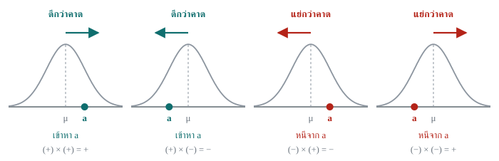

## บทที่ 19 · policy gradient — ทิศที่ทำให้ action ดีออกบ่อยขึ้น

> [!INTRO]
> บทที่ 14 ให้กฎหมุนลูกบิดไว้แล้ว คือสมการ (12) แต่ loss ที่ใช้ฝึกในบทนั้นดึงระฆังเข้าหา action ทุกตัว ไม่ว่าจะดีหรือแย่ บทที่ 8 บอกเป้าหมายตัวจริงไว้ คือทำให้ $J$ สูงที่สุด สิ่งที่ยังขาดคือทิศ ถ้าอยากให้ $J$ สูงขึ้น ต้องหมุนลูกบิดแต่ละตัวของ policy ไปทางไหน
>
> คำถามนี้ยากกว่าที่เห็น เพราะระหว่างลูกบิดกับ reward มีการสุ่มและมี environment คั่นอยู่ บทนี้ข้ามสิ่งคั่นนั้นด้วยเอกลักษณ์หนึ่งข้อ คือสมการ (22) ซึ่งนำไปสู่ policy gradient ตามสมการ (23) และรูปของมันสำหรับระฆัง Gaussian ตามสมการ (24)
>
> ของที่ต้องรู้มาก่อน: ค่าคาดหวังและกล่องบัตร จากบทที่ 4 · $J$ จากบทที่ 8 · advantage สมการ (8) จากบทที่ 9 · สมการ (14) จากบทที่ 10 · $\pi_\theta$ และ $\theta$ จากบทที่ 11 · การสุ่ม action จากบทที่ 12 · ความชัน chain rule และสมการ (12) จากบทที่ 14 · $\delta_t$ จากบทที่ 17 · $\rho_t$ จากบทที่ 18
>
> จบบทนี้แล้ว เราบอกได้ว่าแต่ละช่องของตารางตัวอย่างผลัก $\mu$ ไปทางไหนและแรงเท่าไร อธิบายได้ว่าความชันเดินทางจาก loss ถึงลูกบิดโดยไม่ผ่าน action และรู้ว่าทำไมโค้ดจึงไม่มีบรรทัดที่เขียนสมการ (23)

### ของที่ต้องมีก่อนเริ่ม

บทนี้ใช้สามแถวของตารางตัวอย่าง คือ $\mu$, $a$ และ $\delta_t$ จากบทที่ 17 ทุกช่องใช้ $\sigma = 0.5$ จึงมี $\sigma^2 = 0.25$

| | | t=0 | t=1 | t=2 | t=3 |
| --- | --- | --- | --- | --- | --- |
| **env 0** | $\mu$ | 0.20 | 0.30 | 0.10 | 0.40 |
| | $a$ | 0.40 | 0.20 | 0.50 | 0.40 |
| | $\delta_t$ | +0.05 | −0.40 | +0.15 | −0.30 |
| **env 1** | $\mu$ | −0.10 | 0.00 | 0.20 | −0.30 |
| | $a$ | −0.40 | 0.40 | 0.30 | −0.10 |
| | $\delta_t$ | −0.70 | −0.10 | −3.00 | −0.85 |

สัญลักษณ์ที่ใช้ในบทนี้ เรียงตามลำดับที่จะพบ

| สัญลักษณ์ | ชนิด | ความหมาย |
| --- | --- | --- |
| $J(\theta)$ **objective** | ฟังก์ชัน ซึ่งรับ $\theta$ แล้วคืนจำนวนจริง | ผลตอบแทนคาดหวังทั้ง episode มองเป็นฟังก์ชันของ weight |
| $\nabla_\theta J$ | เวกเตอร์ยาว 187,280 | ทิศที่ทำให้ $J$ เพิ่มเร็วที่สุด |
| **score function** $\nabla_\theta \log\pi_\theta(a \mid s)$ | เวกเตอร์ยาว 187,280 | ทิศที่ทำให้ $\log\pi_\theta(a \mid s)$ เพิ่มเร็วที่สุด |
| **policy gradient** | สมการ | ทิศที่ต้องขยับ $\theta$ เพื่อให้ผลตอบแทนคาดหวังสูงขึ้น |
| $\partial\log\pi / \partial\mu$ | scalar ต่อมิติ | $\log\pi$ ไวต่อ $\mu$ แค่ไหน |

$J(\theta)$ คือ $J(\pi)$ ของบทที่ 8 ตัวเดิม บทที่ 11 แสดงว่า policy ของ Tron1 ถูกกำหนดด้วย $\theta$ ทั้งหมด การเลือก policy จึงเท่ากับการเลือก $\theta$

### ภาพก่อนสัญลักษณ์: สี่กรณีของการขยับจุดกลาง

ดูข้อต่อเดียว ระฆังหนึ่งใบที่มีจุดกลาง $\mu$ และ action $a$ ที่สุ่มได้หนึ่งตัว สมมติว่ามีคนบอกเราว่า action ตัวนั้นออกมาดีกว่าหรือแย่กว่าที่คาด ซึ่งคือเครื่องหมายของ advantage ตามบทที่ 9 สามัญสำนึกบอกว่าควรทำอย่างไรกับ $\mu$

| action ตัวนั้น | $a$ อยู่ข้างใดของ $\mu$ | $\mu$ ควรไปทางใด | แปลว่า |
| --- | --- | --- | --- |
| ดีกว่าคาด | ขวา | ขวา เข้าหา $a$ | ทำแบบนั้นอีก |
| ดีกว่าคาด | ซ้าย | ซ้าย เข้าหา $a$ | ทำแบบนั้นอีก |
| แย่กว่าคาด | ขวา | ซ้าย หนีจาก $a$ | อย่าทำแบบนั้น |
| แย่กว่าคาด | ซ้าย | ขวา หนีจาก $a$ | อย่าทำแบบนั้น |

สี่แถวนี้ยุบเป็นกฎเดียว คือขยับ $\mu$ ไปทางเครื่องหมายของ advantage คูณกับ $(a - \mu)$ ส่วนที่เหลือของบทนี้แสดงว่าแคลคูลัสให้กฎเดียวกันออกมาเอง พร้อมขนาดของแรง และใช้ได้กับลูกบิดทุกตัวของ $\theta$ ไม่ใช่เฉพาะ $\mu$

### ปัญหา: ระหว่างลูกบิดกับ reward มีของสองอย่างคั่นอยู่

บทที่ 14 สอนสูตรสำเร็จไว้ คือตั้ง loss ให้ backpropagation เดินย้อนจาก loss ไปหาลูกบิด แล้วหมุนสวนทางความชัน วิธีง่ายที่สุดจึงเป็นการตั้ง loss ให้เท่ากับ reward ที่กลับเครื่องหมาย แล้วเรียก `loss.backward()`

วิธีนี้ใช้ไม่ได้ ดูทางที่ค่าไหลจากลูกบิดถึง reward

| ช่วงของทาง | เดินย้อนด้วย chain rule ได้หรือไม่ |
| --- | --- |
| $\theta$ ถึง $\mu$ และ $\sigma$ | ได้ เป็นการคำนวณของโครงข่ายตามบทที่ 13 |
| $\mu$ และ $\sigma$ ถึง $a$ | ไม่ได้ในโค้ดนี้ `.sample()` สุ่มโดยสั่ง PyTorch ไม่ให้บันทึก (`normal.py:70-73`) |
| $a$ ถึง $r$ | ไม่ได้ ตัวจำลองฟิสิกส์รับ $a$ แล้วคืน $r$ เป็นตัวเลข ไม่มีสูตรที่บอกว่า $r$ ขึ้นกับ $a$ อย่างไร |

ทางขาดสองที่ แต่สองที่นี้หนักไม่เท่ากัน ที่การสุ่ม ทางขาดเพราะวิธีที่โค้ดเลือกใช้ บทที่ 12 แสดงว่า $a = \mu + \sigma\varepsilon$ ซึ่งเป็นสูตรที่เดินย้อนได้ และ PyTorch มีคำสั่ง `.rsample()` ที่สุ่มตามสูตรนั้นพร้อมบันทึก ซึ่ง Tron1 ไม่ได้ใช้ ที่ environment ทางขาดโดยเลี่ยงไม่ได้ ต่อให้เปลี่ยนไปใช้ `.rsample()` การเดินย้อนจาก reward ก็ยังหยุดที่ตัวจำลองฟิสิกส์ และไปไม่ถึงลูกบิดตัวใดเลย

ทางออกมาจากการถามว่าลูกบิดเปลี่ยนอะไรได้จริง การหมุนลูกบิดไม่ได้เปลี่ยน reward ที่ action หนึ่งจะได้ เรื่องนั้น environment เป็นผู้กำหนด สิ่งที่การหมุนลูกบิดเปลี่ยนคือระฆัง ซึ่งกำหนดว่า action แต่ละตัวออก*บ่อยแค่ไหน* และบทที่ 10 ให้สูตรของระฆังไว้ครบ เราจึงหาความชันของความบ่อยได้ แม้จะหาความชันของผลลัพธ์ไม่ได้

### เหรียญที่มีลูกบิด: policy ที่ง่ายที่สุด

ก่อนใช้กับระฆัง ลองกับ policy ที่ง่ายที่สุดที่เรามี คือเหรียญของบทที่ 4 ให้เหรียญมีลูกบิดหนึ่งตัวชื่อ $p$ ซึ่งคือความน่าจะเป็นที่จะได้กล่อง 1 ความน่าจะเป็นของกล่อง 0 จึงเป็น $1 - p$ บทที่ 4 ใช้ $p = 1/2$ ตัวอักษร $K$ กับ $X$ ข้างล่างคือเลขกล่องกับตัวเลขบนบัตร ตามบทที่ 4

บทที่ 4 หาค่าคาดหวังของบัตรในแต่ละกล่องไว้ คือ 0.75 สำหรับกล่อง 0 และ −0.125 สำหรับกล่อง 1 กฎการเฉลี่ยสองชั้นให้ค่าคาดหวังรวมเป็นฟังก์ชันของลูกบิด

$$J(p) = (1 - p) \times 0.75 + p \times (-0.125)$$

ความชันของมันอ่านได้ตรง ๆ คือ $-0.75 - 0.125 = -0.875$ แต่เราอ่านได้เพราะรู้ค่าคาดหวังของทั้งสองกล่อง agent ไม่รู้สิ่งนั้น มันรู้เพียงความน่าจะเป็นของเหรียญตัวเอง และเห็นบัตรที่จับได้ทีละใบ เราจึงต้องการสูตรของความชันที่อยู่ในรูป*ค่าเฉลี่ยของบัตรที่จับได้*

| สมการ | หมายเหตุ |
| --- | --- |
| $J(p) = \sum_k P(K = k)\ \mathbb{E}[X \mid K = k]$ | กฎการเฉลี่ยสองชั้น |
| $\dfrac{dJ}{dp} = \sum_k \dfrac{dP(K = k)}{dp}\ \mathbb{E}[X \mid K = k]$ | สิ่งที่อยู่ในกล่องไม่ขึ้นกับลูกบิด มีแต่ความน่าจะเป็นที่ขึ้น |
| $= \sum_k P(K = k)\ \dfrac{1}{P(K = k)}\dfrac{dP(K = k)}{dp}\ \mathbb{E}[X \mid K = k]$ | คูณและหารด้วย $P(K = k)$ |
| $= \sum_k P(K = k)\ \dfrac{d \log P(K = k)}{dp}\ \mathbb{E}[X \mid K = k]$ | ความชันของ $\ln u$ เทียบกับ $u$ คือ $1/u$ |

บรรทัดที่สองไม่ใช่ค่าเฉลี่ย เพราะแต่ละพจน์ไม่ได้ถูกถ่วงด้วยโอกาสของกล่อง บรรทัดสุดท้ายเป็นค่าเฉลี่ยแล้ว คือค่าเฉลี่ยของตัวเลขบนบัตร คูณด้วยความชันของ log ของความน่าจะเป็นของกล่องที่บัตรใบนั้นมา ตัวคูณนี้เราคำนวณได้เองจากเหรียญ โดยไม่ต้องรู้ว่าในกล่องมีอะไร

> [!EXAMPLE] จงหาความชันของ $J$ เทียบกับลูกบิด $p$ ที่ $p = 1/2$ จากบัตร 8 ใบ
> ขั้นที่ 1 หาตัวคูณของแต่ละกล่อง
>
> $$\frac{d \log(1 - p)}{dp} = -\frac{1}{1 - p} = -2 \qquad\qquad \frac{d \log p}{dp} = \frac{1}{p} = +2$$
>
> กล่อง 0 ได้ −2 และกล่อง 1 ได้ +2
>
> ขั้นที่ 2 คูณตัวเลขบนบัตรทุกใบด้วยตัวคูณของกล่อง แล้วเฉลี่ยทั้ง 8 ใบ ซึ่งมีโอกาสเท่ากันเมื่อ $p = 1/2$
>
> $$\frac{-2\,(1.0 + 0.5 + 1.0 + 0.5) + 2\,(0.5 + 1.0 - 2.0 + 0.0)}{8} = \frac{-6.0 - 1.0}{8} = -0.875$$
>
> ตรงกับความชันที่อ่านได้จากสูตรของ $J(p)$

ความชันเป็นลบ การเพิ่ม $p$ ทำให้ $J$ ลด เราจึงลด $p$ คือให้เหรียญเลือกกล่อง 0 บ่อยขึ้น ตรงกับที่ควรเป็น เพราะกล่อง 0 ดีกว่า ถ้าก้าวหนึ่งครั้งด้วย $\alpha = 0.1$ ไปทางที่ $J$ เพิ่ม $p$ เปลี่ยนจาก 0.5 เป็น $0.5 + 0.1 \times (-0.875) = 0.4125$ และ $J$ เพิ่มจาก 0.3125 เป็น 0.3891

เราเพิ่งหาความชันข้ามการสุ่มได้ โดยไม่ได้หาความชันของตัวเลขบนบัตรเลย เหรียญตัวนี้ต่างจาก policy ของ Tron1 สามเรื่อง คือมันมีทางเลือกสองทาง ไม่ขึ้นกับสถานะ และได้ผลลัพธ์ทันทีในครั้งเดียว สิ่งที่ยกไปใช้ต่อได้คือขั้นคูณและหารในบรรทัดที่สามของตาราง

### สมการ (22): เอกลักษณ์ของ score function

ขั้นคูณและหารนั้นใช้ได้กับการแจกแจงทุกตัว รวมถึงระฆังของ policy

| สมการ | หมายเหตุ |
| --- | --- |
| $\nabla_\theta \log\pi_\theta(a \mid s) = \dfrac{1}{\pi_\theta(a \mid s)}\,\nabla_\theta\,\pi_\theta(a \mid s)$ | chain rule ผ่าน log |
| $\nabla_\theta\,\pi_\theta(a \mid s) = \pi_\theta(a \mid s)\,\nabla_\theta \log\pi_\theta(a \mid s)$ | คูณทั้งสองข้างด้วย $\pi_\theta(a \mid s)$ |

> [!KEY] เอกลักษณ์ของ score function
> $$\nabla_\theta\,\pi_\theta(a \mid s) = \pi_\theta(a \mid s)\ \nabla_\theta \log\pi_\theta(a \mid s) \tag{22}$$

สมการนี้บอกว่าความชันของความหนาแน่น เท่ากับความหนาแน่นเอง คูณกับความชันของ log ของมัน ประโยชน์อยู่ที่ทางขวามี $\pi_\theta(a \mid s)$ ยืนอยู่ข้างหน้า ซึ่งคือน้ำหนักของการเฉลี่ย เมื่ออยู่ในผลรวม มันทำให้ผลรวมนั้นอ่านเป็นค่าคาดหวังได้

เวกเตอร์ $\nabla_\theta \log\pi_\theta(a \mid s)$ มีชื่อว่า **score function** มันคือทิศที่ทำให้ระฆังสูงขึ้น ณ $a$ เร็วที่สุด คำว่า score ในชื่อนี้เป็นศัพท์ของวิชาสถิติ ไม่เกี่ยวกับคะแนนหรือ reward

เราตรวจสมการ (22) ที่ช่อง e0 t0 ได้ โดยดูลูกบิดตัวเดียวคือ $\mu$ ทางขวาคือความสูงของระฆัง 0.7365 คูณกับความชันของ log ซึ่งเป็น 0.80 คือค่าลบของ −0.80 ที่บทที่ 14 หาไว้ให้ loss $-\log\pi_\theta$ ได้ 0.5892 ทางซ้ายหาได้โดยไม่ใช้แคลคูลัส คือคำนวณความสูงของระฆัง ณ $a = 0.40$ เมื่อ $\mu$ เป็น 0.21 และ 0.19 แล้วหารผลต่างด้วย 0.02 ได้ 0.5891 ตรงกันถึงทศนิยมตำแหน่งที่สาม

### สมการ (23): ทิศของ $J$

ทำซ้ำสิ่งที่ทำกับเหรียญ โดยใช้ระฆังแทนเหรียญ ให้ $f(a)$ คือตัวเลขใดก็ได้ที่วัดว่า action $a$ ดีแค่ไหน เราอยากรู้ว่าค่าเฉลี่ยของ $f$ เปลี่ยนอย่างไรเมื่อหมุนลูกบิด

| สมการ | หมายเหตุ |
| --- | --- |
| $\nabla_\theta\ \mathbb{E}_{a \sim \pi_\theta}\big[f(a)\big] = \nabla_\theta \sum_a \pi_\theta(a \mid s)\,f(a)$ | เขียนค่าคาดหวังเป็นผลรวม |
| $= \sum_a \nabla_\theta\,\pi_\theta(a \mid s)\ f(a)$ | $f$ ไม่ขึ้นกับ $\theta$ เพราะ environment เป็นผู้กำหนด |
| $= \sum_a \pi_\theta(a \mid s)\ \nabla_\theta \log\pi_\theta(a \mid s)\ f(a)$ | แทนสมการ (22) |
| $= \mathbb{E}_{a \sim \pi_\theta}\big[\nabla_\theta \log\pi_\theta(a \mid s)\ f(a)\big]$ | อ่านกลับเป็นค่าคาดหวัง |

เหมือนบทที่ 18 ผลรวมนี้กลายเป็นพื้นที่ใต้กราฟเมื่อ $a$ เป็นจำนวนจริง และรูปของสมการไม่เปลี่ยน บรรทัดสุดท้ายคือสิ่งที่เราต้องการ มันเป็นค่าเฉลี่ยเหนือ action ที่สุ่มจาก policy เราจึงประมาณมันได้จากช่องในตาราง ช่องละหนึ่งตัวอย่าง

การ derive ข้างบนดู step เดียว episode มีหลาย step และ action ของ step นี้ส่งผลถึง reward ของ step ถัดไปด้วย ผลสำหรับทั้ง episode มีชื่อว่า policy gradient theorem (Sutton & Barto §13.2) เล่มนี้ไม่พิสูจน์มัน สิ่งที่ทฤษฎีบทบอกคือรูปข้างบนยังใช้ได้กับทุก step โดยตัวเลข $f$ ของแต่ละ step ต้องวัดว่า action นั้นดีแค่ไหน*สำหรับอนาคตทั้งหมด* ไม่ใช่เฉพาะ step เดียว ตัวเลขที่ใช้ได้มีหลายตัว และตัวที่ PPO ใช้คือ advantage ของบทที่ 9

> [!KEY] policy gradient
> $$\nabla_\theta J(\theta) = \mathbb{E}\Big[\nabla_\theta \log\pi_\theta(a_t \mid s_t)\ A^{\pi}(s_t, a_t)\Big] \tag{23}$$
>
> | | |
> | --- | --- |
> | $\nabla_\theta \log\pi_\theta(a_t \mid s_t)$ | score function ทิศที่ทำให้ $a_t$ ออกบ่อยขึ้น |
> | $A^{\pi}(s_t, a_t)$ | advantage ตามสมการ (8) คือ $a_t$ ดีกว่าที่คาดเท่าไร |
> | $\mathbb{E}$ | เฉลี่ยเหนือสถานะและ action ที่ policy ตัวนี้พบ |

สมการนี้อ่านได้ว่า

ทิศที่ทำให้ $J$ เพิ่ม = ค่าเฉลี่ยของ ทิศที่ทำให้ action นี้ออกบ่อยขึ้น × action นี้ดีกว่าที่คาดเท่าไร

> [!NOTE]
> ตำราเขียนทฤษฎีบทนี้ด้วยเครื่องหมายเป็นสัดส่วนกับ ไม่ใช่เท่ากับ และพิสูจน์สำหรับกรณีที่ไม่ลด reward ด้วย $\gamma$ เมื่อมี $\gamma$ รูปที่ตรงตามทฤษฎีมีตัวคูณ $\gamma^t$ เพิ่มอีกหนึ่งตัวต่อ step ซึ่ง PPO และโค้ดนี้ไม่ใส่ สมการ (23) ในเล่มนี้จึงเป็นรูปที่ใช้กันในทางปฏิบัติ สิ่งที่เราใช้จากมันคือทิศ ส่วนขนาดของก้าวเป็นหน้าที่ของ $\alpha$

action ที่มี advantage เป็นบวกดึง $\theta$ ไปทางที่ทำให้ตัวเองออกบ่อยขึ้น action ที่มี advantage เป็นลบมีตัวคูณติดลบ จึงดัน $\theta$ ไปทางตรงข้าม คือทำให้ตัวเองออกน้อยลง ตารางสี่กรณีตอนต้นบทคือสมการ (23) ในรูปคำพูด

**ทำไมใช้ advantage ไม่ใช้ return ตรง ๆ** ทฤษฎีบทยอมให้ใช้ return ที่นับจาก step นั้นเป็นตัวเลข $f$ ก็ได้ แต่ลองดูเหรียญอีกครั้ง สมมติว่ามีคนบวก 10 เข้ากับตัวเลขบนบัตรทุกใบ กล่องที่ดีกว่ายังเป็นกล่องเดิม และความชันก็ยังเป็น −0.875 เท่าเดิม แต่ผลคูณรายใบเปลี่ยนไปมาก

| | บัตรของกล่อง 0 | บัตรของกล่อง 1 | ค่าเฉลี่ย |
| --- | --- | --- | --- |
| ตัวคูณ × (บัตร + 10) | −22, −21, −22, −21 | +21, +22, +16, +20 | −0.875 |
| ตัวคูณ × (บัตร + 10 − 10.3125) | −1.375, −0.375, −1.375, −0.375 | +0.375, +1.375, −4.625, −0.625 | −0.875 |

แถวบนเป็นตัวเลขขนาดราว 20 ที่หักล้างกันจนเหลือ −0.875 ถ้าเราจับบัตรได้ไม่กี่ใบ ค่าเฉลี่ยจะแกว่งแรง แถวล่างลบค่าคาดหวังรวมออกจากบัตรทุกใบก่อน ซึ่งคือ $0.3125 + 10 = 10.3125$ ค่าเฉลี่ยไม่เปลี่ยน แต่ตัวเลขรายใบเล็กลงมาก

การลบแบบนี้ไม่เปลี่ยนค่าเฉลี่ยเสมอ เพราะค่าเฉลี่ยของ score function ใต้การแจกแจงของตัวเองเป็นศูนย์

$$\sum_a \pi_\theta(a \mid s)\ \nabla_\theta \log\pi_\theta(a \mid s) = \sum_a \nabla_\theta\,\pi_\theta(a \mid s) = \nabla_\theta \sum_a \pi_\theta(a \mid s) = \nabla_\theta\,1 = 0$$

ตัวคูณของเหรียญคือ −2 กับ +2 ซึ่งเฉลี่ยได้ศูนย์ตามนี้ ตัวเลขใดที่ไม่ขึ้นกับ action จึงลบออกจาก $f$ ได้โดยไม่เปลี่ยนค่าเฉลี่ย advantage คือ $Q$ ลบด้วย $V$ และ $V$ ไม่ขึ้นกับ action การใช้ advantage จึงเท่ากับการลบค่ากลางของสถานะออกก่อน สิ่งที่ผลัก policy คือ action ดีกว่าที่คาดเท่าไร ไม่ใช่ได้คะแนนสูงเท่าไร ตามที่บทที่ 9 บอกไว้

### สมการ (24): ทิศของ $\mu$ สำหรับระฆัง Gaussian

สมการ (23) ต้องการ score function ซึ่งมี 187,280 ช่อง backpropagation ของบทที่ 14 หามันให้ครบทุกช่อง ส่วนที่เราหาด้วยมือได้ และเห็นความหมายชัดที่สุด คือข้อต่อสุดท้ายของสาย ได้แก่ความชันของ $\log\pi$ เทียบกับ $\mu$

| สมการ | หมายเหตุ |
| --- | --- |
| $\log\pi_\theta(a \mid s) = -\tfrac12 \ln 2\pi - \ln\sigma - \dfrac{(a - \mu)^2}{2\sigma^2}$ | สมการ (14) |
| $\dfrac{\partial \log\pi_\theta(a \mid s)}{\partial\mu} = -\dfrac{2\,(a - \mu)\,(-1)}{2\sigma^2}$ | สองพจน์แรกไม่มี $\mu$ พจน์ที่สามใช้ chain rule ผ่าน $(a - \mu)$ |

> [!KEY] ทิศของ $\mu$
> $$\frac{\partial \log\pi_\theta(a \mid s)}{\partial\mu} = \frac{a - \mu}{\sigma^2} \tag{24}$$

เครื่องหมายของสมการนี้บอกว่า $a$ อยู่ข้างใดของ $\mu$ และขนาดของมันบอกว่า $a$ อยู่ห่างเท่าไรเมื่อวัดเทียบกับ $\sigma^2$ เมื่อคูณด้วย advantage ตามสมการ (23) เราได้เครื่องหมายของ advantage คูณกับเครื่องหมายของ $(a - \mu)$ ตารางสี่กรณีจึงออกมาจากแคลคูลัสเอง

บทที่ 14 เคยพบสมการนี้แล้วโดยไม่ได้ตั้งชื่อ loss ของบทนั้นคือ $L = -\log\pi_\theta(a \mid s)$ และได้ $\partial L / \partial\mu = -0.80$ ที่ช่อง e0 t0 ซึ่งคือสมการ (24) ที่กลับเครื่องหมาย loss ตัวนั้นจึงเป็นสมการ (23) ในกรณีที่ถือว่าทุก action มี advantage เท่ากับ 1 มันดึงเข้าหาทุก action เพราะไม่มีตัวคูณใดเป็นลบ สิ่งที่ PPO เพิ่มเข้ามาคือตัวคูณที่เป็นลบได้

ลูกบิด $\ell$ ทำงานแบบเดียวกัน บทที่ 14 หาไว้แล้วว่าความชันของ $-\log\pi$ เทียบกับ $\ell$ คือ $1 - z^2$ ความชันของ $\log\pi$ เทียบกับ $\ell$ จึงเป็น $z^2 - 1$ โดย $z$ คือระยะมาตรฐานของบทที่ 10 action ที่ดีและอยู่ไกลกว่าหนึ่ง $\sigma$ ทำให้ระฆังกว้างขึ้น action ที่ดีและอยู่ใกล้กว่านั้นทำให้ระฆังแคบลง และ action ที่แย่ให้ผลตรงข้าม

> [!EXAMPLE] ช่อง e0 t0 และ e1 t1 ผลัก $\mu$ ไปทางใด และแรงเท่าไร โดยใช้ $\delta_t$ เป็นค่าประมาณของ advantage
> บทที่ 17 แสดงว่า $\delta_t$ อ่านเป็นค่าประมาณแบบหยาบของ advantage ได้ เราใช้มันไปก่อน
>
> | ช่อง | $a$ | $\mu$ | สมการ (24) | $\delta_t$ | ผลคูณ | $\mu$ ถูกผลักไปทาง |
> | --- | --- | --- | --- | --- | --- | --- |
> | e0 t0 | 0.40 | 0.20 | $0.20 / 0.25 = +0.80$ | +0.05 | +0.04 | ขวา เข้าหา 0.40 |
> | e1 t1 | 0.40 | 0.00 | $0.40 / 0.25 = +1.60$ | −0.10 | −0.16 | ซ้าย หนีจาก 0.40 |
>
> สองช่องนี้สั่ง action ค่าเดียวกัน คือ 0.40 และ $a$ อยู่ทางขวาของ $\mu$ ทั้งคู่ สิ่งที่ทำให้ทิศต่างกันคือเครื่องหมายของ $\delta_t$

ผลคูณในตัวอย่างคือความชันของ $J$ เทียบกับ $\mu$ ที่ช่องนั้นประมาณจากตัวอย่างเดียว เราทำให้มันเป็น gradient step ได้ ด้วยการตั้ง loss ที่มีความชันเป็นค่าลบของมัน คือ $L = -\delta_t \log\pi_\theta(a_t \mid s_t)$ โดยถือ $\delta_t$ เป็นค่าคงที่ และสมมติเพื่อการคำนวณว่าแต่ละช่องมี $\mu$ เป็นลูกบิดของตัวเอง ที่ช่อง e0 t0 ได้ $\partial L / \partial\mu = -0.04$ และสมการ (12) ด้วย $\alpha = 0.1$ เลื่อน $\mu$ จาก 0.20 เป็น 0.2040 ที่ช่อง e1 t1 ได้ $\partial L / \partial\mu = +0.16$ และ $\mu$ เลื่อนจาก 0.00 เป็น −0.0160

> [!NOTE]
> $\delta_t$ เป็นค่าประมาณที่หยาบ มันดูผลจริงเพียง step เดียว ตัวเลข advantage ที่ PPO ใช้จริงสร้างขึ้นในบทที่ 22 และไม่จำเป็นต้องมีเครื่องหมายเดียวกับ $\delta_t$ ของช่องเดียวกัน ทิศที่คำนวณในบทนี้จึงแสดงกลไก ไม่ใช่ทิศที่ PPO จะเดินจริง

### ในโค้ดไม่มีสมการ (23)

ไม่มีบรรทัดใดใน repo ที่คำนวณ score function แล้วคูณกับ advantage ตามที่สมการ (23) เขียน สิ่งที่โค้ดทำคือสร้าง loss ที่มี $\log\pi_\theta(a_t \mid s_t)$ อยู่ข้างใน แล้วให้ `loss.backward()` หาความชันเอง (`ppo.py:288`) กุญแจอยู่ที่ว่าตอนปรับ ของชิ้นใดเป็นค่าคงที่ และชิ้นใดยังขึ้นกับ $\theta$

| ของ | ตอนปรับเป็นอะไร | เพราะ |
| --- | --- | --- |
| $a_t$ | ค่าคงที่ อ่านจากตาราง | ถูกสุ่มไปแล้วตอนเก็บข้อมูล และถูกเก็บเป็นตัวเลขที่ไม่มีบันทึกย้อนถึง $\theta$ (`ppo.py:137-139`) |
| ตัวเลข advantage ของช่อง | ค่าคงที่ อ่านจากตาราง | คำนวณเสร็จก่อนเริ่มปรับ |
| $\mu_\theta(s_t)$ และ $\sigma$ | ขึ้นกับ $\theta$ | คำนวณใหม่ทุก gradient step (`ppo.py:205-210`) |
| $\log\pi_\theta(a_t \mid s_t)$ | ขึ้นกับ $\theta$ ผ่าน $\mu$ และ $\sigma$ | `ppo.py:212-214` เรียก `actor_critic.py:164` |

ความชันจึงเดินจาก loss ผ่าน $\log\pi$ ลงไปที่ $\mu$ และ $\sigma$ แล้วต่อไปถึง weight ทุกตัว มันไม่เคยผ่าน $a_t$ และไม่เคยผ่าน environment สองที่ซึ่งทางขาดในหัวข้อปัญหาจึงไม่อยู่บนทางนี้

loss ของ PPO ไม่ได้ใช้ $\log\pi$ ตรง ๆ มันใช้ $\rho_t$ ของบทที่ 18 ซึ่งคือ $\exp(\log\pi_{new} - \log\pi_{old})$ (`ppo.py:252-254`) คูณกับตัวเลข advantage ของช่อง (`ppo.py:256`) ความชันของ $\rho_t$ หาได้จากสมการ (22) ถ้าหารทั้งสองข้างของสมการ (22) ด้วย $\pi_{old}(a_t \mid s_t)$ ซึ่งเป็นค่าคงที่ ทางซ้ายกลายเป็นความชันของ $\rho_t$ และทางขวากลายเป็น $\rho_t$ คูณ score function สำหรับลูกบิด $\mu$ จึงได้

$$\frac{\partial \rho_t}{\partial\mu} = \rho_t\ \frac{a_t - \mu}{\sigma^2}$$

โดย $\mu$ ในที่นี้คือจุดกลางของระฆังใหม่ ที่ gradient step ครั้งแรกของ iteration ระฆังยังไม่ขยับ $\rho_t = 1$ สำหรับทุกช่องที่ครั้งนั้นใช้ ความชันของ $\rho_t$ จึงเท่ากับสมการ (24) พอดี ที่ช่อง e0 t0 ได้ 0.80 เมื่อระฆังเลื่อนไปแล้ว เช่น $\mu$ เป็น 0.25 ได้ $1.0356 \times 0.15 / 0.25 = 0.6214$ loss ที่สร้างจาก $\rho_t$ จึงให้ทิศเดียวกับสมการ (23) บทที่ 23 นำตัวเลข advantage ของบทที่ 22 มาประกอบกับ $\rho_t$ เป็น loss ตัวจริง

> [!REMARK]
> อัลกอริทึมที่ใช้สมการ (23) ตรง ๆ โดยให้ return เป็นตัวเลข $f$ และไม่มี critic ชื่อ REINFORCE (Williams 1992) มันเป็น policy gradient แบบดั้งเดิม และมีปัญหาของ Monte Carlo ตามบทที่ 17 ครบทั้งสองข้อ repo นี้ไม่มี REINFORCE

### จากสมการถึงโค้ด

| ในสมการ | บรรทัด | โค้ด |
| --- | --- | --- |
| การสุ่มที่ไม่มีบันทึก | `normal.py:70-73` | `with torch.no_grad(): return torch.normal(...)` |
| $a_t$ เป็นค่าคงที่ | `ppo.py:137-139` | `self.actor_critic.act(...).detach()` |
| $\log\pi_\theta(a_t \mid s_t)$ ที่ขึ้นกับ $\theta$ | `actor_critic.py:164` | `self.distribution.log_prob(actions).sum(dim=-1)` |
| $\rho_t$ | `ppo.py:252-254` | `ratio = torch.exp(...)` |
| $\rho_t$ คูณตัวเลข advantage | `ppo.py:256` | `surrogate = -torch.squeeze(advantages_batch) * ratio` |
| score function ของลูกบิดทุกตัว | `ppo.py:288` | `loss.backward()` |
| สมการ (23) ที่เขียนเป็นสูตร | ไม่มี | |

`normal.py` เป็นไฟล์ของ PyTorch เวอร์ชัน 2.5.1 ไม่ใช่ไฟล์ของ repo คำว่า `.detach()` ในแถวที่สองเป็นคำสั่งที่ตัดบันทึกของ PyTorch ซึ่งบทที่ 21 อธิบาย

> [!SUMMARY]
> - การเดินย้อนจาก reward ไปหาลูกบิดทำไม่ได้ เพราะ environment ไม่มีสูตรให้เดินย้อน และโค้ดสุ่ม action โดยไม่บันทึก สิ่งที่หาความชันได้คือ action แต่ละตัวออกบ่อยแค่ไหน
> - สมการ (22) เขียนความชันของความหนาแน่นเป็นความหนาแน่นคูณ score function ทำให้ความชันของค่าเฉลี่ยกลับมาอยู่ในรูปค่าเฉลี่ย ซึ่งประมาณได้จากตัวอย่าง
> - สมการ (23) บอกว่าทิศที่ทำให้ $J$ เพิ่ม คือค่าเฉลี่ยของ score function คูณ advantage การใช้ advantage แทน return ไม่เปลี่ยนค่าเฉลี่ย เพราะ score function เฉลี่ยได้ศูนย์
> - สมการ (24) ให้ score function ของ $\mu$ เป็น $(a - \mu)/\sigma^2$ ที่ e0 t0 ได้ +0.80 เมื่อคูณ advantage จึงได้ตารางสี่กรณี
> - โค้ดไม่มีสมการ (23) ความชันเดินจาก loss ผ่าน $\log\pi$ ไปถึง $\theta$ โดย action และตัวเลข advantage เป็นค่าคงที่จากตาราง
>
> ประโยคที่ควรจำ: **policy gradient ขยับลูกบิดไปทางที่ทำให้ action ที่ดีกว่าคาดออกบ่อยขึ้น และ action ที่แย่กว่าคาดออกน้อยลง ความชันเดินผ่านความบ่อยของ action ไม่ได้เดินผ่านตัว action**

### แบบฝึกหัด

1. ข้อใดถูกต้อง
    1. backpropagation เดินย้อนจาก reward ผ่านตัวจำลองฟิสิกส์ไปถึง $\theta$ ได้
    2. การหมุนลูกบิดของ policy เปลี่ยนว่า action แต่ละตัวออกบ่อยแค่ไหน
    3. score function คือ reward ของ step นั้น
    4. ค่าเฉลี่ยของ score function ใต้การแจกแจงของตัวเองเป็นศูนย์
    5. สมการ (24) เป็นบวกเมื่อ $a$ อยู่ทางขวาของ $\mu$
    6. action ที่มี advantage เป็นลบดึง $\mu$ เข้าหาตัวเอง
    7. การลบ $V(s_t)$ ออกจากตัวเลขที่ใช้คูณ ทำให้ค่าเฉลี่ยในสมการ (23) เปลี่ยน
    8. ตอนปรับ $a_t$ เป็นค่าคงที่ที่อ่านจากตาราง
    9. repo นี้มีฟังก์ชันชื่อ REINFORCE
    10. ที่ gradient step ครั้งแรกของ iteration ความชันของ $\rho_t$ เทียบกับ $\mu$ ของช่องที่ครั้งนั้นใช้ เท่ากับสมการ (24)

2. จงหาค่าของสมการ (24) และผลคูณกับ $\delta_t$ สำหรับช่อง e0 t1, e0 t2, e1 t0 และ e1 t2 แล้วบอกว่าแต่ละช่องผลัก $\mu$ ไปทางซ้ายหรือขวา และเป็นการเข้าหาหรือหนีจาก $a$ [05 §4.1] <!--space:38-->

3. ช่องทั้งสี่ในข้อ 2 ตรงกับแถวใดของตารางสี่กรณี และมีแถวใดของตารางสี่กรณีที่ไม่ปรากฏในตารางตัวอย่างทั้ง 8 ช่องเมื่อใช้ $\delta_t$ <!--space:18-->

4. ช่อง e0 t3 มี $a = \mu$ จงหาค่าของสมการ (24) และอธิบายว่าเหตุใด $\mu$ ของช่องนี้จึงไม่ถูกผลักไปทางใด ไม่ว่า advantage จะเป็นเท่าไร <!--space:16-->

5. จงใช้ loss $L = -\delta_t \log\pi_\theta(a_t \mid s_t)$ กับช่อง e1 t2 แล้วทำ gradient step หนึ่งครั้งด้วย $\alpha = 0.1$ $\mu$ ใหม่เป็นเท่าไร <!--space:18-->

6. จงหาความชันของ $J$ เทียบกับลูกบิดของเหรียญที่ $p = 1/4$ ด้วยสูตรค่าเฉลี่ยของตัวคูณกับค่าคาดหวังของกล่อง และตรวจว่าค่าเฉลี่ยของตัวคูณเป็นศูนย์ [05 §4.1] <!--space:30-->

7. ที่ช่อง e0 t0 ถ้าระฆังแคบลงเป็น $\sigma = 0.25$ ค่าของสมการ (24) เป็นเท่าไร และถ้ากว้างขึ้นเป็น $\sigma = 1.0$ เป็นเท่าไร จงบอกว่าความกว้างของระฆังมีผลต่อแรงผลักอย่างไร <!--space:18-->

8. จงหาความชันของ $\rho$ เทียบกับ $\mu$ ที่ช่อง e0 t2 [ppo.py:252-254]
    1. เมื่อระฆังยังไม่ขยับ
    2. เมื่อ $\mu$ เลื่อนเป็น 0.15 ซึ่งบทที่ 18 หา $\rho = 1.0779$ ไว้

    <!--space:18-->

9. เพื่อนเสนอว่า "ตั้ง `loss = -rewards.mean()` แล้วเรียก `loss.backward()` ก็พอ" จงอธิบายว่าเหตุใดวิธีนี้ไม่ทำให้ลูกบิดของ policy ขยับ <!--space:20-->

10. จงอธิบายว่าเหตุใด loss ของบทที่ 14 จึงดึงระฆังเข้าหา action ทุกตัว ขณะที่สมการ (23) ผลักออกจาก action บางตัวได้ <!--space:18-->

<!-- เฉลย -->

1. ข้อที่ถูก: 2, 4, 5, 8, 10

    - ข้อ 1 ผิด: ตัวจำลองฟิสิกส์ไม่มีสูตรให้เดินย้อน และโค้ดสุ่ม action โดยไม่บันทึก
    - ข้อ 3 ผิด: score function คือ $\nabla_\theta \log\pi_\theta(a \mid s)$ ไม่เกี่ยวกับ reward
    - ข้อ 6 ผิด: ตัวคูณติดลบ จึงดัน $\mu$ หนีออก
    - ข้อ 7 ผิด: $V(s_t)$ ไม่ขึ้นกับ action และ score function เฉลี่ยได้ศูนย์ ค่าเฉลี่ยจึงไม่เปลี่ยน
    - ข้อ 9 ผิด: ไม่มี ความชันมาจาก `loss.backward()` (`ppo.py:288`)

2. ตารางของสี่ช่อง

    | ช่อง | $a - \mu$ | สมการ (24) | $\delta_t$ | ผลคูณ | $\mu$ ถูกผลัก |
    | --- | --- | --- | --- | --- | --- |
    | e0 t1 | −0.10 | −0.40 | −0.40 | +0.16 | ขวา หนีจาก $a$ |
    | e0 t2 | +0.40 | +1.60 | +0.15 | +0.24 | ขวา เข้าหา $a$ |
    | e1 t0 | −0.30 | −1.20 | −0.70 | +0.84 | ขวา หนีจาก $a$ |
    | e1 t2 | +0.10 | +0.40 | −3.00 | −1.20 | ซ้าย หนีจาก $a$ |

3. e0 t2 คือแถวที่ 1 (ดีกว่าคาด $a$ อยู่ขวา) · e1 t2 คือแถวที่ 3 (แย่กว่าคาด $a$ อยู่ขวา) · e0 t1 และ e1 t0 คือแถวที่ 4 (แย่กว่าคาด $a$ อยู่ซ้าย) แถวที่ 2 (ดีกว่าคาด $a$ อยู่ซ้าย) ไม่ปรากฏ เพราะช่องที่ $\delta_t$ เป็นบวกมีสองช่อง คือ e0 t0 และ e0 t2 และทั้งสองมี $a$ อยู่ทางขวาของ $\mu$

4. $(0.40 - 0.40)/0.25 = 0$ ผลคูณกับ advantage จึงเป็นศูนย์เสมอ $a$ อยู่ที่ยอดระฆังพอดี การเลื่อน $\mu$ ไปทางใดก็ทำให้ระฆัง ณ $a$ เตี้ยลงเท่ากัน จึงไม่มีทิศใดดีกว่าอีกทิศหนึ่ง ช่องนี้ยังผลัก $\ell$ ได้ เพราะ $z^2 - 1 = -1$ ไม่เป็นศูนย์

5. สมการ (24) ให้ $0.10/0.25 = 0.40$ จึงได้ $\partial L / \partial\mu = -(-3.00) \times 0.40 = +1.20$ และ $\mu \leftarrow 0.20 - 0.1 \times 1.20 = 0.08$ ซึ่งหนีจาก $a = 0.30$

6. ตัวคูณของกล่อง 0 คือ $-1/(1 - p) = -1.3333$ และของกล่อง 1 คือ $1/p = +4$

    $$\tfrac34 \times (-1.3333) \times 0.75 + \tfrac14 \times 4 \times (-0.125) = -0.75 - 0.125 = -0.875$$

    ค่าเฉลี่ยของตัวคูณ: $\tfrac34 \times (-1.3333) + \tfrac14 \times 4 = -1 + 1 = 0$

7. $\sigma = 0.25$ ให้ $0.20/0.0625 = 3.20$ และ $\sigma = 1.0$ ให้ $0.20/1.0 = 0.20$ ระฆังยิ่งแคบ แรงผลักต่อ $\mu$ ยิ่งมาก เพราะ action ที่ห่างเท่าเดิมอยู่ไกลขึ้นเมื่อวัดเทียบกับความกว้างของระฆัง

8. ความชันของ $\rho$

    1. $\rho = 1$ จึงได้ $(0.50 - 0.10)/0.25 = 1.60$
    2. $1.0779 \times (0.50 - 0.15)/0.25 = 1.0779 \times 1.40 = 1.5090$ เมื่อคิดจาก $\rho$ ค่าเต็มแล้วปัดตอนท้าย ถ้าคูณจากค่าที่ปัดแล้วจะได้ 1.5091

9. `rewards` เป็นตัวเลขที่ environment ส่งกลับมา ตัวจำลองฟิสิกส์ไม่มีสูตรที่โยงมันกลับไปถึง action จึงไม่มีบันทึกของ PyTorch ให้เดินย้อน นี่เป็นเหตุที่เลี่ยงไม่ได้ นอกจากนั้น action ในโค้ดนี้ยังมาจาก `.sample()` ซึ่งสุ่มโดยไม่บันทึก `loss.backward()` จึงไม่มีทางเดินย้อนไปถึงลูกบิดตัวใด

10. loss ของบทที่ 14 คือ $-\log\pi_\theta(a \mid s)$ ซึ่งเท่ากับการใช้สมการ (23) โดยให้ advantage เป็น 1 ทุก action ตัวคูณเป็นบวกเสมอ จึงมีแต่การดึงเข้าหา สมการ (23) คูณด้วย advantage ซึ่งเป็นลบได้ เมื่อเป็นลบ ทิศกลับด้าน และกลายเป็นการผลักออก
