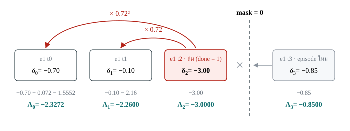

## บทที่ 22 · GAE — ให้เครดิตย้อนหลังแก่ทุก action

> [!INTRO]
> หุ่นตัวหนึ่งล้ม เรารู้ว่า action สุดท้ายก่อนล้มแย่ แต่ action ก่อนหน้านั้นที่พาหุ่นมาถึงท่าเสียหลักควรถูกโทษด้วยหรือไม่ และควรโทษเท่าไร บทนี้ตอบคำถามนั้นเป็นตัวเลข
>
> เราจะสร้างปริมาณสามตัวต่อจาก TD error $\delta_t$ ของบทที่ 17 ได้แก่ advantage $A_t$ เป้าของ critic $R_t$ และ advantage ที่ normalize แล้ว $\hat A_t$ ด้วยสมการ (25)–(28) ทั้งหมดคำนวณจากตารางตัวอย่าง 2 env × 4 step ด้วยมือ
>
> ของที่ต้องรู้มาก่อน: done และ episode จากบทที่ 7 · return $G_t$ จากบทที่ 8 · value function $V$ และนิยาม advantage สมการ (8) จากบทที่ 9 · Monte Carlo และ TD error สมการ (19) จากบทที่ 17 · actor กับ critic จากบทที่ 20
>
> จบบทนี้แล้ว เราเติมคอลัมน์ $A_t$, $R_t$, $\hat A_t$ ของตารางได้เองทุกช่อง และชี้ได้ว่าแต่ละบรรทัดของ `compute_returns` ตรงกับสมการไหน

### ของที่ต้องมีก่อนเริ่ม

บทนี้ใช้ข้อมูลสี่แถวจากตารางตัวอย่างประจำเล่ม คือ $r$, $V$, done และ $\delta_t$ ที่คำนวณไว้แล้วในบทที่ 17 ตัวหนาคือจุดที่ env 1 ล้ม

| | | t=0 | t=1 | t=2 | t=3 | $V_{last}$ |
| --- | --- | --- | --- | --- | --- | --- |
| **env 0** | $r$ | 1.0 | 0.5 | 1.0 | 0.5 | |
| | $V$ | 5.0 | 4.5 | 4.0 | 3.5 | 3.0 |
| | done | 0 | 0 | 0 | 0 | |
| | $\delta_t$ | +0.05 | −0.40 | +0.15 | −0.30 | |
| **env 1** | $r$ | 0.5 | 1.0 | **−2.0** | 0.0 | |
| | $V$ | 3.0 | 2.0 | 1.0 | 4.0 | 3.5 |
| | done | 0 | 0 | **1** | 0 | |
| | $\delta_t$ | −0.70 | −0.10 | **−3.00** | −0.85 | |

สัญลักษณ์ที่ใช้ในบทนี้ เรียงตามลำดับที่จะพบ

| สัญลักษณ์ | ชนิด | ความหมาย |
| --- | --- | --- |
| $\delta_t$ **TD error** | scalar ต่อช่อง | ผลจริงก้าวนี้ + $\gamma$ × ทำนายพรุ่งนี้ − ทำนายวันนี้ = critic พลาดเท่าไร |
| **mask** $(1-\text{done}_t)$ | เวกเตอร์ | ตัดพจน์ bootstrap ทิ้งเมื่อ episode จบที่ช่องนี้ |
| $\gamma$ **discount** | ค่าคงที่ | อนาคตหนึ่งก้าวถัดไปมีค่ากี่เปอร์เซ็นต์ของตอนนี้ · toy 0.9 · Tron1 0.99 (`gamma` `limx_rsl_rl_ppo_cfg.py:102`) |
| $\lambda$ **GAE lambda** | ค่าคงที่ | เชื่อ critic แค่ไหน เทียบกับรอผลจริง (0 = TD ล้วน, 1 = MC ล้วน) · toy 0.8 · Tron1 0.95 (`lam` `:103`) |
| $A^{(k)}_t$ **ตัวประมาณ $k$ ก้าว** | scalar ต่อช่อง | advantage ที่ประมาณด้วยผลจริง $k$ ก้าว แล้วให้ critic ทำนายที่เหลือ · เป็นขั้นกลางของการ derive ไม่มีในโค้ด |
| $A_t$ **advantage** | scalar ต่อช่อง | ผลรวมถ่วงน้ำหนัก $(\gamma\lambda)^k$ ของ $\delta$ ในอนาคต หยุดที่ขอบ episode |
| $R_t$ **return เป้าของ critic** | scalar ต่อช่อง | $A_t + V_t$ — ไม่ใช่ $G_t$ มีคำทำนายของ critic ปนอยู่ |
| $\hat A_t$ **advantage ที่ normalize แล้ว** | scalar ต่อช่อง | $A_t$ ลบค่าเฉลี่ย $\bar A$ แล้วหารด้วยส่วนเบี่ยงเบนมาตรฐาน $\mathrm{sd}_A$ ของทั้งตาราง |
| $\bar A$ · $\mathrm{sd}_A$ | scalar | $\bar A$ คือค่าเฉลี่ยของ $A_t$ ทุกช่องในตาราง · $\mathrm{sd}_A$ คือส่วนเบี่ยงเบนมาตรฐานของ $A_t$ ทุกช่อง แบบหารด้วย $n-1$ โดย $n$ คือจำนวนช่องของตาราง |

ในตารางตัวอย่าง $\gamma\lambda = 0.9 \times 0.8 = 0.72$ เราจะใช้เลขนี้ตลอดบท

> [!NOTE]
> ทวน $\delta_t$ ของช่อง e1 t2 ซึ่งเป็นช่องที่ mask ทำงาน: $\delta_2 = -2.0 + 0 \times 0.9 \times 4.0 - 1.0 = -3.00$ ค่า 4.0 ที่ถูกตัดทิ้งคือ $V$ ของท่ายืนใหม่หลัง reset ไม่ใช่อนาคตของท่าที่กำลังล้ม

### ปัญหา: หุ่นล้มที่ t2 แล้วใครผิด

ดูคอลัมน์ env 1 หุ่นได้ reward −2.0 และ episode จบที่ t2 เราต้องให้คะแนนแก่ action ทั้งสามตัวของ episode นี้ คือที่ t0, t1 และ t2 ว่าแต่ละตัวดีหรือแย่กว่าที่ critic คาดไว้เท่าไร ตัวเลขนี้คือ advantage ตามสมการ (8) ซึ่งบทที่ 9 บอกไว้ว่าคำนวณตามนิยามไม่ได้ เพราะไม่มี $Q$ สิ่งที่บทนี้สร้างคือตัวประมาณของมันจาก reward กับคำทำนายของ critic

**วิธีที่หนึ่ง ใช้ $\delta_t$ ตรง ๆ** ได้ −0.70, −0.10 และ −3.00 ตามลำดับ สังเกตว่า t1 แทบไม่ถูกโทษ เหตุผลอยู่ในสูตรของมันเอง

$$\delta_1 = r_1 + \gamma V(s_2) - V(s_1) = 1.0 + 0.9(1.0) - 2.0 = -0.10$$

$\delta_1$ เชื่อ critic ว่าสถานะ $s_2$ มีค่า 1.0 แต่ผลจริงที่ออกจาก $s_2$ คือ −2.0 critic ทำนายสูงเกินไปถึง 3.0 และ $\delta_1$ มองไม่เห็นความพลาดนี้ เพราะมันดูผลจริงแค่ก้าวเดียว

**วิธีที่สอง รอผลจริงจนจบ episode** แล้วใช้ $G_t - V(s_t)$ ซึ่งคือ Monte Carlo ของบทที่ 17

$$G_1 - V(s_1) = \big(1.0 + 0.9(-2.0)\big) - 2.0 = -0.80 - 2.0 = -2.80$$

วิธีนี้เห็นการล้มเต็ม ๆ แต่มีราคาสองอย่าง อย่างแรกคือต้องรอ episode จบ ซึ่งของ Tron1 ยาวได้ถึง 1000 step (`episode_length_s = 20.0` `limx_base_env_cfg.py:498` หารด้วยก้าวละ 0.02 วินาที) ขณะที่ตารางหนึ่งใบมีแค่ 24 แถว (`num_steps_per_env` `limx_rsl_rl_ppo_cfg.py:81`) อย่างที่สองคือผลจริงเป็นผลรวมของ reward ที่สุ่มหลายก้าว ค่าจึงแกว่ง

| ช่อง | เชื่อ critic ทั้งหมด ($\delta_t$) | เชื่อผลจริงทั้งหมด ($G_t - V_t$) |
| --- | --- | --- |
| e1 t0 | −0.70 | −3.22 |
| e1 t1 | −0.10 | −2.80 |
| e1 t2 | −3.00 | −3.00 |

เราอยากได้ตัวเลขที่อยู่ระหว่างสองคอลัมน์นี้ และเลื่อนเข้าหาฝั่งใดก็ได้ด้วยลูกบิดตัวเดียว ลูกบิดนั้นคือ $\lambda$

### จาก $\delta$ ตัวเดียว ถึงผลรวมของ $\delta$

สองวิธีข้างบนเป็นปลายสองข้างของตระกูลเดียวกัน เราจะเห็นได้เมื่อเขียนตัวประมาณ "ใช้ผลจริง $k$ ก้าว แล้วให้ critic ทำนายที่เหลือ" ออกมาทีละตัว ตลอดการ derive ในหัวข้อนี้เราอยู่ภายใน episode เดียว mask จึงเป็น 1 ทุกช่อง ยกเว้นช่องสุดท้ายของ episode ซึ่ง done ทำให้ mask เป็น 0 และพจน์ $V$ ของสถานะหลัง episode หายไป เราจะเขียน mask ลงในสูตรเมื่อถึงสมการ (26)

| สมการ | หมายเหตุ |
| --- | --- |
| $A^{(1)}_t = r_t + \gamma V(s_{t+1}) - V(s_t) = \delta_t$ | ผลจริง 1 ก้าว ตรงกับสมการ (19) เมื่อ mask = 1 |
| $A^{(2)}_t = r_t + \gamma r_{t+1} + \gamma^2 V(s_{t+2}) - V(s_t)$ | ผลจริง 2 ก้าว |
| $\phantom{A^{(2)}_t} = \big[r_t + \gamma V(s_{t+1}) - V(s_t)\big] + \gamma\big[r_{t+1} + \gamma V(s_{t+2}) - V(s_{t+1})\big]$ | บวกแล้วลบ $\gamma V(s_{t+1})$ |
| $\phantom{A^{(2)}_t} = \delta_t + \gamma\,\delta_{t+1}$ | แต่ละวงเล็บคือ TD error หนึ่งตัว |
| $A^{(k)}_t = \delta_t + \gamma\,\delta_{t+1} + \cdots + \gamma^{k-1}\delta_{t+k-1}$ | ทำแบบเดียวกันซ้ำ $k$ ครั้ง |
| $A^{(\infty)}_t = \sum_{k\ge 0}\gamma^k\delta_{t+k} = G_t - V(s_t)$ | ทำจนจบ episode พจน์ $V$ ตรงกลางตัดกันหมด |

ตรวจแถวสุดท้ายกับ e1 t0: $\delta_0 + 0.9\,\delta_1 + 0.81\,\delta_2 = -0.70 - 0.09 - 2.43 = -3.22$ ตรงกับ $G_0 - V(s_0)$ ในตารางก่อนหน้า

GAE ไม่เลือก $k$ ตัวใดตัวหนึ่ง แต่เฉลี่ยทุกตัว โดยตัวถัดไปได้น้ำหนักเป็น $\lambda$ เท่าของตัวก่อนหน้า (Schulman et al. 2016 สมการ (16))

$$A_t = (1-\lambda)\Big(A^{(1)}_t + \lambda A^{(2)}_t + \lambda^2 A^{(3)}_t + \cdots\Big)$$

น้ำหนักรวมกันได้ 1 พอดีเมื่อ $0 \le \lambda < 1$ เพราะ $(1-\lambda)(1 + \lambda + \lambda^2 + \cdots) = 1$ เมื่อแทน $A^{(k)}_t$ ด้วยผลรวมของ $\delta$ แล้วจัดกลุ่มใหม่ อนุกรมนี้ยุบเหลือผลรวมเดียว

| สมการ | หมายเหตุ |
| --- | --- |
| $A_t = (1-\lambda)\big[\delta_t + \lambda(\delta_t + \gamma\delta_{t+1}) + \lambda^2(\delta_t + \gamma\delta_{t+1} + \gamma^2\delta_{t+2}) + \cdots\big]$ | แทน $A^{(k)}_t$ |
| $= (1-\lambda)\big[\delta_t(1 + \lambda + \lambda^2 + \cdots) + \gamma\delta_{t+1}(\lambda + \lambda^2 + \cdots) + \cdots\big]$ | รวมพจน์ที่มี $\delta$ ตัวเดียวกัน |
| $= (1-\lambda)\Big[\dfrac{\delta_t}{1-\lambda} + \dfrac{\gamma\lambda\,\delta_{t+1}}{1-\lambda} + \dfrac{(\gamma\lambda)^2\delta_{t+2}}{1-\lambda} + \cdots\Big]$ | อนุกรมเรขาคณิต $\lambda^j + \lambda^{j+1} + \cdots = \dfrac{\lambda^j}{1-\lambda}$ |
| $= \delta_t + \gamma\lambda\,\delta_{t+1} + (\gamma\lambda)^2\delta_{t+2} + \cdots$ | $(1-\lambda)$ ตัดกัน |

> [!KEY] สมการ GAE แบบผลรวม
> $$A_t = \sum_{k=0}^{\infty}(\gamma\lambda)^k\,\delta_{t+k} \tag{25}$$

ตัว $k$ ในสมการ (25) เป็นตัวนับพจน์ของผลรวม เป็นคนละตัวกับ $k$ ใน $A^{(k)}_t$ ซึ่งนับจำนวนก้าวของผลจริง

สมการนี้บอกว่า advantage ของช่องหนึ่งคือความพลาดของ critic ที่ช่องนั้น บวกความพลาดที่ช่องถัดไปซึ่งลดน้ำหนักเหลือ $\gamma\lambda$ เท่า บวกช่องถัดจากนั้นที่ $(\gamma\lambda)^2$ เท่า และต่อไปเรื่อย ๆ ความพลาดที่อยู่ไกลออกไปมีผลน้อยลง

| ค่า $\lambda$ | สมการ (25) เหลือ | คือ |
| --- | --- | --- |
| 0 | $A_t = \delta_t$ | เชื่อ critic ทั้งหมด (TD) |
| 1 | $A_t = \sum_k \gamma^k\delta_{t+k}$ | เชื่อผลจริงทั้งหมด (MC) |
| 0.8 (toy) · 0.95 (Tron1) | น้ำหนัก $0.72^k$ · $0.9405^k$ | อยู่ระหว่างสองฝั่ง |

> [!REMARK]
> ผลรวมใน (25) เขียนถึงอนันต์ แต่ในโค้ดผลรวมหยุดที่สองที่ คือที่ช่องซึ่ง episode จบ และที่แถวสุดท้ายของตาราง ซึ่งปิดท้ายด้วย $V_{last}$ ดังนั้น $\lambda = 1$ ในโค้ดจึงเป็น MC ที่ถูกตัดที่ขอบตาราง ไม่ใช่ MC จนจบ episode เสมอไป

### วิธีที่โค้ดคำนวณจริง: เดินย้อนหลังทีละช่อง

การบวกอนุกรม (25) ใหม่ทุกช่องต้องยกกำลัง $\gamma\lambda$ ซ้ำหลายรอบ เราเลี่ยงได้เมื่อสังเกตว่าผลรวมของช่อง $t$ มีผลรวมของช่อง $t+1$ ซ่อนอยู่ข้างใน

| สมการ | หมายเหตุ |
| --- | --- |
| $A_t = \delta_t + \gamma\lambda\,\delta_{t+1} + (\gamma\lambda)^2\delta_{t+2} + \cdots$ | สมการ (25) |
| $= \delta_t + \gamma\lambda\big[\delta_{t+1} + \gamma\lambda\,\delta_{t+2} + \cdots\big]$ | ดึง $\gamma\lambda$ ออกจากทุกพจน์หลังพจน์แรก |
| $= \delta_t + \gamma\lambda\,A_{t+1}$ | วงเล็บคือสมการ (25) ของช่อง $t+1$ |

เมื่อเติม mask เพื่อให้ผลรวมหยุดที่ขอบ episode เราได้สมการที่โค้ดใช้

> [!KEY] สมการ GAE แบบเวียนเกิด
> $$A_t = \delta_t + (1-\text{done}_t)\,\gamma\lambda\,A_{t+1}, \qquad A_T = 0 \tag{26}$$
>
> | | |
> | --- | --- |
> | $A_{t+1}$ | advantage ของช่องถัดไปในคอลัมน์เดียวกัน |
> | $A_T$ | ค่าเริ่มต้นใต้แถวสุดท้ายของตาราง ($T = 4$ ใน toy) |

สมการนี้อ่านได้ว่า

เครดิตของช่องนี้ = ความพลาดของ critic ที่ช่องนี้ + $\gamma\lambda$ × เครดิตของช่องถัดไป

และถ้า episode จบที่ช่องนี้ พจน์หลังหายไปทั้งพจน์ เพราะช่องถัดไปเป็นของอีก episode หนึ่ง สมการ (26) ต้องรู้ $A_{t+1}$ ก่อนจึงจะหา $A_t$ ได้ เราจึงเริ่มที่แถวล่างสุดแล้วเดินขึ้น

> [!EXAMPLE] จงหา $A_t$ ของ env 1 ทั้งสี่ช่อง ด้วยสมการ (26)
> เริ่มจาก $A_4 = 0$ แล้วเดินจาก t = 3 ขึ้นไปถึง t = 0
>
> $$\begin{aligned}
> A_3 &= \delta_3 + 1 \times 0.72 \times A_4 = -0.85 + 0 &&= -0.8500 \\
> A_2 &= \delta_2 + 0 \times 0.72 \times A_3 = -3.00 + 0 &&= -3.0000 &&\leftarrow\ \text{mask} = 0 \\
> A_1 &= \delta_1 + 1 \times 0.72 \times A_2 = -0.10 - 2.16 &&= -2.2600 \\
> A_0 &= \delta_0 + 1 \times 0.72 \times A_1 = -0.70 - 1.6272 &&= -2.3272
> \end{aligned}$$
>
> ที่ t = 2 ค่า done เป็น 1 mask จึงเป็น 0 และพจน์หลังถูกตัดทิ้ง

ตรวจคำตอบของ $A_0$ ด้วยสมการ (25) โดยให้ผลรวมหยุดที่ t = 2 ซึ่งเป็นขอบ episode

$$A_0 = \delta_0 + 0.72\,\delta_1 + 0.72^2\,\delta_2 = -0.70 - 0.072 - 1.5552 = -2.3272$$

ตัวเลขนี้ตอบคำถามเปิดบท การล้มที่ t2 ถูกส่งย้อนไปโทษ t1 ด้วยน้ำหนัก 0.72 (เป็น −2.16) และโทษ t0 ด้วยน้ำหนัก $0.72^2$ (เป็น −1.5552) ส่วน $\delta_3 = -0.85$ ไม่ถูกนับใน $A_0$ ถึง $A_2$ เลย เพราะเป็นของ episode ใหม่ที่เริ่มหลัง reset

env 0 ไม่มี done เลย เมื่อคำนวณแบบเดียวกันจะได้ค่าครบทั้งตาราง

| | t=0 | t=1 | t=2 | t=3 |
| --- | --- | --- | --- | --- |
| env 0: $A_t$ | −0.2722 | −0.4475 | −0.0660 | −0.3000 |
| env 1: $A_t$ | −2.3272 | −2.2600 | −3.0000 | −0.8500 |

ตารางถัดไปเทียบค่าของ env 1 กับปลายสองข้างของ $\lambda$

| ช่อง | เชื่อ critic ทั้งหมด ($\lambda = 0$) | GAE ($\lambda = 0.8$) | เชื่อผลจริงทั้งหมด ($\lambda = 1$) |
| --- | --- | --- | --- |
| e1 t0 | −0.70 | **−2.3272** | −3.22 |
| e1 t1 | −0.10 | **−2.2600** | −2.80 |
| e1 t2 | −3.00 | **−3.0000** | −3.00 |

> [!WARNING] ถ้าไม่มี mask
> ช่อง e1 t2 จะได้ $\delta_2 = -2.0 + 0.9(4.0) - 1.0 = +0.60$ ซึ่งอ่านว่า "ล้มแล้วดีกว่าที่คาด" และ $\delta_3$ ของ episode ใหม่จะถูกส่งย้อนไปโทษ action ของ episode เก่า ทั้งสองอย่างผิด

> [!REMARK]
> done เกิดได้จากสองสาเหตุ ตารางตัวอย่างมีแต่กรณี*ล้ม* ซึ่งอนาคตถูกตัดจริง ส่วนกรณี*หมดเวลา* (`time_out`) อนาคตยังมี เพียงแต่เราหยุดดู โค้ดจึงบวก $\gamma \cdot V(s_t)$ กลับเข้าไปใน $r_t$ ก่อนเก็บลงตาราง (`ppo.py:163-168`) ค่า $V(s_t)$ ที่ใช้เป็นของช่องนั้นเอง แทน $V(s_{t+1})$ ที่ไม่ได้คำนวณ จึงเป็นการประมาณ

### เป้าของ critic: $R_t$

critic ทำนาย $V(s_t)$ ไว้ และ $A_t$ บอกว่าผลที่ออกมาต่างจากคำทำนายนั้นเท่าไร เมื่อบวกสองตัวนี้เข้าด้วยกัน เราได้ค่าที่ critic ควรจะทำนายตั้งแต่แรก

> [!KEY] สมการเป้าของ critic
> $$R_t = A_t + V_t \tag{27}$$

$R_t$ คือเฉลยที่จะใช้สอน critic ในบทที่ 24

> [!EXAMPLE] จงหา $R_t$ ของ env 1 ทั้งสี่ช่อง
> $$\begin{aligned}
> R_0 &= -2.3272 + 3.0 &&= \phantom{-}0.6728 \\
> R_1 &= -2.2600 + 2.0 &&= -0.2600 \\
> R_2 &= -3.0000 + 1.0 &&= -2.0000 \\
> R_3 &= -0.8500 + 4.0 &&= \phantom{-}3.1500
> \end{aligned}$$

คำว่า return ในเล่มนี้มีสองตัว และเป็นคนละของกัน

| สัญลักษณ์ | คืออะไร | มีคำทำนายของ critic ปนไหม | อยู่ในโค้ดไหม |
| --- | --- | --- | --- |
| $G_t$ | ผลรวม reward ถ่วง $\gamma$ จนจบ episode เป็นข้อเท็จจริง | ไม่มี | ไม่มีใน repo |
| $R_t$ | $A_t + V_t$ เป้าของ critic | มี | `self.returns` |

สองตัวนี้ตรงกันได้ในบางช่อง ที่ e1 t2 เราได้ $R_2 = -2.0000 = G_2$ เพราะ episode จบที่ช่องนั้น จึงไม่มีคำทำนายใดเหลืออยู่ในผลรวม ส่วนที่ e1 t0 เราได้ $R_0 = 0.6728$ ขณะที่ $G_0 = -0.22$

### ปรับสเกลทั้งตาราง: $\hat A_t$

ค่า $A_t$ ในตารางของหัวข้อก่อนหน้าติดลบทั้งแปดช่อง ถ้าเราใช้เครื่องหมายของ $A_t$ ตัดสินตรง ๆ ทุก action ในตารางนี้จะถูกนับว่าแย่ ทั้งที่ env 0 เดินได้ตลอดและ env 1 ล้ม อีกเรื่องหนึ่งคือขนาดของ $A_t$ ขึ้นกับขนาดของ reward ซึ่งต่างกันไปตามงาน เราแก้ทั้งสองเรื่องพร้อมกันด้วยการวัดแต่ละช่องเทียบกับค่าเฉลี่ยของทั้งตาราง

> [!KEY] สมการ advantage ที่ normalize แล้ว
> $$\hat A_t = \frac{A_t - \bar A}{\mathrm{sd}_A + 10^{-8}} \tag{28}$$
>
> | | |
> | --- | --- |
> | $\bar A$ | ค่าเฉลี่ยของ $A_t$ ทุกช่องของตาราง |
> | $\mathrm{sd}_A$ | ส่วนเบี่ยงเบนมาตรฐานของ $A_t$ ทุกช่องของตาราง แบบหารด้วย $n-1$ โดย $n$ คือจำนวนช่องของตาราง · ทั้งสองคำนวณหนึ่งครั้งต่อหนึ่งตาราง |
> | $10^{-8}$ | กันการหารด้วยศูนย์ |

หลังปรับแล้ว ค่าทั้งตารางมีค่าเฉลี่ย 0 และมีขนาดราว ±1 ไม่ว่า reward จะใหญ่หรือเล็ก ช่องที่เป็นบวกคือช่องที่ดีกว่าค่าเฉลี่ยของตาราง

> [!EXAMPLE] จงหา $\hat A_t$ ของ env 1 ทั้งสี่ช่อง
> ขั้นที่ 1 หาค่าเฉลี่ยของ $A_t$ ทั้ง 8 ช่อง
>
> $$\bar A = \frac{-0.2722-0.4475-0.0660-0.3000-2.3272-2.2600-3.0000-0.8500}{8} = \frac{-9.5229}{8} = -1.1904$$
>
> ขั้นที่ 2 หาส่วนเบี่ยงเบนมาตรฐาน โดยหารด้วย $n - 1 = 7$
>
> $$\mathrm{sd}_A = \sqrt{\frac{\sum_t (A_t - \bar A)^2}{8-1}} = \sqrt{\frac{9.2789}{7}} = \sqrt{1.3256} = 1.1513$$
>
> ขั้นที่ 3 แทนค่าทีละช่อง
>
> $$\begin{aligned}
> \hat A_0 &= \frac{-2.3272 + 1.1904}{1.1513} &&= -0.9874 \\
> \hat A_1 &= \frac{-2.2600 + 1.1904}{1.1513} &&= -0.9290 \\
> \hat A_2 &= \frac{-3.0000 + 1.1904}{1.1513} &&= -1.5718 \\
> \hat A_3 &= \frac{-0.8500 + 1.1904}{1.1513} &&= +0.2956
> \end{aligned}$$

> [!WARNING] หารด้วย $n-1$ ไม่ใช่ $n$
> `torch.std()` หารด้วย $n - 1$ ถ้าคำนวณด้วยมือแล้วได้ 1.0770 แปลว่าหารด้วย 8 ต้องหารด้วย 7 จึงจะตรงกับโค้ด

> [!NOTE]
> ตัวเลขในเล่มนี้คำนวณด้วยค่าเต็มแล้วปัดตอนท้าย ถ้าปัดระหว่างทางแล้วคิดต่อ ทศนิยมตำแหน่งที่สี่อาจต่างไป 1

สี่ปริมาณของบทนี้เป็น scalar ต่อช่องเหมือนกันทั้งหมด สิ่งที่ต่างคือคำนวณจากอะไร และใครเป็นผู้ใช้ต่อ

| ปริมาณ | ชนิด | คำนวณจาก | ใครใช้ต่อ |
| --- | --- | --- | --- |
| $\delta_t$ | scalar ต่อช่อง | $r_t$, $V$ สองช่อง, done | $A_t$ |
| $A_t$ | scalar ต่อช่อง | $\delta_t$ และ $A_{t+1}$ | $R_t$ และ $\hat A_t$ |
| $R_t$ | scalar ต่อช่อง | $A_t + V_t$ | critic ใช้เป็นเป้า |
| $\hat A_t$ | scalar ต่อช่อง | $A_t$ ของทั้งตาราง | actor ใช้ตัดสินว่า action ดีหรือแย่ |

### จากสมการถึงโค้ด

เกือบทั้งบทนี้คือฟังก์ชันเดียวในโค้ด คือ `compute_returns` ใน `rollout_storage.py` ลูปเก็บข้อมูลเรียกมันหนึ่งครั้งหลังตารางเต็ม (`on_policy_runner.py:221-225`) ผ่านฟังก์ชันห่อที่ให้ critic คำนวณ $V_{last}$ ก่อน (`ppo.py:176-178`) ส่วนเดียวที่อยู่นอกฟังก์ชันนี้คือการชดเชยกรณีหมดเวลาใน Remark ของหัวข้อก่อนหน้า ตารางข้างล่างจับคู่ทีละบรรทัด

| บรรทัด | โค้ด | สมการ |
| --- | --- | --- |
| `rollout_storage.py:187` | `def compute_returns(self, last_values, gamma, lam)` | รับ $V_{last}$, $\gamma$, $\lambda$ |
| `:188` | `advantage = 0` | $A_T = 0$ |
| `:189` | `for step in reversed(range(...))` | เดินจากแถวล่างขึ้นบน |
| `:190-193` | `next_values = last_values` ที่แถวสุดท้าย ไม่เช่นนั้น `self.values[step + 1]` | $V(s_{t+1})$ ใน (19) |
| `:194` | `next_is_not_terminal = 1.0 - self.dones[step].float()` | mask $(1-\text{done}_t)$ |
| `:195-199` | `delta = self.rewards[step] + next_is_not_terminal * gamma * next_values - self.values[step]` | (19) |
| `:200` | `advantage = delta + next_is_not_terminal * gamma * lam * advantage` | (26) |
| `:201` | `self.returns[step] = advantage + self.values[step]` | (27) |
| `:204` | `self.advantages = self.returns - self.values` | ได้ $A_t$ กลับมาจาก (27) |
| `:205-207` | `(self.advantages - self.advantages.mean()) / (self.advantages.std() + 1e-8)` | (28) |

ที่บรรทัด `:200` ตัวแปร `advantage` ทางขวาของเครื่องหมายเท่ากับคือ $A_{t+1}$ และทางซ้ายคือ $A_t$ ตัวแปรตัวเดียวถูกเขียนทับทุกรอบ

> [!SUMMARY]
> - $A_t$ คือผลรวมของ $\delta$ ตั้งแต่ช่องนี้ไปข้างหน้า ถ่วงด้วย $(\gamma\lambda)^k$ ตามสมการ (25) และ $\lambda$ เลื่อนระหว่างเชื่อ critic ทั้งหมด (0) กับเชื่อผลจริงทั้งหมด (1)
> - โค้ดคำนวณด้วยสมการ (26) โดยเดินย้อนจากแถวล่างสุด และ mask ทำให้ผลรวมหยุดที่ขอบ episode
> - $R_t = A_t + V_t$ ตามสมการ (27) คือเป้าของ critic และไม่ใช่ $G_t$
> - $\hat A_t$ ตามสมการ (28) ลบค่าเฉลี่ยของทั้งตารางออกก่อน เครื่องหมายของ $\hat A_t$ จึงอาจต่างจากของ $A_t$
> - $\mathrm{sd}_A$ ในสมการ (28) หารด้วย $n-1$ ซึ่งเปลี่ยนเฉพาะขนาดของ $\hat A_t$ ไม่เปลี่ยนเครื่องหมาย
>
> ประโยคที่ควรจำ: **ความพลาดของ critic ที่ช่องหนึ่ง ถูกส่งย้อนไปให้ทุกช่องก่อนหน้าใน episode เดียวกัน โดยคูณด้วย $\gamma\lambda$ ทุกหนึ่งก้าวที่ย้อนไป**

### แบบฝึกหัด

1. ข้อใดถูกต้อง
    1. $\delta_t$ ใช้ผลจริงเพียงก้าวเดียว
    2. $A_t$ ของแถวสุดท้ายในตารางเท่ากับ $\delta_t$ ของช่องนั้นเสมอ
    3. ถ้า done ของช่องใดเป็น 1 แล้ว $A_t = \delta_t$ ที่ช่องนั้น
    4. $\delta_3$ ของ env 1 มีส่วนอยู่ใน $A_0$ ของ env 1
    5. $R_t$ คือ return จริง $G_t$
    6. ถ้า $A_t < 0$ แล้ว $\hat A_t < 0$ เสมอ
    7. ค่าเฉลี่ยของ $\hat A_t$ ทั้งตารางเท่ากับ 0
    8. เมื่อ $\lambda = 0$ จะได้ $A_t = \delta_t$ ทุกช่อง
    9. $\bar A$ และ $\mathrm{sd}_A$ ในสมการ (28) คำนวณแยกทีละ env
    10. โค้ดคำนวณ $A_t$ จากแถวบนลงล่าง

2. จงแสดงวิธีหา $A_t$ ของ env 0 ทั้งสี่ช่อง ด้วยสมการ (26) ให้ได้ค่าตรงกับตารางในเนื้อหา [07 §4.3] <!--space:42-->

3. จงตรวจ $A_0$ ของ env 0 จากข้อ 2 ด้วยสมการ (25) [07 §4.3] <!--space:22-->

4. จงหา $R_t$ ของ env 0 ทั้งสี่ช่อง [07 §4.4] <!--space:26-->

5. จงหา $\hat A_t$ ของ env 0 ทั้งสี่ช่อง โดยใช้ $\bar A = -1.1904$ และ $\mathrm{sd}_A = 1.1513$ แล้วเทียบเครื่องหมายกับ $A_t$ ในข้อ 2 [07 §4.5] <!--space:34-->

6. สมมติว่าโค้ดลืมคูณ mask ทั้งในสมการ (19) และ (26) จงคำนวณค่าของ env 1 ใหม่ [05 §4.5]
    1. $\delta_2$
    2. $A_2$
    3. $A_1$
    4. $A_0$

    แล้วเทียบ $A_1$ กับค่าที่ถูกต้อง −2.2600 ข้อสรุปเกี่ยวกับ action ที่ t1 เปลี่ยนไปอย่างไร <!--space:30-->

7. จงหา $A_0$ ของ env 0 เมื่อ
    1. $\lambda = 0$
    2. $\lambda = 1$ (ใช้ $\gamma\lambda = 0.9$)

    <!--space:26-->

8. สมมติว่า done ที่ e1 t2 เกิดจากหมดเวลา ไม่ใช่การล้ม [ppo.py:163-168]
    1. ค่า $r_2$ ที่ถูกเก็บลงตารางเป็นเท่าไร
    2. $\delta_2$ เป็นเท่าไร
    3. $A_1$ เป็นเท่าไร

    <!--space:26-->

9. ถ้าคำนวณ $\mathrm{sd}_A$ โดยหารด้วย $n = 8$ จะได้เท่าไร และ $\hat A_t$ ของ e0 t0 จะเป็นเท่าไร <!--space:20-->

10. ช่อง e1 t3 มี $A_t = -0.8500$ แต่ $\hat A_t = +0.2956$ จงอธิบายว่าเหตุใดเครื่องหมายจึงต่างกัน <!--space:18-->

<!-- เฉลย -->

1. ข้อที่ถูก: 1, 2, 3, 7, 8

    - ข้อ 4 ผิด: mask ที่ t2 ตัดสาย $\delta_3$ เป็นของ episode ใหม่
    - ข้อ 5 ผิด: $R_t$ มีคำทำนายของ critic ปนอยู่
    - ข้อ 6 ผิด: env 0 มี $A_t$ ติดลบทุกช่อง แต่ $\hat A_t$ เป็นบวกทุกช่อง
    - ข้อ 9 ผิด: คำนวณจากทุกช่องของตารางพร้อมกัน
    - ข้อ 10 ผิด: เดินจากแถวล่างขึ้นบน (`rollout_storage.py:189`)

2. เริ่มจาก $A_4 = 0$

    $$\begin{aligned}
    A_3 &= -0.30 + 0.72 \times 0 &&= -0.3000 \\
    A_2 &= +0.15 + 0.72 \times (-0.3000) &&= -0.0660 \\
    A_1 &= -0.40 + 0.72 \times (-0.0660) &&= -0.4475 \\
    A_0 &= +0.05 + 0.72 \times (-0.4475) &&= -0.2722
    \end{aligned}$$

3. $A_0 = 0.05 + 0.72(-0.40) + 0.72^2(0.15) + 0.72^3(-0.30)$ $= 0.05 - 0.2880 + 0.0778 - 0.1120 = -0.2722$

4. $R_0 = 4.7278$ · $R_1 = 4.0525$ · $R_2 = 3.9340$ · $R_3 = 3.2000$

5. $\hat A_0 = +0.7975$ · $\hat A_1 = +0.6452$ · $\hat A_2 = +0.9766$ · $\hat A_3 = +0.7733$ เป็นบวกทั้งสี่ช่อง ขณะที่ $A_t$ ติดลบทั้งสี่ช่อง (ค่าเหล่านี้คิดจาก mean และ std ค่าเต็ม ถ้าใช้ค่าที่ปัดแล้วตามโจทย์ ตำแหน่งที่สี่อาจต่างไป 1 เช่นได้ $\hat A_1 = +0.6453$)

6. เมื่อไม่มี mask

    1. $\delta_2 = -2.0 + 0.9(4.0) - 1.0 = +0.60$
    2. $A_2 = 0.60 + 0.72(-0.85) = -0.0120$
    3. $A_1 = -0.10 + 0.72(-0.0120) = -0.1086$
    4. $A_0 = -0.70 + 0.72(-0.1086) = -0.7782$

    $A_1$ เปลี่ยนจาก −2.2600 เป็น −0.1086 action ที่พาหุ่นไปล้มแทบไม่ถูกโทษ

7. ค่าของ $A_0$

    1. $A_0 = \delta_0 = +0.05$
    2. $A_0 = 0.05 + 0.9(-0.40) + 0.9^2(0.15) + 0.9^3(-0.30) = -0.4072$

8. เมื่อ done มาจากหมดเวลา

    1. $r_2 = -2.0 + 0.9 \times 1.0 = -1.10$
    2. $\delta_2 = -1.10 + 0 - 1.0 = -2.10$
    3. $A_1 = -0.10 + 0.72(-2.10) = -1.6120$

9. ได้ 1.0770 และ $\hat A_t$ ของ e0 t0 = +0.8525 (ถ้าใช้ค่าที่ปัดแล้วจะได้ +0.8526) ค่าที่ถูกเมื่อหารด้วย $n-1$ คือ +0.7975

10. $\hat A_t$ วัดเทียบกับค่าเฉลี่ยของตาราง ซึ่งเท่ากับ −1.1904 ค่า −0.8500 สูงกว่าค่าเฉลี่ยนี้ ช่องนี้จึงดีกว่าค่าเฉลี่ยของตาราง
