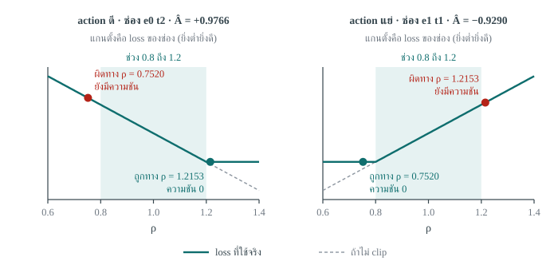
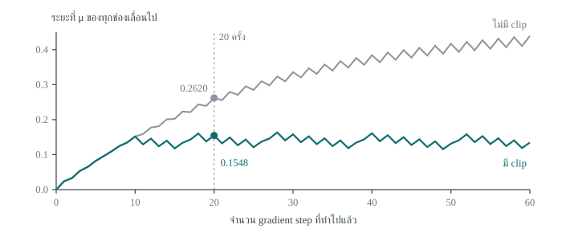

## บทที่ 23 · clipped surrogate — loss ที่ผลักแรงพอ แต่หยุดเมื่อไปไกลพอ

> [!INTRO]
> ชิ้นส่วนสามชิ้นวางอยู่บนโต๊ะแล้ว บทที่ 19 ให้ทิศ คือสมการ (23) บทที่ 22 ให้ตัวเลข $\hat A_t$ ที่บอกว่า action ของแต่ละช่องดีหรือแย่กว่าค่าเฉลี่ยของตาราง และบทที่ 18 ให้ $\rho_t$ ที่ทำให้ตารางใบเดิมใช้ซ้ำได้ สิ่งที่ยังไม่มีคือ loss ตามความหมายของบทที่ 14 คือตัวเลขตัวเดียวที่ `loss.backward()` เดินย้อนได้ และต้องใช้ได้กับ gradient step ทั้ง 20 ครั้งของตารางหนึ่งใบ
>
> บทนี้ประกอบ loss ตัวนั้นจากสามชิ้นข้างบน เราจะพบว่า loss ที่สร้างจาก $\rho_t$ ตรง ๆ ไม่มีอะไรห้ามไม่ให้ policy ใหม่ไปไกลจากตัวที่เก็บข้อมูล ซึ่งเป็นสิ่งที่บทที่ 18 เตือนไว้ ทางแก้ของ PPO คือการ clip ผลที่ได้คือ $L^{CLIP}$ ตามสมการ (29) และความชันของมันเทียบกับ $\mu$ ตามสมการ (G)
>
> ของที่ต้องรู้มาก่อน: loss ความชัน และสมการ (12) จากบทที่ 14 · importance sampling สมการ (20) และ $\rho_t$ สมการ (21) จากบทที่ 18 · สมการ (22) ถึง (24) และความชันของ $\rho_t$ จากบทที่ 19 · actor จากบทที่ 20 · $\hat A_t$ สมการ (28) จากบทที่ 22
>
> จบบทนี้แล้ว เราคำนวณ $L^{CLIP}$ ของช่องชุดใดก็ได้ในตารางตัวอย่าง บอกได้ว่าช่องหนึ่งยังออกแรงผลัก $\mu$ อยู่หรือหยุดแล้ว และอ่าน `ppo.py:252-260` ได้ทีละบรรทัด

### ของที่ต้องมีก่อนเริ่ม

บทนี้ใช้สี่แถวของตารางตัวอย่าง คือ $\mu$, $a$, $\log\pi_{old}(a \mid s)$ จากบทที่ 18 และ $\hat A_t$ จากบทที่ 22 ทุกช่องใช้ $\sigma = 0.5$ จึงมี $\sigma^2 = 0.25$

| | | t=0 | t=1 | t=2 | t=3 |
| --- | --- | --- | --- | --- | --- |
| **env 0** | $\mu$ | 0.20 | 0.30 | 0.10 | 0.40 |
| | $a$ | 0.40 | 0.20 | 0.50 | 0.40 |
| | $\log\pi_{old}$ | −0.3058 | −0.2458 | −0.5458 | −0.2258 |
| | $\hat A_t$ | +0.7975 | +0.6452 | +0.9766 | +0.7733 |
| **env 1** | $\mu$ | −0.10 | 0.00 | 0.20 | −0.30 |
| | $a$ | −0.40 | 0.40 | 0.30 | −0.10 |
| | $\log\pi_{old}$ | −0.4058 | −0.5458 | −0.2458 | −0.3058 |
| | $\hat A_t$ | −0.9874 | −0.9290 | −1.5718 | +0.2956 |

**ชุดของช่อง** บทที่ 18 บอกไว้ว่า gradient step หนึ่งครั้งไม่ได้ใช้ทั้งตาราง มันใช้ช่องเพียงชุดหนึ่ง ซึ่งของ Tron1 คือหนึ่งในสี่ของตาราง (`limx_rsl_rl_ppo_cfg.py:99`) โค้ดสับลำดับช่องทั้งตารางก่อน แล้วจึงตัดเป็นชุด (`rollout_storage.py:230`) ช่องในชุดเดียวกันจึงมาจากหลาย env และหลาย step ปนกัน ตารางตัวอย่างแบ่ง 8 ช่องเป็นสองชุด ชุดละ 4 ช่อง

| ชุด | ช่อง |
| --- | --- |
| ชุดที่ 1 | e0 t0 · e0 t2 · e1 t1 · e1 t3 |
| ชุดที่ 2 | e0 t1 · e0 t3 · e1 t0 · e1 t2 |

ในบทนี้คำว่า*ชุด*หมายถึงสิ่งนี้เท่านั้น บทที่ 27 ให้ชื่อทางการของมัน และอธิบายว่าทำไมจึงแบ่ง

สัญลักษณ์และคำที่ใช้ในบทนี้ เรียงตามลำดับที่จะพบ

| สัญลักษณ์ | ชนิด | ความหมาย |
| --- | --- | --- |
| $\rho_t$ **probability ratio** | scalar ต่อช่อง | policy ใหม่ชอบ action เก่านี้มากขึ้นกี่เท่า |
| $\hat A_t$ **advantage ที่ normalize แล้ว** | scalar ต่อช่อง | $A_t$ ลบค่าเฉลี่ย หารด้วยส่วนเบี่ยงเบนมาตรฐานของทั้งตาราง |
| **surrogate** | แนวคิด | ฟังก์ชันตัวแทนของเป้าหมายจริงที่คำนวณไม่ได้จากข้อมูลเก่า ความชันตรงกับของจริงเฉพาะแถว ๆ $\theta_{old}$ |
| $\text{clip}(x,\ x_{min},\ x_{max})$ | ฟังก์ชัน | หนีบ $x$ ให้อยู่ในช่วง $[x_{min},\ x_{max}]$ |
| $\epsilon$ **ขอบ clip** | ค่าคงที่ | ครึ่งความกว้างของช่วง $[1-\epsilon,\ 1+\epsilon]$ ที่ใช้หนีบ $\rho$ ใน loss · 0.2 ทั้งในตารางตัวอย่างและใน Tron1 |
| $L_i$ | scalar ต่อช่อง | พจน์ของช่องเดียวใน $L^{CLIP}$ ก่อน `.mean()` · $i$ ตรงนี้นับช่อง คนละตัวกับ $i$ ที่นับข้อต่อ |
| $L^{CLIP}$ **surrogate loss** | scalar | $-\hat A\rho$ กับ $-\hat A\,\text{clip}(\rho)$ เอาตัวที่ใหญ่กว่า แล้วเฉลี่ยทั้งชุด |
| $\partial L_i / \partial\mu$ | scalar ต่อมิติ | ทิศที่ $\mu$ ต้องขยับ คือเข้าหา $a$ ที่ $\hat A > 0$ และหนีจาก $a$ ที่ $\hat A < 0$ |

$\theta_{old}$ คือค่าของลูกบิดของ policy ตอนที่เก็บข้อมูล ซึ่งให้ระฆังเก่าของบทที่ 18 ส่วน $\theta$ ที่ไม่มีตัวห้อยคือค่าปัจจุบัน ซึ่งให้ระฆังใหม่

> [!NOTE]
> ตัวเลขในบทนี้คำนวณด้วยค่าเต็มแล้วปัดตอนท้าย ตามข้อตกลงของบทที่ 22 ถ้านำตัวเลขที่ปัดแล้วมาคิดต่อ ทศนิยมตำแหน่งที่สี่อาจต่างไป 1

### ปัญหา: loss ตัวแรกที่นึกออกใช้ได้ครั้งเดียว

บทที่ 19 จบด้วย loss ตัวหนึ่งที่มีความชันตรงกับสมการ (23) คือ $-\delta_t \log\pi_\theta(a_t \mid s_t)$ ตอนนั้นเราใช้ $\delta_t$ เพราะยังไม่มีตัวเลขที่ดีกว่า ตอนนี้มี $\hat A_t$ แล้ว วิธีง่ายที่สุดจึงเป็นการเปลี่ยนตัวคูณ แล้วเฉลี่ยทั้งชุด

$$\text{mean}\Big[-\hat A_t\,\log\pi_\theta(a_t \mid s_t)\Big]$$

ที่ช่อง e0 t0 ความชันของพจน์นี้เทียบกับ $\mu$ คือ $-\hat A$ คูณสมการ (24) ได้ $-0.7975 \times 0.80 = -0.6380$ ความชันเป็นลบ สมการ (12) จึงเพิ่ม $\mu$ เข้าหา $a = 0.40$ ซึ่งถูกทิศ เพราะ action นี้ดีกว่าค่าเฉลี่ย

loss ตัวนี้ถูกต้องที่ gradient step ครั้งแรกของ iteration และผิดตั้งแต่ครั้งที่สอง เหตุผลอยู่ในสมการ (23) เอง ค่าคาดหวังของมันเฉลี่ยเหนือ action ที่ policy *ตัวปัจจุบัน*สุ่ม หลัง gradient step ครั้งแรก policy ปัจจุบันคือระฆังใหม่ ส่วนช่องในตารางยังเป็นตัวอย่างของระฆังเก่า บทที่ 18 ให้เครื่องมือแก้ไว้แล้ว คือถ่วงแต่ละช่องด้วย $\rho_t$

| สมการ | หมายเหตุ |
| --- | --- |
| $\mathbb{E}_{a \sim \pi_{new}}\big[\nabla_\theta \log\pi_{new}(a \mid s)\ \hat A\big]$ | รูปของสมการ (23) เมื่อ action สุ่มจากระฆังใหม่ โดยใช้ตัวเลข $\hat A$ ที่มีอยู่ในตาราง |
| $= \mathbb{E}_{a \sim \pi_{old}}\big[\rho\ \nabla_\theta \log\pi_{new}(a \mid s)\ \hat A\big]$ | สมการ (20) เพราะช่องในตารางเป็นตัวอย่างของระฆังเก่า |
| $= \mathbb{E}_{a \sim \pi_{old}}\big[\nabla_\theta\,\rho\ \ \hat A\big]$ | บทที่ 19: ความชันของ $\rho$ คือ $\rho$ คูณ score function |
| $= \nabla_\theta\ \mathbb{E}_{a \sim \pi_{old}}\big[\rho\,\hat A\big]$ | $\hat A$ และระฆังเก่าเป็นค่าคงที่จากตาราง ไม่ขึ้นกับ $\theta$ |

บรรทัดสุดท้ายบอกว่า ทิศที่ต้องการคือความชันของค่าเฉลี่ยของ $\rho_t \hat A_t$ เราอยากให้ค่าเฉลี่ยนี้*สูงขึ้น* ตามข้อตกลงของบทที่ 14 จึงใส่เครื่องหมายลบแล้วลดแทน loss ตัวที่สองคือ

$$\text{mean}\Big[-\rho_t\,\hat A_t\Big]$$

ความชันของพจน์ของช่องหนึ่งเทียบกับ $\mu$ หาได้จากความชันของ $\rho_t$ ที่บทที่ 19 หาไว้ คือ $-\hat A_t\,\rho_t\,(a_t - \mu)/\sigma^2$ โดย $\mu$ คือจุดกลางของระฆังใหม่ ตารางข้างล่างเทียบ loss สองตัวที่ช่อง e0 t0

| ระฆังใหม่อยู่ที่ | $\rho$ | ความชันของ $-\hat A \log\pi$ | ความชันของ $-\rho\hat A$ |
| --- | --- | --- | --- |
| $\mu = 0.20$ ยังไม่ขยับ | 1.0000 | −0.6380 | −0.6380 |
| $\mu = 0.25$ | 1.0356 | −0.4785 | −0.4955 |

เมื่อระฆังยังไม่ขยับ $\rho = 1$ และ loss สองตัวให้ความชันเท่ากัน คือสมการ (23) พอดี เมื่อระฆังขยับไปแล้ว ตัวที่สองมีตัวคูณ $\rho$ ซึ่งเป็นน้ำหนักของ importance sampling ส่วนตัวแรกไม่มี

### surrogate: ตัวแทนของ $J$

ค่าเฉลี่ยของ $\rho_t \hat A_t$ มีชื่อเรียกว่า **surrogate** แปลว่าตัวแทน มันเป็นตัวแทนของ $J$ ซึ่งเป็นเป้าหมายจริงตามบทที่ 8 และ 19

| | $J(\theta)$ | surrogate |
| --- | --- | --- |
| ชนิด | ฟังก์ชัน ซึ่งรับ $\theta$ แล้วคืนจำนวนจริง | ฟังก์ชัน ซึ่งรับ $\theta$ แล้วคืนจำนวนจริง |
| คือ | ผลตอบแทนคาดหวังทั้ง episode | ค่าเฉลี่ยของ $\rho_t \hat A_t$ เหนือช่องในตาราง |
| คำนวณจากตารางใบเดิมได้หรือไม่ | ไม่ได้ ต้องให้ policy ตัวใหม่ไปเก็บข้อมูลเอง | ได้ ใช้ $a_t$, $\log\pi_{old}$ และ $\hat A_t$ ที่เก็บไว้ |
| ความชัน ณ $\theta_{old}$ | สมการ (23) | เท่ากับสมการ (23) ที่ประมาณจากตาราง |
| ความชันเมื่อห่างจาก $\theta_{old}$ | ทิศที่ทำให้ $J$ เพิ่มจริง | เริ่มไม่ตรงกับของจริง |

คำว่า objective ก็ใช้กับทั้งสองตัว $J$ คือ objective จริง ส่วน surrogate คือ objective ตัวแทน และตัวที่ PPO ไต่จริงในแต่ละ gradient step คือ surrogate ที่ผ่านการ clip แล้ว ซึ่งบทนี้สร้างในหัวข้อถัดไป ทั้งสองความหมายคือตัวเลขที่อยากให้สูงขึ้น ซึ่งตรงข้ามกับ loss

แถวสุดท้ายของตารางคือข้อจำกัดของการเป็นตัวแทน และมีที่มาสองทาง

- $\hat A_t$ วัดว่า action ดีแค่ไหนเมื่อ step ที่เหลือเดินด้วย policy *เก่า* เพราะแถว $r$ และ $V$ ที่ใช้คำนวณมันมาจากการเก็บข้อมูลของ policy เก่า
- สถานะในตารางเป็นชุดที่ policy เก่าพาไปพบ ซึ่งเป็นข้อจำกัดข้อที่สามของบทที่ 18 การถ่วงด้วย $\rho_t$ แก้ได้เฉพาะ action ที่เลือกจากสถานะเหล่านั้น

ที่ $\theta_{old}$ ทั้งสองข้อไม่เป็นปัญหา เพราะ policy ใหม่กับ policy เก่าเป็นตัวเดียวกัน ยิ่งห่างออกไป surrogate ยิ่งบอกเรื่องของ $J$ ได้น้อยลง

### surrogate ไม่มีอะไรห้ามไม่ให้ไปไกล

ปัญหาคือ loss ที่สร้างจาก surrogate ไม่รู้ข้อจำกัดของตัวเอง ดูพจน์ของช่องเดียว คือ $-\rho\,\hat A$ แล้วถามว่ามันต่ำลงได้อีกเท่าไรเมื่อเลื่อนระฆัง

**ช่อง e1 t1 ซึ่งเป็น action แย่** ($\hat A = -0.9290$) พจน์ของมันคือ $0.9290\,\rho$ การลดพจน์นี้คือการลด $\rho$ ซึ่งทำได้โดยเลื่อน $\mu$ หนีจาก $a = 0.40$

| $\mu$ ใหม่ | $\rho$ | $-\rho\hat A$ |
| --- | --- | --- |
| 0.00 ยังไม่ขยับ | 1.0000 | +0.9290 |
| −0.15 | 0.7520 | +0.6987 |
| −0.40 | 0.3829 | +0.3557 |
| −1.00 | 0.0273 | +0.0254 |

**ช่อง e0 t2 ซึ่งเป็น action ดี** ($\hat A = +0.9766$) พจน์ของมันคือ $-0.9766\,\rho$ การลดพจน์นี้คือการเพิ่ม $\rho$ ซึ่งทำได้โดยเลื่อน $\mu$ เข้าหา $a = 0.50$ และเมื่อ $\mu$ ทับ $a$ แล้ว ก็ทำต่อได้โดยบีบ $\sigma$ ให้ระฆังสูงขึ้นที่จุดนั้น

| $\mu$ ใหม่ | $\sigma$ ใหม่ | $\rho$ | $-\rho\hat A$ |
| --- | --- | --- | --- |
| 0.10 ยังไม่ขยับ | 0.5 | 1.0000 | −0.9766 |
| 0.25 | 0.5 | 1.2153 | −1.1869 |
| 0.50 ทับ $a$ | 0.5 | 1.3771 | −1.3449 |
| 0.50 | 0.25 | 2.7543 | −2.6898 |
| 0.50 | 0.1 | 6.8856 | −6.7244 |

ทั้งสองตาราง loss ลดลงทุกแถว gradient descent จึงเดินตามไปเรื่อย ๆ ถ้าไม่มีอะไรหยุด แต่ตารางตัวอย่างไม่ได้บอกอะไรเลยว่าหุ่นจะเป็นอย่างไรเมื่อ $\mu$ ของช่อง e1 t1 อยู่ที่ −1.00 หรือเมื่อระฆังของช่อง e0 t2 แคบเหลือ $\sigma = 0.1$ ข้อมูลมีเพียงผลของ action ตัวเดียวต่อช่อง ซึ่งเก็บมาใกล้ ๆ ระฆังเก่า loss ที่ลดลงในแถวล่าง ๆ จึงเป็นคำสัญญาของตัวแทน ไม่ใช่ของ $J$

บทที่ 14 พบอาการเดียวกันกับ loss ตัวอย่างของบทนั้น ซึ่งลดได้ไม่สิ้นสุดเมื่อระฆังหุบ และบทที่ 18 เตือนว่าเมื่อ $\rho_t$ ของบางช่องโตกว่าช่องอื่นหลายเท่า ค่าเฉลี่ยของตารางบอกเรื่องของช่องนั้นช่องเดียว เราต้องการ loss ที่ผลักเต็มแรงเมื่อระฆังใหม่ยังอยู่ใกล้ และหยุดผลักเมื่อไปไกลพอ

### clip: หนีบค่าให้อยู่ในช่วง

เครื่องมือที่ใช้คือฟังก์ชันง่าย ๆ ตัวหนึ่ง

**clip** คือฟังก์ชันที่รับตัวเลข $x$ กับขอบสองค่า แล้วคืน $x$ ที่ถูกหนีบให้อยู่ระหว่างขอบ

| ถ้า $x$ | $\text{clip}(x,\ x_{min},\ x_{max})$ คืน |
| --- | --- |
| ต่ำกว่า $x_{min}$ | $x_{min}$ |
| อยู่ระหว่าง $x_{min}$ กับ $x_{max}$ | $x$ ตัวเดิม |
| สูงกว่า $x_{max}$ | $x_{max}$ |

PPO หนีบ $\rho_t$ ด้วยช่วง $[1 - \epsilon,\ 1 + \epsilon]$ โดย $\epsilon$ อ่านว่าเอปไซลอน และ config ตั้งไว้ที่ 0.2 (`clip_param` `limx_rsl_rl_ppo_cfg.py:96`) ช่วงจึงเป็น 0.8 ถึง 1.2

| $\rho$ | $\text{clip}(\rho,\ 0.8,\ 1.2)$ | |
| --- | --- | --- |
| 1.0356 | 1.0356 | อยู่ในช่วง ไม่เปลี่ยน |
| 1.2153 | 1.2 | เกินขอบบน |
| 0.7520 | 0.8 | ต่ำกว่าขอบล่าง |

สิ่งสำคัญคือสองแถวล่าง ค่าที่คืนเป็น*ค่าคงที่* ไม่ว่า $\rho$ จะเลยขอบไปเท่าไร ผลลัพธ์ก็เป็น 1.2 หรือ 0.8 เท่าเดิม ค่าคงที่ไม่ขึ้นกับลูกบิดตัวใด ความชันของมันจึงเป็นศูนย์ และบทที่ 14 แสดงไว้แล้วว่าความชันศูนย์ทำให้ลูกบิดไม่ขยับ

> [!WARNING] $\epsilon$ ไม่ใช่ $\varepsilon$
> $\epsilon$ ของบทนี้คือขอบ clip เป็นค่าคงที่ 0.2 จาก config ส่วน $\varepsilon$ ของบทที่ 12 คือ noise ที่สุ่มใหม่ทุก step สองตัวนี้ไม่เกี่ยวกัน

### สมการ (29): สองพจน์ต่อช่อง แล้วเลือกตัวที่แย่กว่า

ถ้าเราแทน $\rho_t$ ด้วย $\text{clip}(\rho_t)$ ไปเลย ช่องที่ $\rho_t$ ออกนอกช่วงจะหยุดผลักทุกกรณี รวมถึงกรณีที่ policy กำลังเดินผิดทางและควรถูกดึงกลับ PPO จึงไม่แทน มันคำนวณทั้งสองแบบ แล้วเลือกตัวที่ให้ loss สูงกว่า

> [!KEY] clipped surrogate loss
> $$L^{CLIP} = \text{mean}\Big[\max\big(-\rho_t\,\hat A_t,\ \ -\text{clip}(\rho_t,\ 1-\epsilon,\ 1+\epsilon)\,\hat A_t\big)\Big] \tag{29}$$
>
> | | |
> | --- | --- |
> | $-\rho_t\,\hat A_t$ | พจน์ดิบ คือ surrogate ที่กลับเครื่องหมาย |
> | $-\text{clip}(\rho_t)\,\hat A_t$ | พจน์ที่ $\rho_t$ ถูกหนีบ |
> | $\max$ | เลือกตัวที่ใหญ่กว่าของสองพจน์ ทีละช่อง |
> | mean | เฉลี่ยทุกช่องในชุดที่ gradient step ครั้งนั้นใช้ |

สมการนี้อ่านได้ว่า

<div class="wordeq"><span>loss ของช่อง</span> = ตัวที่แย่กว่าระหว่าง <span>ผลักเต็มแรง</span> กับ <span>ผลักเหมือน $\rho$ หยุดอยู่ที่ขอบ</span></div>

loss ยิ่งสูงยิ่งแย่ การเลือกตัวที่สูงกว่าจึงเป็นการมองในแง่ร้าย ถ้าการไปไกลกว่าขอบทำให้ loss ดูดีขึ้น เราไม่เชื่อ และคิด loss เท่ากับที่ขอบ ถ้าการไปไกลกว่าขอบทำให้ loss แย่ลง เราเชื่อ และคิดเต็มจำนวน หัวข้อถัดไปแสดงสองกรณีนี้เป็นตัวเลข

เราเขียนพจน์ของช่องเดียวก่อนเฉลี่ยว่า $L_i$

> [!EXAMPLE] จงหา $L^{CLIP}$ ของชุดที่ 1 เมื่อ $\mu$ ของทุกช่องเพิ่มขึ้น 0.05
> ค่า $\rho_t$ ของข้อสมมตินี้คำนวณไว้แล้วในบทที่ 18 ทั้งสี่ช่องอยู่ในช่วง 0.8 ถึง 1.2 การหนีบจึงไม่เปลี่ยนค่า และสองพจน์เท่ากัน
>
> | ช่อง | $\rho_t$ | $\text{clip}(\rho_t)$ | $\hat A_t$ | $-\rho_t\hat A_t$ | $-\text{clip}(\rho_t)\hat A_t$ | $L_i$ |
> | --- | --- | --- | --- | --- | --- | --- |
> | e0 t0 | 1.0356 | 1.0356 | +0.7975 | −0.8259 | −0.8259 | −0.8259 |
> | e0 t2 | 1.0779 | 1.0779 | +0.9766 | −1.0526 | −1.0526 | −1.0526 |
> | e1 t1 | 1.0779 | 1.0779 | −0.9290 | +1.0014 | +1.0014 | +1.0014 |
> | e1 t3 | 1.0356 | 1.0356 | +0.2956 | −0.3062 | −0.3062 | −0.3062 |
>
> $$L^{CLIP} = \frac{-0.8259 - 1.0526 + 1.0014 - 0.3062}{4} = \frac{-1.1833}{4} = -0.2958$$

ช่อง e1 t1 เป็นช่องเดียวที่ให้ $L_i$ เป็นบวก action ของมันแย่กว่าค่าเฉลี่ย แต่การเลื่อน $\mu$ ขึ้น 0.05 ทำให้ระฆังใหม่ชอบ action ตัวนี้มากขึ้น ($\rho > 1$) loss ของช่องนี้จึงสูงขึ้นจาก +0.9290 เป็น +1.0014 ความชันของมันจะดึง $\mu$ กลับ

> [!NOTE]
> ค่าของ $L^{CLIP}$ ไม่ได้บอกว่า policy ดีแค่ไหน เมื่อระฆังยังไม่ขยับ ทุกช่องมี $\rho_t = 1$ และพจน์ของช่องเป็น $-\hat A_t$ ถ้า gradient step ครั้งแรกของ iteration ใช้ชุดที่ 1 จะได้ $L^{CLIP} = -0.2852$ ถ้าใช้ชุดที่ 2 จะได้ +0.2852 ตัวเลขสองตัวนี้ต่างกันเพียงเพราะช่องที่ดีตกไปอยู่ชุดที่ 1 มากกว่า ถ้าเฉลี่ยทั้ง 8 ช่องจะได้ศูนย์พอดี เพราะสมการ (28) ลบค่าเฉลี่ยของตารางออกแล้ว สิ่งที่เราใช้จาก $L^{CLIP}$ คือความชันของมัน

> [!NOTE]
> เปเปอร์ของ PPO (Schulman et al. 2017 สมการ (7)) เขียนสิ่งเดียวกันในรูปที่ต้องทำให้*สูงสุด* คือค่าเฉลี่ยของ $\min\big(\rho_t\hat A_t,\ \text{clip}(\rho_t)\hat A_t\big)$ โค้ดคูณทั้งสองพจน์ด้วยลบหนึ่งเพื่อให้เป็น loss ที่ต้องลด ตัวที่เล็กที่สุดของสองจำนวนจึงกลายเป็นตัวที่ใหญ่ที่สุดของค่าลบของมัน และ $\min$ กลายเป็น $\max$ ที่ช่อง e1 t1 ของตัวอย่าง รูปของเปเปอร์ให้ $\min(-1.0014,\ -1.0014) = -1.0014$ ซึ่งคือ $-L_i$

### clip ทำงานเมื่อไร: คู่แฝดสี่กรณี

ในตัวอย่างข้างบน clip ไม่มีผลเลย เพราะ $\mu$ ขยับเพียง 0.05 ตารางตัวอย่างมีช่องคู่หนึ่งที่ออกแบบไว้สำหรับดูกรณีที่มันมีผล คือ e0 t2 กับ e1 t1 สองช่องนี้มี $a - \mu = 0.40$ เท่ากัน จึงมี $\log\pi_{old} = -0.5458$ เท่ากัน และเมื่อ $\mu$ ขยับเท่ากัน ก็ได้ $\rho$ เท่ากัน สิ่งเดียวที่ต่างคือเครื่องหมายของ $\hat A_t$ เราเรียกสองช่องนี้ว่า*คู่แฝด*

สมมติว่า gradient step หลายครั้งที่ผ่านมาเลื่อน $\mu$ ของแต่ละช่องไปแล้ว 0.15 เราลองทั้งสองทิศ ทิศ*ถูกทาง*คือทิศที่ตารางสี่กรณีของบทที่ 19 บอก คือเข้าหา $a$ เมื่อ action ดี และหนีจาก $a$ เมื่อ action แย่ ทิศ*ผิดทาง*คือทิศตรงข้าม

| ช่อง | $\hat A_t$ | $\mu$ ขยับ | $\rho$ | $-\rho\hat A$ | $-\text{clip}(\rho)\hat A$ | $L_i$ คือตัวที่ใหญ่กว่า | ความชันเทียบกับ $\mu$ |
| --- | --- | --- | --- | --- | --- | --- | --- |
| e0 t2 | +0.9766 | ถูกทาง +0.15 | 1.2153 | −1.1869 | **−1.1719** | พจน์ที่ถูกหนีบ | 0 |
| e1 t1 | −0.9290 | ถูกทาง −0.15 | 0.7520 | +0.6987 | **+0.7432** | พจน์ที่ถูกหนีบ | 0 |
| e0 t2 | +0.9766 | ผิดทาง −0.15 | 0.7520 | **−0.7344** | −0.7813 | พจน์ดิบ | −1.6157 |
| e1 t1 | −0.9290 | ผิดทาง +0.15 | 1.2153 | **+1.1291** | +1.1149 | พจน์ดิบ | +1.1291 |

ทั้งสี่แถว $\rho$ อยู่นอกช่วง 0.8 ถึง 1.2 แต่ผลต่างกัน

**สองแถวบน** ระฆังเดินถูกทางและเลยขอบไปแล้ว พจน์ดิบให้ loss ต่ำกว่าพจน์ที่ถูกหนีบ $\max$ จึงเลือกพจน์ที่ถูกหนีบ ซึ่งเป็นค่าคงที่ ความชันเป็นศูนย์ ช่องนี้หยุดออกแรง ถ้าเขียนเป็นคำพูด ช่องนี้บอกว่า ขยับมาทางนี้พอแล้วสำหรับข้อมูลชุดนี้

**สองแถวล่าง** ระฆังเดินผิดทาง ค่า $\rho$ เป็นสองค่าเดิมของสองแถวบน เพียงสลับช่องกัน แต่ครั้งนี้พจน์ดิบให้ loss สูงกว่า $\max$ จึงเลือกพจน์ดิบ ความชันไหลเต็ม และเครื่องหมายของมันดึง $\mu$ กลับ ความชัน −1.6157 ของ e0 t2 ทำให้สมการ (12) เพิ่ม $\mu$ กลับเข้าหา $a$ ส่วน +1.1291 ของ e1 t1 ทำให้ $\mu$ ลดลงหนีจาก $a$



รูปที่เห็นอธิบายว่าทำไม $\max$ จึงให้ผลแบบนี้ สำหรับ action ดี พจน์ดิบเป็นเส้นที่ลาดลงเมื่อ $\rho$ เพิ่ม พจน์ที่ถูกหนีบเป็นเส้นเดียวกันภายในช่วง และราบเมื่ออยู่นอกช่วง ทางขวาของ 1.2 เส้นราบอยู่สูงกว่า จึงถูกเลือก ทางซ้ายของ 0.8 เส้นราบอยู่ต่ำกว่า จึงไม่ถูกเลือก สำหรับ action แย่ ทุกอย่างกลับด้าน

| $\hat A_t$ | $\rho_t > 1 + \epsilon$ ชอบ action นี้มากขึ้น | $\rho_t < 1 - \epsilon$ ชอบ action นี้น้อยลง |
| --- | --- | --- |
| บวก action ดี | เลือกพจน์ที่ถูกหนีบ ความชัน 0 | เลือกพจน์ดิบ ความชันดึงกลับเข้าหา $a$ |
| ลบ action แย่ | เลือกพจน์ดิบ ความชันผลักออกจาก $a$ | เลือกพจน์ที่ถูกหนีบ ความชัน 0 |

clip จึงปิดความชันเฉพาะของช่องที่ระฆังเดินถูกทางและไปไกลพอแล้ว มันไม่หยุดช่องที่ $\rho_t$ เดินไปทางที่ทำให้ loss ของช่องนั้นแย่ลง

### สมการ (G): แรงที่แต่ละช่องออก

เราหาความชันของ $L_i$ เทียบกับ $\mu$ ได้ครบทั้งสองกรณีแล้ว

| สมการ | หมายเหตุ |
| --- | --- |
| $\dfrac{\partial \rho_t}{\partial\mu} = \rho_t\,\dfrac{a_t - \mu}{\sigma^2}$ | บทที่ 19 จากสมการ (22) และ (24) |
| $\dfrac{\partial}{\partial\mu}\big(-\rho_t\,\hat A_t\big) = -\hat A_t\,\rho_t\,\dfrac{a_t - \mu}{\sigma^2}$ | $\hat A_t$ เป็นค่าคงที่จากตาราง |
| $\dfrac{\partial}{\partial\mu}\big(-\text{clip}(\rho_t)\,\hat A_t\big) = 0$ เมื่อ $\rho_t$ อยู่นอกช่วง | ค่าที่ถูกหนีบเป็นค่าคงที่ |

> [!KEY] ความชันของ loss เทียบกับ $\mu$
> $$\frac{\partial L_i}{\partial\mu} = -\hat A_t\ \rho_t\ \frac{a_t - \mu}{\sigma^2} \tag{G}$$
>
> | | |
> | --- | --- |
> | $\mu$ | จุดกลางของระฆังใหม่ |
> | ใช้เมื่อ | $\max$ เลือกพจน์ดิบ ซึ่งรวมกรณีที่ $\rho_t$ อยู่ในช่วง |
> | เมื่อ $\max$ เลือกพจน์ที่ถูกหนีบ | ความชันเป็น 0 |

สมการนี้คือสมการ (24) ที่มีตัวคูณเพิ่มสองตัว คือ $\rho_t$ จาก importance sampling และ $-\hat A_t$ จากการที่ loss เป็นค่าลบของ surrogate เครื่องหมายของมันให้ตารางสี่กรณีของบทที่ 19 กลับมา ครั้งนี้ด้วยตัวเลข advantage ตัวจริง

| $\hat A_t$ | $a_t$ อยู่ข้างใดของ $\mu$ | $\partial L_i/\partial\mu$ | สมการ (12) เลื่อน $\mu$ ไปทาง |
| --- | --- | --- | --- |
| บวก | ขวา | ลบ | ขวา เข้าหา $a_t$ |
| บวก | ซ้าย | บวก | ซ้าย เข้าหา $a_t$ |
| ลบ | ขวา | บวก | ซ้าย หนีจาก $a_t$ |
| ลบ | ซ้าย | ลบ | ขวา หนีจาก $a_t$ |

> [!EXAMPLE] จงหาสมการ (G) ของชุดที่ 1 เมื่อ $\mu$ ของทุกช่องเพิ่มขึ้น 0.05
> ทุกช่องมี $\rho_t$ อยู่ในช่วง จึงใช้สมการ (G) ได้ทั้งสี่ช่อง ตัวหารคือ $\sigma^2 = 0.25$
>
> | ช่อง | $\hat A_t$ | $\rho_t$ | $a_t - \mu$ | $\partial L_i/\partial\mu$ | แรงนี้ผลัก $\mu$ |
> | --- | --- | --- | --- | --- | --- |
> | e0 t0 | +0.7975 | 1.0356 | +0.15 | −0.4955 | ขึ้น เข้าหา 0.40 |
> | e0 t2 | +0.9766 | 1.0779 | +0.35 | −1.4737 | ขึ้น เข้าหา 0.50 |
> | e1 t1 | −0.9290 | 1.0779 | +0.35 | +1.4020 | ลง หนีจาก 0.40 |
> | e1 t3 | +0.2956 | 1.0356 | +0.15 | −0.1837 | ขึ้น เข้าหา −0.10 |
>
> แถวแรกคือ $-0.7975 \times 1.0356 \times 0.15 / 0.25 = -0.4955$

ถ้าช่อง e0 t0 มีลูกบิดเป็นของตัวเอง สมการ (12) ด้วย $\alpha = 0.1$ จะเลื่อน $\mu$ ของมันจาก 0.25 เป็น $0.25 + 0.1 \times 0.4955 = 0.2996$ ในโครงข่ายจริงไม่มีช่องใดมีลูกบิดของตัวเอง หัวข้อถัดไปดูกรณีนั้น

> [!NOTE]
> บทที่ 19 ใช้ $\delta_t$ แทน advantage และเตือนว่าตัวจริงอาจมีเครื่องหมายต่างไป ในตารางตัวอย่าง เครื่องหมายต่างกันสามช่อง คือ e0 t1, e0 t3 และ e1 t3 ช่อง e0 t1 มี $\delta_t = -0.40$ แต่ $\hat A_t = +0.6452$ ทิศที่บทที่ 19 คำนวณให้ช่องนี้จึงกลับด้านเมื่อใช้ตัวเลขจริง

### ลูกบิดตัวเดียว ฟังทุกช่องในชุด

$\mu$ ไม่ใช่ลูกบิด ลูกบิดคือ weight และ bias ของ actor และลูกบิดหนึ่งตัวมีผลต่อ $\mu$ ของทุกช่องพร้อมกัน เราใช้ลูกบิดตัวเดียวกับบทที่ 14 คือ bias $b$ ของ node สุดท้าย ถ้า $b$ เพิ่มขึ้นเท่าไร $\mu$ ของทุกช่องก็เพิ่มขึ้นเท่านั้น ความชันของ $L^{CLIP}$ เทียบกับ $b$ จึงเป็นค่าเฉลี่ยของสมการ (G) ของทุกช่องในชุด

ที่ gradient step ครั้งแรก ทุกช่องมี $\rho_t = 1$ สมการ (G) ของชุดที่ 1 คือ −0.6380, −1.5625, +1.4865 และ −0.2365 ค่าเฉลี่ยคือ −0.2376 สมการ (12) ด้วย $\alpha = 0.1$ จึงเพิ่ม $b$ ขึ้น 0.0238 และ $\mu$ ของทุกช่องเลื่อนขึ้นเท่านั้น คู่แฝดออกแรงเกือบเท่ากันในทิศตรงข้าม ผลที่เหลือส่วนใหญ่จึงมาจาก e0 t0 และ e1 t3

ทีนี้ลองทำต่อไปเรื่อย ๆ โดยใช้ชุดที่ 1 กับชุดที่ 2 สลับกัน และเทียบ loss สองแบบ คือ surrogate ที่ไม่มี clip กับสมการ (29)



| หลัง gradient step | ไม่มี clip: $\mu$ เลื่อนไป | $\rho$ ต่ำสุดและสูงสุดใน 8 ช่อง | มี clip: $\mu$ เลื่อนไป | $\rho$ ต่ำสุดและสูงสุดใน 8 ช่อง |
| --- | --- | --- | --- | --- |
| 1 ครั้ง | 0.0238 | 0.9708 · 1.0376 | 0.0238 | 0.9708 · 1.0376 |
| 10 ครั้ง | 0.1517 | 0.7960 · 1.2174 | 0.1517 | 0.7960 · 1.2174 |
| 20 ครั้ง | 0.2620 | 0.6365 · 1.3257 | 0.1548 | 0.7917 · 1.2211 |
| 100 ครั้ง | 0.4794 | 0.3552 · 1.3599 | 0.1474 | 0.8022 · 1.2121 |

สิบครั้งแรกเหมือนกันทุกตัวเลข เพราะยังไม่มีช่องใดออกนอกช่วง หลังครั้งที่ 10 มีสามช่องที่ออกนอกช่วง คือคู่แฝดซึ่งมี $\rho = 1.2174$ และช่อง e1 t0 ซึ่งมี $\rho = 0.7960$ ครั้งที่ 11 ใช้ชุดที่ 1 ซึ่งมีคู่แฝดอยู่ทั้งสองช่อง

| ช่องของชุดที่ 1 | ความชันเทียบกับ $\mu$ ในครั้งที่ 11 | |
| --- | --- | --- |
| e0 t0 | −0.1660 | ยังดึงเข้าหา $a$ |
| e0 t2 | 0 | action ดีที่ $\rho$ เกิน 1.2 หยุดออกแรง |
| e1 t1 | +1.1232 | action แย่ที่ $\rho$ เกิน 1.2 ยังออกแรงเต็ม |
| e1 t3 | −0.0616 | ยังดึงเข้าหา $a$ |

ก่อนหน้านี้คู่แฝดออกแรงหักล้างกันเกือบหมด เมื่อ e0 t2 หยุด แรงของ e1 t1 ไม่มีอะไรมาหักล้าง ค่าเฉลี่ยของทั้งชุดจึงกลับเครื่องหมายเป็น +0.2239 และลูกบิดถูกดึงกลับจาก 0.1517 เป็น 0.1293 ถ้าไม่มี clip ครั้งที่ 11 จะพาลูกบิดเดินต่อไปเป็น 0.1589 เหตุการณ์แบบนี้เกิดซ้ำอีกหลายครั้งหลังจากนั้น ตั้งแต่ครั้งที่ 20 ถึง 100 ระยะที่เลื่อนไปจึงแกว่งอยู่ระหว่าง 0.1157 กับ 0.1635 เมื่อไม่มี clip ลูกบิดเดินต่อไปถึง 0.4794 ซึ่งไกลกว่าสามเท่า และมีช่องที่ $\rho$ เหลือ 0.3552

ตัวอย่างนี้เป็นข้อสมมติของเล่มนี้ ไม่ใช่การเทรนจริง มันมีลูกบิดตัวเดียว ข้อต่อเดียว และก้าวด้วยสมการ (12) ที่ $\alpha = 0.1$ มันยังตรึง $\sigma$ ไว้ ซึ่งบทที่ 18 แสดงว่าทำให้ $\rho$ มีเพดานอยู่แล้ว ตารางตัวอย่างเองทำ gradient step เพียง 4 ครั้งต่อตาราง ส่วน 20 คือจำนวนของ Tron1 โครงข่ายจริงมีลูกบิด 187,280 ตัว มี 8 ข้อต่อ และปรับ $\sigma$ ได้ surrogate ที่ไม่มี clip จึงมีทางไปไกลกว่าที่ตัวอย่างนี้แสดงมาก

### สิ่งที่ clip ไม่ได้ทำ

clip มักถูกเล่าว่าเป็นกำแพงที่ห้าม $\rho_t$ ออกนอกช่วง 0.8 ถึง 1.2 ซึ่งไม่ตรง ตารางคู่แฝดมี $\rho = 1.2153$ และการเดินของลูกบิดข้างบนมี $\rho$ สูงสุด 1.2313 และต่ำสุด 0.7791 ทั้งที่ใช้สมการ (29) ทุกครั้ง

| clip ทำ | clip ไม่ได้ทำ |
| --- | --- |
| ทำให้ช่องที่เดินถูกทางจนเลยขอบหยุดออกแรง | ห้าม $\rho_t$ ของช่องนั้นเลยขอบ |
| ปล่อยให้ช่องที่เดินผิดทางออกแรงเต็ม | จำกัดว่าช่องที่เดินผิดทางจะไปได้ไกลแค่ไหน |
| ดู $\rho_t$ ของช่องในตาราง ทีละช่อง | บอกอะไรเกี่ยวกับสถานะที่ไม่อยู่ในตาราง |

$\rho_t$ เลยขอบได้ด้วยเหตุอย่างน้อยสองข้อ gradient step ที่เริ่มจากในช่วงพาไปตกนอกช่วงได้ เพราะความชันบอกเพียงทิศ ไม่ได้บอกว่าต้องหยุดที่ขอบ และลูกบิดทุกตัวใช้ร่วมกันทุกช่อง ช่องที่หยุดออกแรงแล้วยังถูกช่องอื่นพาไปได้

มีอีกสามเรื่องที่ควรรู้เมื่ออ่านค่า 0.2

- **ช่วงนี้เป็นของ $\rho_t$ ทั้งช่อง** บทที่ 18 แสดงว่า $\rho_t$ ของ Tron1 เป็นผลคูณของอัตราส่วนของ 8 ข้อต่อ ถ้าทุกข้อต่อขยับเท่ากัน แต่ละข้อต่อมีที่ให้ขยับเพียง $1.2^{1/8} = 1.0231$ ก่อนที่ผลคูณจะถึงขอบบน และ $0.8^{1/8} = 0.9725$ ก่อนถึงขอบล่าง คำว่าถูกทางกับผิดทางของบทนี้นิยามจากข้อต่อเดียว ใน Tron1 สิ่งที่ถูกตัดสินคือผลคูณทั้งช่อง ข้อต่อหนึ่งที่เดินผิดทางจึงได้ความชันศูนย์ได้เหมือนกัน ถ้าอีกเจ็ดข้อต่อพาผลคูณเลยขอบไปในทิศที่ได้กำไร
- **ระฆังยิ่งแคบ ขอบยิ่งถึงเร็ว** ถ้าช่อง e0 t2 มี $\sigma = 0.25$ การเลื่อน $\mu$ ไป 0.15 เท่าเดิมให้ $\rho = 2.1815$ ซึ่งเลยขอบบนไปไกล ขณะที่ $\sigma = 0.5$ ให้ 1.2153
- **บางช่องไม่มีวันถึงขอบบน** บทที่ 18 แสดงว่าเมื่อ $\sigma$ คงที่ $\rho$ ของข้อต่อเดียวสูงสุดได้ $e^{z^2/2}$ ช่อง e0 t0 มี $z = 0.40$ เพดานของมันจึงเป็น 1.0833 ซึ่งต่ำกว่า 1.2 ช่องนี้ออกแรงดึง $\mu$ เข้าหา $a$ ได้ตลอด

clip ดูเฉพาะช่องในตาราง และดูทีละช่อง โค้ดมีเครื่องวัดอีกตัวหนึ่งที่วัดว่าระฆังทั้งใบขยับไปเท่าไรโดยรวม ซึ่งบทที่ 26 อธิบาย

> [!REMARK]
> ชื่อ PPO ย่อจาก Proximal Policy Optimization คำว่า proximal แปลว่าอยู่ใกล้ ชื่อนี้บอกเจตนาของอัลกอริทึม คือปรับ policy โดยให้ตัวใหม่อยู่ใกล้ตัวที่เก็บข้อมูล clip ของบทนี้เป็นกลไกหนึ่งที่ทำเช่นนั้น เปเปอร์ต้นฉบับใช้ $\epsilon = 0.2$ เป็นค่าตัวอย่าง ซึ่งตรงกับค่าใน config ของ Tron1

### จากสมการถึงโค้ด

สมการ (21), (29) และสองพจน์ของมันอยู่ในเก้าบรรทัดติดกันของ `ppo.py`

```text
ratio = torch.exp(
    actions_log_prob_batch - torch.squeeze(old_actions_log_prob_batch)
)
# print(ratio)
surrogate = -torch.squeeze(advantages_batch) * ratio
surrogate_clipped = -torch.squeeze(advantages_batch) * torch.clamp(
    ratio, 1.0 - self.clip_param, 1.0 + self.clip_param
)
surrogate_loss = torch.max(surrogate, surrogate_clipped).mean()
```

| บรรทัด | โค้ด | สมการ |
| --- | --- | --- |
| `ppo.py:252-254` | `ratio = torch.exp(...)` | (21) |
| `:256` | `surrogate = -torch.squeeze(advantages_batch) * ratio` | พจน์ดิบ $-\rho_t\hat A_t$ |
| `:257-259` | `surrogate_clipped = -torch.squeeze(advantages_batch) * torch.clamp(ratio, ...)` | พจน์ที่ถูกหนีบ |
| `:258` | `ratio, 1.0 - self.clip_param, 1.0 + self.clip_param` | ขอบของช่วง คือ $1-\epsilon$ กับ $1+\epsilon$ |
| `:260` | `torch.max(surrogate, surrogate_clipped).mean()` | (29) |
| `limx_rsl_rl_ppo_cfg.py:96` | `clip_param=0.2` | $\epsilon$ |
| `rollout_storage.py:205-207` | `self.advantages = (...) / (self.advantages.std() + 1e-8)` | $\hat A_t$ ถูกคำนวณก่อนเริ่มปรับ |
| `rollout_storage.py:278` | `group_advantages_batch = group_advantages[group_batch_idx]` | $\hat A_t$ ของช่องในชุด อ่านจากตาราง |
| `ppo.py:288` | `loss.backward()` | (G) และความชันของลูกบิดทุกตัว |

ชื่อฟังก์ชันใน PyTorch คือ `clamp` ซึ่งทำสิ่งเดียวกับ clip ของบทนี้ `torch.max` ที่รับ tensor สองตัวเทียบทีละช่อง ไม่ได้หาค่าสูงสุดของทั้งชุด และ `.mean()` คือ mean ในสมการ (29)

ไม่มีบรรทัดใดเขียนสมการ (G) เหมือนที่บทที่ 19 พบว่าไม่มีบรรทัดใดเขียนสมการ (23) `advantages_batch` เป็นตัวเลขที่อ่านจากตาราง ไม่มีบันทึกย้อนถึงลูกบิดตัวใด ส่วน `ratio` ขึ้นกับลูกบิดของ actor และ $\ell$ ผ่าน `actions_log_prob_batch` การเดินย้อนของ `loss.backward()` จึงให้สมการ (G) ออกมาเอง เมื่อ `torch.clamp` คืนค่าที่ขอบ PyTorch ให้ความชันผ่านมันเป็นศูนย์ ซึ่งคือแถวที่ความชันเป็น 0 ของตารางคู่แฝด

> [!NOTE]
> `torch.squeeze` ในสามบรรทัดนั้น (`ppo.py:253`, `:256`, `:257`) ไม่ได้มีไว้ประดับ ตารางเก็บ $\hat A_t$ และ $\log\pi_{old}$ เป็นคอลัมน์ที่มิติท้ายยาว 1 (`rollout_storage.py:112-114`, `:103-105`) `advantages_batch` จึงมีรูป `(N, 1)` ส่วน `ratio` มีรูป `(N,)` เพราะ $\log\pi_{new}$ ถูกบวกรวมข้อต่อไปแล้ว (`actor_critic.py:164`) โดย $N$ คือจำนวนช่องในชุด ถ้าคูณกันตรง ๆ PyTorch จะขยายทั้งสองเป็นตาราง `(N, N)` คือคูณ $\hat A$ ของทุกช่องกับ $\rho$ ของทุกช่อง ซึ่งไม่ใช่สิ่งที่สมการ (29) เขียน `squeeze` ตัดมิติที่ยาว 1 ทิ้ง ให้ทั้งสองมีรูป `(N,)` และคูณกันช่องต่อช่อง

> [!SUMMARY]
> - loss $-\hat A_t \log\pi_\theta$ ให้ทิศของสมการ (23) ได้เฉพาะ gradient step ครั้งแรก เมื่อถ่วงด้วย $\rho_t$ ตามสมการ (20) เราได้ surrogate คือค่าเฉลี่ยของ $\rho_t\hat A_t$ ซึ่งใช้กับตารางใบเดิมซ้ำได้
> - surrogate เป็นตัวแทนของ $J$ ความชันของมันตรงกับสมการ (23) ที่ $\theta_{old}$ และเชื่อได้น้อยลงเมื่อห่างออกไป แต่ตัวมันเองลดได้เรื่อย ๆ เมื่อระฆังไปไกล
> - สมการ (29) คำนวณสองพจน์ต่อช่อง คือพจน์ดิบกับพจน์ที่ $\rho_t$ ถูกหนีบไว้ในช่วง $1 \pm \epsilon$ แล้วเลือกตัวที่ใหญ่กว่า
> - ช่องที่ระฆังเดินถูกทางจนเลยขอบได้ความชันศูนย์ ช่องที่ระฆังเดินผิดทางยังได้ความชันเต็ม
> - สมการ (G) คือแรงที่ช่องหนึ่งออกต่อ $\mu$ ลูกบิดหนึ่งตัวรับค่าเฉลี่ยของแรงจากทุกช่องในชุด clip ไม่ได้ห้าม $\rho_t$ เลยขอบ มันทำให้ช่องนั้นเลิกออกแรง
>
> ประโยคที่ควรจำ: **$L^{CLIP}$ ผลัก $\mu$ เข้าหา action ที่ดีและหนีจาก action ที่แย่ จนกว่า $\rho_t$ ของช่องนั้นจะเลยขอบ $1 \pm \epsilon$ ไปในทิศที่ได้กำไร เมื่อเลยแล้วช่องนั้นหยุดออกแรง ส่วนช่องที่ $\rho_t$ เดินไปในทิศที่ขาดทุนไม่ถูกหยุด**

### แบบฝึกหัด

1. ข้อใดถูกต้อง
    1. loss $-\hat A_t \log\pi_\theta(a_t \mid s_t)$ ให้ทิศของสมการ (23) ได้ทุก gradient step ของ iteration
    2. ที่ gradient step ครั้งแรกของ iteration พจน์ดิบกับพจน์ที่ถูกหนีบเท่ากันทุกช่อง
    3. surrogate คำนวณได้จากข้อมูลในตารางใบเดิม
    4. สมการ (29) เลือกตัวที่เล็กกว่าของสองพจน์
    5. เมื่อ $\hat A_t > 0$ และ $\rho_t > 1.2$ ความชันของช่องนั้นเทียบกับ $\mu$ เป็นศูนย์
    6. เมื่อ $\hat A_t < 0$ และ $\rho_t > 1.2$ ความชันของช่องนั้นเทียบกับ $\mu$ เป็นศูนย์
    7. เมื่อใช้สมการ (29) $\rho_t$ ของทุกช่องอยู่ในช่วง 0.8 ถึง 1.2 เสมอ
    8. $\epsilon$ ของบทนี้กับ $\varepsilon$ ของบทที่ 12 เป็นตัวเดียวกัน
    9. ใน Tron1 ช่วง 0.8 ถึง 1.2 ใช้กับ $\rho_t$ ของทั้งช่อง ซึ่งเป็นผลคูณของ 8 ข้อต่อ
    10. โค้ดมีบรรทัดที่เขียนสมการ (G) ตรงตัว

2. จงหา $L_i$ ของชุดที่ 2 ทั้งสี่ช่อง เมื่อ $\mu$ ของทุกช่องเพิ่มขึ้น 0.05 แล้วหา $L^{CLIP}$ ของชุดนี้ ใช้ $\rho_t$ จากบทที่ 18 คือ 0.9753, 0.9950, 0.9371 และ 1.0151 ตามลำดับของช่องในชุด [07 §5.2] <!--space:38-->

3. จงหาสมการ (G) ของชุดที่ 2 ทั้งสี่ช่องในสถานการณ์ของข้อ 2 แล้วบอกว่าแต่ละช่องผลัก $\mu$ ขึ้นหรือลง และเป็นการเข้าหาหรือหนีจาก $a_t$ [07 §5.2] <!--space:34-->

4. สมมติว่า gradient step ครั้งแรกของ iteration ใช้ชุดที่ 2 ทุกช่องจึงมี $\rho_t = 1$ จงหาสมการ (G) ของชุดที่ 2 ทั้งสี่ช่อง ค่าเฉลี่ยของมัน และระยะที่ลูกบิด $b$ เลื่อนเมื่อ $\alpha = 0.1$ <!--space:28-->

5. ช่อง e1 t0 มี $a = -0.40$, $\mu = -0.10$ และ $\hat A_t = -0.9874$ จงหา $\rho$, พจน์ทั้งสอง, $L_i$ และความชันเทียบกับ $\mu$ เมื่อ $\mu$ เลื่อนไปเป็น [07 §5.3]
    1. +0.05
    2. −0.25

    แล้วบอกว่าแต่ละข้อตรงกับช่องใดของตารางสองคูณสองท้ายหัวข้อคู่แฝด <!--space:40-->

6. สมมติว่า config ตั้ง $\epsilon = 0.05$ จงหา $L^{CLIP}$ ของชุดที่ 1 เมื่อ $\mu$ ของทุกช่องเพิ่มขึ้น 0.05 แล้วบอกว่าช่องใดหยุดออกแรง และช่องใดที่ $\rho_t$ อยู่นอกช่วงแต่ยังออกแรง [limx_rsl_rl_ppo_cfg.py:96] <!--space:34-->

7. จงเขียนช่อง e1 t1 กรณีถูกทาง ($\rho = 0.7520$) ในรูปของเปเปอร์ คือ $\min\big(\rho\hat A,\ \text{clip}(\rho)\hat A\big)$ แล้วตรวจว่าได้ค่าลบของ $L_i$ ในตารางคู่แฝด <!--space:18-->

8. ช่อง e0 t0 มี $z = 0.40$ จงใช้เพดาน $e^{z^2/2}$ ของบทที่ 18 แสดงว่า เมื่อ $\sigma$ คงที่ $\rho$ ของช่องนี้ไม่มีวันถึง 1.2 แล้วบอกว่าต้องมี $\lvert z \rvert$ อย่างน้อยเท่าไร เพดานจึงถึง 1.2 <!--space:22-->

9. เพื่อนเสนอให้ตัดพจน์ดิบทิ้ง และใช้ $-\text{clip}(\rho_t)\,\hat A_t$ เพียงพจน์เดียว จงใช้แถวที่สี่ของตารางคู่แฝดอธิบายว่าจะเสียอะไรไป <!--space:22-->

10. จงอธิบายว่าเหตุใด clip จึงไม่ได้รับประกันว่า $\rho_t$ จะอยู่ในช่วง 0.8 ถึง 1.2 โดยอ้างตัวเลขจากตารางการเดินของลูกบิด <!--space:22-->

<!-- เฉลย -->

1. ข้อที่ถูก: 2, 3, 5, 9

    - ข้อ 1 ผิด: ถูกเฉพาะครั้งแรก หลังจากนั้นช่องในตารางเป็นตัวอย่างของระฆังเก่า ต้องถ่วงด้วย $\rho_t$
    - ข้อ 4 ผิด: เลือกตัวที่ใหญ่กว่า (`ppo.py:260`) รูปที่เลือกตัวเล็กกว่าคือรูปของเปเปอร์ ซึ่งไม่มีเครื่องหมายลบ
    - ข้อ 6 ผิด: กรณีนี้ $\max$ เลือกพจน์ดิบ ความชันไหลและผลัก $\mu$ ออกจาก $a_t$
    - ข้อ 7 ผิด: การเดินของลูกบิดในเนื้อหามี $\rho$ ถึง 1.2313 และ 0.7791
    - ข้อ 8 ผิด: $\epsilon$ คือขอบ clip 0.2 ส่วน $\varepsilon$ คือ noise
    - ข้อ 10 ผิด: ความชันมาจาก `loss.backward()` (`ppo.py:288`)

2. ทุกช่องมี $\rho_t$ อยู่ในช่วง สองพจน์จึงเท่ากัน

    | ช่อง | $\rho_t$ | $\hat A_t$ | $L_i = -\rho_t\hat A_t$ |
    | --- | --- | --- | --- |
    | e0 t1 | 0.9753 | +0.6452 | −0.6293 |
    | e0 t3 | 0.9950 | +0.7733 | −0.7695 |
    | e1 t0 | 0.9371 | −0.9874 | +0.9253 |
    | e1 t2 | 1.0151 | −1.5718 | +1.5955 |

    $L^{CLIP} = (-0.6293 - 0.7695 + 0.9253 + 1.5955)/4 = 1.1220/4 = +0.2805$

3. ใช้ $\mu$ ใหม่ คือ 0.35, 0.45, −0.05 และ 0.25

    | ช่อง | $a_t - \mu$ | $\partial L_i/\partial\mu$ | แรงนี้ผลัก $\mu$ |
    | --- | --- | --- | --- |
    | e0 t1 | −0.15 | +0.3776 | ลง เข้าหา 0.20 |
    | e0 t3 | −0.05 | +0.1539 | ลง เข้าหา 0.40 |
    | e1 t0 | −0.35 | −1.2954 | ขึ้น หนีจาก −0.40 |
    | e1 t2 | +0.05 | +0.3191 | ลง หนีจาก 0.30 |

4. $-\hat A_t (a_t - \mu)/0.25$ ของแต่ละช่อง: e0 t1 ได้ $-0.6452 \times (-0.10)/0.25 = +0.2581$ · e0 t3 ได้ 0 เพราะ $a = \mu$ · e1 t0 ได้ $0.9874 \times (-0.30)/0.25 = -1.1849$ · e1 t2 ได้ $1.5718 \times 0.10/0.25 = +0.6287$ ค่าเฉลี่ยคือ $-0.2981/4 = -0.0745$ ลูกบิดจึงเลื่อน $-0.1 \times (-0.0745) = +0.0075$

5. ช่อง e1 t0

    1. $\mu = +0.05$ เป็นการหนีจาก $a$ ซึ่งถูกทางสำหรับ action แย่ ได้ $\rho = 0.7985$ ต่ำกว่า 0.8 พจน์ดิบคือ +0.7885 เมื่อคิดจากค่าเต็ม พจน์ที่ถูกหนีบคือ $0.8 \times 0.9874 = +0.7899$ $L_i = +0.7899$ เลือกพจน์ที่ถูกหนีบ ความชันเป็น 0 ตรงกับช่องล่างขวาของตาราง
    2. $\mu = -0.25$ เป็นการเข้าหา $a$ ซึ่งผิดทาง ได้ $\rho = 1.1445$ อยู่ในช่วง สองพจน์เท่ากันที่ +1.1301 ความชันคือ $0.9874 \times 1.1445 \times (-0.15)/0.25 = -0.6781$ เมื่อคิดจากค่าเต็ม ซึ่งเพิ่ม $\mu$ กลับ ข้อนี้ไม่ตรงกับช่องใดของตาราง เพราะ $\rho$ ยังไม่ออกนอกช่วง ถ้าเลื่อนต่อจน $\rho$ เกิน 1.2 จะตรงกับช่องล่างซ้าย แต่ช่องนี้มีเพดาน $e^{0.6^2/2} = 1.1972$ จึงไม่ถึง

6. ช่วงใหม่คือ 0.95 ถึง 1.05 ช่อง e0 t0 และ e1 t3 มี $\rho = 1.0356$ ยังอยู่ในช่วง คู่แฝดมี $\rho = 1.0779$ อยู่นอกช่วง

    - e0 t2 ($\hat A > 0$): พจน์ดิบ −1.0526 พจน์ที่ถูกหนีบ $-1.05 \times 0.9766 = -1.0254$ เลือก −1.0254 ช่องนี้หยุดออกแรง
    - e1 t1 ($\hat A < 0$): พจน์ดิบ +1.0014 พจน์ที่ถูกหนีบ $1.05 \times 0.9290 = +0.9755$ เลือก +1.0014 ช่องนี้ยังออกแรง

    $L^{CLIP} = (-0.8259 - 1.0254 + 1.0014 - 0.3062)/4 = -0.2890$

7. $\rho\hat A = 0.7520 \times (-0.9290) = -0.6987$ เมื่อคิดจากค่าเต็ม (ตัวเลขที่ปัดแล้วให้ −0.6986) และ $\text{clip}(\rho)\hat A = 0.8 \times (-0.9290) = -0.7432$ ตัวที่เล็กกว่าคือ −0.7432 ค่าลบของมันคือ +0.7432 ตรงกับ $L_i$

8. $e^{0.40^2/2} = e^{0.08} = 1.0833$ ซึ่งต่ำกว่า 1.2 เพดานถึง 1.2 เมื่อ $z^2/2 = \ln 1.2$ คือ $\lvert z \rvert = \sqrt{2\ln 1.2} = 0.6039$ ในตารางตัวอย่างมีเพียงคู่แฝดที่ $\lvert z \rvert = 0.80$ ผ่านเกณฑ์นี้

9. แถวที่สี่คือ action แย่ที่ระฆังใหม่ชอบมากขึ้นจน $\rho = 1.2153$ ถ้าใช้พจน์ที่ถูกหนีบเพียงพจน์เดียว loss ของช่องนี้คือ +1.1149 ซึ่งเป็นค่าคงที่ ความชันเป็นศูนย์ และไม่มีอะไรดึง $\mu$ กลับ สมการ (29) เลือกพจน์ดิบ +1.1291 ซึ่งมีความชัน +1.1291 และผลัก $\mu$ ออกจาก action แย่ การตัดพจน์ดิบทิ้งจึงทำให้ policy แก้ทิศที่ผิดไม่ได้เมื่อเลยขอบไปแล้ว

10. clip เปลี่ยนเพียงความชันของช่อง มันไม่ได้เขียนทับ $\rho_t$ ลูกบิดหนึ่งตัวใช้ร่วมกันทุกช่อง ช่องที่หยุดออกแรงแล้วจึงยังถูกช่องอื่นพาไป และ gradient step ที่เริ่มจากในช่วงก็ตกนอกช่วงได้ ในตาราง หลัง 20 ครั้งที่มี clip ยังมีช่องที่ $\rho = 1.2211$ และ 0.7917 สิ่งที่ clip ทำได้คือทำให้ระยะที่เลื่อนไปหยุดอยู่แถว 0.15 แทนที่จะเดินต่อไปถึง 0.2620
