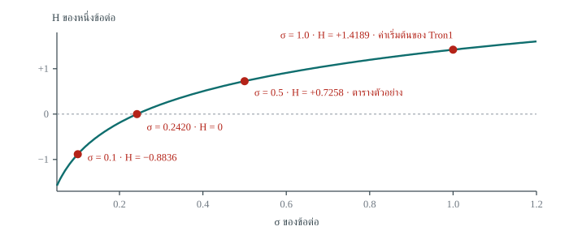

## บทที่ 24 · value loss entropy และ loss รวม — สอน critic ต้านระฆังหุบ แล้วรวมเป็นเข็มเดียว

> [!INTRO]
> $L^{CLIP}$ ของบทที่ 23 หมุนได้เฉพาะลูกบิดของ actor กับ $\ell$ งานสองอย่างยังค้างอยู่ งานแรกคือ critic บทที่ 9 บอกไว้ว่ามันถูกสอนจากความต่างระหว่างคำทำนายกับสิ่งที่เกิดจริง และบทที่ 22 เตรียมเฉลยไว้ให้แล้ว คือ $R_t$ แต่ยังไม่มี loss ที่ใช้เฉลยนั้น งานที่สองคือความกว้างของระฆัง บทที่ 12 และ 14 เตือนว่าถ้าไม่มีอะไรต้าน ระฆังจะหุบเร็วเกินไป และหุ่นจะเลิกลองของใหม่
>
> บทนี้สร้างพจน์สองพจน์สำหรับสองงานนั้น คือ value loss $L_V$ ตามสมการ (32) และ entropy $H$ ตามสมการ (31) แล้วรวมกับ $L^{CLIP}$ เป็น loss ตัวเดียว คือ $L$ ตามสมการ (33) ซึ่งเป็นเข็มที่สมการ (12) รออยู่ตั้งแต่บทที่ 14 ระหว่างทางเราจะได้สมการ (35) ซึ่งบอกว่าแต่ละพจน์ผลัก $\sigma$ ไปทางไหน
>
> ของที่ต้องรู้มาก่อน: ความหนาแน่น สมการ (13) และ (14) และระยะมาตรฐาน $z$ จากบทที่ 10 · $\sigma$ กับความกล้าลอง จากบทที่ 12 · loss ลูกบิด เข็ม และความชันเทียบกับ $\ell$ จากบทที่ 14 · score function จากบทที่ 19 · critic และ $\phi$ จากบทที่ 20 · supervised learning และ MSE จากบทที่ 21 · $A_t$ และ $R_t$ จากบทที่ 22 · $L^{CLIP}$, clip, $\epsilon$ และชุดของช่อง จากบทที่ 23
>
> จบบทนี้แล้ว เราคำนวณ $L$ ของชุดใดก็ได้ในตารางตัวอย่าง บอกได้ว่าแต่ละพจน์ไปถึงลูกบิดกลุ่มใด และอ่าน `ppo.py:263-278` ได้ทีละบรรทัด

### ของที่ต้องมีก่อนเริ่ม

บทนี้ใช้ห้าแถวของตารางตัวอย่าง แถว $V$ คือคำทำนายที่ critic ให้ไว้ตอนเก็บข้อมูล แถว $A_t$ และ $R_t$ มาจากบทที่ 22 แถว $z$ คือระยะมาตรฐาน $(a - \mu)/\sigma$ ของบทที่ 10 และแถว $\hat A_t$ มาจากบทที่ 22

| | | t=0 | t=1 | t=2 | t=3 |
| --- | --- | --- | --- | --- | --- |
| **env 0** | $V$ | 5.0 | 4.5 | 4.0 | 3.5 |
| | $A_t$ | −0.2722 | −0.4475 | −0.0660 | −0.3000 |
| | $R_t$ | 4.7278 | 4.0525 | 3.9340 | 3.2000 |
| | $z$ | +0.40 | −0.20 | +0.80 | 0.00 |
| | $\hat A_t$ | +0.7975 | +0.6452 | +0.9766 | +0.7733 |
| **env 1** | $V$ | 3.0 | 2.0 | 1.0 | 4.0 |
| | $A_t$ | −2.3272 | −2.2600 | −3.0000 | −0.8500 |
| | $R_t$ | 0.6728 | −0.2600 | −2.0000 | 3.1500 |
| | $z$ | −0.60 | +0.80 | +0.20 | +0.40 |
| | $\hat A_t$ | −0.9874 | −0.9290 | −1.5718 | +0.2956 |

ชุดของช่องเป็นสองชุดเดิมของบทที่ 23 คือชุดที่ 1 ได้แก่ e0 t0, e0 t2, e1 t1, e1 t3 และชุดที่ 2 ได้แก่ช่องที่เหลือ

> [!NOTE]
> ตัวเลขในบทนี้คำนวณด้วยค่าเต็มแล้วปัดตอนท้าย ตามข้อตกลงของบทที่ 22 ถ้านำตัวเลขที่ปัดแล้วมาคิดต่อ ทศนิยมตำแหน่งที่สี่อาจต่างไป 1

สัญลักษณ์ที่ใช้ในบทนี้ เรียงตามลำดับที่จะพบ

| สัญลักษณ์ | ชนิด | ความหมาย |
| --- | --- | --- |
| $V_{old}$ | scalar ต่อช่อง | คำทำนายของ critic ที่เก็บลงตารางตอนเก็บข้อมูล คือแถว $V$ ข้างบน |
| $V_{new}$ | scalar ต่อช่อง | คำทำนายของสถานะเดิม ที่ทำนายใหม่ด้วย $\phi$ ปัจจุบัน |
| $V_{clip}$ | scalar ต่อช่อง | $V_{new}$ ที่ถูกหนีบให้ห่างจาก $V_{old}$ ไม่เกิน $\epsilon$ |
| $L_V$ **value loss** | scalar | critic ทำนายพลาดจาก $R_t$ เท่าไร (กำลังสอง) แบบ clipped ใช้ตัวที่ใหญ่กว่าระหว่างพลาดจริงกับพลาดของค่าที่ถูกหนีบ |
| $H$ **entropy** | scalar | ความไม่แน่นอนของระฆัง ขึ้นกับ $\sigma$ อย่างเดียว ไม่เกี่ยวกับ $\mu$ |
| $\partial L / \partial\ell$ | scalar ต่อมิติ | ทิศที่ $\sigma$ ต้องขยับ |
| $c_V$, $c_H$ **สัมประสิทธิ์** | ค่าคงที่ | น้ำหนักของ $L_V$ และ $H$ ใน loss รวม · 1.0 และ 0.01 |
| $L$ **loss รวม** | scalar ตัวเดียวทั้งระบบ | เข็มวัดความแย่ ยิ่งน้อยยิ่งดี |

### สอน critic: เป้าคือ $R_t$

บทที่ 21 สอน encoder ด้วยวิธีที่ตรงที่สุด คือมีคำทำนาย มีเฉลย และใช้ MSE วัดว่าห่างกันเท่าไร เราทำแบบเดียวกันกับ critic ได้ คำทำนายคือ $V_{new}$ ซึ่ง critic ทำนายใหม่ทุก gradient step จากสถานะเดิมในตาราง (`ppo.py:216`) และเฉลยคือ $R_t$ ของบทที่ 22

$$\text{mean}\Big[\big(V_{new} - R_t\big)^2\Big]$$

ที่ gradient step ครั้งแรกของ iteration $\phi$ ยังไม่ถูกปรับ $V_{new}$ จึงเท่ากับ $V_{old}$ ทุกช่อง เหมือนกับที่ $\rho_t = 1$ ในบทที่ 18 และสมการ (27) บอกว่า $R_t = A_t + V_t$ ส่วนต่างในวงเล็บจึงเป็น $-A_t$ พอดี value loss ของครั้งแรกอ่านได้จากแถว $A_t$ โดยตรง

> [!EXAMPLE] จงหา MSE ระหว่าง $V_{new}$ กับ $R_t$ ของชุดที่ 1 ที่ gradient step ครั้งแรก
> ที่ครั้งแรก $V_{new} = V_{old}$ ส่วนต่างของแต่ละช่องจึงเป็น $-A_t$
>
> | ช่อง | $V_{new} = V_{old}$ | $R_t$ | $V_{new} - R_t$ | กำลังสอง |
> | --- | --- | --- | --- | --- |
> | e0 t0 | 5.0 | 4.7278 | +0.2722 | 0.0741 |
> | e0 t2 | 4.0 | 3.9340 | +0.0660 | 0.0044 |
> | e1 t1 | 2.0 | −0.2600 | +2.2600 | 5.1076 |
> | e1 t3 | 4.0 | 3.1500 | +0.8500 | 0.7225 |
>
> $$\text{mean} = \frac{0.0741 + 0.0044 + 5.1076 + 0.7225}{4} = \frac{5.9086}{4} = 1.4771$$

ช่อง e1 t1 ช่องเดียวมีส่วนถึงร้อยละ 86 ของผลรวม นี่คือสมบัติของการยกกำลังสองที่บทที่ 21 บอกไว้ ช่องที่พลาดมากมีน้ำหนักมากกว่าช่องที่พลาดน้อยหลายเท่า

ความชันของกำลังสองเทียบกับคำทำนายคือ $2\,(V_{new} - R_t)$ ตามบทที่ 21 ที่ช่อง e1 t1 ได้ $2 \times 2.26 = +4.52$ ความชันเป็นบวก สมการ (12) จึงลดคำทำนายของช่องนี้ลงเข้าหา $R_t$ ในตารางตัวอย่าง ส่วนต่างเป็นบวกทั้ง 8 ช่อง เพราะ $A_t$ ติดลบทุกช่อง critic ทำนายสูงเกินไปทุกที่ และ loss นี้ดึงคำทำนายลงทุกช่อง

การสอน critic ต่างจากการสอน encoder ตรงที่มาของเฉลย

| | encoder | critic |
| --- | --- | --- |
| คำทำนาย | $\hat v$ | $V_{new}$ |
| เฉลย | ความเร็วจริงจากตัวจำลอง | $R_t = A_t + V_t$ |
| เฉลยมีคำทำนายของโครงข่ายตัวเดียวกันปนหรือไม่ | ไม่มี | มี คือคำทำนายของ critic สำหรับช่องถัด ๆ ไปในคอลัมน์เดียวกัน |
| เฉลยเปลี่ยนระหว่าง 20 gradient step หรือไม่ | ไม่เปลี่ยน | ไม่เปลี่ยน คำนวณครั้งเดียวหลังตารางเต็ม (`rollout_storage.py:201`) |

แถวที่สามคือ bootstrapping ของบทที่ 9 เป้าของ critic สร้างจาก reward จริงบวกกับคำทำนายของ critic เองสำหรับ step ถัดไป สูตร $R_t = A_t + V_t$ ดูเหมือนมี $V_t$ ของช่องตัวเอง แต่ $\delta_t$ ที่อยู่ใน $A_t$ มี $-V_t$ ซึ่งตัดกันพอดี สิ่งที่เหลือคือ $r_t$ กับ reward และคำทำนายของช่องถัด ๆ ไป ที่ช่อง e0 t3 ซึ่งเป็นแถวสุดท้ายของตาราง เป้าคือ $r_3 + \gamma V_{last} = 0.5 + 0.9 \times 3.0 = 3.2$ ส่วนที่ช่อง e1 t2 ซึ่ง episode จบ เป้าคือ reward −2.0 ตัวเดียว ไม่มีคำทำนายปน เป้าแบบนี้เป็นเฉลยที่ดีกว่าคำทำนายเดิม แต่ไม่ใช่ความจริง เมื่อ critic ดีขึ้น $R_t$ ของตารางใบถัดไปก็ดีขึ้นตาม

### สมการ (32): value loss แบบ clipped

โค้ดของ Tron1 ไม่ได้ใช้ MSE ตรง ๆ มันใช้กลเดียวกับบทที่ 23 กับ critic ด้วย คือคำนวณสองพจน์ต่อช่อง แล้วเลือกตัวที่แย่กว่า พจน์ที่สองใช้คำทำนายที่ถูกหนีบไม่ให้ห่างจากคำทำนายเดิมเกิน $\epsilon$

> [!KEY] value loss
> $$L_V = \text{mean}\Big[\max\big((V_{new} - R_t)^2,\ (V_{clip} - R_t)^2\big)\Big] \tag{32}$$
>
> $$V_{clip} = V_{old} + \text{clip}\big(V_{new} - V_{old},\ -\epsilon,\ \epsilon\big)$$
>
> | | |
> | --- | --- |
> | $(V_{new} - R_t)^2$ | พลาดจริง |
> | $(V_{clip} - R_t)^2$ | พลาดของคำทำนายที่ถูกหนีบ |
> | $\epsilon$ | 0.2 ตัวเดียวกับของ $\rho_t$ (`clip_param`) |

สมการนี้อ่านได้ว่า

<div class="wordeq"><span>loss ของช่อง</span> = ตัวที่แย่กว่าระหว่าง <span>พลาดจริง</span> กับ <span>พลาดเหมือนคำทำนายหยุดอยู่ที่ขอบ</span></div>

ทางเลือกนี้เปิดด้วย `use_clipped_value_loss = True` (`limx_rsl_rl_ppo_cfg.py:95`) ถ้าปิด โค้ดใช้ MSE ธรรมดาของหัวข้อก่อนหน้า (`ppo.py:271`)

> [!EXAMPLE] ช่อง e0 t0 มี $V_{old} = 5.0$ และ $R_t = 4.7278$ จงหา loss ของช่องนี้เมื่อ $V_{new}$ เป็น 4.9, 4.75 และ 4.5
> ขอบของการหนีบคือ $5.0 \pm 0.2$ คือ 4.8 กับ 5.2
>
> | $V_{new}$ | $V_{clip}$ | $(V_{new} - R_t)^2$ | $(V_{clip} - R_t)^2$ | ถูกคิด | ความชันเทียบกับ $V_{new}$ |
> | --- | --- | --- | --- | --- | --- |
> | 4.9 | 4.9 | 0.0297 | 0.0297 | 0.0297 | +0.3444 |
> | 4.75 | 4.8 | 0.0005 | **0.0052** | 0.0052 | 0 |
> | 4.5 | 4.8 | **0.0519** | 0.0052 | 0.0519 | −0.4556 |
>
> แถวแรก คำทำนายยังไม่เลยขอบ สองพจน์เท่ากัน และความชัน $2 \times (4.9 - 4.7278) = +0.3444$ ดึงคำทำนายลงเข้าหาเป้า
>
> แถวที่สอง คำทำนายเลยขอบ 4.8 มาแล้ว และอยู่ใกล้เป้ามากกว่าที่ขอบอยู่ พจน์ที่ถูกหนีบใหญ่กว่า จึงถูกเลือก มันเป็นค่าคงที่ ความชันเป็นศูนย์
>
> แถวที่สาม คำทำนายเลยเป้าไปไกล จนห่างจากเป้ามากกว่าที่ขอบห่าง พจน์ดิบใหญ่กว่า ความชัน $2 \times (4.5 - 4.7278) = -0.4556$ ดึงคำทำนายขึ้นกลับเข้าหาเป้า


รูปแสดงว่ามีช่วงหนึ่งของ $V_{new}$ ที่เส้นทึบราบ คือตั้งแต่ขอบ 4.8 ไปจนถึงจุดที่อยู่ห่างจากเป้าเท่ากับขอบแต่อยู่อีกฝั่งหนึ่ง คือ $2 \times 4.7278 - 4.8 = 4.6556$ ภายในช่วงนี้ critic ไม่ได้รับแรงจากช่องนี้เลย

| $V_{new}$ อยู่ที่ใด | ตัวที่ถูกคิด | ความชัน |
| --- | --- | --- |
| ห่างจาก $V_{old}$ ไม่เกิน $\epsilon$ | สองพจน์เท่ากัน | $2\,(V_{new} - R_t)$ ดึงเข้าหาเป้า |
| เลยขอบ และใกล้เป้ากว่าที่ขอบอยู่ | พจน์ที่ถูกหนีบ | 0 |
| เลยขอบ และไกลเป้ากว่าที่ขอบอยู่ | พจน์ดิบ | $2\,(V_{new} - R_t)$ ดึงกลับ |

ตารางนี้มีรูปเดียวกับตารางของบทที่ 23 ช่องที่คำทำนายเดินเข้าหาเป้าจนเลยขอบหยุดออกแรง ช่องที่คำทำนายอยู่ผิดที่ยังถูกดึงเต็มแรง แถวที่สามรวมสองกรณี คือคำทำนายที่เดินหนีจากเป้าจนเลยขอบ และคำทำนายที่วิ่งเลยเป้าไปไกลเหมือนในตัวอย่าง

ผลคือ ในหนึ่งตาราง ช่องหนึ่งดึงคำทำนายของตัวเองเข้าหาเป้าได้ไม่เกิน $\epsilon$ จากค่าเดิม ช่วงที่ความชันเป็นศูนย์มีเฉพาะช่องที่เป้าอยู่ห่างจาก $V_{old}$ เกิน $\epsilon$ ซึ่งก็คือช่องที่ $\lvert A_t \rvert > 0.2$ ในตารางตัวอย่างมีอย่างนี้ 7 ใน 8 ช่อง ยกเว้น e0 t2 ซึ่งมี $\lvert A_t \rvert = 0.0660$

> [!WARNING] 0.2 ตัวเดียวกัน แต่หน่วยไม่เหมือนกัน
> `clip_param` ถูกใช้สองที่ (`ppo.py:258` และ `:266`) ที่แรกหนีบ $\rho_t$ ซึ่งเป็นอัตราส่วน 0.2 จึงหมายถึงร้อยละ 20 ที่สองหนีบผลต่างของ $V$ ซึ่งมีหน่วยเดียวกับ reward 0.2 จึงหมายถึง 0.2 คะแนน ไม่ว่า $V$ จะมีขนาดเท่าไร ถ้า reward ของงานถูกคูณด้วย 10 ทุกพจน์ $V$ และ $R_t$ จะใหญ่ขึ้น 10 เท่า แต่ขอบยังเป็น 0.2 การหนีบจึงเข้มขึ้น 10 เท่าโดยไม่มีใครแก้ config

ข้อจำกัดของบทที่ 23 ใช้ที่นี่ด้วย การหนีบเปลี่ยนเพียงความชันของช่อง มันไม่ได้ห้าม $V_{new}$ เลยขอบ เพราะลูกบิดของ critic ใช้ร่วมกันทุกช่อง

> [!REMARK]
> การหนีบของ value loss ไม่อยู่ในเปเปอร์ของ PPO สมการ (9) ของ Schulman et al. (2017) ใช้กำลังสองของส่วนต่างธรรมดา การหนีบมาจากโค้ดของ PPO ที่ OpenAI เผยแพร่ในชุด Baselines และแพร่ไปยังโค้ดของ PPO จำนวนมากรวมถึง `rsl_rl` Engstrom et al. (2020) นับมันเป็นหนึ่งในรายละเอียดระดับโค้ดที่ไม่ได้อยู่ในคำอธิบายของอัลกอริทึม เมื่ออ่านเปเปอร์เทียบกับโค้ด บรรทัด `ppo.py:263-269` จึงเป็นส่วนที่หาคู่ในเปเปอร์ไม่พบ

### entropy: วัดว่าการแจกแจงยังสุ่มอยู่แค่ไหน

งานที่สองคือความกว้างของระฆัง เราต้องการตัวเลขที่วัดว่า policy ยังสุ่มอยู่มากน้อยเพียงใด ก่อนจะใช้กับระฆัง ลองกับเหรียญของบทที่ 4

ถ้าเหรียญให้กล่อง 0 ด้วยความน่าจะเป็น 0.99 แล้วผลออกมาเป็นกล่อง 0 เราไม่ประหลาดใจ ถ้าออกกล่อง 1 เราประหลาดใจมาก ตัวเลขที่วัดความประหลาดใจของผลหนึ่งครั้งคือ $-\log p$ โดย $p$ คือความน่าจะเป็นของผลนั้น ผลที่แน่นอนมี $p = 1$ และได้ศูนย์ ผลที่หายากมี $p$ เล็ก และได้ค่ามาก

**entropy** คือค่าคาดหวังของความประหลาดใจ เมื่อผลถูกสุ่มจากการแจกแจงนั้นเอง

$$H(p) = -\,\mathbb{E}_{a \sim p}\big[\log p(a)\big]$$

มันรับการแจกแจงหนึ่งตัว แล้วคืนตัวเลขหนึ่งตัว การแจกแจงที่เดาผลได้ง่ายมี entropy ต่ำ การแจกแจงที่เดาผลยากมี entropy สูง

| เหรียญให้กล่อง 0 ด้วยความน่าจะเป็น | entropy |
| --- | --- |
| 0.5 | 0.6931 |
| 0.75 | 0.5623 |
| 0.99 | 0.0560 |
| 1 | 0 |

แถวแรกคือ $-(0.5 \ln 0.5 + 0.5 \ln 0.5) = \ln 2$ เหรียญที่ยุติธรรมเดายากที่สุด และเหรียญที่ออกหน้าเดียวไม่มีอะไรให้เดา

เราเคยพบความประหลาดใจมาแล้วโดยไม่ได้ตั้งชื่อ loss ตัวอย่างของบทที่ 14 คือ $-\log\pi_\theta(a \mid s)$ ซึ่งเป็นความประหลาดใจของ action ตัวเดียว ที่ช่อง e0 t0 ได้ 0.3058 entropy ของระฆังคือค่าเฉลี่ยของตัวเลขแบบนี้ เหนือ action ทุกตัวที่ระฆังใบนั้นสุ่มได้

เหรียญเทียบกับระฆังไม่ได้เรื่องเดียว ความน่าจะเป็นของเหรียญไม่เกิน 1 ความประหลาดใจจึงไม่ติดลบ และ entropy ของเหรียญไม่ต่ำกว่าศูนย์ ระฆังมีความหนาแน่น ซึ่งบทที่ 10 แสดงว่าเกิน 1 ได้ log ของมันจึงเป็นบวกได้ และ entropy ของระฆังติดลบได้

### สมการ (31): entropy ของระฆัง Gaussian

สำหรับระฆัง Gaussian เราหา entropy เป็นสูตรได้ โดยแทนสมการ (14) ลงในนิยาม

| สมการ | หมายเหตุ |
| --- | --- |
| $-\log\pi(a) = \tfrac12\ln 2\pi + \ln\sigma + \dfrac{(a - \mu)^2}{2\sigma^2}$ | สมการ (14) กลับเครื่องหมาย |
| $H = \tfrac12\ln 2\pi + \ln\sigma + \dfrac{\mathbb{E}\big[(a - \mu)^2\big]}{2\sigma^2}$ | สองพจน์แรกเป็นค่าคงที่ จึงออกจาก $\mathbb{E}$ ได้ตามความเป็นเชิงเส้นของบทที่ 4 |
| $= \tfrac12\ln 2\pi + \ln\sigma + \dfrac{\sigma^2}{2\sigma^2}$ | ค่าคาดหวังของระยะห่างจากจุดกลางยกกำลังสอง คือความแปรปรวน $\sigma^2$ |

> [!KEY] entropy ของระฆัง Gaussian
> $$H = \sum_{i}\Big[\tfrac12 + \tfrac12\ln 2\pi + \ln\sigma_i\Big] \tag{31}$$
>
> | | |
> | --- | --- |
> | วงเล็บ | entropy ของหนึ่งข้อต่อ คือผลของตารางข้างบน |
> | $i$ | เลขข้อต่อ ตารางตัวอย่างมีข้อต่อเดียว ผลบวกจึงมีพจน์เดียว |

บรรทัดที่สามใช้ความหมายของความแปรปรวน ซึ่งบทที่ 10 เอ่ยชื่อไว้ สคริปต์เฉลยตรวจด้วยการคำนวณพื้นที่เชิงตัวเลขสำหรับ $\sigma = 0.5$ ได้ค่าคาดหวังของ $(a - \mu)^2$ เท่ากับ 0.2500 และได้ $H = 0.7258$ ตรงกับสมการ (31)

สมการนี้ไม่มี $\mu$ เลย การเลื่อนระฆังไปทางซ้ายหรือขวาไม่ทำให้เดาผลยากขึ้นหรือง่ายขึ้น สิ่งเดียวที่เปลี่ยน entropy คือความกว้าง

| $\sigma$ | $\ln\sigma$ | $H$ ต่อข้อต่อ | |
| --- | --- | --- | --- |
| 1.0 | 0 | +1.4189 | ค่าเริ่มต้นของ Tron1 |
| 0.5 | −0.6931 | +0.7258 | ตารางตัวอย่าง |
| 0.25 | −1.3863 | +0.0326 | |
| 0.2420 | −1.4189 | 0 | |
| 0.1 | −2.3026 | −0.8836 | |



ทุกครั้งที่ $\sigma$ ลดลงครึ่งหนึ่ง $H$ ลดลง $\ln 2 = 0.6931$ เท่ากันทุกครั้ง และเมื่อ $\sigma$ ต่ำกว่า 0.2420 ค่า $H$ ติดลบ ซึ่งไม่ได้แปลว่ามีอะไรผิด มันเป็นผลของการที่ความหนาแน่นเกิน 1 ได้

Tron1 มี 8 ข้อต่อ สมการ (15) บวก log ของ 8 ระฆังเข้าด้วยกัน entropy ของทั้ง action จึงเป็นผลบวกของ 8 ข้อต่อ ซึ่งคือเครื่องหมายผลบวกในสมการ (31) โค้ดบวกที่ `actor_critic.py:153` เมื่อเริ่มเทรน $\ell$ เป็นศูนย์ทุกตัว (`actor_critic.py:118`) $\sigma$ จึงเป็น 1 และได้ $8 \times 1.418939 = 11.3515$

ในโค้ดนี้ $\sigma$ ไม่ขึ้นกับสถานะ บทที่ 11 แสดงว่ามันมาจาก $\ell$ ซึ่งเป็นลูกบิด 8 ตัวที่ใช้ร่วมกันทุกช่อง (`actor_critic.py:118`, `:157`) ทุกช่องจึงมี $H$ เท่ากัน และการเฉลี่ยทั้งชุดที่ `ppo.py:273` ได้ค่าเดิม

### สมการ (35): แต่ละพจน์ผลัก $\sigma$ ไปทางไหน

ลูกบิดที่คุม $\sigma$ คือ $\ell$ ซึ่งเท่ากับ $\ln\sigma$ ตามบทที่ 11 สองพจน์ของ loss มี $\ell$ อยู่ข้างใน คือ $L^{CLIP}$ และ $H$

**พจน์ $H$** เมื่อแทน $\ln\sigma$ ด้วย $\ell$ วงเล็บของสมการ (31) สำหรับข้อต่อหนึ่งกลายเป็น $\tfrac12 + \tfrac12\ln 2\pi + \ell$ ข้อต่ออื่นไม่มี $\ell$ ตัวนี้ ความชันของ $H$ เทียบกับ $\ell$ จึงเป็น 1 พอดี ไม่ว่า $\ell$ จะมีค่าเท่าไร และไม่ขึ้นกับข้อมูลในตาราง

**พจน์ $L^{CLIP}$** เราทำเหมือนที่บทที่ 23 ทำกับ $\mu$

| สมการ | หมายเหตุ |
| --- | --- |
| $\dfrac{\partial \log\pi}{\partial\ell} = z^2 - 1$ | บทที่ 14 หาความชันของ $-\log\pi$ ไว้ว่าเป็น $1 - z^2$ |
| $\dfrac{\partial \rho_t}{\partial\ell} = \rho_t\,(z^2 - 1)$ | บทที่ 19: ความชันของ $\rho_t$ คือ $\rho_t$ คูณความชันของ $\log\pi$ |
| $\dfrac{\partial}{\partial\ell}\big(-\rho_t\,\hat A_t\big) = -\hat A_t\,\rho_t\,(z^2 - 1)$ | $\hat A_t$ เป็นค่าคงที่จากตาราง |

> [!KEY] ทิศของ $\sigma$
> $$\frac{\partial L_i}{\partial\ell} = -\hat A_t\ \rho_t\ (z^2 - 1), \qquad \frac{\partial H}{\partial\ell} = 1 \tag{35}$$
>
> | | |
> | --- | --- |
> | $L_i$ | พจน์ของช่องเดียวใน $L^{CLIP}$ เมื่อ $\max$ เลือกพจน์ดิบ ถ้าเลือกพจน์ที่ถูกหนีบ ความชันเป็น 0 |
> | $z$ | ระยะมาตรฐานของ $a_t$ ใต้ระฆังใหม่ |
> | $\ell$ | ลูกบิดของข้อต่อเดียว แต่ละข้อต่อมี $\ell$ และ $z$ ของตัวเอง |
> | $i$ ใน $L_i$ | นับช่อง ไม่ได้นับข้อต่อเหมือน $i$ ในสมการ (31) |

ครึ่งซ้ายของสมการนี้มีสี่กรณี เหมือนสมการ (G) แต่สิ่งที่ตัดสินไม่ใช่ว่า $a_t$ อยู่ข้างใดของ $\mu$ สิ่งที่ตัดสินคือ $a_t$ อยู่ใกล้หรือไกลกว่าหนึ่ง $\sigma$

| $\hat A_t$ | $a_t$ อยู่ | $\partial L_i/\partial\ell$ | ระฆัง |
| --- | --- | --- | --- |
| บวก action ดี | ไกลกว่าหนึ่ง $\sigma$ | ลบ | กว้างขึ้น เพื่อเอื้อมไปถึง action ดีที่อยู่ไกล |
| บวก action ดี | ใกล้กว่าหนึ่ง $\sigma$ | บวก | แคบลง เพื่อรวมรอบ action ดีที่อยู่ใกล้ |
| ลบ action แย่ | ไกลกว่าหนึ่ง $\sigma$ | บวก | แคบลง เพื่อถอยจาก action แย่ที่อยู่ไกล |
| ลบ action แย่ | ใกล้กว่าหนึ่ง $\sigma$ | ลบ | กว้างขึ้น เพื่อให้ระฆังเตี้ยลงตรงที่ action แย่อยู่ |

> [!EXAMPLE] จงหาความชันของ $L_i$ เทียบกับ $\ell$ ของชุดที่ 1 ที่ gradient step ครั้งแรก แล้วเทียบกับแรงของ entropy
> ทุกช่องมี $\rho_t = 1$ จึงใช้ $-\hat A_t\,(z^2 - 1)$
>
> | ช่อง | $z$ | $z^2 - 1$ | $\hat A_t$ | $\partial L_i/\partial\ell$ | ช่องนี้บอกให้ระฆัง |
> | --- | --- | --- | --- | --- | --- |
> | e0 t0 | +0.40 | −0.84 | +0.7975 | +0.6699 | แคบลง |
> | e0 t2 | +0.80 | −0.36 | +0.9766 | +0.3516 | แคบลง |
> | e1 t1 | +0.80 | −0.36 | −0.9290 | −0.3345 | กว้างขึ้น |
> | e1 t3 | +0.40 | −0.84 | +0.2956 | +0.2483 | แคบลง |
>
> ลูกบิด $\ell$ ใช้ร่วมกันทุกช่อง มันจึงรับค่าเฉลี่ย คือ $(0.6699 + 0.3516 - 0.3345 + 0.2483)/4 = +0.2338$
>
> พจน์ entropy อยู่ใน loss ในรูป $-c_H H$ โดย $c_H = 0.01$ ความชันของมันเทียบกับ $\ell$ คือ $-0.01 \times 1 = -0.01$ ซึ่งไม่ต้องเฉลี่ย เพราะเท่ากันทุกช่อง
>
> ความชันรวมคือ $+0.2338 - 0.01 = +0.2238$ เป็นบวก สมการ (12) จึงลด $\ell$ และระฆังแคบลง

ในตารางตัวอย่าง action ทุกตัวอยู่ใกล้กว่าหนึ่ง $\sigma$ ช่องที่ดีจึงบอกให้แคบลงทุกช่อง และช่องที่แย่บอกให้กว้างขึ้นทุกช่อง ตารางถัดไปรวมทั้ง 8 ช่อง โดยคิดที่ $\rho_t = 1$ ทุกช่อง คือเหมือนว่าชุดนั้นถูกใช้ก่อนที่ระฆังจะขยับ

| ช่องที่ใช้ | ค่าเฉลี่ยของ $\partial L_i/\partial\ell$ | เมื่อรวม entropy | ระฆัง |
| --- | --- | --- | --- |
| ชุดที่ 1 | +0.2338 | +0.2238 | แคบลง |
| ชุดที่ 2 | −0.1870 | −0.1970 | กว้างขึ้น |
| ทั้ง 8 ช่อง | +0.0234 | +0.0134 | แคบลงเล็กน้อย |

ตัวเลขชุดนี้บอกขนาดของการชักเย่อ แรงของช่องเดี่ยว ๆ มีขนาดตั้งแต่ 0.2483 ถึง 1.5089 ซึ่งใหญ่กว่าแรง 0.01 ของ entropy ราว 25 ถึง 150 เท่า แต่แรงของช่องต่าง ๆ หักล้างกัน เมื่อเฉลี่ยทั้งตารางเหลือเพียง +0.0234 ซึ่งมีขนาดใกล้กับ 0.01

การหักล้างในตารางนี้มาจากสมการ (28) ซึ่งทำให้ $\hat A_t$ ของทั้งตารางเฉลี่ยได้ศูนย์ ถ้า $z^2$ ของทุกช่องเท่ากัน แรง $-\hat A_t(z^2 - 1)$ ของทั้ง 8 ช่องจะรวมกันได้ศูนย์พอดี สิ่งที่เหลือ +0.0234 จึงวัดว่า action ที่ดีกับ action ที่แย่อยู่ห่างจุดกลางต่างกันเท่าไร ภายในชุดเดียวการหักล้างไม่ครบ เพราะ $\hat A_t$ ของชุดไม่ได้เฉลี่ยเป็นศูนย์ ชุดที่ 1 จึงได้ +0.2338 และชุดที่ 2 ได้ −0.1870

เมื่อมีช่องจำนวนมาก มีเหตุผลอีกข้อหนึ่ง ตัวคูณ $z^2 - 1$ คือ score function ของลูกบิด $\ell$ และบทที่ 19 แสดงว่า score function เฉลี่ยได้ศูนย์ใต้ระฆังของตัวเอง ถ้า $\hat A_t$ ไม่ขึ้นกับว่า action อยู่ใกล้หรือไกลจุดกลาง แรงนี้จึงเฉลี่ยได้ศูนย์ และสิ่งที่เหลือมาจากส่วนที่สองอย่างนี้เกี่ยวกัน ตารางตัวอย่างไม่แสดงข้อนี้ เพราะมีเพียง 8 ช่อง และทุกช่องมี $\lvert z \rvert < 1$ ค่าเฉลี่ยของ $z^2 - 1$ ของมันคือ −0.7450 ไม่ใช่ศูนย์

แรง 0.01 ของ entropy เล็กกว่าแรงรายช่องมาก แต่มันไม่หักล้างกันเองระหว่างช่อง เพราะมันมีเครื่องหมายเดียวกันทุกช่องและทุก gradient step ในตารางตัวอย่างมันมีขนาดใกล้กับสิ่งที่เหลือของอีกฝ่าย เล่มนี้ไม่มีข้อมูลจากการเทรนจริงที่จะบอกว่าใน Tron1 สองแรงนี้มีขนาดเทียบกันอย่างไร

entropy ไม่ได้ห้ามระฆังแคบลง มันเพียงเอียงตาชั่งไปทางกว้าง ค่า `Mean action noise std` ที่บทที่ 12 ดูระหว่างเทรน คือผลรวมของสองแรงนี้ ระฆังแคบลงเมื่อ action ที่ดีกระจุกอยู่ใกล้จุดกลางมากพอที่จะชนะแรงของ entropy

> [!NOTE]
> ตารางตัวอย่างตรึง $\sigma = 0.5$ ไว้ทุกบท เพื่อให้คำนวณตามได้ ถ้าปล่อยให้ช่อง e0 t0 ช่องเดียวหมุน $\ell$ ด้วยความชัน $+0.6699 - 0.01 = +0.6599$ และ $\alpha = 10^{-3}$ ซึ่งเป็นค่าเริ่มต้นของ Tron1 (`limx_rsl_rl_ppo_cfg.py:100`) สมการ (12) จะเปลี่ยน $\ell$ จาก −0.693147 เป็น −0.693807 และ $\sigma$ จาก 0.500000 เป็น 0.499670 การก้าวนี้ใช้สมการ (12) ตรงตัวกับแรงของช่องเดียว optimizer จริงของ Tron1 ก้าวต่างออกไปตามที่บทที่ 14 บอกไว้ ซึ่งบทที่ 25 อธิบาย ตัวเลขนี้จึงบอกเพียงขนาดโดยประมาณ คือหนึ่ง gradient step เปลี่ยนความกว้างของระฆังน้อยมาก

### สมการ (33): เข็มเดียว

ตอนนี้มีครบสามพจน์ PPO บวกเข้าด้วยกันเป็นตัวเลขตัวเดียว

> [!KEY] loss รวมของ PPO
> $$L = L^{CLIP} + c_V\,L_V - c_H\,H \tag{33}$$
>
> | | |
> | --- | --- |
> | $L^{CLIP}$ | สมการ (29) ยิ่งต่ำ policy ยิ่งชอบ action ที่ดี |
> | $L_V$ | สมการ (32) ยิ่งต่ำ critic ยิ่งทำนายใกล้ $R_t$ |
> | $H$ | สมการ (31) รวม 8 ข้อต่อ ยิ่งสูงระฆังยิ่งกว้าง |
> | $c_V$ | 1.0 (`value_loss_coef` `limx_rsl_rl_ppo_cfg.py:94`) |
> | $c_H$ | 0.01 (`entropy_coef` `limx_rsl_rl_ppo_cfg.py:97`) |

เครื่องหมายของสามพจน์มาจากข้อตกลงของบทที่ 14 ว่าเราลดตัวเลขเสมอ สองพจน์แรกเป็นสิ่งที่อยากให้ต่ำ จึงบวกเข้าไป $H$ เป็นสิ่งที่อยากให้สูง จึงใส่เครื่องหมายลบ การลด $-c_H H$ คือการเพิ่ม $H$ พจน์นี้จึงถูกเรียกว่าโบนัสของ entropy

> [!EXAMPLE] จงหา $L$ ของชุดที่ 1 ที่ gradient step ครั้งแรกของ iteration
> ที่ครั้งแรก $\rho_t = 1$ และ $V_{new} = V_{old}$ ทุกช่อง เราจึงไม่ต้องสมมติอะไรเพิ่ม
>
> - $L^{CLIP} = -\,\text{mean}(\hat A_t) = -(0.7975 + 0.9766 - 0.9290 + 0.2956)/4 = -0.2852$ ตามบทที่ 23
> - $L_V = 1.4771$ จากตัวอย่างแรกของบทนี้ การหนีบยังไม่มีผล เพราะ $V_{clip} = V_{new}$
> - $H = 0.7258$ สำหรับข้อต่อเดียวที่ $\sigma = 0.5$
>
> $$L = -0.2852 + 1.0 \times 1.4771 - 0.01 \times 0.7258 = -0.2852 + 1.4771 - 0.0073 = +1.1847$$
>
> ผลลัพธ์คิดจากค่าเต็ม ถ้าบวกสามตัวเลขที่ปัดแล้วจะได้ +1.1846

**พจน์ไหนไปถึงลูกบิดกลุ่มไหน** ตัวเลขตัวเดียวนี้ถูกเดินย้อนด้วย `loss.backward()` ครั้งเดียว ความชันของผลบวกคือผลบวกของความชัน และพจน์ที่ไม่มีลูกบิดตัวหนึ่งอยู่ข้างในมีความชันเทียบกับลูกบิดตัวนั้นเป็นศูนย์ แต่ละพจน์จึงไปถึงเฉพาะลูกบิดที่มันใช้

| พจน์ | ลูกบิดที่อยู่ข้างใน | จำนวน | เพราะ |
| --- | --- | --- | --- |
| $L^{CLIP}$ | actor และ $\ell$ ซึ่งรวมกันคือ $\theta$ | 187,272 + 8 | $\rho_t$ มาจาก $\log\pi_{new}$ ซึ่งคำนวณจาก $\mu$ และ $\sigma$ |
| $c_V L_V$ | critic คือ $\phi$ | 282,625 | $V_{new}$ มาจาก critic ส่วน $R_t$ และ $V_{old}$ อ่านจากตาราง |
| $-c_H H$ | $\ell$ | 8 | $H$ ขึ้นกับ $\sigma$ อย่างเดียว |

สามกลุ่มรวมกันคือลูกบิด 469,905 ตัวที่บทที่ 21 บอกว่า optimizer หลักถือไว้ ในสามกลุ่มนี้ $\ell$ เป็นกลุ่มเดียวที่รับแรงจากสองพจน์ ซึ่งคือการชักเย่อของหัวข้อก่อนหน้า ส่วน actor กับ critic เป็นโครงข่ายคนละตัวตามบทที่ 20 การที่ $L^{CLIP}$ กับ $L_V$ อยู่ในผลบวกเดียวกันจึงไม่ทำให้สองตัวนี้รบกวนกัน $c_V$ เป็นเพียงตัวคูณของความชันทั้งก้อนของ critic

แถวของ $H$ มีรายละเอียดหนึ่งข้อ บรรทัด `actor_critic.py:157` เขียน $\sigma$ ในรูป `mean * 0.0 + torch.exp(self.logstd)` ทางเดินย้อนจาก $H$ ไปถึง actor จึงมีอยู่ในบันทึกของ PyTorch แต่ถูกคูณด้วยศูนย์ ความชันที่ไปถึง weight ของ actor เป็นศูนย์พอดี

**สิ่งที่ไม่อยู่ใน $L$** MSE ของ encoder ในบทที่ 21 เป็นเข็มอีกอันหนึ่ง มี optimizer ของตัวเอง และไม่ถูกบวกเข้ามา ส่วนบรรทัด `ppo.py:221-244` ซึ่งอยู่ก่อนการคำนวณ loss ในลูปเดียวกัน คำนวณตัววัดอีกตัวหนึ่งที่ไม่ถูกบวกเข้า $L$ เช่นกัน บทที่ 26 อธิบาย

**ค่าของ $L$ ไม่ใช่คะแนนของหุ่น** ในตัวอย่าง $L_V$ มีขนาดใหญ่กว่าอีกสองพจน์รวมกัน ค่าของ $L$ จึงบอกเรื่องของ critic เป็นส่วนใหญ่ และบทที่ 23 แสดงว่า $L^{CLIP}$ เริ่มที่ค่าเฉลี่ยของ $-\hat A_t$ ของชุดทุกครั้งที่ขึ้น iteration ใหม่ มันจึงไม่ลดลงสะสมข้าม iteration เหมือน loss ของงาน supervised learning ระหว่างเทรน โปรแกรมพิมพ์ `Value function loss` และ `Surrogate loss` ซึ่งเป็นค่าเฉลี่ยของ $L_V$ และ $L^{CLIP}$ ตลอดทุก gradient step ของ iteration นั้น (`ppo.py:293-294`, `:326`, `:329` พิมพ์ที่ `on_policy_runner.py:322-323`) ตัวเลขที่บอกว่าหุ่นเดินดีขึ้นหรือไม่ ยังเป็น `Mean reward` ของบทที่ 7

> [!NOTE]
> เปเปอร์ของ PPO เขียนผลรวมนี้ในรูปที่ต้องทำให้สูงสุด คือ $L^{CLIP} - c_1 L^{VF} + c_2 S$ (Schulman et al. 2017 สมการ (9)) โดย $L^{CLIP}$ ของเปเปอร์ไม่มีเครื่องหมายลบตามที่บทที่ 23 บอกไว้ และ $S$ คือ entropy สมการ (33) คือค่าลบของรูปนั้น เปเปอร์ให้เหตุผลของการรวมไว้สำหรับโครงข่ายที่ policy กับ value function ใช้ลูกบิดร่วมกัน ใน Tron1 สองตัวนี้แยกกัน การรวมเป็นตัวเลขเดียวจึงเป็นความสะดวก คือเดินย้อนครั้งเดียวได้ความชันของลูกบิดทุกตัว

สิ่งที่เกิดต่อจากนี้คือสี่บรรทัดของบทที่ 14 (`ppo.py:287-290`) ซึ่งเดินย้อนจาก $L$ แล้วหมุนลูกบิดทั้ง 469,905 ตัว บทที่ 25 อ่านสี่บรรทัดนั้นทีละบรรทัด

### จากสมการถึงโค้ด

สามพจน์ของบทนี้และผลรวมอยู่ใน `ppo.py:263-278`

```text
if self.use_clipped_value_loss:
    value_clipped = target_values_batch + (
        value_batch - target_values_batch
    ).clamp(-self.clip_param, self.clip_param)
    value_losses = (value_batch - returns_batch).pow(2)
    value_losses_clipped = (value_clipped - returns_batch).pow(2)
    value_loss = torch.max(value_losses, value_losses_clipped).mean()
else:
    value_loss = (returns_batch - value_batch).pow(2).mean()

entropy_batch_mean = entropy_batch.mean()
loss = (
    surrogate_loss
    + self.value_loss_coef * value_loss
    - self.entropy_coef * entropy_batch_mean
)
```

| บรรทัด | โค้ด | สมการ |
| --- | --- | --- |
| `ppo.py:216` | `value_batch = self.actor_critic.evaluate(critic_obs_batch)` | $V_{new}$ |
| `rollout_storage.py:269` | `group_target_values_batch = group_values[group_batch_idx]` | $V_{old}$ |
| `rollout_storage.py:272` | `group_returns_batch = group_returns[group_batch_idx]` | $R_t$ |
| `ppo.py:264-266` | `value_clipped = target_values_batch + (...).clamp(...)` | $V_{clip}$ |
| `:267` | `(value_batch - returns_batch).pow(2)` | $(V_{new} - R_t)^2$ |
| `:268` | `(value_clipped - returns_batch).pow(2)` | $(V_{clip} - R_t)^2$ |
| `:269` | `torch.max(value_losses, value_losses_clipped).mean()` | (32) |
| `actor_critic.py:153` | `self.distribution.entropy().sum(dim=-1)` | (31) บวก 8 ข้อต่อ |
| `normal.py:105` | `0.5 + 0.5 * math.log(2 * math.pi) + torch.log(self.scale)` | (31) ต่อข้อต่อ |
| `ppo.py:219`, `:273` | `entropy_batch = self.actor_critic.entropy` แล้ว `.mean()` | $H$ เฉลี่ยทั้งชุด |
| `:274-278` | `loss = (surrogate_loss + ... - ...)` | (33) |
| `limx_rsl_rl_ppo_cfg.py:94-97` | `value_loss_coef=1.0`, `use_clipped_value_loss=True`, `clip_param=0.2`, `entropy_coef=0.01` | $c_V$ · ทางเลือกของ (32) · $\epsilon$ · $c_H$ |

`normal.py` เป็นไฟล์ของ PyTorch เวอร์ชัน 2.5.1 เหมือนในบทที่ 19 และบรรทัด `:105` คือสมการ (31) ตรงตัว โดย `self.scale` คือ $\sigma$

ค่าปริยายของ `entropy_coef` ในคลาส `PPO` คือ 0.0 (`ppo.py:54`) ซึ่งทำให้ไม่มีโบนัสของ entropy เลย config ของงาน SF เขียนทับเป็น 0.01

> [!WARNING] `target_values_batch` ไม่ใช่เป้า
> ชื่อตัวแปรชวนให้อ่านผิด `target_values_batch` คือแถว $V$ ที่เก็บไว้ตอนเก็บข้อมูล (`rollout_storage.py:243`) ซึ่งคือ $V_{old}$ เป้าของ critic คือ `returns_batch` ซึ่งคือ $R_t$ (`rollout_storage.py:244`) บรรทัด `ppo.py:264-266` ใช้ `target_values_batch` เป็นจุดกลางของการหนีบ ไม่ได้ใช้เป็นเฉลย

> [!SUMMARY]
> - critic ถูกสอนแบบ supervised learning โดยมี $R_t$ เป็นเป้า ที่ gradient step ครั้งแรก กำลังสองของส่วนต่างของช่องหนึ่งคือ $A_t^2$ พอดี
> - สมการ (32) คิดตัวที่ใหญ่กว่าระหว่างพลาดจริงกับพลาดของคำทำนายที่ถูกหนีบไว้ไม่ให้ห่างจาก $V_{old}$ เกิน $\epsilon$ ช่องที่คำทำนายเดินเข้าหาเป้าจนเลยขอบจึงได้ความชันศูนย์
> - entropy คือค่าคาดหวังของ $-\log p$ สำหรับระฆัง Gaussian สมการ (31) ให้ $H = \tfrac12 + \tfrac12\ln 2\pi + \ln\sigma$ ต่อข้อต่อ ซึ่งขึ้นกับ $\sigma$ อย่างเดียว
> - สมการ (35) บอกว่า $L^{CLIP}$ ผลัก $\ell$ ด้วยแรง $-\hat A_t\rho_t(z^2 - 1)$ ซึ่งหักล้างกันเมื่อเฉลี่ยทั้งตารางตัวอย่าง แต่ภายในชุดเดียวหักล้างไม่ครบ ส่วน entropy ผลักไปทางกว้างด้วยแรง 0.01 ทางเดียวทุก gradient step
> - สมการ (33) รวมสามพจน์เป็นเข็มเดียว $L^{CLIP}$ ไปถึง $\theta$ $L_V$ ไปถึง $\phi$ และ $H$ ไปถึง $\ell$ ค่าของ $L$ ไม่ใช่คะแนนของหุ่น
>
> ประโยคที่ควรจำ: **loss ของ PPO คือผลบวกของสามพจน์ พจน์แรกสอน actor พจน์ที่สองสอน critic พจน์ที่สามต้านไม่ให้ระฆังหุบ และแต่ละพจน์หมุนได้เฉพาะลูกบิดที่อยู่ข้างในมัน**

### แบบฝึกหัด

1. ข้อใดถูกต้อง
    1. เป้าของ critic ใน value loss คือ return จริง $G_t$
    2. ที่ gradient step ครั้งแรกของ iteration $(V_{new} - R_t)^2$ ของช่องหนึ่งเท่ากับ $A_t^2$
    3. `target_values_batch` ในโค้ดคือเป้าที่ critic ต้องทำนายให้ตรง
    4. เมื่อ $V_{new}$ ห่างจาก $V_{old}$ ไม่เกิน 0.2 สองพจน์ของสมการ (32) เท่ากัน
    5. entropy ของระฆัง Gaussian ขึ้นกับ $\mu$
    6. entropy ของระฆัง Gaussian ติดลบได้
    7. ความชันของ $H$ เทียบกับ $\ell$ เท่ากับ 1 เสมอ
    8. โบนัสของ entropy ห้ามไม่ให้ $\sigma$ ลดลง
    9. $L_V$ มีความชันเทียบกับลูกบิดของ actor
    10. loss ของ encoder ถูกบวกรวมอยู่ใน $L$ ของสมการ (33)

2. จงหา MSE ระหว่าง $V_{new}$ กับ $R_t$ ของชุดที่ 2 เมื่อ $V_{new} = V_{old}$ ทุกช่อง แล้วบอกว่าช่องใดมีส่วนมากที่สุด [07 §5.4] <!--space:34-->

3. ช่อง e1 t1 มี $V_{old} = 2.0$ และ $R_t = -0.2600$ จงทำตารางแบบเดียวกับตัวอย่างในเนื้อหา เมื่อ $V_{new}$ เป็น [ppo.py:263-269]
    1. 1.9
    2. 1.5
    3. 2.5

    แล้วบอกว่าแต่ละข้อตรงกับแถวใดของตารางสามแถวท้ายตัวอย่าง <!--space:40-->

4. ช่อง e0 t3 มี $V_{old} = 3.5$ และ $R_t = 3.2000$ จงหาช่วงของ $V_{new}$ ที่ความชันของช่องนี้เป็นศูนย์ และอธิบายว่าเหตุใดช่อง e0 t2 จึงไม่มีช่วงเช่นนี้ <!--space:24-->

5. จงหา entropy ของเหรียญที่ให้กล่อง 0 ด้วยความน่าจะเป็น 0.9 <!--space:14-->

6. จงหา $H$ ต่อข้อต่อ เมื่อ [05 §4.6]
    1. $\sigma = 2.0$
    2. $\sigma = 0.25$

    แล้วตรวจว่าการลด $\sigma$ จาก 1.0 เป็น 0.5 และจาก 0.5 เป็น 0.25 เปลี่ยน $H$ เท่ากัน <!--space:24-->

7. เมื่อเริ่มเทรน Tron1 มี $\sigma = 1.0$ ทั้ง 8 ข้อต่อ จงหา $H$ ของทั้ง action และค่าของพจน์ $-c_H H$ ใน loss [actor_critic.py:153] <!--space:16-->

8. จงหา $\partial L_i/\partial\ell$ ของชุดที่ 2 ทั้งสี่ช่องเมื่อ $\rho_t = 1$ ค่าเฉลี่ยของมัน และความชันรวมเมื่อบวกแรงของ entropy แล้วบอกว่าชุดนี้ทำให้ระฆังกว้างขึ้นหรือแคบลง [06 §3.4] <!--space:36-->

9. สมมติว่า gradient step ครั้งแรกของ iteration ใช้ชุดที่ 2 แทนชุดที่ 1 จงหา $L$ ของชุดนี้ <!--space:22-->

10. เพื่อนดูค่า $L$ ลดลงจาก iteration หนึ่งไปอีก iteration หนึ่ง แล้วสรุปว่าหุ่นเดินดีขึ้น จงอธิบายว่าเหตุใดข้อสรุปนี้ไม่ถูก และควรดูตัวเลขใดแทน <!--space:22-->

<!-- เฉลย -->

1. ข้อที่ถูก: 2, 4, 6, 7

    - ข้อ 1 ผิด: เป้าคือ $R_t = A_t + V_t$ ซึ่งมีคำทำนายของ critic ปนอยู่
    - ข้อ 3 ผิด: มันคือ $V_{old}$ เป้าคือ `returns_batch`
    - ข้อ 5 ผิด: สมการ (31) ไม่มี $\mu$
    - ข้อ 8 ผิด: มันเพิ่มแรงไปทางกว้าง 0.01 ไม่ได้ห้าม
    - ข้อ 9 ผิด: $V_{new}$ มาจาก critic เท่านั้น
    - ข้อ 10 ผิด: encoder มี loss และ optimizer ของตัวเอง

2. ส่วนต่างคือ $-A_t$ ของแต่ละช่อง

    | ช่อง | $V_{new} - R_t$ | กำลังสอง |
    | --- | --- | --- |
    | e0 t1 | +0.4475 | 0.2003 |
    | e0 t3 | +0.3000 | 0.0900 |
    | e1 t0 | +2.3272 | 5.4159 |
    | e1 t2 | +3.0000 | 9.0000 |

    ค่าเฉลี่ยคือ $14.7061/4 = 3.6765$ (ผลรวมคิดจากค่าเต็ม) ช่อง e1 t2 ซึ่งเป็นช่องที่หุ่นล้ม มีส่วนมากที่สุด คือ 9.0000 จาก 14.7061

3. ขอบของการหนีบคือ 1.8 กับ 2.2

    | $V_{new}$ | $V_{clip}$ | $(V_{new} - R_t)^2$ | $(V_{clip} - R_t)^2$ | ถูกคิด | ความชัน |
    | --- | --- | --- | --- | --- | --- |
    | 1.9 | 1.9 | 4.6656 | 4.6656 | 4.6656 | +4.3200 |
    | 1.5 | 1.8 | 3.0976 | 4.2436 | 4.2436 | 0 |
    | 2.5 | 2.2 | 7.6176 | 6.0516 | 7.6176 | +5.5200 |

    ข้อ 1 ตรงกับแถวแรก คือยังไม่เลยขอบ ข้อ 2 ตรงกับแถวที่สอง คือเลยขอบและใกล้เป้ากว่าที่ขอบอยู่ ข้อ 3 ตรงกับแถวที่สาม คือเดินหนีจากเป้าจนเลยขอบ ความชัน +5.52 ดึงคำทำนายลงกลับ

4. เป้าอยู่ต่ำกว่า $V_{old}$ ขอบฝั่งนั้นคือ 3.3 จุดที่ห่างจากเป้าเท่ากันอีกฝั่งหนึ่งคือ $2 \times 3.2 - 3.3 = 3.1$ ความชันเป็นศูนย์เมื่อ $V_{new}$ อยู่ระหว่าง 3.1 กับ 3.3 ช่อง e0 t2 มีเป้า 3.9340 ซึ่งห่างจาก $V_{old} = 4.0$ เพียง 0.0660 เป้าอยู่ในช่วงที่ยังไม่ถูกหนีบ คำทำนายจึงเดินถึงเป้าได้โดยไม่มีช่วงใดที่พจน์ที่ถูกหนีบใหญ่กว่า

5. $-(0.9\ln 0.9 + 0.1\ln 0.1) = 0.0948 + 0.2303 = 0.3251$

6. ค่าของ $H$

    1. $1.4189 + \ln 2 = 2.1121$
    2. $1.4189 + \ln 0.25 = 0.0326$

    จาก 1.0 เป็น 0.5: $0.7258 - 1.4189 = -0.6931$ และจาก 0.5 เป็น 0.25: $0.0326 - 0.7258 = -0.6931$ (คิดจากค่าเต็ม) เท่ากับ $-\ln 2$ ทั้งสองครั้ง

7. $H = 8 \times 1.418939 = 11.3515$ และ $-c_H H = -0.01 \times 11.3515 = -0.1135$

8. ใช้ $-\hat A_t\,(z^2 - 1)$

    | ช่อง | $z^2 - 1$ | $\hat A_t$ | $\partial L_i/\partial\ell$ |
    | --- | --- | --- | --- |
    | e0 t1 | −0.96 | +0.6452 | +0.6194 |
    | e0 t3 | −1.00 | +0.7733 | +0.7733 |
    | e1 t0 | −0.64 | −0.9874 | −0.6319 |
    | e1 t2 | −0.96 | −1.5718 | −1.5089 |

    ค่าเฉลี่ยคือ $-0.7481/4 = -0.1870$ เมื่อรวม entropy ได้ $-0.1870 - 0.01 = -0.1970$ ความชันเป็นลบ สมการ (12) จึงเพิ่ม $\ell$ ระฆังกว้างขึ้น เพราะ action แย่สองตัวของ env 1 อยู่ใกล้จุดกลาง และมี $\lvert\hat A_t\rvert$ ใหญ่

9. $L^{CLIP} = -(0.6452 + 0.7733 - 0.9874 - 1.5718)/4 = +0.2852$ · $L_V = 3.6765$ จากข้อ 2 · $H = 0.7258$

    $$L = 0.2852 + 3.6765 - 0.0073 = +3.9544$$

10. ค่าของ $L$ ถูกครอบด้วย $L_V$ ซึ่งวัดว่า critic ทำนายใกล้ $R_t$ แค่ไหน ไม่ได้วัดว่าหุ่นได้ reward เท่าไร ส่วน $L^{CLIP}$ เริ่มที่ค่าเฉลี่ยของ $-\hat A_t$ ของชุดทุก iteration เพราะสมการ (28) ลบค่าเฉลี่ยของตารางออก มันจึงไม่สะสมข้าม iteration $L$ ลดลงได้โดยที่หุ่นไม่ได้เดินดีขึ้น สมมติว่าหุ่นล้มแบบเดิมทุกครั้ง critic จะทำนายได้แม่น และ $L_V$ จะต่ำ ทั้งที่ reward แย่ ตัวเลขที่ควรดูคือ `Mean reward` ของบทที่ 7
