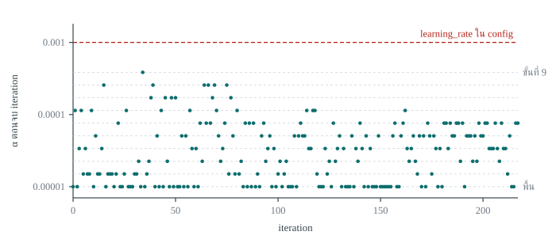

## บทที่ 26 · KL และการปรับ learning rate — วัดว่าระฆังขยับไปเท่าไร แล้วปรับความยาวก้าว

> [!INTRO]
> บทที่ 25 ทิ้งคำถามไว้หนึ่งข้อ ไฟล์ที่การเทรนบันทึกหลัง iteration แรกมี $\alpha = 10^{-5}$ ทั้งที่ config ตั้งไว้ $10^{-3}$ และบทเดียวกันนั้นแสดงว่าเมื่อ optimizer เป็น Adam ระยะที่ลูกบิดขยับในหนึ่ง gradient step อยู่ที่ราว $\alpha$ ไม่ได้ขึ้นกับขนาดของความชัน $\alpha$ จึงเป็นตัวกำหนดว่า policy ใหม่ไปไกลจาก policy ที่เก็บข้อมูลเท่าไร ซึ่งบทที่ 18 บอกว่าต้องไม่ไกล มิฉะนั้นตารางที่เก็บมาใช้ไม่ได้
>
> บทที่ 14 บอกว่า $\alpha$ เป็นตัวเลขที่คนตั้ง ตัวเลขตัวเดียวที่ตั้งไว้ล่วงหน้าไม่มีทางพอดีตลอดการเทรน บทนี้แสดงสิ่งที่โค้ดของ Tron1 ทำแทน คือวัดว่าระฆังขยับไปเท่าไรแล้วด้วยตัววัดชื่อ KL ตามสมการ (30) แล้วใช้ตัวเลขนั้นปรับ $\alpha$ ตามสมการ (37) ทุก gradient step
>
> ของที่ต้องรู้มาก่อน: ค่าคาดหวังและความเป็นเชิงเส้นของมัน จากบทที่ 4 · สมการ (14) จากบทที่ 10 · $\alpha$ และ hyperparameter จากบทที่ 14 · ระฆังเก่า ระฆังใหม่ และ $\rho_t$ จากบทที่ 18 · optimizer ของ encoder จากบทที่ 21 · clip และชุดของช่อง จากบทที่ 23 · ความประหลาดใจ entropy และความแปรปรวนในฐานะค่าคาดหวังของระยะห่างจากจุดกลางยกกำลังสอง จากบทที่ 24 · Adam และ gradient step สี่บรรทัด จากบทที่ 25
>
> จบบทนี้แล้ว เราคำนวณ KL ของระฆังสองใบได้ด้วยมือ บอกได้ว่ากฎทำอะไรกับ $\alpha$ เมื่อเห็นค่า KL ค่าหนึ่ง อ่าน `ppo.py:221-244` ได้ทีละบรรทัด และอ่านค่า `Learning rate` กับ `mean_kl` ในล็อกของการเทรนได้ถูก

### ของที่ต้องมีก่อนเริ่ม

บทนี้ใช้ระฆังของช่อง e0 t0 เป็นตัวอย่างหลัก และใช้แถว $z$ กับ $\rho_t$ ของทั้งตารางหนึ่งครั้ง แถว $\rho_t$ คือของบทที่ 18 ซึ่งคิดเมื่อ $\mu$ ของทุกช่องเลื่อนไป +0.05 โดย $\sigma$ คงเดิม

| | | t=0 | t=1 | t=2 | t=3 |
| --- | --- | --- | --- | --- | --- |
| **env 0** | $\mu$ | 0.20 | 0.30 | 0.10 | 0.40 |
| | $z$ | +0.40 | −0.20 | +0.80 | 0.00 |
| | $\rho_t$ | 1.0356 | 0.9753 | 1.0779 | 0.9950 |
| **env 1** | $\mu$ | −0.10 | 0.00 | 0.20 | −0.30 |
| | $z$ | −0.60 | +0.80 | +0.20 | +0.40 |
| | $\rho_t$ | 0.9371 | 1.0779 | 1.0151 | 1.0356 |

ทุกช่องมี $\sigma = 0.5$ ลูกบิดสามตัว $b$, $\ell$ และ $b_V$ กับค่าเริ่ม $\alpha = 10^{-3}$ เป็นของบทที่ 25

สัญลักษณ์และคำที่ใช้ในบทนี้ เรียงตามลำดับที่จะพบ

| สัญลักษณ์ | ชนิด | ความหมาย |
| --- | --- | --- |
| $D_{KL}(p \,\Vert\, q)$ **KL** | ฟังก์ชัน (การแจกแจง, การแจกแจง) → scalar ≥ 0 | ตัววัดว่าการแจกแจงสองอันต่างกันแค่ไหน ไม่สมมาตร |
| $\mu_o$, $\sigma_o$ | scalar ต่อข้อต่อ ต่อช่อง | ระฆังเก่า ที่ใช้เก็บข้อมูล ตารางเก็บไว้ทุกช่อง |
| $\mu_n$, $\sigma_n$ | scalar ต่อข้อต่อ ต่อช่อง | ระฆังใหม่ ที่ $\theta$ ปัจจุบันให้กับสถานะเดิม |
| $D_{KL}(\pi_{old} \,\Vert\, \pi_{new})$ | scalar ≥ 0 | ระฆังใหม่ห่างจากระฆังที่ใช้เก็บข้อมูลรอบนี้แค่ไหน เป็นระยะสะสมตั้งแต่เริ่มปรับ ไม่ใช่ของก้าวล่าสุด ไม่อยู่ใน loss |
| **desired_kl** | ค่าคงที่ | เป้าของกฎ 0.01 |
| **กฎปรับ lr** | สมการ | KL เกิน 0.02 ให้หาร $\alpha$ ด้วย 1.5 ต่ำกว่า 0.005 ให้คูณด้วย 1.5 ตรวจทุก gradient step |
| `lr` | scalar ปรับได้ | ชื่อของ $\alpha$ ในโค้ด ย่อจาก learning rate |

### ปัญหา: ระฆังทั้งใบขยับไปเท่าไรแล้ว

นึกถึงรูปของบทที่ 18 ซึ่งมีระฆังสองใบซ้อนกัน ใบหนึ่งคือระฆังเก่าที่ใช้เก็บข้อมูล อีกใบคือระฆังใหม่หลังปรับ ทุก gradient step เลื่อนระฆังใหม่ออกจากใบเก่าอีกเล็กน้อย Tron1 ทำ 20 ครั้งต่อตาราง และบทที่ 25 แสดงว่าแต่ละครั้งลูกบิดขยับราว $\alpha$

| ถ้า $\alpha$ | เกิดอะไร |
| --- | --- |
| ใหญ่เกินไป | ระฆังใหม่ไปไกลจากใบเก่า ตารางที่เก็บด้วยใบเก่าบอกอะไรเกี่ยวกับใบใหม่ได้น้อยลง ตามบทที่ 18 และช่องจำนวนมากที่เดินถูกทางเลยขอบ clip จนหยุดออกแรง ตามบทที่ 23 |
| เล็กเกินไป | ไม่มีอะไรเสีย แต่ตารางหนึ่งใบถูกใช้ได้ไม่คุ้ม และการเทรนช้า |

ค่าที่พอดีไม่คงที่ บทที่ 25 แสดงว่าก้าวของ Adam ขึ้นกับความสม่ำเสมอของความชัน ซึ่งเปลี่ยนไประหว่างเทรน และลูกบิดชุดเดียวกันที่ขยับเท่าเดิมเลื่อนระฆังได้ไม่เท่าเดิมเมื่อโครงข่ายเปลี่ยน เราจึงไม่ควรตั้ง $\alpha$ จากการเดา เราควรวัดผลของมัน แล้วปรับตาม สิ่งที่ต้องวัดคือ*ระยะระหว่างระฆังสองใบ* เป็นตัวเลขตัวเดียว

**วิธีง่ายที่หนึ่ง** คือดูว่า $\mu$ เลื่อนไปเท่าไร วิธีนี้ติดสองเรื่อง ระยะ 0.05 เป็นเรื่องเล็กสำหรับระฆังที่กว้าง 0.5 เพราะสองใบยังทับกันเกือบสนิท แต่สำหรับระฆังที่กว้าง 0.05 มันคือการเลื่อนไปหนึ่ง $\sigma$ เต็ม และวิธีนี้ไม่เห็นเลยเมื่อระฆังเปลี่ยนความกว้างโดยจุดกลางอยู่ที่เดิม

**วิธีง่ายที่สอง** คือใช้ $\rho_t$ ซึ่งเรามีอยู่แล้วทุกช่อง และเฉลี่ยมัน วิธีนี้ใช้ไม่ได้เลย ค่าคาดหวังของ $\rho$ เมื่อ $a$ ถูกสุ่มจากระฆังเก่า เท่ากับ 1 เสมอ ไม่ว่าระฆังใหม่จะอยู่ที่ไหน

$$\mathbb{E}_{a \sim \pi_{old}}\!\left[\frac{\pi_{new}(a)}{\pi_{old}(a)}\right] = 1$$

เหตุผลมาจากสมการ (20) ของบทที่ 18 ค่าเฉลี่ยถ่วงด้วย $\rho$ ใต้ระฆังเก่า คือค่าเฉลี่ยใต้ระฆังใหม่ เมื่อสิ่งที่เฉลี่ยคือเลข 1 เราได้พื้นที่ใต้ระฆังใหม่ ซึ่งบทที่ 10 บอกว่าเป็น 1 สคริปต์เฉลยตรวจด้วยการคำนวณพื้นที่เชิงตัวเลขกับระฆังใหม่สามแบบ ได้ 1.0000 ทุกแบบ บางช่องมี $\rho$ มากกว่า 1 บางช่องน้อยกว่า และมันหักล้างกันพอดี

**วิธีที่ใช้ได้** ต่างจากวิธีที่สองเพียงจุดเดียว คือเฉลี่ย $-\log$ ของอัตราส่วนแทนตัวอัตราส่วน log ไม่หักล้างกันแบบนั้น $\rho = 2$ กับ $\rho = 0.5$ เฉลี่ยกันได้ 1.25 แต่ log ของมันเฉลี่ยกันได้ศูนย์ และช่องที่ $\rho$ เข้าใกล้ศูนย์มี log ที่ติดลบมาก ตัวเลขที่ได้คือ KL

### KL: รับระฆังสองใบ คืนตัวเลขตัวเดียว

**KL** ย่อจาก Kullback–Leibler divergence ซึ่งเป็นชื่อของคนสองคน ไม่ใช่ตัวย่อของศัพท์ มันคือฟังก์ชันที่รับการแจกแจงสองตัว แล้วคืน scalar หนึ่งตัวที่ไม่ติดลบ

$$D_{KL}(p \,\Vert\, q) = \mathbb{E}_{a \sim p}\big[\log p(a) - \log q(a)\big]$$

อ่านทีละส่วนตามวิธีของบทที่ 4 ได้ว่า สุ่ม $a$ จาก $p$ แล้วถามทั้งสองการแจกแจงว่าให้ความหนาแน่นกับ $a$ ตัวนี้เท่าไร นำ log มาลบกัน แล้วเฉลี่ยเมื่อทำซ้ำหลายครั้ง

| เขียนว่า | ชนิด | คือ |
| --- | --- | --- |
| $D_{KL}$ | ฟังก์ชัน | ตัวเทียบ ยังไม่ได้ป้อนอะไร |
| $p$, $q$ | การแจกแจง | ระฆังทั้งใบสองใบ ไม่ใช่ตัวเลข |
| $D_{KL}(p \,\Vert\, q)$ | scalar ≥ 0 | ผลของการเทียบ |

เมื่อ $p$ คือระฆังเก่า และ $q$ คือระฆังใหม่ สิ่งที่อยู่ในวงเล็บคือ $\log\pi_{old}(a) - \log\pi_{new}(a)$ ซึ่งเท่ากับ $-\log\rho$ KL ของเราจึงเป็นค่าคาดหวังของ $-\log\rho$ ใต้ระฆังเก่า ตามที่หัวข้อก่อนหน้าต้องการ บทบาทของ $p$ กับ $q$ ตรงนี้กลับกับในสมการ (20) ของบทที่ 18 ซึ่งให้ $p$ เป็นระฆังใหม่

บทที่ 24 เรียก $-\log p(a)$ ว่าความประหลาดใจ KL จึงอ่านได้อีกแบบหนึ่ง ถ้าผลถูกสุ่มจาก $p$ จริง แต่เราเชื่อว่ามันมาจาก $q$ เราจะประหลาดใจ $-\log q(a)$ แทนที่จะเป็น $-\log p(a)$ KL คือความประหลาดใจส่วนเกินโดยเฉลี่ย

| สมบัติ | ความหมาย |
| --- | --- |
| เป็นศูนย์เมื่อสองการแจกแจงเหมือนกันทุกจุด | ระฆังยังไม่ขยับ KL เป็น 0 |
| ไม่ติดลบ | เชื่อผิดไม่ทำให้ประหลาดใจน้อยลงโดยเฉลี่ย |
| ไม่สมมาตร | สลับ $p$ กับ $q$ ได้อีกค่าหนึ่ง จึงไม่ใช่ระยะทางในความหมายของเรขาคณิต |
| หน่วยเป็น nat | เพราะใช้ log ฐาน $e$ |

คำว่า*ระยะ*ในบทนี้จึงเป็นคำเปรียบ มันถูกตรงที่เป็นศูนย์เมื่อสองใบทับกัน และโตขึ้นเมื่อสองใบห่างกัน มันผิดตรงที่ระยะจาก ก ไป ข ไม่เท่ากับจาก ข ไป ก

KL กับ entropy ของบทที่ 24 มาจากความประหลาดใจเหมือนกัน และมักถูกเอ่ยถึงคู่กัน แต่เป็นคนละสิ่ง

| | entropy $H$ | KL |
| --- | --- | --- |
| รับการแจกแจงกี่ตัว | 1 | 2 |
| วัดอะไร | ระฆังใบเดียวกว้างแค่ไหน | ระฆังสองใบต่างกันแค่ไหน |
| ขึ้นกับ $\mu$ หรือไม่ | ไม่ | ขึ้น |
| ติดลบได้หรือไม่ | ได้ | ไม่ได้ |
| อยู่ใน $L$ ของสมการ (33) หรือไม่ | อยู่ ด้วยสัมประสิทธิ์ $-c_H$ | ไม่อยู่ |

> [!WARNING] คำว่า KL มีสามความหมายในวงการ
> | ใครพูด | หมายถึง | Tron1 มีหรือไม่ |
> | --- | --- | --- |
> | ตำราคณิตศาสตร์ | ปริมาณ $D_{KL}(p \,\Vert\, q)$ | มี |
> | คนอ่านล็อกของการเทรน | ตัวเลข `Policy/mean_kl` | มี |
> | คนพูดว่า KL penalty | พจน์หนึ่งใน loss | ไม่มี |

### สมการ (30): KL ของระฆัง Gaussian สองใบ

สำหรับระฆัง Gaussian สองใบ เราหา KL เป็นสูตรได้โดยไม่ต้องสุ่ม เขียนระฆังเก่าเป็น $\mathcal{N}(\mu_o, \sigma_o)$ และระฆังใหม่เป็น $\mathcal{N}(\mu_n, \sigma_n)$ แล้วแทนสมการ (14) ลงในนิยาม

| สมการ | หมายเหตุ |
| --- | --- |
| $\log\pi_{old}(a) - \log\pi_{new}(a)$ $= \ln\dfrac{\sigma_n}{\sigma_o} - \dfrac{(a-\mu_o)^2}{2\sigma_o^2} + \dfrac{(a-\mu_n)^2}{2\sigma_n^2}$ | สมการ (14) สองครั้ง พจน์ $\tfrac12\ln 2\pi$ ตัดกัน |
| $\mathbb{E}\big[(a-\mu_o)^2\big] = \sigma_o^2$ | $a$ สุ่มจากระฆังเก่า ค่าคาดหวังของระยะห่างจากจุดกลางยกกำลังสองคือความแปรปรวน ซึ่งเท่ากับ $\sigma^2$ ตามที่บทที่ 24 ใช้และตรวจด้วยตัวเลขไว้ |
| $\mathbb{E}\big[(a-\mu_n)^2\big] = \sigma_o^2 + (\mu_o-\mu_n)^2$ | เขียน $a - \mu_n$ เป็น $(a-\mu_o) + (\mu_o-\mu_n)$ แล้วยกกำลังสอง พจน์ไขว้มี $\mathbb{E}[a-\mu_o] = 0$ |
| $D_{KL} = \ln\dfrac{\sigma_n}{\sigma_o} - \dfrac12 + \dfrac{\sigma_o^2 + (\mu_o-\mu_n)^2}{2\sigma_n^2}$ | แทนสองบรรทัดกลางลงในบรรทัดแรก ตามความเป็นเชิงเส้นของ $\mathbb{E}$ |

> [!KEY] KL ของระฆัง Gaussian
> $$D_{KL}\big(\pi_{old} \,\Vert\, \pi_{new}\big) = \sum_{i}\left[\ln\frac{\sigma_{n,i}}{\sigma_{o,i}} + \frac{\sigma_{o,i}^2 + (\mu_{o,i}-\mu_{n,i})^2}{2\,\sigma_{n,i}^2} - \frac12\right] \tag{30}$$
>
> | | |
> | --- | --- |
> | $i$ | เลขข้อต่อ ตารางตัวอย่างมีข้อต่อเดียว |
> | พจน์ $\ln$ และ $-\tfrac12$ | ส่วนของความกว้างที่เปลี่ยน |
> | $(\mu_o - \mu_n)^2$ | ส่วนของจุดกลางที่เลื่อน |
> | $2\sigma_n^2$ | ทุกอย่างวัดเทียบกับความกว้างของระฆังใหม่ |

ผลบวกของ 8 ข้อต่อมาจากเหตุเดียวกับสมการ (15) log ของ action ทั้งตัวคือผลบวกของ log ของแต่ละข้อต่อ KL จึงบวกกันตามข้อต่อ สคริปต์เฉลยตรวจสองบรรทัดกลางของตารางด้วยการคำนวณพื้นที่เชิงตัวเลข สำหรับระฆังเก่า $\mathcal{N}(0.20, 0.5)$ และ $\mu_n = 0.25$ ได้ 0.2500 และ 0.2525

**เมื่อความกว้างไม่เปลี่ยน** พจน์ $\ln$ เป็นศูนย์ และ $\sigma_o^2/(2\sigma_n^2)$ ตัดกับ $-\tfrac12$ เหลือพจน์เดียว

$$D_{KL} = \frac{(\mu_o - \mu_n)^2}{2\sigma^2} = \frac12\left(\frac{\mu_o - \mu_n}{\sigma}\right)^2$$

สมการนี้อ่านว่า

<div class="wordeq"><span>KL</span> = ครึ่งหนึ่งของกำลังสองของ <span>ระยะที่จุดกลางเลื่อน วัดเป็นจำนวน σ</span></div>

นี่คือสิ่งที่วิธีง่ายที่หนึ่งขาดไป ระยะที่เลื่อนต้องวัดเทียบกับความกว้างของระฆัง

> [!EXAMPLE] ระฆังของช่อง e0 t0 คือ $\mathcal{N}(0.20, 0.5)$ จงหา KL เมื่อระฆังใหม่เป็น $\mathcal{N}(0.25, 0.5)$ และเมื่อเป็น $\mathcal{N}(0.25, 0.45)$
> กรณีแรก ความกว้างไม่เปลี่ยน
>
> $$D_{KL} = \frac{(0.20 - 0.25)^2}{2 \times 0.5^2} = \frac{0.0025}{0.5} = 0.0050$$
>
> กรณีที่สอง ใช้สมการ (30) ทั้งสามพจน์
>
> $$
> \begin{aligned}
> D_{KL} &= \ln\frac{0.45}{0.5} + \frac{0.5^2 + 0.05^2}{2 \times 0.45^2} - \frac12 \\
> &= -0.1054 + \frac{0.2525}{0.4050} - 0.5 \\
> &= -0.1054 + 0.6235 - 0.5 = 0.0181
> \end{aligned}
> $$

| ระฆังเก่า $\mathcal{N}(0.20, 0.5)$ เปลี่ยนเป็น | พจน์ $\ln$ | พจน์กลาง | KL |
| --- | --- | --- | --- |
| $\mu$ เลื่อน 0.05 | 0 | 0.5050 | 0.0050 |
| $\mu$ เลื่อน 0.10 | 0 | 0.5200 | 0.0200 |
| $\mu$ เลื่อน 0.15 | 0 | 0.5450 | 0.0450 |
| $\sigma$ ลดเป็น 0.45 | −0.1054 | 0.6173 | 0.0119 |
| ทั้งสองอย่าง คือ $\mu$ เลื่อน 0.05 และ $\sigma$ ลดเป็น 0.45 | −0.1054 | 0.6235 | 0.0181 |

ตารางนี้บอกสามเรื่อง เรื่องแรก KL โตตามกำลังสอง เลื่อนไกลขึ้นสองเท่าได้ KL สี่เท่า เลื่อนไกลขึ้นสามเท่าได้เก้าเท่า เรื่องที่สอง ความกว้างที่เปลี่ยนอย่างเดียวก็ให้ KL ได้ การลด $\sigma$ ลงร้อยละ 10 ให้ KL มากกว่าการเลื่อน $\mu$ ไป 0.05 เสียอีก เรื่องที่สาม เมื่อเปลี่ยนสองอย่างพร้อมกัน KL ไม่ใช่ผลบวกของแต่ละอย่าง $0.0050 + 0.0119 = 0.0169$ น้อยกว่า 0.0181 เพราะระยะ 0.05 เดิมถูกวัดเทียบกับระฆังใหม่ที่แคบลง

**ลำดับของสองใบมีผล** สมการ (30) ไม่สมมาตรเมื่อความกว้างต่างกัน

| | KL |
| --- | --- |
| จาก $\mathcal{N}(0.20, 0.5)$ ไป $\mathcal{N}(0.20, 0.25)$ | 0.8069 |
| จาก $\mathcal{N}(0.20, 0.25)$ ไป $\mathcal{N}(0.20, 0.5)$ | 0.3181 |

แถวแรก action ถูกสุ่มจากระฆังกว้าง จำนวนไม่น้อยตกไกลจากจุดกลาง ซึ่งระฆังแคบให้ความหนาแน่นน้อยมาก ความประหลาดใจส่วนเกินจึงสูง แถวที่สอง action ถูกสุ่มจากระฆังแคบ และตกใกล้จุดกลางแทบทั้งหมด ซึ่งระฆังกว้างยังให้ความหนาแน่นพอสมควร สองแถวนี้ต่างกันเพียงว่าใบใดเป็นใบที่สุ่ม โค้ดของ Tron1 ให้ระฆังเก่าเป็นใบที่สุ่มเสมอ เพราะ action ในตารางถูกสุ่มจากระฆังเก่า เมื่อระฆังใหม่แคบกว่าใบเก่า มันจึงอยู่ในกรณีของแถวแรก และเมื่อกว้างกว่า อยู่ในกรณีของแถวที่สอง

**ทำไมไม่ประมาณจากตาราง** นิยามของ KL เป็นค่าคาดหวัง และบทที่ 4 บอกว่าค่าคาดหวังประมาณได้ด้วยค่าเฉลี่ยของตัวอย่าง เรามี $\rho_t$ ของทั้ง 8 ช่องอยู่แล้ว จึงลองเฉลี่ย $-\log\rho_t$ ได้

| ช่อง | e0 t0 | e0 t1 | e0 t2 | e0 t3 | e1 t0 | e1 t1 | e1 t2 | e1 t3 |
| --- | --- | --- | --- | --- | --- | --- | --- | --- |
| $-\log\rho_t$ | −0.0350 | +0.0250 | −0.0750 | +0.0050 | +0.0650 | −0.0750 | −0.0150 | −0.0350 |

ค่าเฉลี่ยของ 8 ช่องคือ −0.0175 ซึ่งติดลบ ทั้งที่ KL ติดลบไม่ได้ และค่าจริงคือ 0.0050 ค่าเฉลี่ยผิดเพราะ action 8 ตัวของตารางบังเอิญตกทางขวาของจุดกลางมากกว่าทางซ้าย ค่าเฉลี่ยของ $z$ คือ +0.225 ไม่ใช่ศูนย์ ระฆังใหม่ที่เลื่อนไปทางขวาจึงดูเหมือนเข้ากับข้อมูลดีกว่าระฆังเก่า

สมการ (30) ไม่มีปัญหานี้ เพราะมันไม่มี $a$ อยู่เลย มันเทียบระฆังสองใบทั้งใบ โดยใช้เพียง $\mu$ และ $\sigma$ ของทั้งสอง นี่คือเหตุที่ตารางเก็บ $\mu$ และ $\sigma$ ของระฆังเก่าไว้ทุกช่อง (`rollout_storage.py:145-146`) ซึ่งบทที่ 18 บอกว่าเก็บไว้เพื่องานอีกอย่างหนึ่ง

### KL ในโค้ด

โค้ดคำนวณสมการ (30) ที่ `ppo.py:221-233` ซึ่งอยู่ในลูปของ gradient step ก่อนการคำนวณ $L$

```text
kl_mean = torch.tensor(0, device=self.device, requires_grad=False)
with torch.inference_mode():
    kl = torch.sum(
        torch.log(sigma_batch / old_sigma_batch + 1.0e-5)
        + (
            torch.square(old_sigma_batch)
            + torch.square(old_mu_batch - mu_batch)
        )
        / (2.0 * torch.square(sigma_batch))
        - 0.5,
        axis=-1,
    )
    kl_mean = torch.mean(kl)
```

| บรรทัด | โค้ด | ในสมการ (30) |
| --- | --- | --- |
| `ppo.py:217-218` | `mu_batch`, `sigma_batch` | $\mu_n$, $\sigma_n$ จากโครงข่ายที่ลูกบิดปัจจุบัน |
| `rollout_storage.py:281-285` | `old_mu_batch`, `old_sigma_batch` | $\mu_o$, $\sigma_o$ ที่อ่านจากตาราง |
| `ppo.py:224` | `torch.log(sigma_batch / old_sigma_batch + 1.0e-5)` | พจน์ $\ln$ |
| `:225-229` | `(... + ...) / (2.0 * torch.square(sigma_batch))` | พจน์กลาง |
| `:230` | `- 0.5` | $-\tfrac12$ |
| `:231` | `axis=-1` | ผลบวกของ 8 ข้อต่อ |
| `:233` | `torch.mean(kl)` | เฉลี่ยทุกช่องของชุด ได้ `kl_mean` |

มีสามเรื่องที่ควรสังเกต

**ค่าเฉลี่ยที่บรรทัด `:233` เป็นการเฉลี่ยเหนือสถานะ ไม่ใช่เหนือ action** แต่ละช่องมีสถานะของตัวเอง จึงมี $\mu_o$ และ $\mu_n$ ของตัวเอง และมี KL ของตัวเองซึ่งคำนวณตรงตัวด้วยสมการ (30) โครงข่ายอาจเลื่อน $\mu$ ของบางสถานะมาก และของบางสถานะน้อย `kl_mean` คือค่าเฉลี่ยของทั้งชุด ซึ่งของ Tron1 มี 12,288 ช่อง

**บล็อก `inference_mode` บอก PyTorch ว่าไม่ต้องบันทึกการคำนวณนี้** บทที่ 14 บอกว่า `loss.backward()` เดินย้อนตามบันทึก เมื่อไม่มีบันทึก `kl_mean` จึงไม่มีทางส่งความชันไปถึงลูกบิดใด มันเป็นตัวเลขที่อ่านได้อย่างเดียว

**เลข $10^{-5}$ ในบรรทัด `:224`** ถูกบวกเข้ากับสิ่งที่ส่งให้ log โค้ดไม่ได้บอกเหตุผล (อัตราส่วนของ $\sigma$ เป็นบวกอยู่แล้ว) ผลของมันอยู่ที่ gradient step ครั้งแรกของทุก iteration ตอนนั้นลูกบิดยังไม่ถูกหมุน ระฆังใหม่จึงเป็นใบเดียวกับใบเก่า และ KL ควรเป็นศูนย์พอดี แต่โค้ดได้ $\ln(1 + 10^{-5}) \approx 10^{-5}$ ต่อข้อต่อ คือราว $8 \times 10^{-5}$ สำหรับ 8 ข้อต่อ ตัวเลขนี้เล็กมาก แต่มากกว่าศูนย์ ซึ่งมีผลต่อกฎในหัวข้อถัดไป

### สมการ (37): กฎปรับ $\alpha$

ทันทีหลังได้ `kl_mean` โค้ดใช้มันปรับ $\alpha$ (`ppo.py:236-244`)

```text
if self.desired_kl != None and self.schedule == "adaptive":
    with torch.inference_mode():
        if kl_mean > self.desired_kl * 2.0:
            self.learning_rate = max(1e-5, self.learning_rate / 1.5)
        elif kl_mean < self.desired_kl / 2.0 and kl_mean > 0.0:
            self.learning_rate = min(1e-2, self.learning_rate * 1.5)

        for param_group in self.optimizer.param_groups:
            param_group["lr"] = self.learning_rate
```

config ของงาน SF ตั้ง `schedule="adaptive"` และ `desired_kl=0.01` (`limx_rsl_rl_ppo_cfg.py:101`, `:104`) เงื่อนไขในบรรทัดแรกจึงเป็นจริง และขอบสองข้างคือ $2 \times 0.01 = 0.02$ กับ $0.01/2 = 0.005$

> [!KEY] กฎปรับ learning rate
> $$\alpha \leftarrow \begin{cases} \max\!\big(10^{-5},\ \alpha/1.5\big) & \overline{D}_{KL} > 0.02 \\ \min\!\big(10^{-2},\ 1.5\,\alpha\big) & 0 < \overline{D}_{KL} < 0.005 \\ \alpha & 0.005 \le \overline{D}_{KL} \le 0.02 \end{cases} \tag{37}$$
>
> | | |
> | --- | --- |
> | $\overline{D}_{KL}$ | `kl_mean` คือค่าเฉลี่ยของ $D_{KL}$ ในสมการ (30) เหนือทุกช่องของชุดที่ gradient step นี้ใช้ |
> | 0.02 และ 0.005 | สองเท่า และครึ่งหนึ่งของ `desired_kl` |
> | $10^{-5}$ และ $10^{-2}$ | พื้นและเพดานของ $\alpha$ |

กรณีที่ $\overline{D}_{KL}$ เป็นศูนย์พอดีไม่เข้าเงื่อนไขใด และ $\alpha$ คงเดิม แต่เลข $10^{-5}$ ของหัวข้อก่อนหน้าทำให้โค้ดไม่ได้ค่าศูนย์พอดี

| `kl_mean` | แปลว่า | กฎทำ |
| --- | --- | --- |
| เกิน 0.02 | ระฆังไปไกลกว่าที่ตั้งใจ | หาร $\alpha$ ด้วย 1.5 แต่ไม่ต่ำกว่า $10^{-5}$ |
| ต่ำกว่า 0.005 | ระฆังยังไปได้อีก | คูณ $\alpha$ ด้วย 1.5 แต่ไม่เกิน $10^{-2}$ |
| ระหว่างนั้น | กำลังดี | ไม่แตะ |


> [!EXAMPLE] $\alpha$ ปัจจุบันคือ $10^{-3}$ จงหา $\alpha$ หลังกฎ เมื่อระฆังของตารางตัวอย่างเลื่อนไปแล้ว 0, 0.05 และ 0.15 จากตอนเก็บข้อมูล โดย $\sigma$ ไม่เปลี่ยน
> ตารางตัวอย่างมีข้อต่อเดียว และทุกช่องเลื่อนเท่ากัน `kl_mean` จึงเท่ากับ KL ของช่องเดียว บวกกับ $10^{-5}$ จากบรรทัด `ppo.py:224`
>
> | เลื่อนไป | `kl_mean` | เทียบกับขอบ | $\alpha$ ใหม่ |
> | --- | --- | --- | --- |
> | 0 | 0.00001 | มากกว่า 0 และต่ำกว่า 0.005 | $1.5 \times 10^{-3} = 0.0015$ |
> | 0.05 | 0.00501 | อยู่ระหว่างขอบ | 0.001 คงเดิม |
> | 0.15 | 0.04501 | เกิน 0.02 | $10^{-3}/1.5 = 0.000667$ |

กฎนี้มักถูกเทียบกับเทอร์โมสแตต คือมีค่าเป้า มีตัววัด และมีวาล์วที่ถูกหรี่หรือเร่งตามผลต่าง `desired_kl` คือค่าเป้า `kl_mean` คือตัววัด และ $\alpha$ คือวาล์ว การเทียบนี้ใช้ไม่ได้สองเรื่อง ห้องที่เทอร์โมสแตตคุมมีอุณหภูมิต่อเนื่องจากเมื่อครู่ แต่ `kl_mean` ถูกตั้งกลับเป็นศูนย์ทุกครั้งที่ขึ้นตารางใบใหม่ เพราะระฆังเก่าถูกเปลี่ยนเป็นระฆังของตารางใบนั้น และเทอร์โมสแตตพยายามดึงอุณหภูมิกลับมาที่ค่าเป้า แต่กฎนี้ไม่ได้ดึงระฆังกลับ มันเปลี่ยนเพียงความยาวของก้าวถัด ๆ ไป

**รายละเอียดห้าข้อที่กำหนดพฤติกรรมของกฎ**

1. **ตรวจทุก gradient step ไม่ใช่ทุก iteration** บล็อกนี้อยู่ในลูปเดียวกับสี่บรรทัดของบทที่ 25 และมาก่อน $\alpha$ ที่ปรับแล้วถูกเขียนลง optimizer ที่ `ppo.py:243-244` และ `optimizer.step()` ของครั้งเดียวกันนั้นใช้ค่าใหม่ทันที (`ppo.py:290`) ในหนึ่ง iteration ของ Tron1 $\alpha$ จึงเปลี่ยนได้ถึง 20 ครั้ง
2. **KL เป็นระยะสะสม ไม่ใช่ระยะของก้าวล่าสุด** ระฆังเก่ามาจากตาราง ซึ่งไม่เปลี่ยนตลอด iteration `kl_mean` ของครั้งที่ 15 จึงวัดผลรวมของ 14 ก้าวก่อนหน้า
3. **ครั้งแรกของทุก iteration เข้ากิ่งเร่งเสมอ** ระฆังยังไม่ขยับ `kl_mean` จึงเป็นราว $8 \times 10^{-5}$ ซึ่งมากกว่าศูนย์และต่ำกว่า 0.005 กฎจึงคูณ $\alpha$ ด้วย 1.5 ทุกครั้ง ไม่ว่า iteration ก่อนหน้าจะจบอย่างไร ข้อยกเว้นเดียวคือเมื่อ $\alpha$ อยู่ที่เพดาน $10^{-2}$ อยู่แล้ว ซึ่งการคูณไม่เปลี่ยนค่า
4. **$\alpha$ ถูกจำข้าม iteration** มันเก็บอยู่ใน `self.learning_rate` ซึ่งไม่ถูกตั้งกลับ ค่าตอนจบ iteration หนึ่งคือค่าตอนเริ่ม iteration ถัดไป
5. **กฎเขียนลง optimizer หลักเท่านั้น และเขียนให้ลูกบิดทุกตัวของมัน** ลูปที่ `ppo.py:243` เดินใน `self.optimizer.param_groups` optimizer ของ encoder จึงใช้ $10^{-3}$ คงที่ตามที่บทที่ 21 บอกไว้ ส่วน optimizer หลักมีลูกบิดกลุ่มเดียว ซึ่งรวมของ critic ไว้ด้วย (`ppo.py:85`) $\alpha$ ที่ปรับตาม KL ของ policy จึงเป็นความยาวก้าวของ critic ด้วย ทั้งที่ KL ไม่ได้วัดอะไรเกี่ยวกับ critic

**$\alpha$ เดินบนขั้นบันได** กฎมีเพียงการคูณและหารด้วย 1.5 ค่าของ $\alpha$ จึงเป็นได้เฉพาะบางค่า

| จาก $10^{-3}$ | ค่าที่ผ่าน | ถึงขอบใน |
| --- | --- | --- |
| เร่งติดกัน | 0.0015 · 0.00225 · 0.003375 · 0.0050625 · 0.00759 · 0.01 | 6 ครั้ง |
| ลดติดกัน | 0.000667 · 0.000444 · 0.000296 · … · 0.0000116 · 0.00001 | 12 ครั้ง |

ครั้งที่หกของการเร่งควรได้ 0.0114 แต่เพดานตัดเหลือ 0.01 และครั้งที่สิบสองของการลดควรได้ 0.0000077 แต่พื้นยกขึ้นเป็น 0.00001 เมื่อ $\alpha$ แตะพื้นแล้ว ค่าที่เป็นไปได้หลังจากนั้นคือ $10^{-5} \times 1.5^{j}$ คือ 0.00001, 0.000015, 0.0000225 และต่อไปเรื่อย ๆ ใน 20 ครั้งของ iteration เดียว $\alpha$ จึงเดินจากค่าเริ่มไปถึงขอบใดขอบหนึ่งได้

**ขอบ 0.005 และ 0.02 หมายถึงการเลื่อนเท่าไร** เมื่อความกว้างไม่เปลี่ยน และทุกข้อต่อเลื่อนเท่ากัน KL คือจำนวนข้อต่อคูณ $\tfrac12(\Delta\mu/\sigma)^2$

| | KL = 0.005 ที่ $\Delta\mu/\sigma$ | KL = 0.02 ที่ $\Delta\mu/\sigma$ |
| --- | --- | --- |
| ข้อต่อเดียว | 0.1000 | 0.2000 |
| 8 ข้อต่อเลื่อนเท่ากัน | 0.0354 | 0.0707 |

สำหรับ Tron1 ตอนเริ่มเทรน $\sigma = 1$ ทุกข้อต่อ กฎจึงลด $\alpha$ เมื่อ $\mu$ ของทั้ง 8 ข้อต่อเลื่อนเกินราว 0.07 โดยเฉลี่ยนับจากตอนเก็บข้อมูล บทที่ 15 บอกว่า action ถูกคูณด้วย 0.25 ก่อนเป็นมุมเป้าหมาย ระยะนี้จึงเท่ากับ $0.0707 \times 0.25 = 0.0177$ เรเดียน หรือราว 1 องศาต่อข้อต่อ ตัวเลขนี้คิดภายใต้ข้อสมมติว่าทุกข้อต่อเลื่อนเท่ากันและความกว้างไม่เปลี่ยน ซึ่งการเทรนจริงไม่เป็นเช่นนั้นพอดี แต่มันบอกขนาด คือกฎนี้ยอมให้ policy เปลี่ยนคำสั่งเฉลี่ยได้เพียงเล็กน้อยต่อตารางหนึ่งใบ

### กฎนี้บนตารางตัวอย่าง

บทที่ 25 เดินสี่ gradient step โดยตรึง $\alpha$ ไว้ ตอนนี้เราเปิดกฎ และเดินสี่ครั้งเดิมอีกรอบ ทุกอย่างอื่นเหมือนเดิม

| ครั้งที่ | ชุด | ระฆังก่อนก้าว: $b$ และ $\sigma$ | `kl_mean` | กฎ | $\alpha$ ที่ใช้ | ขยับ $b$ | ขยับ $\ell$ | ขยับ $b_V$ |
| --- | --- | --- | --- | --- | --- | --- | --- | --- |
| 1 | 1 | 0 · 0.500000 | 0.000010 | เร่ง | 0.0015 | +0.001500 | −0.001500 | −0.001500 |
| 2 | 2 | +0.001500 · 0.499251 | 0.000017 | เร่ง | 0.00225 | +0.001786 | −0.000587 | −0.002251 |
| 3 | 1 | +0.003286 · 0.498958 | 0.000036 | เร่ง | 0.003375 | +0.002988 | −0.001952 | −0.003375 |
| 4 | 2 | +0.006274 · 0.497985 | 0.000106 | เร่ง | 0.0050625 | +0.004036 | −0.001338 | −0.005064 |

กฎเร่งทั้งสี่ครั้ง ครั้งแรกเร่งด้วยเหตุผลของรายละเอียดข้อ 3 ครั้งถัด ๆ ไปเร่งเพราะระฆังขยับน้อยมาก ก่อนครั้งที่ 4 จุดกลางเลื่อนไปเพียง 0.0063 และ $\sigma$ ลดจาก 0.5 เป็น 0.4980 ซึ่งให้ KL ราวหนึ่งในหมื่น ห่างจากขอบ 0.005 อีกราว 50 เท่า

หลังสี่ครั้ง $b = +0.010310$ และ $\sigma = 0.497319$ เทียบกับ $b = +0.003472$ และ $\sigma = 0.498951$ ของบทที่ 25 ซึ่งตรึง $\alpha$ ไว้ กฎทำให้ลูกบิดไปไกลขึ้นราวสามเท่าในสี่ครั้ง เพราะมันเห็นว่าระฆังยังอยู่ใกล้ใบเก่ามาก

ตารางตัวอย่างไม่เคยไปถึงกิ่งที่ลด $\alpha$ มันมีลูกบิดเพียงสามตัว และก้าวเพียงสี่ครั้ง ผลรวมของสี่ก้าวจึงเลื่อนระฆังไม่ถึง 0.05 ที่ขอบล่างต้องการ โครงข่ายจริงมีลูกบิดหลายแสนตัวที่ขยับพร้อมกัน ผลรวมของมันเลื่อน $\mu$ ได้มากกว่านี้ในก้าวเดียว หัวข้อถัดไปดูล็อกของการรันจริง ซึ่งกฎไปถึงกิ่งที่ลดตั้งแต่ iteration แรก

### สิ่งที่เกิดในการรันจริง

โฟลเดอร์ `logs` ของเล่มนี้มีล็อกของการรันสามครั้งเมื่อเดือนกันยายน 2026 ทั้งหมดเป็นการรันทดสอบขนาดเล็ก ไม่ใช่การเทรนเต็มด้วย 2048 env ซึ่งยังไม่ได้ทำ

| รันเมื่อ | env | ช่องต่อชุด | iteration ที่บันทึก |
| --- | --- | --- | --- |
| 4 กันยายน 14:46 | 16 | 96 | 2 |
| 4 กันยายน 14:51 | 64 | 384 | 218 |
| 7 กันยายน 20:38 | 64 | 384 | 92 |

การรันครั้งที่สามใช้ seed เดียวกับครั้งที่สอง (seed คือเลขตั้งต้นของตัวสร้างเลขสุ่ม เลขเดียวกันให้เลขสุ่มชุดเดียวกัน) และค่า $\alpha$, `mean_kl`, loss และ reward ทั้ง 92 iteration ของมันตรงกับ 92 iteration แรกของครั้งที่สองทุกตัว สิ่งที่ต่างมีเพียงเวลาที่ใช้ ซึ่งขึ้นกับเครื่อง มันจึงเป็นหลักฐานชิ้นเดียวกัน ไม่ใช่ชิ้นที่สอง สคริปต์เฉลยอ่านไฟล์ล็อกเหล่านี้โดยตรง ตัวเลขข้างล่างเป็นของการรัน 218 iteration

**iteration แรก** ค่า $\alpha$ ตอนจบ iteration แรกคือ $10^{-5}$ ซึ่งเป็นพื้น และตรงกับค่าในไฟล์ `model_0.pt` ที่บทที่ 25 เปิดดู ไฟล์นั้นมาจากการรันครั้งที่สาม จึงเป็นหลักฐานชิ้นเดียวกัน ไม่ใช่การยืนยันอีกชั้น นี่คือคำตอบของคำถามที่บทนั้นทิ้งไว้ กฎของบทนี้เป็นผู้เปลี่ยน เราอ่านได้มากกว่านั้น $\alpha$ เริ่มที่ $10^{-3}$ ครั้งแรกเร่งเป็น $1.5 \times 10^{-3}$ และการลงจากค่านั้นถึงพื้นต้องลดมากกว่าเร่งอย่างน้อย 13 ครั้ง ใน 19 ครั้งที่เหลือ กฎจึงลด $\alpha$ อย่างน้อย 13 ครั้ง ค่าเฉลี่ยของ `kl_mean` ตลอด 20 ครั้งของ iteration นั้นคือ 0.1561 ซึ่งสูงกว่าขอบบนเกือบแปดเท่า

สิ่งนี้สอดคล้องกับบทที่ 25 ก้าวแรก ๆ ของ Adam ขยับลูกบิดทุกตัวราว $\alpha$ ไม่ว่าความชันจะเล็กเพียงใด เมื่อลูกบิด 187,280 ตัวของ policy ขยับพร้อมกันตัวละราว 0.0015 ระฆังเลื่อนไปไกลกว่าที่ตารางตัวอย่างซึ่งมีลูกบิดสามตัวแสดงมาก ประโยคนี้เป็นคำอธิบายที่เข้ากับตัวเลข ล็อกไม่ได้บันทึก `kl_mean` รายครั้ง เราจึงยืนยันจากล็อกไม่ได้ว่ามันเกินขอบตั้งแต่ครั้งที่เท่าไร

**หลังจากนั้น** ตารางถัดไปคือแปด iteration แรก

| iteration | $\alpha$ ตอนจบ | ขั้นของบันได | ค่าเฉลี่ยของ `kl_mean` |
| --- | --- | --- | --- |
| 0 | 0.00001 | 0 | 0.1561 |
| 1 | 0.000114 | 6 | 0.0106 |
| 2 | 0.00001 | 0 | 0.0193 |
| 3 | 0.0000338 | 3 | 0.0106 |
| 4 | 0.000114 | 6 | 0.0124 |
| 5 | 0.000015 | 1 | 0.0153 |
| 6 | 0.0000338 | 3 | 0.0120 |
| 7 | 0.000015 | 1 | 0.0129 |

ขั้นของบันไดคือ $j$ ใน $10^{-5} \times 1.5^{j}$



| สิ่งที่นับจาก 218 iteration | ค่า |
| --- | --- |
| ค่า $\alpha$ ตอนจบ iteration ที่ต่ำสุดและสูงสุด | 0.00001 และ 0.000384 |
| จำนวน iteration ที่จบที่พื้น $10^{-5}$ | 64 |
| จำนวน iteration ที่ $\alpha$ ตอนจบถึง $10^{-3}$ | 0 |
| ระยะจากขั้นบันได $10^{-5} \times 1.5^{j}$ ที่มากที่สุด | ไม่ถึงหนึ่งในสิบล้านของค่า |
| ค่ากลางของค่าเฉลี่ยของ `kl_mean` | 0.0129 |
| จำนวน iteration ที่ค่าเฉลี่ยของ `kl_mean` อยู่ระหว่าง 0.005 กับ 0.02 | 211 |

ทุกค่าของ $\alpha$ ตกบนขั้นบันไดพอดี ตามที่กฎซึ่งมีเพียงการคูณและหารด้วย 1.5 ต้องให้ ค่าสูงสุดคือขั้นที่ 9 นับจากพื้น ค่า $10^{-3}$ ที่ config ตั้งไว้เป็นเพียงจุดเริ่ม ครั้งแรกสุดกฎเร่งมันเป็น 0.0015 ก่อนที่ `optimizer.step()` ครั้งแรกจะใช้ ภายใน iteration แรกมันถูกลดลงจนถึงพื้น และหลังจากนั้นค่าตอนจบ iteration ไม่เคยกลับขึ้นไปถึง $10^{-3}$ อีก สำหรับการรันนี้ ค่าของ $\alpha$ เกือบทั้งหมดจึงถูกกำหนดโดยกฎและ `desired_kl` ไม่ใช่โดย `learning_rate` ใน config

ค่าเฉลี่ยของ `kl_mean` อยู่ใกล้ 0.01 ซึ่งคือ `desired_kl` ในเกือบทุก iteration กฎจึงทำงานตามที่ตั้งใจในการรันนี้ ข้อสรุปนี้เป็นของการรัน 64 env เท่านั้น ชุดของมันมี 384 ช่อง ส่วนชุดของการเทรนเต็มมี 12,288 ช่อง ความชันของชุดที่ใหญ่กว่าแกว่งน้อยกว่า ซึ่งตามบทที่ 25 ทำให้ก้าวของ Adam ต่างไป เล่มนี้ยังไม่มีข้อมูลว่า $\alpha$ ของการเทรนเต็มอยู่ที่ขั้นใด

> [!WARNING] `Learning rate: 0.0000` ไม่ได้แปลว่าหยุดเรียน
> ระหว่างเทรน โปรแกรมพิมพ์ $\alpha$ ด้วยทศนิยมสี่ตำแหน่ง (`on_policy_runner.py:325`) ค่าที่ต่ำกว่า 0.00005 จึงพิมพ์ออกมาเป็น `0.0000` ในการรัน 64 env ที่ยาว 218 iteration มีอย่างนี้ 133 iteration ทั้งที่ $\alpha$ ไม่เคยต่ำกว่า $10^{-5}$ ค่าจริงอ่านได้จากกราฟ `Loss/learning_rate` (`on_policy_runner.py:283`)
>
> ตัวเลขสองตัวในล็อกยังมีความหมายที่ต้องระวัง ค่า $\alpha$ ที่พิมพ์คือค่าหลังการตรวจครั้งสุดท้ายของ iteration ไม่ใช่ค่าเฉลี่ยของ iteration ส่วน `Policy/mean_kl` คือค่าเฉลี่ยของ `kl_mean` ทั้ง 20 ครั้ง (`ppo.py:295`, `:330`) ซึ่งรวมครั้งแรกที่เป็นเกือบศูนย์เสมอ กฎไม่ได้ใช้ค่าเฉลี่ยนี้ มันใช้ `kl_mean` ของแต่ละครั้ง

### สิ่งที่กฎนี้ไม่ได้ทำ

**KL ไม่อยู่ใน loss** สามพจน์ของสมการ (33) ไม่มี KL (`ppo.py:274-278`) และบล็อก `inference_mode` ทำให้มันส่งความชันไม่ได้ กฎนี้จึงไม่ผลักลูกบิดตัวใดไปทางใด ทิศของการหมุนยังมาจาก $L$ ทั้งหมด ถ้าลบบรรทัด `ppo.py:221-244` ทิ้ง ความชันที่ `loss.backward()` คำนวณในแต่ละครั้งยังเป็นสูตรเดิมทุกตัว สิ่งเดียวที่ต่างคือ $\alpha$ จะคงที่

**มันไม่ใช่กำแพง** กฎเปลี่ยนความยาวของก้าวนี้และก้าวถัดไป มันไม่ได้ดึงระฆังกลับ และไม่ได้หยุดลูป iteration แรกของการรันจริงขนาด 64 env มีค่าเฉลี่ยของ `kl_mean` ถึง 0.1561 ทั้งที่กฎทำงานทุกครั้ง โค้ดมีกิ่งที่หยุดลูปจริงเมื่อ KL เกิน 1.5 เท่าของ `desired_kl` (`ppo.py:246-249`) แต่กิ่งนี้เปิดด้วย `early_stop` ซึ่งค่าปริยายคือ `False` (`ppo.py:63`) และ config ไม่ได้ตั้ง มันจึงไม่เคยทำงาน

**มันไม่ได้ทำงานซ้ำกับ clip** ทั้งสองมีเจตนาเดียวกัน คือให้ policy ใหม่อยู่ใกล้ตัวที่เก็บข้อมูล แต่ดูคนละอย่าง

| | clip ของบทที่ 23 | กฎของบทนี้ |
| --- | --- | --- |
| ดูอะไร | $\rho_t$ ของ action ที่สั่งไปแล้ว ทีละช่อง | ระฆังทั้งใบ เฉลี่ยทุกสถานะของชุด |
| ขึ้นกับว่า $a_t$ ตกตรงไหนหรือไม่ | ขึ้น | ไม่ขึ้น |
| อยู่ใน $L$ หรือไม่ | อยู่ | ไม่อยู่ |
| สิ่งที่มันเปลี่ยน | ความชันของช่องใดไหล ช่องใดเป็นศูนย์ | ความยาวของก้าว |
| มีผลเมื่อใด | ใน gradient step เดียวกัน | ใน gradient step นี้และครั้งถัดไป |

ตัวเลขของตารางตัวอย่างแสดงว่าสองตัวนี้ไม่ได้ถึงขอบพร้อมกัน

| ช่อง | $\mu$ เลื่อนเข้าหา $a$ | $\rho_t$ | KL | clip | กฎ |
| --- | --- | --- | --- | --- | --- |
| e0 t0 ($z = 0.40$) | 0.15 | 1.0779 | 0.0450 | ยังอยู่ในช่วง | ลด $\alpha$ |
| e0 t2 ($z = 0.80$) | 0.12 | 1.1773 | 0.0288 | ยังอยู่ในช่วง | ลด $\alpha$ |
| e0 t2 ($z = 0.80$) | 0.15 | 1.2153 | 0.0450 | เลยขอบ | ลด $\alpha$ |

ในข้อต่อเดียวที่ความกว้างไม่เปลี่ยน $\rho$ ของ action ที่อยู่ห่างจุดกลางน้อยกว่าหนึ่ง $\sigma$ ยังไม่ถึง 1.2 เมื่อ KL ถึง 0.02 แล้ว กฎจึงทำงานก่อน clip สำหรับ action ส่วนใหญ่ ส่วน action ที่อยู่ไกลกว่าหนึ่ง $\sigma$ ถึงขอบ clip ก่อน

> [!REMARK]
> กฎปรับ $\alpha$ ด้วย KL ไม่อยู่ในเปเปอร์ของ PPO เปเปอร์เสนอ KL ในอีกบทบาทหนึ่ง คือเป็นพจน์ลงโทษใน loss ที่สัมประสิทธิ์ถูกปรับตามค่า KL ที่วัดได้ (Schulman et al. 2017 หัวข้อ 4) และรายงานว่าได้ผลแย่กว่า clip โค้ดของ `rsl_rl` ที่ Tron1 ใช้เก็บความคิดเรื่องค่าเป้าของ KL ไว้ แต่นำไปปรับ $\alpha$ แทน และใช้ร่วมกับ clip ตัวเลข 1.5, 2.0 และพื้นกับเพดานของ $\alpha$ เขียนอยู่ในโค้ดตรง ๆ (`ppo.py:238-241`) ไม่ได้อยู่ใน config
>
> โค้ดมีอีกทางหนึ่งที่เปลี่ยน $\alpha$ คือ `anneal_lr` (`ppo.py:280-284`) ซึ่งค่าปริยายคือ `False` (`ppo.py:64`) และ config ไม่ได้ตั้ง ถ้าเปิด มันคูณ $\alpha$ ด้วยตัวเลขที่ลดจาก 1 ลงทีละ 1/20 ภายใน iteration เดียว แล้วเริ่มใหม่ทุก iteration เพราะตัวนับ `num_updates` ถูกตั้งเป็นศูนย์ทุกครั้งที่เข้า `update()` (`ppo.py:181`)

### จากสมการถึงโค้ด

| ในบทนี้ | บรรทัด | โค้ด |
| --- | --- | --- |
| เก็บระฆังเก่าตอนเก็บข้อมูล | `ppo.py:150-151` | `self.transition.action_mean = ...`, `self.transition.action_sigma = ...` |
| เขียนลงตาราง | `rollout_storage.py:145-146` | `self.mu[self.step].copy_(...)`, `self.sigma[self.step].copy_(...)` |
| $\mu_o$, $\sigma_o$ ของชุด | `rollout_storage.py:281-285` | `old_mu_batch`, `old_sigma_batch` |
| $\mu_n$, $\sigma_n$ | `ppo.py:217-218` | `self.actor_critic.action_mean`, `self.actor_critic.action_std` |
| สมการ (30) | `ppo.py:223-232` | `kl = torch.sum(..., axis=-1)` |
| เฉลี่ยทั้งชุด | `ppo.py:233` | `kl_mean = torch.mean(kl)` |
| สมการ (37) | `ppo.py:238-241` | `max(1e-5, self.learning_rate / 1.5)`, `min(1e-2, self.learning_rate * 1.5)` |
| เขียน $\alpha$ ลง optimizer หลัก | `ppo.py:243-244` | `param_group["lr"] = self.learning_rate` |
| เปิดกฎ และค่าเป้า | `limx_rsl_rl_ppo_cfg.py:101`, `:104` | `schedule="adaptive"`, `desired_kl=0.01` |
| ค่าเริ่มของ $\alpha$ | `limx_rsl_rl_ppo_cfg.py:100` | `learning_rate=1.0e-3` |
| ค่าเฉลี่ยที่ขึ้นล็อก | `ppo.py:295`, `:330` | `mean_kl += kl_mean.item()` แล้ว `mean_kl /= num_updates` |
| ล็อก | `on_policy_runner.py:283`, `:285`, `:325` | `Loss/learning_rate`, `Policy/mean_kl`, `Learning rate:` |

ค่าปริยายของคลาส `PPO` คือ `schedule="fixed"` (`ppo.py:58`) ซึ่งปิดกฎนี้ทั้งหมด config ของงาน SF เขียนทับเป็น `"adaptive"`

> [!SUMMARY]
> - KL รับการแจกแจงสองตัว แล้วคืน scalar ที่ไม่ติดลบ มันคือค่าคาดหวังของ $-\log\rho$ ใต้ระฆังเก่า เป็นศูนย์เมื่อสองใบเหมือนกัน และไม่สมมาตร
> - สำหรับระฆัง Gaussian สมการ (30) ให้ KL จาก $\mu$ และ $\sigma$ ของสองใบโดยไม่ต้องใช้ action เมื่อความกว้างไม่เปลี่ยน มันคือ $\tfrac12(\Delta\mu/\sigma)^2$ ต่อข้อต่อ
> - สมการ (37) ตรวจ `kl_mean` ทุก gradient step ถ้าเกิน 0.02 หาร $\alpha$ ด้วย 1.5 ถ้าต่ำกว่า 0.005 คูณด้วย 1.5 โดย $\alpha$ อยู่ระหว่าง $10^{-5}$ กับ $10^{-2}$
> - KL เป็นระยะสะสมจากระฆังของตารางใบนี้ ครั้งแรกของทุก iteration จึงเข้ากิ่งเร่งเสมอ และ $\alpha$ เดินบนขั้นบันไดของการคูณหารด้วย 1.5
> - KL ไม่อยู่ใน loss กฎนี้เปลี่ยนเพียงความยาวของก้าว ไม่ได้ผลักลูกบิด ไม่ได้ดึงระฆังกลับ และไม่แตะ optimizer ของ encoder
>
> ประโยคที่ควรจำ: **KL เป็นมาตรวัด ไม่ใช่แรง มันบอกว่าระฆังไปไกลจากใบที่เก็บข้อมูลเท่าไรแล้ว และสิ่งเดียวที่มันเปลี่ยนคือ $\alpha$**

### แบบฝึกหัด

1. ข้อใดถูกต้อง
    1. KL รับการแจกแจงสองตัว แล้วคืนการแจกแจงหนึ่งตัว
    2. KL ของระฆังสองใบที่เหมือนกันทุกจุดเป็นศูนย์
    3. KL ติดลบได้เมื่อระฆังใหม่แคบกว่าระฆังเก่า
    4. สมการ (30) ต้องใช้ action $a_t$ ของช่อง
    5. เมื่อความกว้างไม่เปลี่ยน การเลื่อน $\mu$ ไกลขึ้นสองเท่าทำให้ KL เป็นสี่เท่า
    6. KL เป็นพจน์หนึ่งของ $L$ ในสมการ (33)
    7. กฎปรับ $\alpha$ ถูกตรวจหนึ่งครั้งต่อ iteration
    8. ที่ gradient step ครั้งแรกของทุก iteration กฎเข้ากิ่งที่เร่ง $\alpha$
    9. กฎปรับ $\alpha$ เปลี่ยน $\alpha$ ของ optimizer ของ encoder ด้วย
    10. เมื่อล็อกพิมพ์ `Learning rate: 0.0000` ลูกบิดหยุดขยับ

2. จงหา KL และบอกว่ากฎทำอะไรกับ $\alpha$ เมื่อ $\sigma = 0.5$ ไม่เปลี่ยน และ [05 §4.6]
    1. ระฆังของช่อง e1 t0 เลื่อนจาก $\mu = -0.10$ เป็น $-0.02$
    2. ระฆังของช่อง e1 t3 เลื่อนจาก $\mu = -0.30$ เป็น $-0.18$

    <!--space:26-->

3. ระฆังของช่อง e0 t1 คือ $\mathcal{N}(0.30, 0.5)$ จงหา KL เมื่อระฆังใหม่เป็น $\mathcal{N}(0.36, 0.48)$ โดยแสดงทั้งสามพจน์ของสมการ (30) [ppo.py:223-232] <!--space:30-->

4. จงหา KL จาก $\mathcal{N}(0.25, 0.45)$ ไป $\mathcal{N}(0.20, 0.5)$ แล้วเทียบกับ 0.0181 ของตัวอย่างในเนื้อหา ซึ่งเป็นลำดับกลับกัน <!--space:26-->

5. เมื่อความกว้างไม่เปลี่ยน จงหาระยะที่ $\mu$ ต้องเลื่อนเพื่อให้ KL เท่ากับ 0.02 พอดี
    1. ข้อต่อเดียว $\sigma = 0.25$
    2. ข้อต่อเดียว $\sigma = 1.0$
    3. 8 ข้อต่อเลื่อนเท่ากัน $\sigma = 0.5$

    <!--space:24-->

6. $\alpha$ เริ่มที่ 0.001 และ `kl_mean` ของห้า gradient step ติดกันคือ 0.00008, 0.003, 0.025, 0.012 และ 0.04 จงหา $\alpha$ หลังแต่ละครั้ง [ppo.py:238-241] <!--space:24-->

7. $\alpha$ เริ่มที่ 0.005 และ `kl_mean` ของห้า gradient step ติดกันคือ 0.00008, 0.004, 0.012, 0.031 และ 0.0199 จงหา $\alpha$ หลังแต่ละครั้ง และบอกว่าครั้งใดที่เพดานมีผล <!--space:24-->

8. จงหาค่าเฉลี่ยของ $-\log\rho_t$ ของสี่ช่องของ env 0 จากตารางในเนื้อหา แล้วอธิบายว่าทำไมมันจึงไม่ใช่ค่าประมาณที่ดีของ KL ซึ่งเท่ากับ 0.0050 <!--space:24-->

9. ในล็อกของการรันจริง $\alpha$ ตอนจบ iteration หนึ่งคือ 0.00001 และตอนจบ iteration ถัดไปคือ 0.000114 จงหาว่าใน iteration หลัง กฎเร่งมากกว่าลดกี่ครั้ง และถ้ากฎเร่ง 9 ครั้ง มันลดและคงเดิมอย่างละกี่ครั้ง โดยสมมติว่าไม่มีครั้งใดที่กฎลดขณะ $\alpha$ อยู่ที่พื้น <!--space:26-->

10. เพื่อนอ่าน config แล้วบอกว่า `desired_kl = 0.01` บังคับให้ policy ใหม่ห่างจาก policy ที่เก็บข้อมูลไม่เกิน 0.01 จงอธิบายว่าข้อความนี้ไม่ตรงอย่างไร โดยอ้างตัวเลขจากการรันจริงในเนื้อหา <!--space:28-->

<!-- เฉลย -->

1. ข้อที่ถูก: 2, 5, 8

    - ข้อ 1 ผิด: มันคืน scalar หนึ่งตัว
    - ข้อ 3 ผิด: KL ไม่ติดลบ ตัวที่ติดลบได้คือ entropy
    - ข้อ 4 ผิด: สมการ (30) ใช้เพียง $\mu$ และ $\sigma$ ของสองใบ
    - ข้อ 6 ผิด: $L$ มีสามพจน์ ไม่มี KL
    - ข้อ 7 ผิด: ตรวจทุก gradient step คือ 20 ครั้งต่อ iteration
    - ข้อ 9 ผิด: มันเขียนลง optimizer หลักเท่านั้น
    - ข้อ 10 ผิด: ค่าจริงไม่ต่ำกว่า $10^{-5}$ การพิมพ์สี่ตำแหน่งปัดเป็นศูนย์

2. ใช้ $\tfrac12(\Delta\mu/\sigma)^2$

    1. $\Delta\mu = 0.08$ ได้ $0.0064/0.5 = 0.0128$ อยู่ระหว่างขอบ $\alpha$ คงเดิม
    2. $\Delta\mu = 0.12$ ได้ $0.0144/0.5 = 0.0288$ เกิน 0.02 กฎหาร $\alpha$ ด้วย 1.5

3. พจน์ $\ln$ คือ $\ln(0.48/0.5) = -0.0408$ พจน์กลางคือ $(0.25 + 0.0036)/(2 \times 0.2304) = 0.5503$

    $$D_{KL} = -0.0408 + 0.5503 - 0.5 = 0.0095$$

4. พจน์ $\ln$ คือ $\ln(0.5/0.45) = +0.1054$ พจน์กลางคือ $(0.2025 + 0.0025)/(2 \times 0.25) = 0.4100$

    $$D_{KL} = 0.1054 + 0.4100 - 0.5 = 0.0154$$

    ต่างจาก 0.0181 ของลำดับกลับกัน ระฆังสองคู่เดียวกันให้ KL สองค่าตามว่าใบใดเป็นใบที่สุ่ม

5. ต้องการ $\tfrac12(\Delta\mu/\sigma)^2 \times$ จำนวนข้อต่อ $= 0.02$

    1. $\Delta\mu/\sigma = 0.2$ ได้ $\Delta\mu = 0.05$
    2. $\Delta\mu = 0.2$
    3. $\Delta\mu/\sigma = \sqrt{0.04/8} = 0.0707$ ได้ $\Delta\mu = 0.0354$ ต่อข้อต่อ

6. เร่งเป็น 0.0015 · เร่งเป็น 0.00225 · ลดเป็น 0.0015 · คงเดิม 0.0015 · ลดเป็น 0.001

7. เร่งเป็น 0.0075 · เร่ง ซึ่งควรได้ 0.01125 แต่เพดานตัดเหลือ 0.01 · คงเดิม 0.01 · ลดเป็น 0.00667 · คงเดิม เพราะ 0.0199 ยังไม่เกิน 0.02 เพดานมีผลในครั้งที่สอง

8. $(-0.0350 + 0.0250 - 0.0750 + 0.0050)/4 = -0.0200$ ค่าติดลบ ซึ่ง KL เป็นไม่ได้ สี่ช่องนี้มีค่าเฉลี่ยของ $z$ เท่ากับ +0.25 คือ action ตกทางขวาของจุดกลางมากกว่าทางซ้าย ตัวอย่างสี่ตัวน้อยเกินกว่าจะแทนระฆังทั้งใบ ค่าคาดหวังของ $z$ ใต้ระฆังเก่าคือศูนย์ และเมื่อใช้ค่านั้นจะได้ 0.0050 สมการ (30) ให้ค่านี้โดยไม่ต้องใช้ตัวอย่างเลย

9. $0.000114/0.00001 = 11.39 = 1.5^6$ กฎจึงเร่งมากกว่าลด 6 ครั้ง ถ้าเร่ง 9 ครั้ง ต้องลด 3 ครั้ง และอีก $20 - 9 - 3 = 8$ ครั้งคงเดิม

10. `desired_kl` ไม่ใช่ขอบที่ห้ามเกิน มันเป็นค่าเป้าของกฎที่ปรับ $\alpha$ กฎลด $\alpha$ เมื่อ KL เกิน 0.02 ซึ่งทำให้ก้าวถัดไปสั้นลง แต่ไม่ได้ดึงระฆังกลับและไม่ได้หยุดลูป ใน iteration แรกของการรันจริงขนาด 64 env ค่าเฉลี่ยของ `kl_mean` คือ 0.1561 ซึ่งมากกว่า `desired_kl` 15 เท่า ทั้งที่กฎทำงานจน $\alpha$ ถึงพื้น ใน iteration อื่น ค่าเฉลี่ยอยู่ระหว่าง 0.005 กับ 0.02 เป็นส่วนใหญ่ คืออยู่ใกล้ค่าเป้า ไม่ได้ถูกจำกัดไว้ใต้ค่าเป้า KL ยังไม่อยู่ใน loss จึงไม่มีแรงใดผลักลูกบิดให้ KL ต่ำลง
