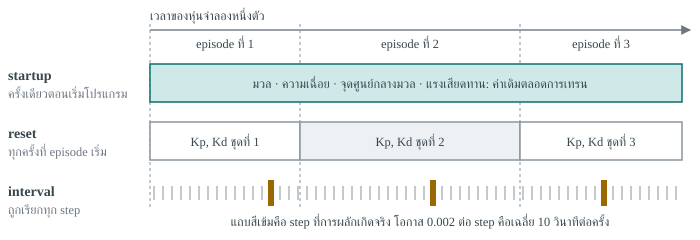

## บทที่ 29 · งาน SF ทั้งใบ — config ทุกหมวด การสุ่มของตัวจำลอง และจากตารางตัวอย่างสู่ขนาดจริง

> [!INTRO]
> บทที่ 2 เปิดไฟล์ `limx_base_env_cfg.py` แล้วพบ config เก้าคลาส ตั้งแต่นั้นเราเรียนไปแล้วเจ็ดคลาส โดยกระจายอยู่ตามบทที่ใช้มัน เหลือสองคลาสที่ยังไม่มีบทใดเปิด คือ `EventsCfg` กับ `CurriculumCfg` และยังไม่เคยมีที่ใดรวม hyperparameter ของ PPO ไว้ในตารางเดียว
>
> บทนี้ปิดไฟล์ config ทั้งสองไฟล์ เราเรียนคำว่า domain randomisation จาก `EventsCfg` เรียนคำว่า curriculum จาก `CurriculumCfg` รวม hyperparameter ทุกตัวพร้อมบทที่สอน แล้วเทียบตารางตัวอย่าง 2 env × 4 step กับขนาดที่ Tron1 เทรนจริง
>
> ของที่ต้องรู้มาก่อน: หมวดของ config จากบทที่ 2 · reward 20 พจน์และ command จากบทที่ 5 · episode กับ termination จากบทที่ 7 · PD และ $k_p$, $k_d$ จากบทที่ 15 · input ของ critic จากบทที่ 20 · hyperparameter ของ PPO จากบทที่ 22 ถึง 27
>
> จบบทนี้แล้ว เราบอกได้ว่าหุ่นจำลองแต่ละตัวต่างกันอย่างไรและต่างกันเมื่อไร อ่านรายการของ `EventsCfg` แล้วคำนวณช่วงของค่าที่สุ่มได้ ชี้ได้ว่า hyperparameter แต่ละตัวอยู่บรรทัดไหนและถูกสอนในบทใด และแปลงตัวเลขของตารางตัวอย่างเป็นของ Tron1 ได้

### ของที่ต้องมีก่อนเริ่ม

คลาสของ config ที่บทที่ 2 พบ และบทที่สอน

| คลาส | บรรทัด | จำนวนรายการ | สอนที่บท |
| --- | --- | --- | --- |
| `SFSceneCfg` | `limx_base_env_cfg.py:30` | ฉากหนึ่งชุด | 2 |
| `CommandsCfg` | `:84` | 2 | 5 |
| `ActionsCfg` | `:113` | 1 | 5 และ 15 |
| `ObservarionsCfg` | `:126` | 4 กลุ่ม | 5, 6, 20, 21 |
| `EventsCfg` | `:237` | 11 | **บทนี้** |
| `RewardsCfg` | `:368` | 20 | 5 |
| `TerminationsCfg` | `:447` | 2 | 7 |
| `CurriculumCfg` | `:458` | 1 | **บทนี้** |
| `SFEnvCfg` | `:480` | รวมทุกหมวด และค่าเวลา | 7 |

คำใหม่ของบทนี้มีสองคำ ส่วนคำว่า hyperparameter คือตัวเลขที่คนตั้งใน config และไม่ถูกเรียนรู้ ตามบทที่ 13

| คำ | ชนิด | ความหมาย |
| --- | --- | --- |
| **domain randomisation** | เทคนิค | การสุ่มค่าทางฟิสิกส์ของตัวจำลองให้ต่างกันในแต่ละ env แต่ละ episode หรือแต่ละ step เพื่อให้ policy ทำงานได้ทั้งช่วง ไม่ใช่กับหุ่นจำลองแบบเดียว |
| **curriculum** | เทคนิค | การปรับความยากของงานระหว่างเทรน ตามจำนวน step หรือตามผลงานของ policy |

ตัวเลขที่บทนี้เรียกว่า*วัดจากงานจริง* มาจากการเปิดงาน SF ด้วย 16 env เป็นเวลา 2000 step เมื่อ 26 พฤศจิกายน 2026 ด้วยสคริปต์ `scripts/workbook_env_probe.py` ซึ่งบันทึกผลไว้ในไฟล์ `scripts/env_probe_2026-11-26.json`

### ปัญหา: policy ที่เก่งกับหุ่นจำลองตัวเดียว

สมมติว่าเราเทรนด้วยหุ่นจำลอง 2048 ตัวที่เหมือนกันทุกประการ คือมวลเท่ากัน พื้นฝืดเท่ากัน และมอเตอร์ตอบสนองเท่ากัน policy ที่ได้จะเก่งกับหุ่นแบบนั้นแบบเดียว แต่หุ่นจริงไม่ตรงกับโมเดลในไฟล์ มวลของชิ้นส่วนคลาดไปบ้าง พื้นห้องฝืดไม่เท่าพื้นในตัวจำลอง และมอเตอร์จริงไม่ได้ตอบสนองตามสมการ (18) พอดี policy ที่ไม่เคยเจอความต่างเหล่านี้อาจล้มในก้าวแรก

**วิธีง่าย** คือวัดหุ่นจริงให้แม่น แล้วตั้งตัวจำลองให้ตรง วิธีนี้ติดสามข้อ

- บางค่าวัดยาก เช่น ความฝืดระหว่างเท้ากับพื้น ซึ่งเปลี่ยนไปตามพื้นแต่ละแบบ
- บางค่าเปลี่ยนตามเวลา เช่น มวล เมื่อหุ่นถือของ หรือการตอบสนองของมอเตอร์ เมื่อร้อน
- ต่อให้วัดได้ครบ ตัวจำลองก็ยังเป็นแบบจำลอง ไม่ใช่โลกจริง

คำตอบที่ใช้กันคือกลับด้านปัญหา แทนที่จะทำให้ตัวจำลองตรงกับหุ่นจริงหนึ่งตัว เราทำให้หุ่นจำลองแต่ละตัวต่างกัน แล้วให้ policy ตัวเดียวต้องเดินได้กับทุกตัว ถ้าช่วงของความต่างกว้างพอ หุ่นจริงก็เป็นเพียงอีกตัวหนึ่งในช่วงนั้น

### domain randomisation: สามจังหวะของการสุ่ม

**domain randomisation** คือการสุ่มค่าทางฟิสิกส์ของตัวจำลองให้ต่างกันในแต่ละ env แต่ละ episode หรือแต่ละ step สิ่งที่บทที่ 2 เรียกว่า*เหตุการณ์ที่จงใจทำให้เกิด* คือรายการของมัน ใน Isaac Lab การสุ่มเหล่านี้เขียนเป็นรายการของ `EventsCfg` ทุกรายการมีช่องชื่อ `mode` ซึ่งบอกว่ารายการนั้นทำงานเมื่อไร

| `mode` | ทำงานเมื่อ | บรรทัดที่เรียก | จำนวนรายการ |
| --- | --- | --- | --- |
| `startup` | ครั้งเดียว ตอนสร้าง environment | `manager_based_rl_env.py:134-135` | 7 |
| `reset` | ทุกครั้งที่ env หนึ่งเริ่ม episode ใหม่ | `manager_based_rl_env.py:360` | 3 |
| `interval` | ตามช่วงเวลาที่ตั้ง ตรวจทุก step | `manager_based_rl_env.py:235-236` | 1 |

จังหวะของการสุ่มกำหนดว่า policy เจอความหลากหลายแบบใด

| | `startup` | `reset` | `interval` |
| --- | --- | --- | --- |
| ต่างกันระหว่าง env | ใช่ | ใช่ | ใช่ |
| เปลี่ยนเมื่อ episode ใหม่ | ไม่ | ใช่ | ไม่เกี่ยว |
| เปลี่ยนกลาง episode | ไม่ | ไม่ | ใช่ |

หุ่นจำลองตัวที่ 7 จึงมีมวลเท่าเดิมตั้งแต่ iteration แรกจนถึง iteration ที่ 15,000 ความหลากหลายของมวลมาจากการมีหุ่น 2048 ตัว ไม่ได้มาจากการสุ่มซ้ำ

รายการทั้ง 11 ของ `EventsCfg`

| รายการ | บรรทัด | `mode` | ทำอะไร | ช่วง |
| --- | --- | --- | --- | --- |
| `prepare_quantity_for_tron1_piper` | `:241` | `startup` | เก็บค่าคงที่หนึ่งตัวไว้ใน environment ไม่ได้สุ่มอะไร (`events.py:17-18`) | |
| `add_base_mass` | `:250` | `startup` | บวกมวลให้ลำตัว | −1.0 ถึง +2.0 kg |
| `add_link_mass` | `:259` | `startup` | คูณมวลของชิ้นส่วนขา 8 ชิ้น | 0.8 ถึง 1.2 เท่า |
| `radomize_rigid_body_mass_inertia` | `:268` | `startup` | คูณมวลและความเฉื่อยของทุกชิ้นส่วน | 0.8 ถึง 1.2 เท่า |
| `robot_physics_material` | `:277` | `startup` | สุ่มความฝืดและการกระดอนของผิวสัมผัส | ฝืดสถิต 0.4 ถึง 1.2 · ฝืดจลน์ 0.7 ถึง 0.9 · กระดอน 0 ถึง 1 |
| `robot_joint_stiffness_and_damping` | `:288` | `startup` | ตั้ง $k_p$, $k_d$ ของทุกข้อต่อ | $k_p$ 32 ถึง 48 · $k_d$ 2.0 ถึง 3.0 |
| `robot_center_of_mass` | `:299` | `startup` | เลื่อนจุดศูนย์กลางมวลของทุกชิ้นส่วน | ±0.075 m ทุกแกน |
| `reset_robot_base` | `:311` | `reset` | สุ่มตำแหน่ง ทิศ และความเร็วของลำตัว | ±0.5 m · หมุนรอบแกนตั้ง ±3.14 rad · ความเร็ว ±0.5 |
| `reset_robot_joints` | `:327` | `reset` | สุ่มมุมและความเร็วของข้อต่อ | ±0.2 rad · ±0.5 rad/s |
| `randomize_actuator_gains` | `:337` | `reset` | คูณ $k_p$, $k_d$ ของทุกข้อต่อ | 0.5 ถึง 2.0 เท่า |
| `push_robot` | `:350` | `interval` | ออกแรงและแรงบิดที่ลำตัว | ±500 N · ±50 N·m |

ช่วงของ `add_base_mass` ในตารางไม่ใช่ค่าที่เขียนอยู่ที่ `:255` ไฟล์นั้นเขียน −5.0 ถึง 5.0 แต่คลาสของรุ่น SF เขียนทับเป็น −1.0 ถึง 2.0 (`limx_solefoot_env_cfg.py:42`) ตามลำดับการสืบทอดที่บทที่ 2 แสดงไว้

> [!EXAMPLE] มวลของลำตัวหุ่นจำลองหนึ่งตัวอยู่ในช่วงใด
> ไฟล์โมเดลของรุ่น SF มี 10 ชิ้นส่วน มวลรวม 20.813 kg โดยลำตัว `base_Link` หนัก 9.585 kg (วัดจากงานจริง)
>
> ขั้นที่ 1 `add_base_mass` บวกค่าในช่วง −1.0 ถึง +2.0 kg
>
> $$9.585 - 1.0 = 8.585 \qquad 9.585 + 2.0 = 11.585$$
>
> ขั้นที่ 2 `add_link_mass` ไม่แตะลำตัว เพราะมันเลือกเฉพาะชิ้นส่วนที่ชื่อลงท้ายด้วย `_L_Link` หรือ `_R_Link` (`:263`)
>
> ขั้นที่ 3 `radomize_rigid_body_mass_inertia` คูณมวลของทุกชิ้นส่วนด้วยค่าในช่วง 0.8 ถึง 1.2
>
> $$8.585 \times 0.8 = 6.868 \qquad 11.585 \times 1.2 = 13.902$$
>
> ลำตัวจึงหนักได้ตั้งแต่ 6.868 ถึง 13.902 kg ในงานจริง 16 env ลำตัวหนักตั้งแต่ 8.07 ถึง 12.79 kg ซึ่งอยู่ในช่วงนี้

ชิ้นส่วนขาถูกคูณสองครั้ง คือโดย `add_link_mass` และโดย `radomize_rigid_body_mass_inertia` ตัวคูณรวมจึงอยู่ในช่วง $0.8 \times 0.8 = 0.64$ ถึง $1.2 \times 1.2 = 1.44$

### สองรายการที่อ่านจากชื่อแล้วเข้าใจผิดได้

**$k_p$ และ $k_d$ ถูกสุ่มสองครั้ง และครั้งแรกไม่มีผล** รายการ `robot_joint_stiffness_and_damping` ตั้ง $k_p$ ในช่วง 32 ถึง 48 ตอนเริ่มโปรแกรม แต่รายการ `randomize_actuator_gains` ทำงานทุกครั้งที่ episode เริ่ม รวมถึง episode แรกของทุก env ทั้งสองรายการใช้ฟังก์ชันเดียวกัน และฟังก์ชันนั้นเริ่มจากค่าตั้งต้นของหุ่นทุกครั้ง ไม่ได้เริ่มจากค่าที่สุ่มไว้ครั้งก่อน (`envs/mdp/events.py:512` และ `:520`) การสุ่มครั้งที่สองจึงเขียนทับครั้งแรกทั้งหมด ก่อนที่หุ่นจะเดิน step แรก

ค่าตั้งต้นคือ $k_p = 45$ ทุกข้อต่อ และ $k_d = 1.5$ ที่ขา กับ 0.8 ที่ข้อเท้า ตามบทที่ 15 ช่วงที่ policy เจอจริงจึงเป็นค่าตั้งต้นคูณด้วย 0.5 ถึง 2.0

| | ค่าตั้งต้น | ช่วงที่ policy เจอ | วัดจากงานจริงหลัง 758 episode |
| --- | --- | --- | --- |
| $k_p$ | 45 | 22.5 ถึง 90 | 22.50 ถึง 89.98 |
| $k_d$ ของขา | 1.5 | 0.75 ถึง 3.0 | 0.75 ถึง 3.00 |
| $k_d$ ของข้อเท้า | 0.8 | 0.4 ถึง 1.6 | 0.40 ถึง 1.60 |

ตัวคูณถูกสุ่มแบบ `log_uniform` (`:345`) คือสุ่ม log ของมันอย่างสม่ำเสมอ ตัวคูณที่มากกว่า 1 กับที่น้อยกว่า 1 จึงออกบ่อยเท่ากัน และค่ากลางคือ $\sqrt{0.5 \times 2.0} = 1.0$ ถ้าสุ่มตัวคูณเองอย่างสม่ำเสมอในช่วง 0.5 ถึง 2.0 ตัวคูณที่มากกว่า 1 จะออกบ่อยเป็นสองเท่า

**`push_robot` ทำงานอยู่ ทั้งที่ช่วงเวลาตั้งไว้เป็นศูนย์** รายการนี้ตั้ง `interval_range_s=(0.0, 0.0)` (`:353`) ซึ่งอ่านเผิน ๆ เหมือนปิด แต่ตัวจัดการของ Isaac Lab นับเวลาที่เหลือของแต่ละ env ถอยหลังทีละ step (`event_manager.py:207-209`) เมื่อเวลาที่เหลือต่ำกว่าศูนย์ มันเรียกฟังก์ชัน แล้วสุ่มช่วงเวลาใหม่จากช่วงที่ตั้งไว้ (`:222-229`) ช่วงที่เป็นศูนย์ทำให้เวลาที่เหลือเป็นศูนย์เสมอ ฟังก์ชันจึงถูกเรียกทุก step กับทุก env

ความถี่ที่แท้จริงของการผลักอยู่ข้างในฟังก์ชัน มันสุ่มเลขระหว่าง 0 ถึง 1 ให้แต่ละ env แล้วผลักเฉพาะ env ที่เลขนั้นต่ำกว่า `probability` (`events.py:45-47`) ซึ่งตั้งไว้ 0.002 (`:362`)

> [!EXAMPLE] หุ่นจำลองหนึ่งตัวถูกผลักบ่อยแค่ไหน และแรงแค่ไหน
> โอกาส 0.002 ต่อ step หมายถึงเฉลี่ยหนึ่งครั้งทุก $1/0.002 = 500$ step ซึ่งคือ $500 \times 0.02 = 10$ วินาที episode เต็ม 1000 step จึงถูกผลักเฉลี่ย 2 ครั้ง
>
> ฟังก์ชันล้างแรงเก่าทุกครั้งที่ถูกเรียก (`events.py:38-39`) การผลักหนึ่งครั้งจึงอยู่เพียง step เดียว คือ 0.02 วินาที แรงสูงสุดต่อแกนคือ 500 N
>
> $$500 \times 0.02 = 10 \text{ N·s}$$
>
> ถ้าคิดหุ่นทั้งตัวเป็นก้อนเดียวหนัก 20.813 kg ความเร็วของลำตัวเปลี่ยนได้มากที่สุด $10 / 20.813 = 0.48$ m/s ต่อแกน
>
> ในงานจริง 16 env เป็นเวลา 2000 step ฟังก์ชันถูกเรียก 2000 ครั้ง ครั้งละ 16 env และมีการผลักเกิดขึ้น 75 ครั้ง เทียบกับค่าคาดหวัง $2000 \times 16 \times 0.002 = 64$ ครั้ง

ตัวเลข 0.48 m/s เป็นค่าประมาณหยาบ หุ่นไม่ใช่ก้อนเดียว และแรงกระทำที่ลำตัวซึ่งหนักเพียง 9.585 kg ส่วนที่ต่อกับขา ค่านี้บอกเพียงขนาดว่าการผลักหนึ่งครั้งเทียบได้กับครึ่งหนึ่งของ command ความเร็วสูงสุด 1.0 m/s

เมื่อเปิดงานด้วยชื่อที่มีคำว่า `Play` เพื่อดูผล คลาสของ config ปิดการผลัก ปิดการบวกมวลของลำตัว และปิด noise ของ observation (`limx_solefoot_env_cfg.py:59-63`)

### critic เห็นการสุ่มเหล่านี้แค่ไหน

บทที่ 20 แสดงว่า critic รับ 227 ค่าจากกลุ่ม `CriticCfg` และในนั้นมีรายการชื่อ `robot_mass`, `robot_inertia`, `robot_joint_stiffness` และ `robot_joint_damping` ชื่อเหล่านี้ชวนให้คิดว่า critic ได้เห็นมวลและ $k_p$, $k_d$ ที่สุ่มให้หุ่นแต่ละตัว เมื่อเปิดโค้ดและวัดจากงานจริง พบว่าไม่เป็นเช่นนั้น

Isaac Lab เก็บค่าของหุ่นไว้สองชุด ชุดหนึ่งคือค่าตั้งต้น ซึ่งตั้งครั้งเดียวตอนโหลด มวลและความเฉื่อยคัดลอกจากไฟล์โมเดล (`articulation.py:1239-1240`) ส่วน $k_p$, $k_d$ และมุมตั้งต้นของข้อต่อมาจาก config ของหุ่น (`articulation.py:1379-1380` และ `:1286-1289`) อีกชุดหนึ่งคือค่าที่ตัวจำลองใช้คำนวณฟิสิกส์จริง ฟังก์ชันสุ่มอ่านจากชุดแรก แล้วเขียนลงชุดที่สอง (`envs/mdp/events.py:323` และ `:333` สำหรับมวล · `:512` และ `:516` สำหรับ $k_p$) ชุดแรกจึงไม่เคยเปลี่ยน ส่วนฟังก์ชันของ observation ทั้งสี่รายการนั้น และของ `robot_joint_pos` อีกหนึ่งรายการ อ่านจากชุดแรก

| รายการใน `CriticCfg` | อ่านจาก | บรรทัด | จำนวนค่า | ต่างกันระหว่าง env หรือไม่ |
| --- | --- | --- | --- | --- |
| `robot_mass` | ค่าตั้งต้น `default_mass` | `observations.py:43` | 10 | ไม่ |
| `robot_inertia` | ค่าตั้งต้น `default_inertia` | `:50` | 90 | ไม่ |
| `robot_joint_pos` | ค่าตั้งต้น `default_joint_pos` | `:58` | 8 | ไม่ และเป็นศูนย์ทั้ง 8 ค่า |
| `robot_joint_stiffness` | ค่าตั้งต้น `default_joint_stiffness` | `:65` | 8 | ไม่ และเป็น 45 ทั้ง 8 ค่า |
| `robot_joint_damping` | ค่าตั้งต้น `default_joint_damping` | `:72` | 8 | ไม่ และเป็น 1.5 หกค่า 0.8 สองค่า |
| `robot_material_properties` | ค่าที่ตัวจำลองใช้ | `:95` | 27 | ต่าง |

ในงานนี้ไม่มีรายการใดของ `EventsCfg` เขียนทับค่าตั้งต้นหลังโหลด การวัดจากงานจริงยืนยันตารางนี้ ตลอด 2000 step ของ 16 env ค่าของห้ารายการแรกเท่ากันทุก env และทุก step ทั้งที่มวลจริงของหุ่น 16 ตัวนั้นต่างกันตั้งแต่ 18.13 ถึง 23.64 kg

$$10 + 90 + 8 + 8 + 8 = 124$$

ในจำนวน 227 ค่าของกลุ่ม `CriticCfg` จึงมี 124 ค่า คือร้อยละ 54.6 ที่เป็นตัวเลขชุดเดียวกันเสมอ และไม่บอกอะไรเกี่ยวกับสถานะ critic ได้ข้อมูลจริงจาก 103 ค่าที่เหลือ กับ command 3 ค่า สิ่งที่ถูกสุ่มและ critic เห็นจริงมีเพียงความฝืดและการกระดอนของผิวสัมผัส 27 ค่า

การวัดเดียวกันให้ความกว้างของสามรายการที่บทที่ 20 หาได้เพียงผลรวม คือ `robot_mass` 10 ค่า ตามจำนวนชิ้นส่วน `robot_inertia` 90 ค่า คือ 10 ชิ้นส่วน ชิ้นละ 9 ค่า และ `robot_material_properties` 27 ค่า คือผิวสัมผัส 9 ชิ้น ชิ้นละ 3 ค่า รวมเป็น 127 ตรงกับที่บทที่ 20 ได้จากการลบ

> [!WARNING] ข้อสรุปนี้เป็นของโค้ดเวอร์ชันที่เล่มนี้ตรวจ
> เราไม่รู้ว่าผู้เขียนโค้ดตั้งใจให้ critic เห็นค่าตั้งต้น หรือตั้งใจให้เห็นค่าที่สุ่มแล้วเขียนพลาด สิ่งที่บอกได้คือโค้ดที่ commit `307145e` ทำอะไร ข้อโต้แย้งของบทที่ 20 ว่า critic ที่เห็นมากกว่าทำนายได้ดีกว่า ยังใช้ได้กับ `base_lin_vel` แรงที่เท้ากดพื้น และค่าอื่นใน 103 ค่านั้น แต่ใช้ไม่ได้กับมวลและ $k_p$, $k_d$ ของหุ่นแต่ละตัว ซึ่ง critic ของงานนี้ไม่ได้เห็น

### noise ของ observation

การสุ่มอีกชนิดหนึ่งไม่อยู่ใน `EventsCfg` บทที่ 20 บอกว่ารายการห้าในเจ็ดรายการของกลุ่ม `PolicyCfg` ถูกบวกเลขสุ่มขนาดเล็ก ตัวจัดการของ Isaac Lab ทำสามอย่างกับแต่ละรายการตามลำดับ คือบวก noise จำกัดช่วง แล้วคูณด้วยตัวคูณ (`observation_manager.py:313-318`) noise จึงถูกคูณไปด้วย

| รายการ | ส่วนเบี่ยงเบนของ noise | ตัวคูณ | ส่วนเบี่ยงเบนที่ policy เห็น | บรรทัด |
| --- | --- | --- | --- | --- |
| `base_ang_vel` | 0.05 | 0.25 | 0.0125 | `limx_base_env_cfg.py:134` |
| `proj_gravity` | 0.025 | 1.0 | 0.025 | `:135` |
| `joint_pos` | 0.01 | 1.0 | 0.01 | `:138` |
| `joint_vel` | 0.01 | 0.05 | 0.0005 | `:139` |
| `last_action` | 0.01 | 1.0 | 0.01 | `:142` |
| `gait_phase` · `gait_command` | ไม่มี | ไม่มี | ไม่มี | `:145-146` |

noise นี้สุ่มใหม่ทุก step และทุก env มันเลียนแบบเซนเซอร์จริงซึ่งอ่านค่าได้ไม่นิ่ง กลุ่ม `CriticCfg` ไม่มี noise ตามที่บทที่ 20 แสดง

### domain randomisation ไม่ใช่การสุ่มของ policy

เล่มนี้มีการสุ่มหลายแห่ง ซึ่งทำหน้าที่ต่างกัน

| | สุ่มอะไร | ใครสุ่ม | เพื่ออะไร | บท |
| --- | --- | --- | --- | --- |
| $\varepsilon$ | action รอบ $\mu$ | policy | ลองสิ่งที่ยังไม่เคยทำ | 12 |
| การสับตาราง | ลำดับของช่อง | อัลกอริทึม | ให้ mini-batch มีช่องจากทั่วตาราง | 27 |
| command | ความเร็วที่สั่ง | environment | ให้ฝึกเดินตามหลายความเร็ว | 5 |
| domain randomisation | ฟิสิกส์ของตัวจำลอง | environment | ให้ทนต่อความต่างระหว่างตัวจำลองกับหุ่นจริง | บทนี้ |
| noise ของ observation | ค่าที่ policy อ่านได้ | environment | เลียนแบบเซนเซอร์ที่อ่านค่าได้ไม่นิ่ง | บทนี้ |

สามแถวล่างอยู่ฝั่ง environment ทั้งหมด ตามเส้นแบ่งของบทที่ 3 สำหรับ policy มวลที่สุ่มได้เป็นส่วนหนึ่งของโลกที่มันมองไม่เห็นโดยตรง โจทย์จึงยิ่งเป็น POMDP ตามบทที่ 6 มากขึ้น ร่องรอยของมวลมีอยู่ในประวัติ $h$ แต่ actor ไม่ได้รับ $h$ มันได้รับเพียง $\hat v$ สามค่า ซึ่ง encoder ถูกสอนให้ตรงกับความเร็วของลำตัวอย่างเดียว ตามบทที่ 21 ไม่มีอะไรสอนให้ $\hat v$ เก็บมวลไว้ policy จึงไม่มีช่องทางที่ออกแบบไว้ให้รู้ว่าตัวเองหนักหรือเบา การสุ่มมวลทำให้ policy ถูกให้คะแนนบนมวลหลายค่า พฤติกรรมที่ใช้ได้เฉพาะกับมวลค่าเดียวจึงมีแนวโน้มได้คะแนนเฉลี่ยต่ำลง เล่มนี้ยังไม่ได้วัดทั้งข้อนี้ และยังไม่ได้วัดว่า policy ที่ได้ทำงานได้ดีเท่ากันตลอดช่วงของมวลหรือไม่

domain randomisation มีราคา ช่วงที่กว้างเกินไปทำให้ policy ต้องระวังตัวกับทุกกรณี และเดินได้ไม่ดีที่สุดกับกรณีใดเลย ช่วงที่แคบเกินไปทำให้หุ่นจริงอยู่นอกช่วง ตัวเลขในตารางของ `EventsCfg` จึงเป็นการตัดสินใจของผู้ออกแบบ ไม่ได้มาจากสูตร

### curriculum

**curriculum** คือการปรับความยากของงานระหว่างเทรน ตามจำนวน step หรือตามผลงานของ policy ซึ่งบทที่ 2 เรียกด้วยคำธรรมดาว่า*การปรับความยากระหว่างเทรน* ตัวอย่างเช่น เริ่มจากพื้นเรียบ แล้วเพิ่มความขรุขระเมื่อหุ่นเดินได้ไกลขึ้น

| | domain randomisation | curriculum |
| --- | --- | --- |
| ค่าที่เปลี่ยน | สุ่มจากช่วงที่คงที่ | ช่วงหรือระดับเองเลื่อนไป |
| ขึ้นกับผลงานของ policy | ไม่ | ขึ้นได้ |
| ทิศ | ไม่มีทิศ | จากง่ายไปยาก |

`CurriculumCfg` ของรุ่น SF มีรายการเดียว คือ `terrain_levels` (`limx_base_env_cfg.py:461`) ซึ่งเลื่อนหุ่นไปยังพื้นที่ยากขึ้นหรือง่ายลง งานที่เล่มนี้ใช้เป็นพื้นเรียบ คลาสของงานจึงตั้งรายการนี้เป็น `None` (`limx_solefoot_env_cfg.py:80`) เมื่อเปิดงานจริง ตัวจัดการของ curriculum รายงานว่าไม่มีรายการใดทำงาน

**งาน `Isaac-Limx-SF-Blind-Flat-v0` จึงไม่มี curriculum** ความยากของงานเท่าเดิมตั้งแต่ iteration แรกถึง iteration สุดท้าย ไฟล์ config ยังมีรายการอีกหนึ่งรายการที่ถูกคอมเมนต์ทิ้งไว้ (`limx_base_env_cfg.py:463-472`) ชื่อพารามิเตอร์ของมันบอกว่าตั้งใจขยายช่วงของ command ความเร็วเมื่อ reward ถึงเกณฑ์ แต่ฟังก์ชันที่มันเรียกไม่มีอยู่ทั้งในโปรเจกต์และใน Isaac Lab ส่วนไฟล์ `curriculums.py` ของโปรเจกต์มีฟังก์ชันสองตัว ซึ่งไม่มี config ของรุ่น SF เรียกใช้

> [!NOTE]
> กฎปรับ $\alpha$ ของบทที่ 26 เปลี่ยนค่าระหว่างเทรนเช่นกัน แต่ไม่ใช่ curriculum มันปรับความยาวของก้าวของ optimizer ไม่ได้ปรับความยากของงาน

### command สองรายการ

`CommandsCfg` มีสองรายการ ทั้งสองเป็นของที่ environment สุ่มให้หุ่นแต่ละตัว และสุ่มใหม่ระหว่าง episode

| รายการ | สุ่มอะไร | ช่วง | สุ่มใหม่ทุก | บรรทัด |
| --- | --- | --- | --- | --- |
| `base_velocity` | $v_x$, $v_y$ และทิศเป้าหมาย ซึ่งให้ $\omega_z$ ตามบทที่ 5 | $v_x$ ±1.0 · $v_y$ −0.3 ถึง 0.5 m/s | 3 ถึง 15 วินาที | `limx_base_env_cfg.py:98-109` |
| `gait_command` | ความถี่ของจังหวะก้าว และความสูงที่ยกเท้า | 0.8 ถึง 1.6 Hz · 0.1 ถึง 0.2 | 5 วินาที | `:87-96` |

ทุกครั้งที่ `base_velocity` ถูกสุ่มใหม่ หุ่นแต่ละตัวมีโอกาส 2% ที่จะถูกสั่งให้ยืนนิ่ง คือได้ command เป็นศูนย์ทั้งสามค่า (`rel_standing_envs=0.02` ที่ `:102`) ตามบทที่ 5

`gait_command` มี 4 ค่า สองค่าที่เหลือคือระยะเหลื่อมระหว่างสองเท้ากับสัดส่วนของเวลาที่เท้าแตะพื้น ซึ่ง config ตั้งช่วงไว้ที่ 0.5 ถึง 0.5 (`:92-93`) จึงเป็น 0.5 เสมอ ค่าทั้งสี่เข้าไปอยู่ใน observation ของ policy เป็น 4 ใน 36 ค่าตามบทที่ 5 และพจน์ `test_gait_reward` ใช้สามค่าแรกตัดสินว่าเท้าทำตามจังหวะหรือไม่ (`:439` และ `rewards.py:413-421`) ส่วนค่าที่สี่ คือความสูงที่ยกเท้า ไม่มีพจน์ใดของ reward อ่าน policy จึงเห็นค่านี้โดยไม่มีอะไรให้คะแนนตาม และโค้ดไม่ได้เขียนหน่วยของมันไว้ จังหวะก้าวของ Tron1 จึงเป็นสิ่งที่ถูกสั่ง ไม่ได้เกิดขึ้นเองจากการเรียน

### reward 20 พจน์ เมื่อดูจากการรันจริง

บทที่ 5 เตือนว่าขนาดของน้ำหนักอย่างเดียวบอกไม่ได้ว่าพจน์ใดมีผลมาก เพราะค่าที่ฟังก์ชันคืนมีขนาดต่างกัน การรันจริงให้ตัวเลขมายืนยัน ตารางข้างล่างมาจากการรัน 64 env จำนวน 218 iteration ชุดเดียวกับที่บทที่ 26 ใช้ ค่าในคอลัมน์ขวาคือผลรวมของพจน์นั้นตลอด episode หารด้วย 20 วินาที (`reward_manager.py:118-119`) เฉลี่ยตลอด 20 iteration สุดท้าย

| พจน์ | น้ำหนัก | ผลรวมต่อ episode หารด้วย 20 วินาที |
| --- | --- | --- |
| `pen_action_rate` | −0.5 | −0.0486 |
| `pen_base_height` | −50 | −0.0227 |
| `pen_joint_accel` | −1e-6 | −0.0140 |
| `test_gait_reward` | +1.0 | −0.0135 |
| `pen_feet_distance` | −100 | −0.0007 |
| `keep_balance` | +1.0 | +0.0087 |
| ผลรวมของทั้ง 20 พจน์ | | −0.1637 |

ตารางนี้บอกสามเรื่อง

- `pen_joint_accel` มีน้ำหนักขนาดเล็กที่สุดในบรรดา 20 พจน์ คือ $10^{-6}$ แต่หักคะแนนมากกว่า `pen_feet_distance` ซึ่งมีน้ำหนักขนาด 100 ถึง 21.5 เท่า เพราะความเร่งของข้อต่อยกกำลังสองเป็นตัวเลขขนาดใหญ่ ส่วนเท้าแทบไม่เคยชิดกันเกินขีด
- `test_gait_reward` มีน้ำหนักเป็นบวก แต่ผลเป็นลบ ตรงกับคำเตือนของบทที่ 5
- ผลรวม −0.1637 คูณด้วย 20 วินาที ได้ −3.27 ซึ่งตรงกับ `Mean reward` ของช่วงเดียวกัน คือ −3.28

ตัวเลขเหล่านี้เป็นของ policy ที่ยังเดินไม่ได้ ในการรันนั้น episode ยาวเฉลี่ยเพียง 8.7 step ก่อนหุ่นล้ม สัดส่วนของแต่ละพจน์จะเปลี่ยนเมื่อ policy เก่งขึ้น และการรัน 64 env ไม่ใช่การเทรนเต็ม สิ่งที่ตารางนี้ยืนยันได้คือหลักของบทที่ 5 ไม่ใช่ลำดับความสำคัญสุดท้ายของพจน์

### ตาราง hyperparameter

ทุกแถวอยู่ในคลาส `SF_TRON1AFlatPPORunnerCfg` ของไฟล์ `limx_rsl_rl_ppo_cfg.py` คอลัมน์ขวาสุดคือค่าที่ตารางตัวอย่างใช้

| ชื่อใน config | บรรทัด | ค่า | สัญลักษณ์และหน้าที่ | บท | ตารางตัวอย่าง |
| --- | --- | --- | --- | --- | --- |
| `num_steps_per_env` | `:81` | 24 | $T$ จำนวนแถวของตาราง | 7, 27 | 4 |
| `max_iterations` | `:82` | 15,000 | จำนวน iteration | 7 | 1 |
| `save_interval` | `:83` | 500 | บันทึกไฟล์ทุกกี่ iteration | 27 | |
| `init_noise_std` | `:87` | 1.0 | ไม่ถูกใช้ $\ell$ เริ่มที่ศูนย์อยู่แล้ว | 11 | $\sigma$ 0.5 |
| `actor_hidden_dims` · `critic_hidden_dims` | `:88-89` | 512, 256, 128 | จำนวน node ของชั้นกลาง | 13, 20 | |
| `activation` | `:90` | `"elu"` | สมการ (11) | 13 | |
| `value_loss_coef` | `:94` | 1.0 | $c_V$ | 24 | 1.0 |
| `use_clipped_value_loss` | `:95` | `True` | เปิดการหนีบใน $L_V$ | 24 | เปิด |
| `clip_param` | `:96` | 0.2 | $\epsilon$ | 23, 24 | 0.2 |
| `entropy_coef` | `:97` | 0.01 | $c_H$ | 24 | 0.01 |
| `num_learning_epochs` | `:98` | 5 | จำนวน epoch | 27 | 2 |
| `num_mini_batches` | `:99` | 4 | จำนวน mini-batch ต่อ epoch | 27 | 2 |
| `learning_rate` | `:100` | 0.001 | ค่าเริ่มของ $\alpha$ | 14, 26 | 0.1 ในบทที่ 14, 19 และ 23 · 0.001 ตั้งแต่บทที่ 25 |
| `schedule` | `:101` | `"adaptive"` | เปิดกฎของสมการ (37) | 26 | เปิด |
| `gamma` | `:102` | 0.99 | $\gamma$ | 5, 8 | 0.9 |
| `lam` | `:103` | 0.95 | $\lambda$ | 22 | 0.8 |
| `desired_kl` | `:104` | 0.01 | ค่าเป้าของ KL | 26 | 0.01 |
| `max_grad_norm` | `:105` | 1.0 | เพดานของ norm | 25 | 1.0 |
| `obs_history_len` | `:106` | 10 | จำนวน step ในประวัติ $h$ | 6, 21 | |
| `output_detach` · `num_output_dim` · `hidden_dims` | `:109-111` | `True` · 3 · 256, 128 | ของ encoder | 21 | |

สองค่าที่ไม่อยู่ในคลาสนี้แต่กำหนดขนาดของการเทรน คือจำนวน env ซึ่งค่าปริยายเป็น 4096 (`limx_base_env_cfg.py:484`) และเล่มนี้ใช้ 2048 ตามบทที่ 7 กับค่าเวลา `decimation`, `episode_length_s` และ `sim.dt` (`:497-501`) ซึ่งบทที่ 7 ใช้

การอ่านตารางนี้มีข้อควรระวังสี่ข้อ

**ค่าปริยายของคลาส `PPO` ไม่ใช่ค่าที่รัน** ฟังก์ชันสร้างของคลาสมีค่าปริยายของตัวเอง (`ppo.py:48-59`) และ config เขียนทับห้าตัว

| ชื่อ | ค่าปริยายของคลาส | ค่าของ config |
| --- | --- | --- |
| `num_learning_epochs` | 1 | 5 |
| `num_mini_batches` | 1 | 4 |
| `gamma` | 0.998 | 0.99 |
| `entropy_coef` | 0.0 | 0.01 |
| `schedule` | `"fixed"` | `"adaptive"` |

ถ้า config ไม่ได้ตั้ง `schedule` กฎของบทที่ 26 จะไม่ทำงานเลย และถ้าไม่ได้ตั้ง `entropy_coef` พจน์ entropy จะหายจาก $L$ เวลาอ่านโค้ดจึงต้องดูค่าใน config ไม่ใช่ค่าในบรรทัดประกาศฟังก์ชัน

**บางตัวเลขไม่อยู่ใน config** ตัวคูณ 1.5 เกณฑ์ 2.0 และพื้นกับเพดานของ $\alpha$ ในสมการ (37) เขียนอยู่ในโค้ดตรง ๆ (`ppo.py:238-241`) ค่า $\beta_1$, $\beta_2$ และ `eps` ของ Adam เป็นค่าปริยายของ PyTorch ตามบทที่ 25 และ `est_learning_rate` ของ encoder เป็นค่าปริยายของคลาส (`ppo.py:61`) เช่นเดียวกับ `early_stop` และ `anneal_lr` ซึ่งปิดอยู่ (`:63-64`) การเปลี่ยนค่าเหล่านี้ต้องแก้โค้ด ไม่ใช่แก้ config

**ค่าหนึ่งตัวใช้สองที่** `clip_param` ตัวเดียวเป็นขอบของ $\rho_t$ ในสมการ (29) ซึ่งเป็นอัตราส่วนที่ไม่มีหน่วย และเป็นขอบของ $V_{new} - V_{old}$ ในสมการ (32) ซึ่งมีหน่วยเดียวกับ reward ตามบทที่ 24 ค่า 0.2 จึงมีความหมายต่างกันในสองที่ และขอบที่สองขึ้นกับขนาดของ reward ของงาน

**บางตัวตั้งไว้แต่ไม่ถูกอ่าน** `init_noise_std` ไม่ถูกใช้ตามที่บทที่ 11 แสดง และ `empirical_normalization` ที่ `:85` ไม่มีบรรทัดใดในโฟลเดอร์ `rsl_rl` ของโปรเจกต์อ่านค่า

> [!REMARK]
> การหนีบของ $L_V$ ไม่ได้อยู่ในสมการ value loss ของเปเปอร์ PPO (Schulman และคณะ 2017) ซึ่งเขียนเป็นกำลังสองของผลต่างธรรมดา การหนีบเป็นส่วนที่โค้ดของ PPO หลายชุดเพิ่มเข้ามาภายหลัง `rsl_rl` ให้เลือกเปิดหรือปิดได้ด้วย `use_clipped_value_loss` และงานนี้เปิด

### จากตารางตัวอย่างสู่ขนาดจริง

สูตรทุกสูตรของเล่มนี้เหมือนกันทั้งในตารางตัวอย่างและใน Tron1 สิ่งที่ต่างคือขนาด

| ปริมาณ | ตารางตัวอย่าง | Tron1 | ที่มา |
| --- | --- | --- | --- |
| ช่องในตาราง | 2 × 4 = 8 | 2048 × 24 = 49,152 | บทที่ 7 |
| ข้อต่อ | 1 | 8 | บทที่ 5 |
| $\log\pi$ ต่อช่อง | พจน์เดียว | ผลบวก 8 พจน์ | บทที่ 28 |
| $\gamma\lambda$ | 0.72 | 0.9405 | บทที่ 27 |
| ระยะมองของ GAE | 3.57 step | 16.81 step | สมการ (34) |
| ช่องต่อ mini-batch | 4 | 12,288 | บทที่ 27 |
| gradient step ต่อ iteration | 2 × 2 = 4 | 5 × 4 = 20 | บทที่ 27 |
| ลูกบิดของ optimizer หลัก | 3 ตัว คือ $b$, $\ell$, $b_V$ | 469,905 ตัว | บทที่ 20, 25 |
| ลูกบิดของ encoder | ไม่มี | 125,699 ตัว | บทที่ 21 |
| iteration | 1 | 15,000 | |
| หน่วยความจำของตาราง | เขียนลงกระดาษแผ่นเดียวได้ | 136.5 MB | บทที่ 27 |

ลูกบิด 469,905 ตัวคือ actor 187,272 ตัว $\ell$ 8 ตัว และ critic 282,625 ตัว เมื่อรวมกับ encoder ทั้งระบบมี 595,604 ตัว

> [!EXAMPLE] การเทรนเต็ม 15,000 iteration ด้วย 2048 env เก็บประสบการณ์เท่ากับหุ่นเดินนานเท่าไร
> จำนวน transition ตามบทที่ 27
>
> $$15{,}000 \times 49{,}152 = 737{,}280{,}000$$
>
> หนึ่ง transition คือหนึ่ง step ของหุ่นหนึ่งตัว ซึ่งยาว 0.02 วินาที
>
> $$737{,}280{,}000 \times 0.02 = 14{,}745{,}600 \text{ s} = 4{,}096 \text{ h}$$
>
> คือ 170.7 วันของหุ่นหนึ่งตัวที่เดินไม่หยุด ส่วนหุ่นจำลองแต่ละตัวเดินเพียง $15{,}000 \times 24 \times 0.02 = 7{,}200$ วินาที คือ 2 ชั่วโมง

ตัวเลข 4,096 ชั่วโมงคือเวลาในตัวจำลอง ไม่ใช่เวลาที่เครื่องใช้ การรันทดสอบ 64 env ของบทที่ 27 ใช้เวลาราว 0.74 วินาทีต่อ iteration แต่เล่มนี้ยังไม่ได้รันการเทรนเต็ม 2048 env จึงยังไม่มีตัวเลขของเวลาจริง ของขั้นบันไดของ $\alpha$ และของ reward ที่ขนาดเต็ม

การเปลี่ยนจำนวน env เปลี่ยนตัวเลขหลายแถวพร้อมกัน เพราะมันเปลี่ยนจำนวนช่องของตาราง

| จำนวน env | ช่องในตาราง | ช่องต่อ mini-batch | transition ตลอดการเทรน | หน่วยความจำของตาราง |
| --- | --- | --- | --- | --- |
| 1024 | 24,576 | 6,144 | 368,640,000 | 68.2 MB |
| 2048 | 49,152 | 12,288 | 737,280,000 | 136.5 MB |
| 4096 | 98,304 | 24,576 | 1,474,560,000 | 273.0 MB |

จำนวน gradient step ไม่อยู่ในตารางนี้ เพราะมันเป็น 20 ต่อ iteration เสมอ ไม่ว่าจะใช้กี่ env ตามบทที่ 27

### จาก config ถึงโค้ด

| ในบทนี้ | บรรทัด | โค้ด |
| --- | --- | --- |
| การสุ่มตอนเริ่มโปรแกรม | `manager_based_rl_env.py:134-135` | `self.event_manager.apply(mode="startup")` |
| การสุ่มตอน episode เริ่ม | `manager_based_rl_env.py:360` | `self.event_manager.apply(mode="reset", ...)` |
| การตรวจทุก step | `manager_based_rl_env.py:235-236` | `self.event_manager.apply(mode="interval", dt=self.step_dt)` |
| นับเวลาถอยหลัง | `event_manager.py:209` | `time_left -= dt` |
| โอกาสของการผลัก | `events.py:45-46` | `mask = random_values < probability` |
| ฟังก์ชันสุ่มเริ่มจากค่าตั้งต้น | `envs/mdp/events.py:512` | `asset.data.default_joint_stiffness[env_ids][...]` |
| critic อ่านค่าตั้งต้น | `observations.py:43` | `return asset.data.default_mass.to(device)` |
| ลำดับ noise จำกัดช่วง คูณ | `observation_manager.py:313-318` | `term_cfg.noise.func(...)` แล้ว `clip_` แล้ว `mul_` |
| รุ่น SF เขียนทับช่วงของมวล | `limx_solefoot_env_cfg.py:42` | `(-1.0, 2.0)` |
| งานพื้นเรียบปิด curriculum | `limx_solefoot_env_cfg.py:80` | `self.curriculum.terrain_levels = None` |
| ค่าปริยายของคลาส `PPO` | `ppo.py:48-59` | `num_learning_epochs=1, ...` |

> [!SUMMARY]
> - domain randomisation คือการสุ่มฟิสิกส์ของตัวจำลองให้หุ่นแต่ละตัวต่างกัน เขียนเป็นรายการของ `EventsCfg` ซึ่งมี 11 รายการ โดย 10 รายการสุ่มค่า ในสามจังหวะ คือ `startup` ครั้งเดียวตอนเริ่ม `reset` ทุก episode และ `interval` ซึ่งตรวจทุก step
> - $k_p$ และ $k_d$ ที่ policy เจอคือค่าตั้งต้นคูณ 0.5 ถึง 2.0 เพราะการสุ่มตอน `reset` เขียนทับการสุ่มตอน `startup` ส่วนการผลักทำงานทุก step ด้วยโอกาส 0.002 ทั้งที่ช่วงเวลาตั้งไว้เป็นศูนย์
> - ใน 227 ค่าของกลุ่ม `CriticCfg` มี 124 ค่าที่เป็นค่าตั้งต้นซึ่งเหมือนกันทุก env สิ่งที่ถูกสุ่มและ critic เห็นจริงมีเพียงคุณสมบัติของผิวสัมผัส 27 ค่า
> - curriculum คือการปรับความยากระหว่างเทรน งานพื้นเรียบของรุ่น SF ปิดรายการเดียวที่มี จึงไม่มี curriculum
> - hyperparameter ของ PPO อยู่ใน `limx_rsl_rl_ppo_cfg.py:80-114` ค่าปริยายของคลาส `PPO` ถูกเขียนทับห้าตัว และตัวเลขบางตัวของสมการ (36) กับ (37) อยู่ในโค้ด ไม่อยู่ใน config
>
> ประโยคที่ควรจำ: **config บอกว่าตั้งค่าอะไรไว้ แต่ค่าที่ policy เจอจริงต้องตามไปดูว่าโค้ดอ่านค่านั้นเมื่อไร และมีรายการใดเขียนทับ**

### แบบฝึกหัด

1. ข้อใดถูกต้อง
    1. มวลของหุ่นจำลองตัวหนึ่งถูกสุ่มใหม่ทุก episode
    2. `push_robot` ไม่ทำงาน เพราะ `interval_range_s` เป็น (0.0, 0.0)
    3. $k_p$ ที่ policy เจอระหว่างเทรนอยู่ในช่วง 22.5 ถึง 90
    4. critic ได้รับมวลที่สุ่มแล้วของหุ่นแต่ละตัว
    5. กลุ่ม `CriticCfg` ไม่มี noise
    6. งาน `Isaac-Limx-SF-Blind-Flat-v0` มี curriculum หนึ่งรายการที่ทำงาน
    7. ค่าปริยายของ `gamma` ในคลาส `PPO` คือ 0.99
    8. ตัวคูณ 1.5 ของกฎปรับ $\alpha$ ตั้งได้จาก config
    9. `clip_param` ถูกใช้ทั้งในสมการ (29) และ (32)
    10. การเปลี่ยนจำนวน env ไม่เปลี่ยนจำนวน gradient step ต่อ iteration

2. จงจัดรายการต่อไปนี้ตาม `mode` แล้วบอกว่าค่าที่มันตั้งเปลี่ยนเมื่อไร: `add_link_mass`, `reset_robot_joints`, `robot_center_of_mass`, `push_robot`, `randomize_actuator_gains` [limx_base_env_cfg.py:237-364] <!--space:26-->

3. ชิ้นส่วน `knee_L_Link` หนัก 1.22 kg ในไฟล์โมเดล จงหาช่วงของมวลหลังการสุ่มตอนเริ่มโปรแกรม [limx_base_env_cfg.py:259-276] <!--space:22-->

4. ถ้าเปลี่ยน `probability` ของ `push_robot` เป็น 0.01 หุ่นหนึ่งตัวถูกผลักเฉลี่ยทุกกี่วินาที episode เต็มถูกผลักกี่ครั้ง และตารางหนึ่งใบของ 2048 env มีการผลักเฉลี่ยกี่ครั้ง [events.py:45-47] <!--space:24-->

5. โอกาสที่หุ่นหนึ่งตัวจะเดินครบ episode เต็ม 1000 step โดยไม่ถูกผลักเลยเป็นเท่าไร เมื่อ `probability` เป็น 0.002 <!--space:18-->

6. สมมติว่าหุ่นจริงใช้ $k_d$ เท่ากับ 3.0 ที่ขา และ 1.5 ที่ข้อเท้า จงหาตัวคูณที่ต้องสุ่มได้เพื่อให้ $k_d$ ตอนเทรนเท่ากับค่าเหล่านี้ และบอกว่าตัวคูณนั้นอยู่ในช่วงที่สุ่มหรือไม่ <!--space:24-->

7. จงหาส่วนเบี่ยงเบนของ noise ที่ policy เห็นใน `base_ang_vel` และ `joint_vel` แล้วอธิบายว่าทำไมไม่เท่ากับค่าที่เขียนใน config [observation_manager.py:313-318] <!--space:22-->

8. ถ้าใช้ config ของงาน SF กับ 4096 env จงหาจำนวนช่องของตาราง จำนวนช่องต่อ mini-batch จำนวน gradient step ต่อ iteration และเวลาในตัวจำลองที่เก็บได้ตลอด 15,000 iteration เป็นชั่วโมง <!--space:26-->

9. block ของรุ่นอื่นในไฟล์ `limx_rsl_rl_ppo_cfg.py` ตั้ง `max_iterations` เป็น 2000 ถ้าใช้ค่านี้กับ 2048 env การเทรนเก็บ transition กี่ตัว และคิดเป็นกี่ชั่วโมงในตัวจำลอง <!--space:20-->

10. เพื่อนอ่าน `CriticCfg` แล้วสรุปว่า critic ของ Tron1 เห็นมวลและ $k_p$, $k_d$ ของหุ่นแต่ละตัว จึงทำนายได้ดี จงอธิบายว่าข้อสรุปนี้ผิดตรงไหน และจะตรวจด้วยตัวเองได้อย่างไร <!--space:28-->

<!-- เฉลย -->

1. ข้อที่ถูก: 3, 5, 9, 10

    - ข้อ 1 ผิด: มวลสุ่มตอน `startup` ครั้งเดียว
    - ข้อ 2 ผิด: ช่วงเวลาศูนย์ทำให้ฟังก์ชันถูกเรียกทุก step และมันผลักด้วยโอกาส 0.002
    - ข้อ 4 ผิด: `robot_mass` อ่านค่าตั้งต้น ซึ่งเหมือนกันทุก env
    - ข้อ 6 ผิด: `terrain_levels` ถูกตั้งเป็น `None`
    - ข้อ 7 ผิด: ค่าปริยายคือ 0.998 และ config เขียนทับเป็น 0.99
    - ข้อ 8 ผิด: เขียนอยู่ใน `ppo.py:238-241`

2. `startup` คือ `add_link_mass` และ `robot_center_of_mass` ค่าคงเดิมตลอดการเทรน `reset` คือ `reset_robot_joints` และ `randomize_actuator_gains` ค่าเปลี่ยนทุกครั้งที่ episode เริ่ม `interval` คือ `push_robot` ซึ่งถูกเรียกทุก step และออกแรงเมื่อสุ่มได้

3. ชิ้นส่วนขาถูกคูณสองครั้ง $1.22 \times 0.8 \times 0.8 = 0.7808$ kg และ $1.22 \times 1.2 \times 1.2 = 1.7568$ kg

4. ทุก $1/0.01 = 100$ step คือ 2 วินาที episode เต็มถูกผลัก $1000 \times 0.01 = 10$ ครั้ง ตารางหนึ่งใบมี $2048 \times 24 \times 0.01 = 491.5$ ครั้ง เทียบกับ 98.3 ครั้งเมื่อเป็น 0.002

5. $(1 - 0.002)^{1000} = 0.1351$ คือราวร้อยละ 13.5

6. ขา: $3.0 / 1.5 = 2.0$ ซึ่งเป็นขอบบนของช่วงพอดี ข้อเท้า: $1.5 / 0.8 = 1.875$ ซึ่งอยู่ในช่วง 0.5 ถึง 2.0 ค่าทั้งสองจึงอยู่ในช่วงที่ policy เคยเจอ แต่อยู่ชิดขอบบน

7. `base_ang_vel`: $0.05 \times 0.25 = 0.0125$ และ `joint_vel`: $0.01 \times 0.05 = 0.0005$ ตัวจัดการบวก noise ก่อน แล้วจึงคูณด้วยตัวคูณ noise จึงถูกคูณไปด้วย

8. ตาราง $4096 \times 24 = 98{,}304$ ช่อง mini-batch ละ $98{,}304 \div 4 = 24{,}576$ ช่อง gradient step ยังเป็น 20 ต่อ iteration transition รวม $15{,}000 \times 98{,}304 = 1{,}474{,}560{,}000$ ตัว คิดเป็น $1{,}474{,}560{,}000 \times 0.02 \div 3600 = 8{,}192$ ชั่วโมง

9. $2000 \times 49{,}152 = 98{,}304{,}000$ transition คิดเป็น $98{,}304{,}000 \times 0.02 \div 3600 = 546$ ชั่วโมง คือร้อยละ 13.3 ของการเทรน 15,000 iteration

10. ฟังก์ชันของ `robot_mass`, `robot_inertia`, `robot_joint_stiffness` และ `robot_joint_damping` คืนค่าตั้งต้นจาก `default_mass` และตัวแปรชื่อ `default_` อื่น ๆ (`observations.py:43`, `:50`, `:65`, `:72`) ส่วนฟังก์ชันสุ่มเขียนค่าที่สุ่มลงตัวจำลองโดยไม่แตะค่าตั้งต้น critic จึงได้ตัวเลขชุดเดียวกันจากทุก env วิธีตรวจคือเปิดงานด้วยหลาย env แล้วดูว่าคอลัมน์ที่ 61 ถึง 184 ของ input ของ critic (นับจาก 0) ต่างกันระหว่าง env หรือไม่ สคริปต์ `scripts/workbook_env_probe.py` ทำการตรวจนี้ และพบว่าทั้ง 124 คอลัมน์เท่ากันทุก env ตลอด 2000 step
